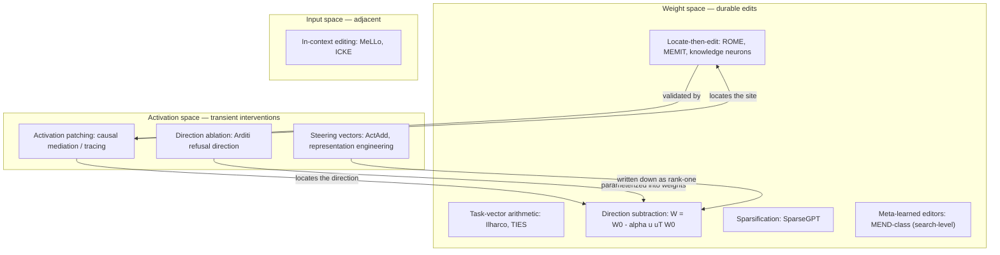
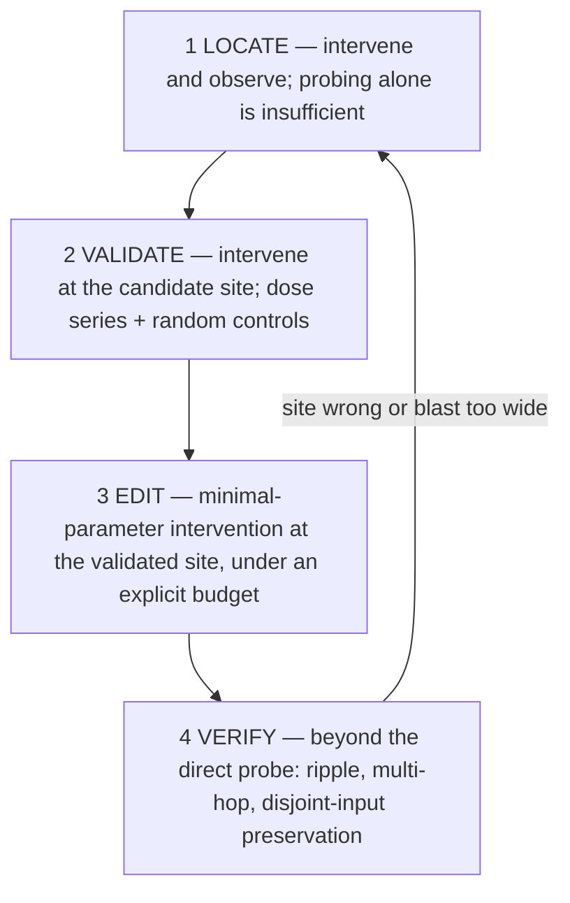

# The domain of direct model modification — a research map

Reference map for the `direct-model-edit` skill, persisted 2026-11-15 from the
inline map delivered in the research session (thread `42ec234c`), verified and
extended by the full-text verification pass (run `ac3ac4bc3af5f4db`).

**Evidence convention.** Every claim below traces to a server-resolved,
ledgered source. Run ids:

- **Run A** — `2fe86a63d8d6b767` + seed full-text pass `aaf284255c0cc444`:
  the perturbation KB (`perturbation-kb.jsonl`, entries `P01`–`P05`,
  `O01`–`O10`; sources in `perturbation-kb-sources.json`, 14 papers).
- **Run B** — `4c02bf49b492711e`: branch evaluation (Agarwal, Slocum
  abstract-level, Oozeer, Chen, Zhang/KnowEdit, Sharkey resolution-level,
  the withdrawn-EVK check).
- **Run C** — `c04d1866bda27360`: domain foundations (Geva, Elhage, Park,
  Wang survey).
- **Run D** — `ac3ac4bc3af5f4db`: verification pass — full text of Slocum
  (arXiv:2510.17941, 90 pp) and Sharkey (arXiv:2501.16496, 82 pp), plus the
  loop-degeneration retrieval (arXiv:2310.10226, arXiv:2012.14660,
  arXiv:2407.06071, all resolved).
- **Run E** — `76bd7e4fcebdf96c`: loop-degeneration full-text verification
  pass — full texts of arXiv:2310.10226 (16 pp), arXiv:2012.14660 (12 pp),
  arXiv:2407.06071 (35 pp) and arXiv:2608.26676 (21 pp, resolved under this
  run; commissioned by the operator's 2026-11-15 "budget $10 — please
  proceed" ruling).

Unmarked claims are extraction- or resolution-verified under one of these
runs. **(search-level)** = surfaced by a ledgered search, abstract not
extracted. **(T3, blog-documented)** = the anchor case (MIT CSAIL, "Sparks of
Weight-Space Programming"): no DOI, Crossref miss recorded verbatim,
corroborated by two independent post-publication audits, and **excluded from
KB evidence** by the KB build's own bar. arXiv:2602.01977 is WITHDRAWN
(withdrawal verified by extraction in run B) — it is carried below as a
cautionary record only, never as evidence.

**Terminology.** The coarse anchors "perturbation probing", "causal mediation
analysis" and "knowledge editing" have no published ontology match; operator
rulings are pending. Every term below carries its paper's own definition
(domain-link verdict recorded in `perturbation-kb-sources.json`).

---

## 0. Definition and the domain's two practices

The domain is the practice of changing a trained language model's behavior by
intervening on its internals — weights or activations — so that a targeted
behavior changes while behavior on other inputs is preserved, without
retraining. The field states its own contract: *"the objective of which is to
efficiently alter the behavior of LLMs within a specific domain without
negatively impacting performance across other inputs"* (Yao et al. 2023, KB
`O08`, run A).

Two practices share the domain: **editing** (making durable interventions)
and **perturbation probing** (intervening in order to *observe* what causally
carries a behavior). The observation practice is the domain's epistemology:
probing-classifier methods *"can only measure whether the information exists,
not whether it is actually used by the model"* (Vig et al. 2020, KB `P05`),
so every durable edit rests on an interventional observation. The lineage is
one practice under evolving names — causal mediation analysis (Vig 2020) →
causal tracing (ROME) → activation patching (*"also known as causal tracing or
interchange intervention"*, Zhang & Nanda, KB `P05`) → the 2026 coinage
*"Perturbation probing generates task-specific causal hypotheses for FFN
neurons in large language models using two forward passes per prompt and no
backpropagation"* (Liu, Li & Wu, run A, full-text verified). "Perturbation
probing" as a name is a 2026 coinage of one research line; the practice
predates it.

---

## 1. The substrate: where behavior lives

**FFN layers are associative memories.** *"Feed-forward layers in
transformer-based language models operate as key-value memories, where each
key correlates with textual patterns in the training examples, and each value
induces a distribution over the output vocabulary"* (Geva, Schuster, Berant &
Levy, EMNLP 2021, run C; KB `O11` in the extended KB). Lower layers capture
shallow patterns, upper layers semantic ones; a layer's output is a
composition of its memories, refined through the residual stream. FFN layers
hold roughly two-thirds of a transformer's parameters — this is the storage
substrate.

**The storage sites are small and dedicated.** KB principle `P01` (five
papers, four independent groups, run A): ROME's causal intervention reveals
*"a distinct set of steps in middle-layer feed-forward modules that mediate
factual predictions while processing subject tokens"*; Dai et al.'s
knowledge-neuron activation is *"positively correlated to the expression of
their corresponding facts"*; ~50 FFN neurons (0.014% of 350,208) control
Qwen3-4B's refusal template; refusal itself is mediated by a
one-dimensional subspace across 13 open chat models up to 72B (Arditi et al.).
Generalization with scope: behaviors **with dedicated circuits** — factual
recall, refusal, refusal formatting, sycophancy — are carried by small
component sets. For behaviors without a single causal component this is *not
established* (see §6, behavior axis).

**A crucial asymmetry: the causal site need not be where training wrote
weights.** The FFN neurons causally carrying RLHF-installed refusal had 0/50
overlap with RLHF's detectably-modified parameters — every above-salience-
floor change was in attention projections (q/k/v/o_proj): *"The method
identifies routing endpoints, not weight changes"* (Liu et al., full-text
verified, KB `O10`, run A). Localization finds where a behavior *flows*, not
where it was *installed*.

---

## 2. Why intervention is possible: the representation layer

**Linear representation.** The linear representation hypothesis — *"high-level
concepts are represented linearly as directions in some representation space"*
(Park, Choe & Veitch, run C; formalized through counterfactuals, with
provable connections to probing and steering) — is why a *direction* is the
domain's unit of intervention (KB `P06` in the extended KB). Refusal is one
direction: *"erasing this direction from the model's residual stream
activations prevents it from refusing harmful instructions, while adding this
direction elicits refusal on even harmless instructions"* (Arditi et al., KB
`P04`). A task vector *"specifies a direction in the weight space of a
pre-trained model, such that movement in that direction improves performance
on the task"* (Ilharco et al., KB `P02`).

**Superposition — and why edits have collateral effects.** Neural networks
*"pack many unrelated concepts into a single neuron"* (polysemanticity),
arising from *"models storing additional sparse features in 'superposition'"*
(Elhage et al. 2022, run C) — more features than dimensions. Consequence: a
direction or neuron you ablate is *shared capacity*; the blast radius is set
by how many concepts superpose on it. The 2026 theory line refines this
(Spectral Superposition, arXiv:2602.02224; Feature Superposition,
arXiv:2609.06862 — both **search-level**), with one standing caution:
geometrically recovered features can be *causally inert*
(arXiv:2607.12166, **search-level**) — recovery is not function.

**Why small edits leave most behavior intact.** Sparse storage (few sites per
behavior) + linear representation (one direction per concept) + compositional
residual refinement compose into: an edit that moves one direction at one site
touches the concepts whose circuits route through it — no more, no less.
SparseGPT proves the point from the other side: models *"can be pruned to at
least 50% sparsity in one-shot, without any retraining, at minimal loss of
accuracy"* (Frantar & Alistarh, KB `O07`) — a *global* computed weight
perturbation can be behavior-preserving while a *sparse* targeted one flips a
single behavior. **The size of the edit surface does not determine the size of
the effect; the circuit membership of the site does.**

---

## 3. The intervention map

| Family | Canonical sources (ledgered unless marked) | Modifies | Durability | Established effect |
|---|---|---|---|---|
| Locate-then-edit | ROME (arXiv:2202.05262), MEMIT (arXiv:2210.07229), knowledge neurons (arXiv:2104.08696) — KB `P01`/`O01`/`O02`, run A | FFN weights at causal-mediator sites | durable | Updates target facts while *"simultaneously maintains both specificity and generalization"*; MEMIT scales to thousands of associations with declining per-edit quality (`O01`) |
| Weight arithmetic | Ilharco (arXiv:2212.04089), TIES (arXiv:2306.01708) — KB `P02`, run A | weight deltas | durable | Negation removes fine-tuned behavior at little control cost; naive merging loses information to *"the interference between parameters of different models, resulting in large performance drops"* |
| Direction subtraction | anchor case (**T3, blog-documented**); Arditi (arXiv:2406.11717) as the activation-space parent, KB `P04` | low-rank weight components along one direction | durable | Removes/unblocks the target behavior at ~0.01%-scale surfaces (anchor: 131,072 of 752,393,024 weights ≈ 0.017%; MATH-500 7.9%→48.1%) |
| Steering | ActAdd (arXiv:2308.10248), representation-engineering taxonomy (arXiv:2502.19649, **search-level**) | residual-stream activations | transient | Shifts model-level modes (sentiment, toxicity, refusal) with capabilities preserved *as reported* |
| Patching / mediation | Vig (arXiv:2004.12265), Zhang & Nanda (arXiv:2309.16042), Liu (arXiv:2604.27401) — KB `P05`/`O06`, run A | activations, observationally | transient | The localization instrument; results are method-sensitive — no consensus hyperparameters (`O06`) |
| Sparsification | SparseGPT (arXiv:2301.00774) — KB `O07`, run A | up to 50–60% of all weights | durable | Behavior-preserving when each weight's update is computed against the others |
| Memory-based / in-context | MeLLo (via MQuAKE, KB `P03`), SERAC-class (arXiv:2206.06520, **search-level**), ICKE (arXiv:2608.25100, **search-level**) | nothing internal — external memory + router | none | KnowEdit's first family (below); MeLLo *beat* weight-space editors on multi-hop (`P03`) |
| SAE-feature intervention | Qwen-Scope (arXiv:2605.11887, **search-level**), SharedSAE (**search-level**) | feature activations | mostly transient | the 2025–26 instrumentation layer |

The **KnowEdit** study (Zhang et al., arXiv:2401.01286, abstract extracted in
run B) gives the field's own top-level taxonomy: *"resorting to external
knowledge, merging knowledge into the model, and editing intrinsic
knowledge"*. A second survey exists in ACM Computing Surveys (Wang et al.
2024, doi:10.1145/3698590, resolution-verified in run C).

**The hard boundary of the map:** weight-space deltas never transfer across
bases (KB `P02` scope: arithmetic is confined to a single base model), but
*directions* are the transferable currency — the activation→weight bridge
(rank-one write-down, `W ← W₀ − α·u·(uᵀW₀)`) is what makes a direction found by
patching into a durable edit. It is the domain's most important piece of
engineering.

---

## 4. How the domain functions: the causal loop

Every method in the map, from ROME through perturbation probing to this
skill's cascade, runs the same loop:

The loop's empirical regularities — the closest thing the domain has to laws,
each multi-source unless noted:

1. **Small causal sites exist for dedicated-circuit behaviors** (5 papers, 4
   groups — KB `P01`).
2. **Dose-response is staircase-shaped, not smooth** — graded with discrete
   jumps; two neurons each flip ~5 prompts (KB `O05`).
3. **Blast radius is set by circuit membership, not edit size**: FFN-template
   ablation changed refusal formatting on 80% of harmful prompts with 3/520
   harmful compliance; residual-direction ablation removed refusal outright
   (KB `O03`).
4. **Circuits are weakly coupled, not independent modules** — a
   language-direction injection *raised* the safety gap at therapeutic
   strength and *halved* it at higher strength as it propagated into the
   safety circuit's layers (KB `O09`, the authors' own limitation).
5. **One circuit can carry opposite-sign behaviors**: ablating the sycophancy
   circuit also destroyed factual self-correction riding the same ~10
   neurons; amplification, not ablation, was the beneficial intervention,
   inside a narrow window (5× degraded coherence) (KB `O05`).
6. **Validating edits by their direct probe overestimates success**:
   multi-hop entailed answers fail to update; ripple implications are neither
   consistently propagated nor preserved (3 groups, 2 paradigms — KB `P03`).
7. **Low-rank intervention has measured validity conditions**:
   single-direction steering works for *modes* (refusal, sentiment) but
   failed for routing-type circuits in 16 of 19 models; the FFN-to-skip
   signal ratio (0.3–1.1) predicted the 3 that worked (KB `P04`/`O04`).
8. **Edits that pass their probe can still be shallow** — mechanistic
   editing *"fail[s] to implant knowledge deeply"* (Slocum et al. 2025,
   abstract in run B; **full text verified in run D**): no generalization to
   related contexts, not robust to self-scrutiny or challenge,
   representationally distinct from genuine knowledge; synthetic-document
   *finetuning* often succeeds where mechanistic edits fail. Verified scope
   conditions (run D): the editor is **AlphaEdit** (a MEMIT-lineage
   null-space editor), primary models are **Llama 3.3 70B Instruct** and
   **Llama 3.1 8B**, the depth criteria are the paper's three — *generality,
   robustness, internal representations* — and scaling the number of distinct
   rewrites per claim (2→20→100) does not improve mechanistic editing.
   Counter-scope: rank-1 LoRA finetuning with enough epochs *can* implant
   deep beliefs — the shallowness is specific to algebraic locate-then-edit,
   not to low-rank weight updates as such. The domain's most important
   negative result for the verify stage (KB `O12` in the extended KB).

---

## 5. What perturbations do: the effect space

Classified by the KB's propagation field (blast radius beyond the intended
target):

- **Local** — the edit does what it says and little else: refusal-direction
  ablation (refusal gone, capabilities preserved as reported); SparseGPT
  (global surface, local behavioral effect); single-neuron fact suppression.
- **Cascading** — effects spread through related circuits: cross-circuit
  coupling at higher strengths (KB `O09`); MEMIT batch-quality decline
  (KB `O01`); ripple non-propagation/non-preservation (KB `P03`).
- **Global** — degeneration: the project's own E2 experiment found a
  dense-trigger edit producing a third of control problems changing outcomes
  at the smallest dose, then gibberish at medium strength, invalid bytes at
  the largest (project record, DME experiments thread `28ac5a09`; a
  single-run experimental result, consistent with the field's dose-response
  regularities).
- **Shallow** — behavior changes but representation doesn't (Slocum's
  belief-depth failures, KB `O12`): the edit works at the surface without
  integrating into the model's knowledge structure.

The two regimes the domain actually knows: **fact-editing** (dense evaluation
infrastructure, deep negative results) and **capability-unblocking** (the
anchor class: one blog-documented case, no published mechanism, no benchmark).

---

## 6. The model space: where it all holds

- **Behavior axis.** Dedicated-circuit behaviors are the editable class
  (facts, refusal, sentiment, templates). Capabilities without a single
  causal component are the established failure class — the anchor case's
  Gemma control (wrong arithmetic has *"no single component to switch off"*,
  per the source's own framing, **T3 blog-documented**).
- **Scale axis — a threshold, not a gradient.** Cross-model steering transfer
  shows *"a suggestive discontinuity near 1.7B parameters"*: at ≥1.7B, 47–49%
  of cross-model feature pairs validate (Pearson r ≥ 0.60, Procrustes
  cosines 0.895–0.956); *"alignment degrades sharply below 0.8B"*; a single
  universal vector achieved 67.3% in 4 of 5 models; transfer also fails under
  generation instability (Agarwal 2026, abstract extracted in run B; KB `P07`
  in the extended KB). The domain's validated cross-model zone is ≥1.7B;
  **the skill's anchor model (0.8B) sits below it** — small-model editing is
  the least-supported region of the map.
- **Family axis.** Transfer crosses Llama/Qwen/Gemma via learned mappings of
  *"shared activation spaces"* — backdoor removal and refusal steering both
  transfer, and smaller models can align larger ones (Oozeer et al., ICML
  2025, run B). Affine maps between residual streams transfer SAEs, probes
  and steering vectors across model sizes, and semantic and structural
  features transfer differently (Chen et al., NeurIPS 2025, run B).
- **Convergence axis.** Independently trained models develop geometrically
  converging representations (the Platonic line — SAE feature universality
  arXiv:2410.06981, Platonic transferability ACL 2025, SharedSAE,
  Master Key hypothesis arXiv:2604.06377 — all **search-level**); Agarwal
  supplies the *functional* complement: geometry is *"functionally
  exploitable, conditionally"* — exploitable only under the scale conditions.
- **The boundary condition.** Weight-space deltas never transfer across
  bases (KB `P02` scope). The transferable currency is the *direction* —
  which is why the activation→weight bridge (§3) is the domain's most
  important piece of engineering.

---

## 7. Repetition-loop degeneration — the anchor's failure mode

*(Filled by the verification pass run D, after the retrieval misfired twice
in run `4c02bf49b492711e`; all four papers below are full-text verified
under run E `76bd7e4fcebdf96c`.)*

The anchor case's failure mode is answers running to the token limit
(32,768-token looping). The loop-formation literature, verified:

1. **The data perspective** — *Repetition In Repetition Out* (Li, Lan, Fu,
   Cai, Liu, Collier, Watanabe, Su; arXiv:2310.10226, NeurIPS 2023): a
   strong correlation between repetition rates in *training data* and
   degeneration across five domains, with the model amplifying data
   repetitions "by more than 10 times"; repetition dropout (masking
   attention to repetitive n-grams during training) cuts generated rep-2
   from 47.05% to 9.78% on WikiText-103, where unlikelihood training
   reaches only 36.77%; the prior single-factor hypotheses (high-inflow
   words, likelihood objective, self-reinforcement) are unified — each
   penalizes repetitions in data; scale does not solve it (OPT-66B still
   degenerates), and instruction tuning helps only through its data's low
   repetition rate (LLaMA2-7B: ALPACA at 5.54% data rep-2 generates 15.08%
   vs WikiText-103-derived tuning data at 10.31% generating 54.10%).
2. **The language-structure theory** — *A Theoretical Analysis of the
   Repetition Problem in Text Generation* (Fu, Lam, So, Shi;
   arXiv:2012.14660, AAAI 2021): the Average Repetition Probability
   framework derives upper bounds showing repetition is caused "by the
   traits of our language itself" — the *high-inflow problem*: "there
   exist too many words predicting the same word as the subsequent word
   with high probability", making return transitions easy. Greedy
   decoding is maximally exposed (ARP "can be very large and even
   diverges to infinity"); top-k/nucleus truncation alone "cannot
   alleviate the repetition problem" and can make it worse — their role
   is solving stochastic sampling's long tail.
3. **The uncertainty-fallback ordering** — *From Loops to Oops* (Ivgi,
   Yoran, Berant, Geva; arXiv:2407.06071): sequence repetitions,
   degenerate text and hallucinations are **fallback behaviors under
   epistemic uncertainty** with a consistent ordering — stronger models
   (parameters, pretraining tokens, instruction tuning) shift from
   repetitions toward hallucinations, and the same ordering appears
   *within a single generation* (correct facts, then hallucinations, then
   degenerate text, then verbatim repetitions; Mann-Whitney p < 1e-8
   across the model-dataset pairs); on fictitious entities "models never
   abstain"; random sampling alleviates repetitions but increases
   harder-to-detect hallucinations.
4. **The weight-perturbation bridge** — *FOCUS & RePAIR* (Lee et al.;
   arXiv:2608.26676, ICML 2026): pruning amplifies repetition loops
   (unpruned 26.6% -> 63.1-63.7% degenerate under greedy decoding; 5.9%
   -> 12.4-15.4% under top-p 0.9) "even when perplexity and task accuracy
   remain largely unchanged" — a computed weight perturbation moving loop
   statistics while headline metrics stay flat. The mechanism decomposes
   degeneration into *loop entry risk* (linear in the bound) and *loop
   persistence* (exponentiated by the required run length), with
   persistence governed by the **escape mass** inside the nucleus
   (rho(c) = a(c) / (a(c) + e(c))); pruning plus naive distillation raise
   both terms (tail leakage raises entry, near-tie collapse raises
   persistence). Measured onset sensitivity: replacing only the first
   **two tokens at the loop onset** drops degeneration from 5.9% to 0.7%
   (sampling) and 26.6% to 10.8% (greedy) — a small-surface intervention
   at the onset suffices.

Search-level corroboration (ledgered by run D's semantic_scholar pass, not
full-text extracted here): Holtzman et al. 2019, *The Curious Case of
Neural Text Degeneration* (the canonical degeneration anchor, 4,785
citations); Xu et al. 2022, *Learning to Break the Loop* (arXiv:2206.02369 —
sentence-level loops under maximization-based decoding, self-reinforcement
analysis).

**Scope honesty.** The verified scope is open-ended generation and
knowledge-recall (GPT-2/OPT/LLaMA/Qwen continuations, list recall,
biographies; greedy and top-p decoding) — not math-reasoning
non-termination. Whether these mechanisms extend to the anchor's specific
regime — 32,768-token looping on math problems — remains exactly the open
question Q1's circuit analysis (looping-vs-progressing traces) is designed
to answer. The uncertainty-fallback ordering is the sharpest available
hypothesis (hard math at the edge of capability = high epistemic
uncertainty = the simplest fallback), and the onset-sensitivity result
names a concrete, falsifiable prediction for the anchor class: if the edit
works the way this literature says loops work, the edited direction should
act on the onset's commitment structure — the loop-mass vs escape-mass
balance at loop-sensitive contexts — not on the capability's computation.

---

## 8. The domain's trajectory and frontier

The arc of the literature, 2020→2026: **observation** (causal mediation,
Vig 2020) → **storage theory** (Geva 2021; knowledge neurons 2021) →
**durable edits at storage sites** (ROME 2022, MEMIT 2022) → **weight
arithmetic** (task vectors 2022, TIES 2023) → **behavioral directions**
(steering 2023, refusal direction 2024) → **systematic perturbation-response
measurement** (RippleEdits 2024, MQuAKE 2023, perturbation probing 2026) →
**cross-model alignment** (stitching 2025, transfer 2025–26) → the current
move toward **capability-scale interventions** (surgical weight injection,
Research Square 2026, **search-level**; Master Key hypothesis 2026,
**search-level**). The field is migrating from facts toward capabilities —
and its evaluation infrastructure has not migrated with it: benchmarks are
fact-shaped (RippleEdits, MQuAKE, KnowEdit, UniEdit arXiv:2505.12345 /
RIPPLECOT arXiv:2410.03122, **search-level**), and even a metric-building
team withdrew their embedding-level evaluation as *"inadequate for assessing
existing model editing algorithms"* (arXiv:2602.01977, WITHDRAWN — cautionary
record only, never evidence).

The field's own catalog of what it cannot yet do (Sharkey et al., Open
Problems in Mechanistic Interpretability, arXiv:2501.16496; **full text
verified in run D**) names the program's gaps in its own words: mechanistic
interpretability *"has not yet found appropriate model components to
intervene on"* (citing ROME's flaws per Thibodeau 2022 and Hase et al.
2023); *"Editing any given capability or piece of knowledge presents a
greater challenge than deleting them"*; the open question whether the field
can *"determine which classes of model edit are even possible, without
damaging generalization in undesirable ways"* (§A.2.2); and the standing
instrumentation gap — the field *"primarily focus[es] on understanding
neural network activations, with little attention paid to how this structure
in activations is computed via weights"*.

What the domain has **not** established, stated plainly:

1. **A positive mechanism for capability-unblocking** — why removing a small
   surface obstacle releases a latent ability while everything else
   survives. The nearest result is Slocum's shallowness finding, which
   *supports* the reading that the blocker is a surface behavior, not part
   of the capability's representation — but no circuit-level account of
   unblocking exists, and the anchor case is outside the indexed literature.
   Sharkey's catalog confirms the gap is general; the loop-degeneration
   literature (§7) now supplies the retrieval base for the looping-vs-
   progressing circuit analysis.
2. **Independent replication of the perturbation-probing line** — all
   coverage of the seed's findings is same-team (Liu et al.); the
   FFN-to-skip ratio predictor is the authors' own.
3. **Verification instruments for capability edits** — dose-response series,
   disjoint-problem preservation, paired-answer attribution appear nowhere
   in the published benchmark space; the withdrawn EVK is the cautionary
   design review. Sharkey's *"which classes of model edit are even
   possible"* and the activations-not-weights gap bracket this from the
   theory side; Slocum's three belief-depth criteria are the porting
   template.
4. **Random weight-noise baselines for LLMs** — absent from the KB's bounded
   sweep; the noise corner of the effect space is unfilled
   (pruning/quantization covered via SparseGPT only). The pruning-amplifies-
   degeneration result (§7, search-level) marks the adjacent territory.

---

## 9. Where the skill sits

The `direct-model-edit` cascade is the domain loop (§4) specialized to one
cell of the map: **durable direction-subtraction in weight space, on
capability-blocker targets, in the sub-1.7B model region** — the cell at the
intersection of all frontier gaps (capability mechanism, small-model
support, verification instruments). That intersection defines the research
program, carried from the prior session's ranked agenda:

1. **The mechanism of blocker-removal edits** — testable via Slocum-style
   belief-depth probes (scope conditions now verified, run D) and circuit
   analysis of looping-vs-progressing traces, with §7's loop-formation
   literature as the retrieval base.
2. **Whether direction-transfer survives below the 1.7B threshold** —
   testable via donor→target direction-transfer with the skill's own
   paired-answer verification; Agarwal's threshold numbers (run B) are the
   standing negative caveat for the 0.8B anchor.
3. **Porting the fact-editing verification constructs** (ripple, multi-hop,
   belief depth) to capability edits, with the withdrawn EVK as the
   cautionary design review.

The map's citations are re-openable: every source above resolves in its
run's ledger (runs A–D) and in `perturbation-kb-sources.json`.
