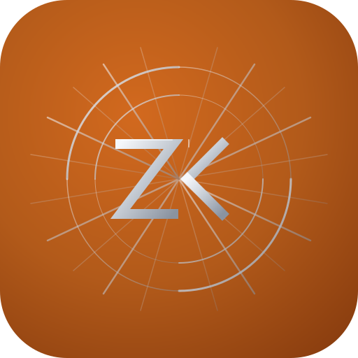

<p align="center">
  
</p>

# Zed-Kask

[](https://zed.dev)

**Zed-Kask** is a minimal-divergence fork of [Zed](https://zed.dev) grown into a **co-research environment**, with the hKask platform compiled in-process: one clone, one build, one CI. The editor and inference surfaces are Zed's (with real-time collab/calls/LiveKit removed under D90). The research platform — skills, an 11-server MCP tool fleet, the Curator, native steer panels, media and Nostr research workspaces, sovereign memory, and sealed experimentation — is Kask's, delivered as native editor surfaces rather than a separate daemon or hosted service.

See [`kask/docs/architecture/core/co-research-environment.md`](./kask/docs/architecture/core/co-research-environment.md) for the platform thesis and [`kask/docs/architecture/core/magnifica-humanitas.md`](./kask/docs/architecture/core/magnifica-humanitas.md) for its values charter.


`DISCLAIMER: The Kask side of the code has been built using agents as a tool for me in my research work.  I am not a professional coder, and am not trying to become one.  I am just using tools and sharing what I have found / built for others to use and learn from as well if it's useful to them.  I do not pretend to have come up with any unique solutions to anything -- which is why I have tried to be careful to track the reference models or design patterns which components of the code are built on, and also why I am sure there are better ways to build each individual component on the Kask side of the code.`


## The contract

- **Local, single-user, human-chaired.** Not a cloud platform, not an autonomous agent framework. The human is the principal investigator — holding the question, the judgment, and the veto — while agents hold the instruments, methods, and memory. There is no unattended autonomous loop by default: skills and the Curator escalate _to the user_, and privacy-marked threads (D100) lock model routing to local providers while disabling external-network MCP servers.
- **Sovereign data.** Memory, ledgers, goals, experiment registries, and galleries live in local SQLCipher databases under a single passphrase (`hkask_db_passphrase`) held in your OS keychain; rotating it re-keys every managed database, with rollback on partial failure. Server infrastructure lives under a single rooted data tree (`{kask_data_dir}/`, including local Nostr relay and Blossom archives), and visible content outputs land in `~/Documents/zk-data/`. External services — inference providers (OpenRouter, DeepInfra, RunPod serverless endpoints), web research providers, Nostr seed relays, and prediction-market APIs — are integrations you configure with your own credentials, not a host.
- **Minimal divergence.** Everything Kask lives under [`kask/`](./kask/) (additive — `git merge upstream/main` never touches it). Everything outside `kask/` tracks upstream Zed except the named seam edits documented in [`DIVERGENCE.md`](./DIVERGENCE.md) (D1–D109: 76 active seams plus three removal records D90–D92; 30 retired), each pinned by tests. The current workspace release is **0.42.0**, tracking upstream Zed `d2a4fb6ded`.

## What you get

### Skills

**60 skills** execute inside the agent panel. A skill is a _process_, not a prompt: its `SKILL.md` body is injected into the conversation via the `skill` tool, and the model — the executor — self-iterates against the convergence criteria the body describes using built-in host instruments:

- `lisp_eval` — a sandboxed Lisp interpreter (no I/O, no network, bounded steps and depth) for deterministic checks and arithmetic.
- `render_template` — renders **222 Jinja2 templates across 55 namespaces** under [`kask/registry/templates/`](./kask/registry/templates/) for structured prompt scaffolding, with `context_path` support for large payloads.
- `onto_anchor` — resolves domain terms (and optional directed relation paths) along the published ontology fallback ladder (W3C RDF Data Cube, OMC, PKO/P-Plan/PROV, SEPIO, GOLEM/CIDOC-CRM, ML-Schema, derived concepts, SUMO, schema.org, Dublin Core/BIBO/CiTO, 5W1H).
- `unfold_plan` and `lean_check` — deterministic DAG fan-out/reconsolidate planning and approval-gated local Lean/Lake proof checking.

Skills are authored in-repo under [`.agents/skills/`](./.agents/skills/) and seeded **once** to the global skills directory (`~/.local/share/zed-kask/skills/`); the disk copy is the runtime source of truth, and edits to non-core skills take effect immediately without recompilation. The **13 core skills** (quality gates, curator methodologies, task coordination) are the exception: re-seeded on every startup, locked against hand-weakening, and unshadowable by a project-local skill of the same name. See [`kask/docs/reference/skills/README.md`](./kask/docs/reference/skills/README.md) for the registry and [`kask/docs/diataxis/`](./kask/docs/diataxis/) for per-crate documentation.

### The Curator

The **Curator** is a native in-process agent — an `Agent::Curator` variant selectable alongside the Zed coding agent in the Agent Panel. It is the system's cybernetic regulator, not an autonomous agent: a background loop (sense → compare → compute → act) monitors regulation health, memory, and experimentation health, coalesces persistent signals, raises algedonic alerts when the system drifts, and escalates _to the user_ via the **Algedonic review** kanban board rather than acting unilaterally. It carries its own sovereign memory store (`agents/curator/curator.db`), federated search over sealed reference corpora, an operator-configured interaction mode (`kask.curator.interaction_mode`), and full coding capabilities plus regulatory context and tools.

### Steer panels

Three native GPUI panels extend the steering surface:

- **Kanban panel** (`kanban_panel`) — persistent, auto-refreshing kata-kanban boards with create/edit/spawn/delete actions alongside a Steer conversation.
- **Media panel** (`media_panel`) — Library and Asset workspace viewer over a Steer curator conversation driving `hkask-mcp-media`, with structural extraction of tool-returned `display_hint` assets.
- **Nostr panel** (`nostr_panel`) — read-first event timeline, conversation, and local-relay state viewer over a Steer curator conversation driving the Nostr MCP servers. No key ever reaches the panel or servers; note publication (`nostr_publish_note`) requests editor-side signing with per-post operator approval (unless `kask.nostr.autopublish` is explicitly enabled).

Each panel attaches a per-context system-prompt overlay via `hkask_steer`, with advertised tool lists generated mechanically from each server's `TOOL_NAMES` and verified by tests so renames degrade loudly rather than silently. Outside the panels, fenced `media`, `graph`, `kanban`, and `scenarios` blocks also render inline as native widgets in any agent conversation (D18).

### Media research

The `media` MCP server is the fleet's largest (**91 tools**): research-evidence ingestion, audio/video transcription with word-level timings, the **educt** transcript layer system (corrections, paragraphs, speakers, highlights, realignments, EDL reel rendering, SRT/WebVTT/Web Annotation/OTIO/corpus exports), time-keyed **media layers** (ffmpeg shot detection, bounded vision semantic/object/OCR passes, audio-event passes, deterministic object track stitching, and approved visual redaction renders), gallery annotation and search, opt-in face and voice identification, content-addressed image fetch, and source-linked excerpt/reel cutting. The **Media panel** pairs the Library and Asset workspace viewer with a Steer curator conversation, and media results render **inline in the conversation** via the editor's `media` block renderer.

### MCP servers

**11 built-in MCP servers** (**243 registered tools** fleet-wide, every count and generated `TOOL_NAMES` set pinned by `tool_surface_pin!` and CI-checked) are launched by the in-process governed `McpRuntime` (D3 — single spawn authority) as child processes over stdio and exposed as agent tools through `rmcp`. Each is a thin surface over in-process domain crates — the binary entrypoint is a one-line wrapper around a library `run()`. The fleet:

| Server | Surface | Tools |
| --- | --- | ---: |
| `corpus` | Document conversion, chunking, ontology-anchored tagging/embedding, grounded QA pipeline, style replicas, bundle export | 24 |
| `curator` | Curator memory, federated corpus search, regulation query, algedonic signals, skill-use issue reporting | 16 |
| `experimentation` | Experiment registry: pre-registered predictions, variant lineages, budget-enforced fitness records, held-out final evaluations, selection fossils | 8 |
| `kata-kanban` | Toyota Kata task boards, Improvement/Coaching Kata state, and canonical functional goals | 26 |
| `media` | Research-evidence ingestion, gallery annotation, transcription, educt transcript layers, time-keyed video/audio layers, reels, redactions | 91 |
| `nostr-blossom` | Local Blossom media sidecar (`BUD-01`/`BUD-02`/`BUD-06`/`BUD-11`) storing allowlisted authors' content-addressed blobs | 3 |
| `nostr-client` | Read Nostr across the local relay and seed relays, plus editor-signed note publishing and Blossom archive/mirror | 10 |
| `nostr-relay` | Loopback Nostr relay archiving allowlisted authors' public events over LMDB (pull-only sync, admission log) | 4 |
| `prediction-markets` | Polymarket/Kalshi base rates, calibration, residuals, EQM rationale scoring, MCDA weighting, and FRED/World Bank/DBnomics macro data | 28 |
| `research` | Web search, extraction, evidence scoring, APA citation, server-ledgered research runs, paper identity resolution | 11 |
| `scenarios` | Event-tree forecasting (Tetlock/Schwartz/Chermack) with prospective declaration, posterior recomputation, and equity forecast persistence | 22 |

All eleven servers auto-load by default (`load_default: true`) unless disabled in Settings → AI → MCP Servers (D45); `list_mcp_tools` lets any session inspect hidden registered tools on demand (D44), and external-network servers (including the Nostr trio) are refused on privacy-marked threads by default (D100). See [`kask/docs/reference/mcp-servers/README.md`](./kask/docs/reference/mcp-servers/README.md) for the full registry, architecture, and per-server pins.

### The discovery loop

The platform's question-throughput capability. Research questions live on an **Open Questions** kanban board — you file them, or the machine files them from regulation signals. One invocation of the `eureka-cycle` skill runs one full human-chaired cycle: orient on the question's lineage and curator memory, route it (research-resolvable, experiment-requiring, or forecasting), generate cited candidate hypotheses, and bring you a **funding brief — you fund what runs**; nothing routes to spend unconfirmed. Funded work executes through the delegated lifecycles (`hypothesis-testing` + `experimental-design`, `self-improvement`, research runs) under sealed, pre-registered predictions in the `experimentation` registry, and resolves at the `algedonic-review` gemba walk with a study report whose memory candidates go to your review. Functional goals carry their own native lifecycle (`kanban_goal_create` → `kanban_goal_judge` → human-gated `kanban_goal_close` with fresh blinded assessment, D58), keeping worker claims, machine evidence, and human acceptance separate.

## Installation

### Source build (Linux, requires Rust toolchain)

There are no prebuilt binaries yet — Zed-Kask is built from source. The installer clones the repo at a pinned tag (or builds from your local checkout), installs system dependencies via `script/linux`, provisions the pinned Lean/Lake toolchain via verified Elan (plain `cargo build` remains offline), builds `zed` and all 11 `hkask-mcp-*` MCP server binaries with `cargo` (using `[profile.release-mcp]` for the servers), and installs them to `~/.local/bin`:

```bash
curl -fsSL https://raw.githubusercontent.com/mdz-axo/zed-kask/main/kask/scripts/build/install.sh | bash
```

Verify the install:

```bash
zed-kask --help
ls ~/.local/bin/hkask-mcp-*
```

If `~/.local/bin` is not on your `PATH`, start a new shell or:

```bash
export PATH="$HOME/.local/bin:$PATH"
```

Environment variables the installer honors:

| Variable | Default | Purpose |
| --- | --- | --- |
| `HKASK_VERSION` | derived from workspace `Cargo.toml` (or `0.42.0`) | Pin a release tag (e.g. `0.42.0`) |
| `HKASK_BUILD_TYPE` | `release` | `release` or `release-fast` |
| `HKASK_STRIP_FAST` | `false` | `--fast` only: strip the installed `--fast` binaries (`.dwo` sidecars keep the symbols) |
| `HKASK_SOURCE_DIR` | unset | Use an existing checkout instead of cloning |
| `HKASK_REPO_URL` | `https://github.com/mdz-axo/zed-kask.git` | Override the clone URL |
| `HKASK_ALLOW_FALLBACK` | `false` | Set to `true` to fall back to `main` if the tag is missing |
| `INSTALL_DIR` | `$HOME/.local` | Install prefix; binaries land in `$INSTALL_DIR/bin` |
| `HKASK_SYSTEM_INSTALL` | `false` | Set to `true` to symlink into `/usr/local/bin` |
| `HKASK_REMOVE_CONFIG` | `false` | Set to `true` to remove config and data on uninstall |

Flags: `--install` (default), `--uninstall`, `--build-only`, `--fast` (release-fast profile — parity flags, no LTO, debug symbols kept), `--system` (system-wide symlink), `--skip-deps` (skip `script/linux`), `--skip-rust`, `--skip-corpora` (skip reference corpus bundles), `--install-dir DIR`, `--help`.

To update from a local checkout, rebuild from source: `bash script/install.sh` (or `bash kask/scripts/build/install.sh --fast --skip-deps` for a quicker rebuild). There is no in-app updater — updates are always a source rebuild.

## License

Zed-Kask inherits Zed's licensing: GPL-3.0-or-later primarily, with Apache-2.0 components where marked. License information for third-party dependencies must be correctly provided for CI to pass; see [`script/licenses/zed-licenses.toml`](./script/licenses/zed-licenses.toml) and the [`cargo-about`](https://github.com/EmbarkStudios/cargo-about) configuration for details.
