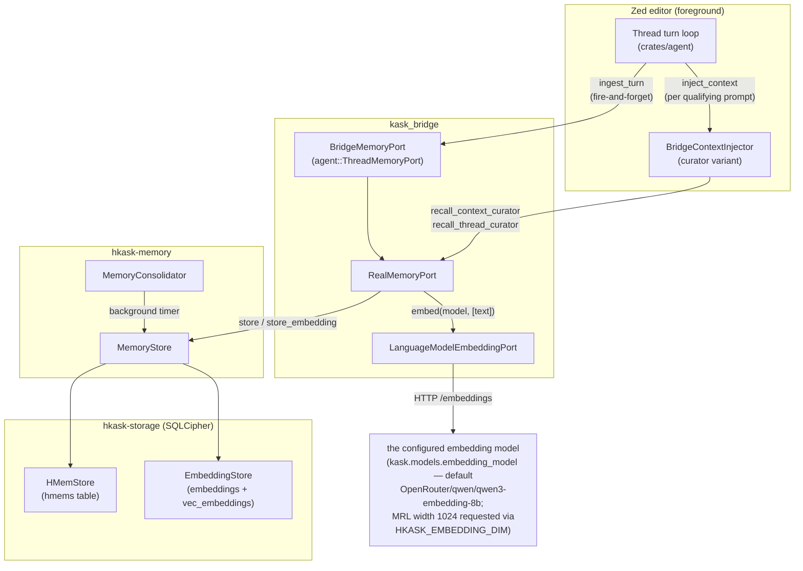
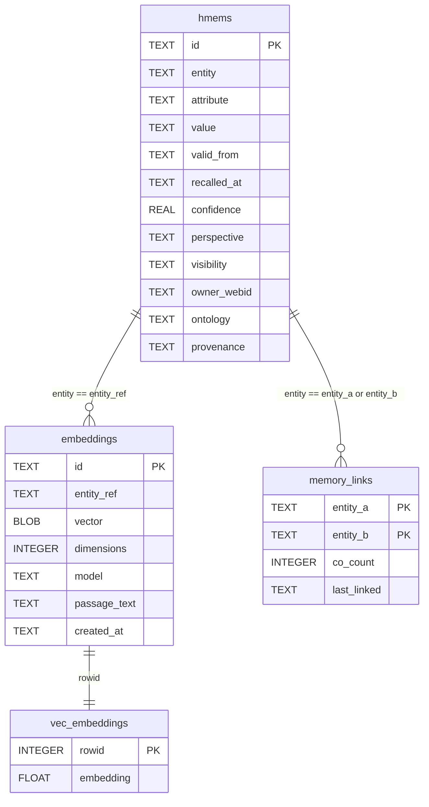
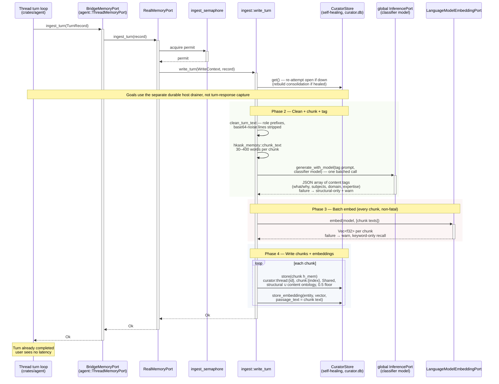
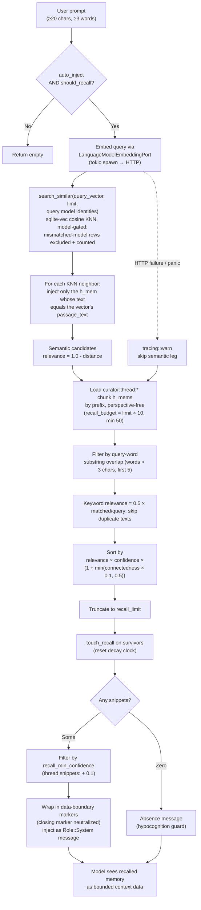
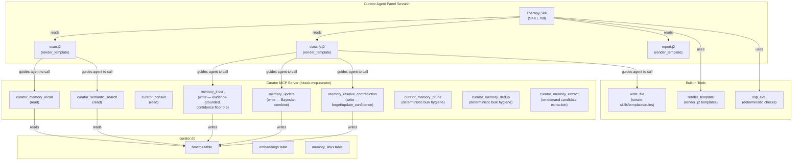
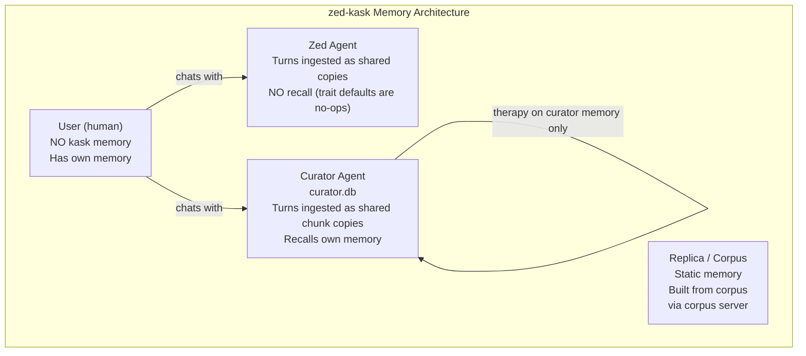

# Memory System Specification

> **Design decision 2026-09-04 (operator-ratified) — chunked content
> pipeline; supersedes the whole-turn dump design.** Threads are chunked
> and those chunks embedded and ontologically tagged along the way, in a
> process mirroring the corpus pipeline (chunk → embed → tag) with an
> added cleaning step at write time. One shared copy per turn — the
> curator-perspective duplicate (`chat:thread:`) and the goal perspective
> duplicate (`goal:{id}`) are retired, and with them every dual-write code
> path in this document's former §4. No backward compatibility requirement
> exists (operator ruling, restated 2026-09-04): legacy whole-turn rows and
> their envelope values are deleted by the therapy hygiene pass and the
> forgetting pass, not accommodated in code. Ratified package: inline LLM
> tagging via the classifier model / single copy under `curator:thread:` /
> rule-based clean / no migration of old rows.

> **Design decision 2026-09-04 (operator ruling; supersedes the
> expire/soft-delete concept everywhere it appeared):** there is no
> "expired" state — memories age and are forgotten or deleted, and
> forgotten means the row is deleted from the database. There is no
> validity window or backward-compatibility shape. The `valid_to` column
> is removed; the on-open migration
> (`core/connection.rs`, `migrate_hmems_forgetting_spec`) deletes previously
> soft-deleted rows and drops the column. Every removal path hard-deletes:
> contradiction resolution (`forget`), normalized-value dedup, age prune,
> the distillation-gated forgetting pass, value/confidence
> update-replacement, and kanban task/board deletes. Decay (§7) remains a
> separate confidence-weighting mechanism, not deletion.
>
> **Migration verification:** deletion and column removal commit together.
> Before the first open with the rebuilt binary, take a fresh SQLCipher
> `VACUUM INTO` backup of curator, kanban, and research DBs. After restart, verify the column is
> absent, retained-row counts match the pre-migration snapshot, and live
> `curator_memory_recall` / `curator_semantic_search` work. Unit tests over
> encrypted fixtures do not substitute for this operator restart gate.

> **Scope:** `kask/crates/hkask-memory/` (unified store + consolidation),
> `kask/crates/hkask-storage/` (`hmem.rs`, schema), and
> `kask/crates/kask_bridge/src/memory.rs` + `src/memory/` (the
> `RealMemoryPort` bridge that wires thread turns into memory). This is the
> D6 seam.
>
> This is the canonical memory-family document. It folds in the former
> companion docs (architecture/therapy framework, design-rationale
> explanation, and the ERD / recall / ingest diagrams) — retired
> 2026-08-28; recoverable via `git log --diff-filter=D -- kask/docs/`.

## 1. Overview

The memory system is a **vector embedding + relational lookup** store. One
`entity_ref` string links each embedding vector to its relational row, so
KNN search results can be joined back to the full text. There is exactly one
store type: every h_mem — chat turn, curator fact — flows
through the same `MemoryStore` (`kask/crates/hkask-memory/src/memory_store.rs:269`).
The ontology blob on each h_mem carries dual-axis anchoring (PKO process
axis + Dublin Core state axis, `kask/crates/hkask-storage/src/hmem.rs:183-186`);
it is a discriminator for recall queries, not a type system. There are no
separate episodic/semantic store structs, no consent manager, and no
narrative generation loop.

### What it does

1. **Ingests** every completed thread turn (curator and zed-agent turns
   alike) into the curator's sovereign `curator.db` as a chunked content
   pipeline (`kask/crates/kask_bridge/src/memory/ingest.rs`):
   - Clean: role-prefixed text (`user:` / `assistant:`), base64-noise
     lines stripped
   - Chunk: word-bounded passages (30–400 words) via
     `hkask_memory::chunk_text` — one h_mem per chunk under
     `curator:thread:{thread_id}`, attribute `chunk:{turn_ms}:{index}` (turn-scoped)
   - Tag: structural 5W1H dimensions (who/when/where/how) deterministically;
     content dimensions (what/why), subjects, domain concepts, and
     expertise via one batched classifier-model call per turn
   - Embed: every chunk in one batched call; each vector stored under the
     thread entity with its `passage_text`, so KNN pinpoints the matched
     chunk
   - Goal custody is separate from turn ingestion: the host maintains one
     `curator:goal:{id}` / `current` row, not turn-response copies.
2. **Recalls** relevant memories on every qualifying prompt by:
   - Embedding the query and searching stored embeddings (KNN), injecting
     only the chunk whose text the matched vector names
   - Loading `curator:thread:*` chunk h_mems by prefix and filtering their
     canonical passages by keyword overlap. KNN, keyword fallback, and exact
     thread recall all use `semantic_passage_for_h_mem`, including object values;
     keyword fallback remains thread-only and does not include other knowledge
     entities. Mutable rows without a supported `recall_text` remain excluded
   - Merging, ranking by relevance × confidence × connectedness, and
     injecting the top results into the model's context
   (`kask/crates/kask_bridge/src/memory.rs`)
3. **Consolidates** on a background timer — confidence-floor cleanup only
   (`kask/crates/hkask-memory/src/consolidation_service.rs::MemoryConsolidator::consolidate`;
   `kask/crates/kask_bridge/src/memory.rs::fire_curator_consolidation_pass`
   supplies `confidence_floor` directly).
4. **Federates explicit searches** without merging stores. `curator_federated_search`
   embeds once, retrieves untouched Curator candidates plus passage text from
   identity-bound sealed corpus databases, and rank-interleaves the already-ranked
   source batches. Every hit carries source and record provenance; every source
   reports `ready`, `unconfigured`, `invalid`, `incompatible`, or `unavailable`.
   Source admission requires the current producer's schema-3 run identity,
   re-derived run ID, schema-2 representation manifest, and matching database
   digest. A nonempty WAL is incompatible with sealed `mode=ro&immutable=1`
   reads. Source file metadata is checked on each search, with full re-admission
   when it changes; an in-flight change excludes external hits. External stores
   cannot be migrated, repaired, touched, linked, or written
   (`hkask-memory/federated_recall.rs`; `hkask-mcp-curator/federated.rs`).
   The sealed-source lexical leg breaks equal BM25 scores by embedding ID
   before truncation (`hkask-memory/src/lexical.rs::LexicalIndex::search`):
   reopening identical rows must not assign different ranks to exact ties,
   since those ranks feed reciprocal-rank fusion.

### What it does NOT do

- No promotion, re-tagging, or reflection in consolidation — the
  episodic→semantic promotion pipeline does not exist
  (`kask/crates/hkask-memory/src/consolidation_service.rs::MemoryConsolidator::consolidate`)
- No query-embedding cache — every recall embeds the query fresh
  (`kask/crates/kask_bridge/src/memory.rs::RealMemoryPort::recall_from`)
- No zed-agent recall — recall is curator-scoped (operator ruling 2026-09-28):
  `BridgeContextInjector::inject_context` returns empty for non-curator
  threads, and the curator recalls via the inherent `recall_context_curator` /
  `recall_thread_curator` methods (`kask/crates/kask_bridge/src/memory.rs::RealMemoryPort::recall_context_curator`
  and `RealMemoryPort::recall_thread_curator`).
  The `MemoryPort` trait's `recall_context` / `recall_thread` keep their
  default no-op implementations as the port contract (`kask/crates/hkask-types/src/ports/memory_port.rs:106,124`);
  `RealMemoryPort` no longer overrides them (`kask/crates/kask_bridge/src/memory.rs`,
  `impl MemoryPort for RealMemoryPort`).
- External-evidence injection is opt-in for Curator chat and off by default.
  The Memory page uses one `Auto-Inject Memories` master switch and a dropdown:
  Curator memory only, or one named source from the sealed-source manifest.
  Choosing a source enables `kask.memory.federated_auto_inject` and saves its
  single ID; choosing memory-only disables it and clears the ID. The injector
  refuses legacy multi-ID selections; when memory `auto_inject` is enabled, it
  frames, labels, and bounds external passages separately from Curator memory. Injector settings are captured at startup; a settings change takes
  effect after restarting the editor. The explicit `curator_federated_search`
  tool remains independent.
- No automatic corpus-to-Curator promotion — external evidence remains in its
  sealed source. Reification still requires a separately reviewed memory write.
- No backward compatibility for federated sources — only the current manifest,
  run-identity, representation-manifest, database-schema, and exact model
  identities are accepted; older forms are rejected without shims or migration.

## 2. Architecture



<!-- DIAGRAM_ALIGNMENT
id: DIAG-MEM-ARCH
verified_date: 2026-09-28
verified_against: kask/crates/kask_bridge/src/memory.rs (impl MemoryPort for RealMemoryPort — ingest only, no-op trait recall; RealMemoryPort::recall_context_curator / RealMemoryPort::recall_thread_curator), kask/crates/kask_bridge/src/memory/ingest.rs:277-666 (write path), kask/crates/hkask-memory/src/memory_store.rs:269-330 (MemoryStore), kask/crates/kask_bridge/src/settings.rs:719 (effective_embedding_model — no constant fallback), kask/crates/hkask-storage/src/core/sql/schema.sql:1-6
status: VERIFIED
-->

### Components

| Component                    | Crate           | Role                                                                                      |
| ---------------------------- | --------------- | ----------------------------------------------------------------------------------------- |
| `Thread` turn loop           | `agent`         | Calls `ingest_turn` on turn completion; calls `inject_context` per prompt                   |
| `BridgeMemoryPort`           | `kask_bridge`   | Adapts `agent::ThreadMemoryPort` (`crates/agent/src/agent.rs:3029`) → `RealMemoryPort`     |
| `RealMemoryPort`             | `kask_bridge`   | The real implementation: ingestion, curator recall, consolidation timer (`memory.rs:190`)   |
| `BridgeContextInjector`      | `kask_bridge`   | Implements `agent::ContextInjector`; curator variant calls `recall_*_curator` (`context_injector.rs:223,262-330`) |
| `CuratorStore`               | `kask_bridge`   | Self-healing handle over the curator's `MemoryStore` (`kask/crates/kask_bridge/src/memory/curator_stores.rs:169`)       |
| `MemoryStore`                | `hkask-memory`  | Wraps `HMemStore` + `EmbeddingStore`; `store`, `query_deduped`, `search_similar` (`memory_store.rs:269`) |
| `MemoryConsolidator`         | `hkask-memory`  | Confidence-floor cleanup (`consolidation_service.rs::MemoryConsolidator::consolidate`) |
| `HMemStore`                  | `hkask-storage` | Relational EAV table (`hmems`, `hmem.rs:135`)                                              |
| `EmbeddingStore`             | `hkask-storage` | Vector table (`embeddings` + `vec_embeddings` via sqlite-vec)                              |
| `LanguageModelEmbeddingPort` | `kask_bridge`   | OpenAI-compatible `/embeddings` HTTP client over zed's credentials                         |

## 3. Storage schema

Tables live in a single SQLCipher DB per store owner. The curator's DB is
`agents/curator/curator.db` under the hKask data dir
(`kask/crates/kask_bridge/src/memory/curator_stores.rs:20-29`, override
`HKASK_CURATOR_DB`). The schema is owned by
`kask/crates/hkask-storage/src/core/sql/schema.sql` and applied on every pool
creation (`hmem.rs:141-149`).

### `hmems` (relational EAV — `schema.sql:1`)

| Column        | Type    | Description                                    |
| ------------- | ------- | ---------------------------------------------- |
| `id`          | TEXT PK | UUID                                           |
| `entity`      | TEXT    | The entity (e.g., `curator:thread:{thread_id}`)|
| `attribute`   | TEXT    | The attribute (e.g., `turn`)                   |
| `value`       | TEXT    | JSON string of the turn content               |
| `valid_from`  | TEXT    | Creation timestamp (`observed_at`)            |
| `recalled_at` | TEXT    | Last recall time (decay clock, `NOT NULL DEFAULT datetime('now')`) |
| `confidence`  | REAL    | Confidence score (0.0–1.0, default 1.0)        |
| `perspective` | TEXT    | The WebID of the agent who wrote this          |
| `visibility`  | TEXT    | `private` / `shared` / `public` (default `private`) |
| `owner_webid` | TEXT    | The owning WebID                               |
| `ontology`    | TEXT    | JSON blob: dual-axis anchoring (PKO process + DC state) |
| `provenance`  | TEXT    | How the value was obtained (NOT NULL DEFAULT `model_inference`): `tool_observed` (a verbatim tool-outcome record, stamped only by the machine paths that hold it) or `model_inference` (the model's synthesis or speech — the extraction ceiling: a model-synthesized memory never retrieves as tool-observed, no matter how often it is recalled or re-asserted). Added 2026-10-10 (R5, fermi's `verification_for_agent_ecologies.md` §5.4/§7); legacy rows backfill as `model_inference` — the fail-safe direction. Surfaced in `curator_memory_recall` / `curator_semantic_search` output. The write-path contradiction check: `memory_insert` refuses a differing value for an existing `(entity, attribute)` key — surfaced by id, routed to `memory_resolve_contradiction` / `memory_update`, never silently coexisting. |

### `embeddings` (vector metadata — `schema.sql:5`)

| Column        | Type    | Description                                        |
| ------------- | ------- | -------------------------------------------------- |
| `id`          | TEXT PK | UUID                                               |
| `entity_ref`  | TEXT    | **MUST equal the h_mem's `entity`** — the join key |
| `vector`      | BLOB    | Encoded float vector                               |
| `dimensions`  | INTEGER | Vector dimension (default 1024)                   |
| `model`       | TEXT    | Embedding model name                               |
| `passage_text`| TEXT    | Original passage stored beside the vector. Corpus writers persist source/synthesis text; bridge memory ingestion persists each turn chunk (`kask/crates/kask_bridge/src/memory/ingest.rs:313-317,394-404`) so KNN recall can pinpoint one hMem rather than inject the whole entity. |
| `created_at`  | TEXT    | Creation timestamp                                 |

### `vec_embeddings` (virtual, sqlite-vec — `schema.sql:6`)

```sql
CREATE VIRTUAL TABLE IF NOT EXISTS vec_embeddings USING vec0(embedding float[$DIM] distance_metric=cosine);
```

Keyed on `rowid` (mirrors `embeddings.rowid`). KNN search via the `MATCH`
operator returns nearest neighbors ordered by cosine distance.

### `memory_links` (co-occurrence — `schema.sql:21-29`)

`entity_a`, `entity_b`, `co_count`, `last_linked`, `PRIMARY KEY (entity_a,
entity_b) WITHOUT ROWID`. Populated by `record_co_occurrence`
(`kask/crates/hkask-memory/src/memory_store.rs::MemoryStore::record_co_occurrence`), called from the context injector after every
non-empty recall (`context_injector.rs:456`). Read by `connectedness`
(`kask/crates/hkask-memory/src/memory_store.rs::MemoryStore::connectedness`) as the recall-ranking salience signal.

### The entity_ref invariant

The embedding's `entity_ref` and the h_mem's `entity` are plain `TEXT`
columns with no foreign key. The invariant (`entity_ref == entity`) is
enforced by:

1. Turn chunks and embeddings share `curator:thread:{id}` in
   `kask/crates/kask_bridge/src/memory/ingest.rs`. Canonical goal projections
   use `curator:goal:{id}` / `current` in the separate host `goals.rs` drainer.
   `goal_index_current` publishes the row/vector under the canonical revision lock;
   failed acknowledgment leaves `indexed_revision` behind for retry.
2. `hkask_memory::semantic_passage_for_h_mem` is the one passage-identity
   contract used by production recall and embedding backfill. Curator MCP recall
   resolves a named vector only to rows whose canonical passage matches, before
   applying its per-entity flood cap; newer unrelated siblings cannot inherit the
   vector's distance. Entity-level vectors retain the freshest-row cap. A missing
   named passage is surfaced as a resolution failure, not substituted silently.
   Mutable lessons project their provenance-bearing `recall_text`; goal recall
   preserves current meaningful state and histories, not coordination fields. Backfill is
   scoped by exact `(entity, passage)`, so one successful sibling vector cannot
   hide another failed h_mem. Canonical goal projections are excluded from generic
   backfill: `goal_index_current` owns their publication and repair. Backfill therefore
   cannot report success with a passage production recall will reject.
3. The regression tests `recall_context_finds_turn_by_embedding_only`,
   `ingest_turn_embeds_every_chunk_with_passage_text`,
   `native_stop_unknown_restart_recall_and_optional_human_forecast_corrections`,
   `publication_before_mark_restart_reuses_one_current_record_and_repairs_active_model`,
   `backfill_embeddings_covers_knowledge_layer_and_excludes_turns`,
   `semantic_search_resolves_the_named_passage_not_newer_siblings`, and
   `object_thread_memory_uses_one_passage_across_recall_legs`.

A future `EntityRef(String)` newtype shared between `HMemStore` and
`EmbeddingStore` would make this compile-time-enforced, but that is a
cross-crate refactor deferred until a third embedding call site appears.

### Canonical entity keys (the key-space protocol)

**Design decision 2026-10-08 (operator instruction; algedonic card
ba0ac90d) — one canonical key form per knowledge class, enforced at the
writer.** Different agents invented per-session key standards before
this existed; the live audit (2026-10-08) measured 56 pipe-concatenated
entities (`category | lesson`), 68 space-containing entities (11 of them
Capitalized With Spaces), and one stringified-JSON value against 881
canonical/namespaced entities.

The canonical form: an entity key is **lowercase `[a-z0-9:._-]+`** — no
spaces, no pipes (`|`), no uppercase, no slashes. Dots are allowed
(amendment 2026-10-10, algedonic card 91ea8f27): the corpus crate's
production entity refs embed source file names
(`corpus:researcher:consolidated:river.txt:0`), and a file extension is
data, not drift — the 2026-10-08 audit's drift classes were pipes,
spaces, and uppercase, and the dot was collateral exclusion. Per
knowledge class:

| Class | Form | Examples |
| --- | --- | --- |
| System records | `<namespace>:…` | `curator:thread:{id}`, `curator:goal:{id}`, `skill_use_issue:{skill}`, `kanban:{id}`, `agent:{id}:turn:{uuid}` |
| Skill knowledge | the BARE skill name (ruling ac85c2c8, 2026-09-28) | `company-research-deep`, `therapy` |
| Lessons / knowledge | bare lowercase-hyphen slug | `verification-protocol`, `workflow-gating`, `release-hygiene` |
| Curator process records | `curator-process` (the attribute carries the record type) | see below |

**Enforcement:** `MemoryStore::store` and
`MemoryStore::store_batch_replacing_key_atomic` reject a non-canonical
entity with a teaching error naming the canonical form per class
(`hkask-memory/src/memory_store.rs`, pinned by
`store_rejects_non_canonical_entity_keys`; classified `invalid_argument`
at the MCP boundary). Every curator.db writer flows through these two
entry points — the bridge's turn chunks and current goal records, the curator
MCP tools, and distillation. Distillation additionally pre-gates at the
per-candidate boundary: `prepare_lesson` skips a non-canonical key with
a teaching warning (via the shared `is_canonical_entity_key` predicate)
so one drifted model output skips as a lesson instead of failing the
whole batch's atomic publication — a batch-level rejection would leave
the watermark unadvanced and stall that thread's distillation forever
(therapy 2026-10-09, algedonic card 7d17d334; pinned by
`non_canonical_entity_keys_skip_without_stalling_the_batch`). The
extraction prompt also states the canonical slug form, because the
prior-lessons list displays `- {entity} | {attribute}` and the model
otherwise mimics the display separator into the key (the live drift
source). `update_confidence` replaces an existing
key and is deliberately unvalidated: existing rows are grandfathered
until the mass-normalization session (algedonic card 7d17d334). The
gate stops new drift; it does not migrate history.

### Curator process records (the record protocol)

The curator's own process records — therapy sessions, values passes,
decisions — live under entity `curator-process` with a canonical
attribute and value shape (unified 2026-10-08; the pre-unification rows
used two date formats and both string and object values):

- **Attribute:** `<record_type>_<yyyy-mm-dd>` — hyphenated dates only
  (the `2026_09_09` underscore form is retired). Known record types:
  `therapy_session_*`, `therapy_values_pass_*`, `*_decision_*`,
  `*_followups_*`.
- **Value:** a JSON **object** carrying `text` (the record) and
  `recall_text` (the recall summary); optional `note`. Never a bare
  string, never stringified JSON (the 2026-09-01 corruption class).
- **Consumers that depend on these forms:** the regulation-loop growth
  sensor reads `therapy_session_*` rows (card c148d75d); the
  values-pass charter-version trigger reads `therapy_values_pass_*`
  rows carrying `charter_version` (therapy skill, card 49e44a76).
  Changing these forms requires updating both consumers in the same
  change.

### Memory Store ERD

Entity-relationship diagram of the four SQLCipher tables that form the
unified `MemoryStore` — the relational EAV side (`hmems`), the embedding
metadata side (`embeddings`), the KNN virtual table (`vec_embeddings`), and
the co-occurrence side (`memory_links`). The join key between the relational
and vector sides is the `entity_ref` / `entity` string.



<!-- DIAGRAM_ALIGNMENT
id: DIAG-PL-MEMORY-ERD
verified_date: 2026-09-28
verified_against: kask/crates/hkask-storage/src/core/sql/schema.sql:1 (hmems), :5 (embeddings incl. passage_text), :6 (vec_embeddings), :21-29 (memory_links)
status: VERIFIED
-->

#### Indexes

| Table | Index | Columns |
|-------|-------|---------|
| `hmems` | `idx_hmems_entity` | `entity` |
| `hmems` | `idx_hmems_attribute` | `attribute` |
| `hmems` | `idx_hmems_entity_attribute` | `entity, attribute` |
| `embeddings` | `idx_embeddings_entity_ref` | `entity_ref` |
| `vec_embeddings` | (implicit) | `rowid` (B-tree) + `embedding` (vec0 virtual) |
| `memory_links` | (implicit) | `PRIMARY KEY (entity_a, entity_b) WITHOUT ROWID` |

All index definitions live in `kask/crates/hkask-storage/src/core/sql/schema.sql:2-4`,
`:7`, `:21-29`.

## 4. Ingestion

**Source:** `kask/crates/kask_bridge/src/memory.rs` (`impl MemoryPort for RealMemoryPort`,
`ingest_turn` semaphore) and `kask/crates/kask_bridge/src/memory/ingest.rs:271-660`
(`write_turn`).

When a thread turn completes, the turn loop calls
`BridgeMemoryPort::ingest_turn(TurnRecord)` fire-and-forget. The
`TurnRecord` carries `thread_id`, `user_input`, `agent_response`, `model`,
`thread_title`, and `agent_id`
(`kask/crates/hkask-types/src/ports/memory_port.rs:27-50`).

### What gets stored (per turn, all in `curator.db`)

| Store | Entity | Attribute | Visibility | Content |
| ----- | ------ | --------- | ---------- | ------- |
| Curator store (every turn, one row per chunk) | `curator:thread:{id}` | `chunk:{turn_ms}:{index}` | Shared | Cleaned chunk text (plain string, role prefixes inline), structural + content ontology blob |
| Curator store (embedding, every chunk) | `curator:thread:{id}` | — | — | Vector of the chunk text + `passage_text` = the chunk text |
| Curator store (current goal) | `curator:goal:{id}` | `current` | Shared | Current meaningful state with source, criteria, progress, closure, assessment and forecast histories |
| Curator store (goal embedding) | `curator:goal:{id}` | — | — | Exact current passage; row/vector replaced atomically |

The host drainer publishes goal recall independently of turn completion.
`kanban_goal_list` reads canonical history, not instructions to store whole-list
copies. Publication failures remain retryable; indexing never prunes the goal.
Each scheduling pass uses one full goal-store scan returning
`HashMap<WebID, Vec<Goal>>`, with per-owner canonical validation before bounded
work. `goal_list(owner)` returns `Vec<Goal>` after caller-owner filtering before
decoding. Invalid current records and query failures remain visible errors;
there is no rejection map or cache.
See [GOAL_INTERFACE.md](../../mcp-servers/hkask-mcp-kata-kanban/GOAL_INTERFACE.md).
Curator-turn detection is `agent_id.as_deref() == Some("Curator")`
(`ingest.rs:277`) — used for logging only; the write path is identical for
every agent. The curator store is behind the self-healing `CuratorStore`
handle — a failed initial open leaves the store `None`, and every `get()`
re-attempts the open (`curator_stores.rs`); a successful re-open also
rebuilds the consolidation service.

### Goal history is not confidence-weighted forecast truth

The 2026-10-20 cutover removes single-score confidence mutation and
response-only score/ack coupling. A low-loss forecast does not authenticate its
source, and a high-loss forecast remains valuable history. The canonical ledger
retains admitted current-schema goals, closure choices, findings, corrections and
score versions; confidence-based retrieval cleanup is not a deletion policy for it.
Memory is a rebuildable projection, not the only surviving structured record.

The bridge calls service-owned `goal_assess` and `goal_index_current`; the
canonical contract above owns evidence consent/bounds and exact-input blindness.
The memory boundary atomically replaces the current row/vector; the service
acknowledges only the revision actually published. Restart repairs that record,
not a historical delivery log. Obsolete goal rows and recall projections are
discarded by an explicit one-time reset, not runtime conversion, archival retention,
or historical-key discovery. No backward compatibility contract applies, and no
reset execution is claimed here.

Optional `HumanAcceptance` forecast arithmetic uses the original closure time;
corrections append without adding cohort weight. Unknown stays unscored. Raw Brier
loss is not a calibration certificate (Murphy 1973; approved plan §2), and never
changes memory confidence. Human judgment requires no scoring administration.
### Ingestion semaphore

A `tokio::sync::Semaphore` (default 1 permit, configurable via
`HKASK_MEMORY_INGEST_CONCURRENCY`, malformed values warn and fall back —
`memory.rs:311,380-400`) serializes concurrent ingestions so they don't contend
with the recall path for the SQLite pool. Pinned by
`ingestion_semaphore_serializes_concurrent_ingestions`
(`kask/crates/kask_bridge/src/memory.rs::tests::ingestion_semaphore_serializes_concurrent_ingestions`).

### Memory Ingest Sequence

The write side, end to end — from a completed thread turn to stored chunk
h_mems plus per-chunk embeddings in `curator.db`:



<!-- DIAGRAM_ALIGNMENT
id: DIAG-PL-MEMORY-INGEST
verified_date: 2026-09-28
verified_against: kask/crates/kask_bridge/src/memory/ingest.rs (turn chunk ingestion); kask/crates/kask_bridge/src/goals.rs (separate canonical goal projection drainer)
status: VERIFIED
-->

#### Key invariants (write side)

1. **Every persisted h_mem that advertises semantic visibility has a
   joinable embedding under the same entity.** Chunk vectors use
   `curator:thread:{thread_id}` with `passage_text` equal to the chunk value.
   Goal recall uses `curator:goal:{id}` / `current` and its exact passage through
   the host drainer; indexing never deletes canonical history.
2. **All writes go to the curator's `curator.db`, one copy per turn.** There
   is no user memory store and no perspective duplicate — `RealMemoryPort`
   holds only the `CuratorStore`. Goal recall replaces one current row under
   `curator:goal:{id}`; whole-list copies are excluded.
3. **Turn-chunk embedding and tagging failures are non-fatal.** Chunk h_mems
   remain keyword-recallable or structurally tagged and the degradation is
   warned. Goal embedding failure leaves an unindexed revision for host retry,
   never missing semantic evidence presented as success.
4. **Curator-store failures are visible and self-healing.** A failed
   initial open leaves the store `None`; every `get()` re-attempts the
   open, and a successful re-open rebuilds the consolidation service.
   Persistent failure warns once per healing attempt — never silently.
5. **Consolidation is decoupled.** It runs on the background timer
   (`start_consolidation_timer`), never in the ingestion path. Write-time
   LLM tagging is creation metadata, not consolidation — it does not
   modify existing h_mems (the sovereignty line).
6. **Every write enters at the 0.5 confidence floor** — chunks and goal projections alike. `HMem::new`'s 1.0 default starves recall ranking and the
   cleanup consolidator.

## 5. Recall

**Source:** `kask/crates/kask_bridge/src/memory.rs::RealMemoryPort::recall_from`,
`RealMemoryPort::recall_thread_from`, and
`kask/crates/kask_bridge/src/context_injector.rs:262-460`
(`inject_context`).

### When recall fires

- `kask.memory.auto_inject` is true (`context_injector.rs:298`)
- The prompt is ≥ 20 chars AND ≥ 3 words (`should_recall`,
  `context_injector.rs:87`, `:256`)
- The `ContextInjector` hook is wired (deferred startup task)

### The two legs

1. **Semantic (embedding KNN):** Embed the query → `search_similar` → for
   each neighbor, inject only the h_mem whose value text equals the
   vector's `passage_text` — the chunk the vector embedded. A vector with
   no `passage_text` injects nothing (no whole-entity fallback).
   Relevance = `1.0 - cosine_distance`.

2. **Keyword (prefix + word overlap):** Load `curator:thread:*` chunk
   h_mems in a single perspective-free prefix query (capped at
   `limit × 10`, minimum 50) → filter by query-word substring overlap
   (words > 3 chars, first 5 words) → relevance =
   `0.5 × matched query entries / query entries` via
   `hkask_memory::salience::keyword_overlap_score`
   (`kask/crates/kask_bridge/src/memory.rs::RealMemoryPort::recall_from`, keyword search; T18, 2026-09-08).
   This replaces the constant score while preserving the keyword leg's
   0.5 ceiling, confidence/connectedness weighting, and semantic dedup precedence.

### Merge, rank, inject

Candidates from both legs are merged (the keyword leg skips texts already
present, so the semantic candidate wins on collision — `RealMemoryPort::recall_from`,
keyword search),
sorted by `relevance × confidence × (1 + min(connectedness × 0.1, 0.5))`
(`RealMemoryPort::recall_from`, candidate sort), truncated to `recall_limit`, and
only the survivors are `touch_recall`-ed (resetting their decay clocks —
`RealMemoryPort::recall_from`, post-truncation touch loop).
The injector then filters by `recall_min_confidence` (prompt snippets) and
`recall_min_confidence + 0.1` (thread snippets), wraps each snippet in
data-boundary markers with the closing marker neutralized against injection
(`context_injector.rs:46-77`, `:282-285`), and injects the
result as a `Role::System` message. Zero-result recalls return an explicit
absence message (the hypocognition guard, `context_injector.rs:395-407`).

### Thread-scoped recall (per turn)

`inject_context` also calls `recall_thread_curator(thread_id)` on every
turn (fresh, not session-cached), which recalls by exact entity match —
`curator:thread:{id}`, the single shared copy — not embedding KNN.

### Memory Recall Flow

The read side, end to end — from a user prompt to recalled memory snippets
injected into the model's context:



<!-- DIAGRAM_ALIGNMENT
id: DIAG-PL-MEMORY-RECALL
verified_date: 2026-09-28
verified_against: kask/crates/kask_bridge/src/context_injector.rs (prompt gate, should_recall, auto_inject gate, confidence filters, absence message, data-boundary markers); kask/crates/kask_bridge/src/memory.rs (recall_from: KNN passage_text pinpointing, keyword leg curator:thread: prefix via query_deduped_untouched_by_prefix, sort, touch; recall_thread_from: single-entity)
status: VERIFIED
-->

A failed embed degrades recall to keyword-only with a `tracing::warn!` —
the operator can distinguish "no memory found" from "embedding endpoint
down" (`kask/crates/kask_bridge/src/memory.rs::RealMemoryPort::recall_from`,
embedding-result handling). The embedding HTTP call adds ~100–300ms to
recall on every qualifying prompt; there is no query-embedding cache (see
[Design rationale](#8-design-rationale)).

## 6. Consolidation

**Sources:** `kask/crates/hkask-memory/src/consolidation_service.rs::MemoryConsolidator::consolidate`;
`kask/crates/kask_bridge/src/memory.rs::fire_curator_consolidation_pass`.

A background timer (cadence from `kask.memory.consolidation_cadence_secs`,
default 300s, 0 = disabled) runs
`MemoryConsolidator::consolidate(&WebID, confidence_floor: f64)`.
It deletes h_mems whose stored confidence is at or below the supplied floor.
Each successful row deletion increments `ConsolidationOutcome::deleted_count`;
each failed row deletion increments `failed_count`, logs a warning, and leaves
other candidates eligible for deletion. Candidate-query failures are logged
and skip cleanup; they are not row-deletion failures.

Deletion uses `MemoryStore::delete_h_mem`, which removes the h_mem and cleans
up its orphaned references: an emptied entity loses its embeddings and
`memory_links`; a surviving entity loses only the deleted row's passage embedding,
unless a surviving sibling shares that passage. Reference-cleanup failures are
logged for the periodic orphan sweep rather than counted as failed row deletions
(`kask/crates/hkask-memory/src/memory_store.rs::MemoryStore::delete_h_mem`,
`MemoryStore::cleanup_orphaned_references_for_entity`).

There is no promotion, no re-tagging, no Bayesian combination in the
consolidation path. `combine_confidences` (log-odds pooling,
`kask/crates/hkask-memory/src/bayesian.rs:86-101`) is used by the curator
MCP server's `memory_update` tool, not by consolidation. Consolidation is
decoupled from ingestion — it runs on the timer, never in the
`ingest_turn` path.

**Why cleanup only:**

1. **Latency.** Consolidation performs potentially many DB writes. Running
   it in the ingestion path would add unpredictable latency to turn
   completion.
2. **Contention.** Consolidation writes to the same SQLite pool as
   ingestion and recall. Running it on a timer spreads the load.
3. **Ashby's Law.** Unbounded memory growth is attenuated by time-based,
   distillation-gated forgetting (`kask.memory.forgetting_days`, §6) and the
   confidence floor[^ashby]. Decoupling cleanup from ingestion means
   the pruning decision is made on a schedule, not under write pressure.
4. **Editing lessons is deliberate.** Reflection that modifies lesson
   content — promotion, re-tagging, contradiction resolution — is the
   therapy skill's job: user-initiated and user-approved. Automatic
   distillation inserts candidate lessons additively; only its private
   per-thread watermark control row is replaced to keep one current coverage
   boundary. Control-state replacement never edits an existing lesson.

**Scheduling enforcement (2026-09-08):** `start_consolidation_timer`
uses an interval of `max(consolidation_cadence_secs, 60)` seconds, skips the
immediate first tick, and fires subsequent passes. Zero disables the timer.
This replaces the non-firing cold-start timestamp gate; no timestamp or
test-only consolidation entry remains. The prior one-hour polling cap was
removed because interval ticks now perform passes directly. Paused-time
production-timer regressions cover the cold start and a two-hour setting;
the real pruning and ingestion-independence controls remain green.

### Distillation pass (ALWAYS-mode)

**Source:** `kask/mcp-servers/hkask-mcp-curator/src/distillation.rs`
(spawn `:163`, core `distill_store` `:404`), started from the server
factory (`hkask_mcp_curator.rs:1625-1630`).

The `curator_memory_extract` tool is on-demand ALWAYS-mode learning: an
agent lists a thread's turns and inserts the lessons worth keeping. The
distillation pass is the closed-loop version (operator decision
2026-09-01, "Option A"): a background timer in the curator MCP server
distills **finished threads** into candidate lesson h_mems automatically,
so lessons survive the session without anyone choosing to save them.

- **Finished means idle.** A thread is distilled when its newest turn is
  at least `distillation_idle_secs` old (default 300s) — an active
  conversation is never distilled mid-flight.
- **Additive lesson layer, bounded control layer.** The pass atomically
  inserts lesson h_mems (Shared visibility, the 0.5 confidence floor, every
  cited evidence h_mem verified to exist — the same invariants
  `memory_insert` enforces). In that same transaction it replaces the
  thread's Private `distilled_through` watermark, leaving one current marker
  instead of an append-only marker history. Existing lesson h_mems are never
  edited or deleted. Pinned by `distillation_pass_is_additive_only`,
  `long_threads_distill_in_batches_with_per_batch_watermarks`, and
  `atomic_replacement_failure_preserves_prior_marker`.
- **Idempotent by latest watermark.** Each thread carries one
  `curator:distilled:{thread_id}` / `distilled_through` marker; a pass
  distills only turns newer than it, so restarts and re-runs insert no
  duplicates. Accepted lessons and the replacement marker publish in one
  transaction. Any insertion failure rolls back both new lessons and marker
  replacement, preserving the prior proven boundary and keeping the thread
  pending for retry.
- **Cross-pass key reuse is source-bound.** Before generating lessons, the
  pass loads a bounded set of existing lessons whose `source_thread` equals
  the current thread and supplies their exact entity/attribute keys to the
  prompt. Later batches in the same pass extend the same context. This closes
  restart/session slug drift without an uncalibrated global similarity
  threshold. Pinned by `prior_lessons_reach_later_batch_prompts` and
  `prior_cross_pass_lessons_reach_the_next_prompt`.
- **Mutable state requires provenance.** Current implementation descriptions,
  defect status, tool counts, and configuration are omitted unless the model
  marks them `mutable_state` and supplies both a `source_locator` and a
  `version_or_date` (commit, version, or verification date). Validation rejects
  marked mutable state without both fields, promotes obvious status/count/
  configuration markers to mutable even when labeled false, and requires both
  provenance strings to appear in the cited evidence text. Accepted mutable
  lessons persist a provenance-bearing `recall_text`; that complete text—not
  the unbounded claim alone—is embedded and injected into future sessions.
  Durable decisions, invariants, preferences, and repeated verified failure
  patterns use `mutable_state: false`. Pinned by the `mutable_state_lesson_*`
  and mutable projection tests.
- **Lessons are semantically recallable.** Each lesson's text is
  embedded under the lesson's entity (the entity_ref invariant, §3), so
  future sessions find them by meaning, not just by entity name.
- **Observable.** Every pass emits a module-target `tracing::info!`
  summary and a `RegulationSpan::Curation` "memory_distilled" span, and
  its outputs are queryable via `curator_memory_recall` /
  `curator_semantic_search`. The consolidation timer's lesson applies:
  a loop whose events go nowhere readable is indistinguishable from a
  broken one.
- **Turn discovery** scans the shared-copy prefix (`curator:thread:{id}`)
  via `thread_turns::shared_turns_by_thread_since` (`thread_turns.rs`) —
  the one turn-discovery contract, shared with `curator_memory_extract`.
  The scan is complete because ingest writes a shared copy for **every**
  turn, curator and non-curator alike; the time-bounded prefix query
  means steady-state passes never load the whole store. The first pass
  after startup scans from the Unix epoch and uses per-thread watermarks
  to skip already-covered work, so older undistilled turns remain
  discoverable after restart.
- **Pending-work revisit** (2026-09-08): a thread skipped as
  active, or whose inference, parse, validation, or atomic publication
  fails, is carried in the timer's in-memory
  pending set and re-examined on every later pass — its turns were
  observed before the scan cursor, so the window scan alone would never
  see it again. The set is bounded (`MAX_PENDING_THREADS = 128`);
  overflow evicts the longest-pending thread with a `warn!` naming it
  and its re-discovery paths (a new turn, or the restart lookback). A
  pass that cannot read the store does not advance the cursor, so
  turns observed during an outage stay visible to the healed pass.
  Pending state is in-memory only: a restart clears it, and the
  epoch-based first-pass scan re-discovers undistilled work. The timer
  polls at the configured cadence with a 60s floor — no upper clamp
  (the obsolete 3600s cap silently shortened longer cadences; removed
  with the same ruling that removed the consolidation cap).
- **Configuration.** `kask.memory.distillation_cadence_secs` (default
  600, 0 = disabled) and `kask.memory.distillation_idle_secs` (default
  300) — `settings.rs:228`, defaults in `Default` (`:279`), emitted to
  the curator server only via `emit_curator_distillation_env`
  (`mcp_env.rs:62`), allowlisted at `mcp_servers.rs:154-155`, read from
  `HKASK_MEMORY_DISTILLATION_CADENCE_SECS` /
  `HKASK_MEMORY_DISTILLATION_IDLE_SECS` with malformed values warned and
  defaulted.

### Distillation-gated forgetting pass

**Source:** `kask/mcp-servers/hkask-mcp-curator/src/forgetting.rs`,
riding the distillation timer (`distillation.rs` — same cadence;
cadence 0 disables both), started from the server factory alongside
the distillation pass.

The goldfish principle's automatic leg (operator ruling 2026-09-04;
naming ruling the same day: one *forgets* memories — "retirement" was
rejected as a workplace metaphor. Distinct from §7 decay, which is the
confidence curve R(t) = exp(-t/S): two mechanisms, two names). A
thread's shared-copy turns are deleted — along with their embeddings
— once the thread's newest distillation watermark has aged past
`forgetting_days`, **and only the turns that watermark covers**: a turn
is covered exactly when its `observed_at` is at or before the
watermark's `through` position (the same boundary the distillation pass
uses to select pending turns). The watermark proves the lessons were
extracted; turns added after the last distillation pass carry no proof,
so they — and their embeddings — survive until a later pass distills
them and the advanced watermark ages past the threshold. Because
deletion is scoped to rows the pass read as covered (never a blind
prefix delete), a turn racing in during the pass is uncovered by
construction. Forgetting is time-based and distillation-gated.

- **Scope:** shared copies only (`curator:thread:{id}`). Since the
  2026-09-04 single-copy ruling there is no separate perspective original
  to preserve — a turn's content lives only in its shared chunks, so
  forgetting the shared copies forgets the covered turns (the lessons
  stay). The forgetting pass
  does not delete watermark control state; the distillation publisher
  atomically replaces each thread's prior marker when coverage advances. A
  never-distilled thread is never forgotten (no watermark, no proof of
  extraction). A watermark whose
  `through` position cannot be parsed skips deletion — no proof, no
  deletion. Pinned by `forgetting_deletes_only_aged_distilled_shared_turns`
  and `forgetting_skips_threads_without_a_parseable_watermark`.
- **Coverage boundary (2026-09-07):** turns newer than the watermark
  survive with their embeddings and remain semantically recallable;
  covered turns and their embeddings are hard-deleted. Pinned by
  `forgetting_preserves_turns_newer_than_the_watermark` (post-pass
  semantic recall returns the surviving chunk, never the forgotten one).
  Embeddings carry no timestamp; their link to a chunk is the shared
  passage text (ingest writes both from one string). A passage that also
  appears in an uncovered chunk cannot be attributed to one side — those
  embedding rows are kept (conservative: a bounded duplicate leak beats
  erasing an uncovered chunk's recall). Pinned by
  `forgetting_keeps_ambiguous_passage_embeddings`. Legacy NULL-passage
  embedding rows cannot be attributed individually; a fully-covered
  thread still takes the whole-entity path (everything it holds is
  proven distilled), and mixed threads leave them until full forgetting.
- **Idempotent:** deleted turns stay deleted; a thread counts as
  forgotten only when work was done. Pinned by `forgetting_is_idempotent`.
- **Orphan sweep:** each pass deletes vector rows whose metadata row is
  gone (KNN's inner join already ignores them; the sweep reclaims space
  and cleans up after therapy SQL passes that delete metadata without
  vec access). Pinned by `forgetting_sweeps_orphaned_vectors`.
- **Observable:** a per-pass `tracing::info!` summary and a
  `RegulationSpan::Curation` "memory_forgotten" span.
- **Configuration.** `kask.memory.forgetting_days` (default 7, 0 =
  disabled) — same plumbing as the distillation settings (`settings.rs`
  Default, `emit_curator_distillation_env`, allowlist), read from
  `HKASK_MEMORY_FORGETTING_DAYS` with malformed values warned and
  defaulted.

## 7. Decay

**Source:** `kask/crates/hkask-memory/src/bayesian.rs:1-47`,
`memory_store.rs:155`, `:563`

Confidence decays by the Wozniak-Gorzelanczyk forgetting curve[^wg95]:
`R(t) = exp(-t / S)` where `S` is `memory_life_days` (default 90) and `t`
is days since `recalled_at`. Decay is applied at recall time (`decayed`,
`memory_store.rs:563`), not at write time. At recall, `touch_recall`
resets the decay clock (`memory_store.rs:447`; storage layer at
`hmem.rs:883`). Only h_mems that survive the
`recall_limit` truncation are touched — this prevents a write storm under
concurrent recall (`kask/crates/kask_bridge/src/memory.rs::RealMemoryPort::recall_from`,
post-truncation touch loop).

**Why this curve:** it is a single parameter (`S`, memory life in days —
no multi-exponential decay, no spaced-repetition scheduling); it is
well-validated (SuperMemo has decades of empirical data behind it); and it
is touchable — `touch_recall` resets `recalled_at` to now, which resets
`t` to 0, which resets `R` to 1.0. "Memory that gets used stays fresh."
Applying decay at recall time (not write time) means a memory's effective
confidence depends on when you ask, not when it was stored — the right
model for a memory that degrades with disuse.

## 8. Design rationale

The "why" behind the design.

### Vector + relational, linked by string key

The memory system pairs a **vector embedding** for semantic similarity
search with a **relational lookup table** for the full text, linked by a
shared string key (`entity_ref` / `entity`). This is the standard
retrieval-augmented pattern: an ANN index for "find me similar" plus a
record store for "give me the full document," joined by a stable
key[^vespa-hybrid].

Why a string key, not a foreign key? Both columns are `TEXT` with no FK
constraint (`schema.sql:1`, `:5`). A normalized design would use an integer
FK. But the string-key design has three advantages:

1. **Debuggability** — you can `SELECT * FROM embeddings WHERE entity_ref
   LIKE 'curator:thread:%'` and immediately see what's stored. An integer
   FK requires a join to interpret.
2. **No schema migration** — the `EmbeddingStore` and `HMemStore` are in
   the same DB but different tables with different APIs. A FK would
   require coordinating the two stores' schemas.
3. **Simplicity** — one store type, one join rule, no type system to keep
   in sync with the ontology blob.

The trade-off: the invariant (`entity_ref == entity`) is enforced by a
comment + test, not by the type system. A future `EntityRef(String)`
newtype would make it compile-time-enforced, but that's deferred until a
third embedding call site appears (YAGNI).

### Why the embedding lives under the shared-copy entity

The embedding is stored under `curator:thread:{thread_id}` — the same
entity as every chunk h_mem of the turn. The chunk rows are written for
**every** turn, curator and zed-agent alike, so the join key always
resolves; and since the 2026-09-04 single-copy ruling there is no other
copy the embedding could live under. The vector's `passage_text` names
the exact chunk it embedded, so the KNN leg injects that chunk — not
every h_mem under the entity (the 500KB-blob behavior the chunk pipeline
replaces).

### Why two recall legs?

The semantic leg (embedding KNN) catches paraphrased follow-ups and
conceptually related questions that share no words with the stored turn.
The keyword leg catches exact-term matches that the embedding model might
not rank highly (e.g., rare proper nouns). Neither leg alone is
sufficient — the semantic leg misses exact terms, the keyword leg misses
paraphrases. Together they cover the space[^hybrid-retrieval].

The semantic leg ranks above the keyword leg when cosine distance < 0.5
(relevance > 0.5), and below it when distance > 0.5 — the keyword leg's
relevance is the constant `0.5`.
This is the right default: a strong semantic match is more relevant than a
keyword match, but a weak semantic match is less relevant than a keyword
match.

### Why fire-and-forget ingestion?

The user has already seen the turn's response. The memory ingestion
(h_mem store + embedding HTTP call) adds latency that the user shouldn't
pay. So `ingest_turn` is spawned in the background and the thread moves
on. The ingestion semaphore (default 1 permit) serializes concurrent
ingestions so they don't contend with the recall path for the SQLite pool
(`kask/crates/kask_bridge/src/memory.rs`, `impl MemoryPort for RealMemoryPort`,
`ingest_turn`).

### Why no query-embedding cache?

Every recall embeds the query fresh via an HTTP call to the embedding
provider (~100–300ms). A query-embedding LRU cache would eliminate repeat
embeddings for identical prompts. But:

1. The `should_recall` gate already skips short prompts (< 20 chars or
   < 3 words, `kask/crates/kask_bridge/src/context_injector.rs:87`),
   which are the most common repeat prompts ("yes", "continue", "ok").
2. The latency is acceptable for the simplicity model.
3. A cache adds invalidation complexity (when should a cached query
   embedding be evicted?).

If latency becomes an issue, a small `query → query_vector` LRU is the
right first step. Not needed now.

### Why the ranking multiplies by confidence and connectedness

Candidates are sorted by `relevance × confidence × (1 +
min(connectedness × 0.1, 0.5))` (`kask/crates/kask_bridge/src/memory.rs::RealMemoryPort::recall_from`,
candidate sort), not by relevance
alone. Two reasons, both grounded in the calibration literature[^tetlock]:

1. **Confidence is the outcome-calibrated signal.** Dunning's double
   curse: the model can't self-evaluate, but confidence that's been
   calibrated by outcomes IS meaningful. Using it as a ranking multiplier
   — not just a threshold filter — means a memory that has been recalled
   many times and never contradicted outranks a fresh, untested memory
   with similar embedding similarity.
2. **Connectedness is a structural prior.** Entities that co-occur
   frequently across recall contexts are more salient — they've been
   tested against more contexts. The bonus is capped at 50% (max 1.5×)
   so a highly-connected entity cannot crowd out fresh memories — the
   dilution-effect guard.

## 9. Memory hygiene and editing tools

The curator MCP server (`kask/mcp-servers/hkask-mcp-curator/src/hkask_mcp_curator.rs`)
exposes the memory surface. Read tools (available to all threads):
`curator_semantic_search`, `curator_federated_search`,
`curator_memory_recall`, and `curator_consult`. Federated search reads Curator
memory plus separately configured sealed sources; it does not make those source
rows Curator memories. Write tools (available to all threads since
2026-09-01, when the curator-thread gate was removed by operator
decision — models cannot reliably emit calls to tools absent from their
visible list; the write invariants — evidence citation, 0.5 confidence
floor — live in the curator server, pinned by
`test_curator_memory_edit_tools_available_to_non_curator_threads` in
`crates/agent/src/tests/mod.rs`):

- **`memory_insert`** — evidence-grounded insert; confidence starts at 0.5,
  calibrated by outcomes, not self-assessment. It uses the shared
  `MemoryStore::prepare_semantic_write` operation: retain a supported canonical
  passage, or derive `recall_text` from entity, attribute, and the supplied JSON
  value. Embedding generation must succeed before publication; `SemanticWrite::publish`
  commits the h_mem and its vector in one transaction. Failure stores neither.
- **`memory_update`** — Bayesian-combines confidence (log-odds pooling),
  rather than assigning the incoming confidence directly. The shared
  `MemoryStore::prepare_semantic_revision` derives missing `recall_text` from the
  revised value and re-embeds the canonical passage. Publication atomically
  deletes the old row and inserts its replacement plus vector; the tool returns
  the replacement ID. Embedding or database failure preserves the old memory.
  Ownership, perspective, ontology, and provenance carry through; rotation stays.
  Obsolete passage vectors are retired in that same transaction, after checking
  surviving rows through the canonical passage projection under the writer lock;
  shared sibling passages remain indexed.
  Raw EAV/control operations remain separate: `store` and `update_confidence`
  do not claim a semantic-recall guarantee. Corpus passage publication uses the
  same semantic-write operation, while `method_signals` remains raw metadata.
  Corpus assertions remain relational metadata under their source chunk; ingested
  QA h_mems retain research exports and evidence without indexing generated QA
  as original source passages. Both tools surface their record role, zero generated
  embeddings, and a retrieval note; these are not failed semantic publications.
- **`curator_memory_backfill_embeddings`** — missing-mode dry runs identify
  legacy curator knowledge rows needing passage repair. Execution revises these
  through `MemoryStore::prepare_semantic_repair`, adding derived `recall_text`
  and a vector atomically and reporting replacement IDs. Repair preserves the
  original observation and recall timestamps, confidence, and provenance; it does
  not rejuvenate stale knowledge. Supported passages receive vectors without
  rewriting their rows. Turn storage, distillation watermarks, and goal
  events remain excluded; sealed external databases are never repaired here.
  The opt-in `tests/live_memory_recall.rs` verifier accepts explicit repair IDs,
  opens the live store read-only, calls the public semantic-search tool through
  the configured inference bridge, and requires each replacement ID to round-trip
  in semantic mode. It is ignored in default tests and writes only its report.
- **`memory_resolve_contradiction`** — `forget` physically deletes the
  dissonant h_mem; `update_confidence` reduces its importance. These are the
  only supported strategies (operator reaffirmation 2026-09-04).
- **`curator_memory_prune`** (`:1626`) — deterministic bulk hygiene:
  delete curator h_mems older than `max_age_days`, optionally sparing
  those recalled within a recent window.
- **`curator_memory_dedup`** — deterministic bulk hygiene: group by
  (entity, attribute, normalized string value), keep the highest-confidence
  h_mem, and delete the rest. Non-string values are skipped; the result
  reports `deleted_count`.
- **`curator_memory_extract`** (`:1858`) — on-demand reification-candidate
  extraction; inserts nothing automatically (`:1858-1862`).
- **`curator_report_skill_use_issue`** (`:1228`) — skill-reported tool
  issues stored at the 0.5 floor under `skill_use_issue:<skill_name>`,
  with the report text embedded under the entity (the same shared
  contract) so the reports are semantically recallable.



<!-- DIAGRAM_ALIGNMENT
id: DIAG-MEM-THERAPY-TOOLS
verified_against: kask/mcp-servers/hkask-mcp-curator/src/hkask_mcp_curator.rs:399 (curator_semantic_search), :639 (curator_memory_recall), :738 (curator_consult), :972 (curator_report_skill_use_issue), :1063 (memory_insert), :1166 (memory_update), :1223 (memory_resolve_contradiction), :1307 (curator_memory_prune), :1386 (curator_memory_dedup), :1490 (curator_memory_extract), :1598 (embed_for_semantic_recall); kask/registry/templates/therapy/ (scan.j2, classify.j2, report.j2); crates/agent/src/tests/mod.rs:5470 (edit-tools-available pin — the curator-thread gate itself was removed 2026-09-01)
verified_date: 2026-09-28
status: VERIFIED
-->

Templates do NOT make tool calls — they are prompt structures rendered by
`render_template` that guide the agent on what to call. The therapy process
itself (scan → classify → propose → user approval → execute → report) is
specified in the [Therapy Skill](../../../.agents/skills/therapy/SKILL.md).
The curator remembers the therapy session because curator turns are
ingested to `curator.db` with the curator's perspective (`ingest.rs:277`,
curator-turn detection used for logging; every turn is ingested identically
as shared chunks) — the cybernetic loop closes: the curator
learns from the act of therapy.

## 10. User sovereignty

The memory system is transparent to the user and respects user
sovereignty:

- **The user can see what's in memory.** The curator MCP server's
  `curator_memory_recall`, `curator_semantic_search`, and
  `curator_federated_search` tools are read-only and available to all threads.
  Federated results label Curator versus corpus provenance explicitly, so
  external evidence cannot masquerade as stored Curator knowledge.

- **The user approves all memory modifications.** Therapy requires user
  approval for every modification — no autonomous memory editing. The
  curator proposes; the user approves. The three write tools
  (`memory_insert`, `memory_update`, `memory_resolve_contradiction`) are
  available to all threads (the curator-thread gate was removed 2026-09-01
  by operator decision, pinned by
  `test_curator_memory_edit_tools_available_to_non_curator_threads`); the
  write invariants — evidence citation, 0.5 confidence floor — are
  enforced by the curator server regardless of caller. The distillation
  pass (§6) inserts lesson candidates additively without a consent gate and
  never modifies an existing lesson. Its private per-thread watermark is
  operational control state: replacing that marker advances the proven
  coverage boundary but does not revise user-facing memory content.

- **The user can run without recall.** The zed agent (the default coding
  agent) has no recall — the `MemoryPort` trait's recall methods are
  no-op defaults (`memory_port.rs:106,124`; `RealMemoryPort` overrides
  only `ingest_turn`; `kask/crates/kask_bridge/src/memory.rs`, `impl MemoryPort for RealMemoryPort`). Its turns are ingested as shared copies only, so
  the curator observes them, but the zed agent itself never injects
  recalled memory. Setting `kask.memory.auto_inject` to false disables
  recall globally (`context_injector.rs:296-299`).

- **The user controls what the curator remembers.** All turns are ingested
  identically — shared chunk h_mems under `curator:thread:{id}` (the
  2026-09-04 single-copy ruling retired the curator's private-perspective
  copy). The user decides what the curator observes by choosing which
  agent to work with; the curator's durable memory of a conversation is
  its distilled lessons, not a private transcript copy.

- **The user can purge memory.** The `memory_resolve_contradiction` tool
  allows the user to forget or reduce confidence in a memory
  (`hkask_mcp_curator.rs:1223`). `curator_memory_prune` (`:1307`)
  and `curator_memory_dedup` (`:1705`) provide deterministic bulk hygiene.
  The user is never trapped by accumulated memory.

- **Forgetting is deliberate, not automatic.** Consolidation (automatic)
  only deletes low-confidence h_mems — it never
  deletes memories the user might want
  (`kask/crates/hkask-memory/src/consolidation_service.rs::MemoryConsolidator::consolidate`). Therapy
  (user-initiated) is the deliberate forgetting process — the user chooses
  what to forget and why. The distillation pass (§6) only adds —
  automatic forgetting remains out of bounds.



<!-- DIAGRAM_ALIGNMENT
id: DIAG-MEM-WHO
verified_date: 2026-10-28
verified_against: kask/crates/kask_bridge/src/memory/ingest.rs:271-660 (all turns ingested as shared chunk copies; curator-turn detection at :277 is logging-only), kask/crates/hkask-types/src/ports/memory_port.rs:106,124 (zed-agent recall no-op defaults), kask/crates/kask_bridge/src/memory/curator_stores.rs:20-29 (curator.db path)
status: VERIFIED
-->

This design respects the principle that the system serves the user, not
the other way around. Memory is a tool the user can use, inspect, modify,
or disable — not a surveillance system that records the user without their
knowledge or consent.

## 11. Implementation status

| Priority | Change | Status |
|---|---|---|
| Episodic/semantic removal | Complete elimination of the type distinction | ✅ Done |
| User memory store removal | RealMemoryPort no longer holds a user store — all writes go to `curator.db` (`memory.rs:190-260`) | ✅ Done |
| 1 | Confidence in recall ranking | ✅ Done (`kask/crates/kask_bridge/src/memory.rs::RealMemoryPort::recall_from`, candidate sort) |
| 2 | Absence signaling (hypocognition guard) | ✅ Done (`context_injector.rs:395-407`) |
| 3 | Connectedness tracking (co-occurrence links) | ✅ Done — schema (`schema.sql:21-29`), recording (`context_injector.rs:456`), ranking bonus (`kask/crates/kask_bridge/src/memory.rs::RealMemoryPort::recall_from`, candidate sort) |
| 4 | Canonical goal evidence and optional forecasts | Replaced 2026-10-20 — retained source/specification, native human closure, blinded unknown-aware assessment and revision-safe current recall; no score-to-confidence mutation (§4) |
| 5 | Curator memory edit tools | ✅ Done (`hkask_mcp_curator.rs:1223-1530`) |
| 6 | Therapy process (skill) | ✅ Done (`.agents/skills/therapy/SKILL.md`) |
| 7 | Q3 reflection pass | Partial — the additive distillation pass landed 2026-09-01 (§6, operator "Option A" ruling); modification-reflection remains therapy-only |
| 8 | ALWAYS-mode distillation pass | ✅ Done — additive lesson layer, latest-only transactional watermark, source-thread key reuse, and mutable-state provenance gate (`distillation.rs`) |

## 12. Passphrases and provisioning

All managed SQLCipher DBs (curator, kata-kanban, research)
share one passphrase architecture:

- **Default:** `"allostery"` on first run
  (`kask/crates/hkask-keystore/src/passphrase.rs:17`) — fixed by design so
  first-run provisioning always produces a DB the user can open; the
  keychain is the security boundary, not the default.
- **Provisioning:** `provision_agent` resolves env override → existing
  keychain entry → default-and-store via the one canonical keystore chain
  (`kask/crates/kask_bridge/src/identity.rs:106-110`, backed by
  `hkask_keystore::provision_db_passphrase_string`,
  `kask/crates/hkask-keystore/src/keychain.rs:383`). The username-independent
  half (`provision_db_passphrase`, `identity.rs:132`) is spawned by
  `build_mcp_server_env` at MCP launch time so servers get a passphrase
  even before login (`kask/crates/kask_bridge/src/mcp_servers.rs:536@build_mcp_server_env`).
  (The former separate `HKASK_SWARM_MEMORY_PASSPHRASE` and its per-DB
  key were removed with the swarm server 2026-10-28 — the DB they opened
  no longer exists.)
- **Keychain namespace:** unified `kask://credentials/<key>` with label
  `zed-github-account` — the same schema zed's `CredentialsProvider` uses.
  One passphrase
  key: `hkask_db_passphrase`
  (`kask/crates/hkask-keystore/src/keychain_keys.rs:14`) — no per-DB key exists.
- **MCP-server resolution:** the canonical helper is
  `hkask_mcp_server::server::resolve_db_passphrase(&credentials)` — a
  2-tier chain (credentials map → `resolve_credential`, which for
  `HKASK_DB_PASSPHRASE` delegates to the keystore's env → keychain chain)
  (`kask/crates/hkask-mcp-server/src/server/credentials.rs:80-90`,
  `:27-30`; keystore chain `keychain.rs:347-352`).
- **Rotation ordering invariant:** `run_pending_db_passphrase_rotation`
  (`kask/crates/kask_bridge/src/passphrase_rotation.rs:167`, called at
  startup from `crates/zed/src/main.rs:373`) must complete — every
  shared-passphrase DB rotated, with rollback of already-rotated DBs on
  failure — before the new passphrase is written to the main keychain slot;
  the keychain write is always last (a partial rotation plus an updated
  keychain is the one state that leaves databases unopenable,
  `passphrase_rotation.rs:13-15`). On
  failure the old passphrase remains in effect and the caller must NOT
  save.

## 13. Configuration

### Settings (`kask.memory` section in settings.json)

Defined in `kask/crates/kask_bridge/src/settings.rs:234-281`; defaults at
`:285-297`:

| Setting                      | Default | Description                                           |
| ---------------------------- | ------- | ----------------------------------------------------- |
| `consolidation_cadence_secs` | 300     | Consolidation timer cadence (0 = disabled)            |
| `confidence_floor`           | 0.3     | Confidence floor for consolidation pruning            |
| `recall_limit`               | 5       | Max snippets to retrieve per recall                   |
| `recall_min_confidence`      | 0.3     | Min confidence for a snippet to be injected           |
| `auto_inject`                | true    | Whether to auto-inject recalled memories into prompts |
| `memory_life_days`           | 90      | Decay constant S applied to bridge and curator-server stores on construction/reopen |
| `forgetting_days`            | 7       | Distillation-gated hard-forgetting horizon in days (0 = disabled) — deletes covered conversation turns once their watermark ages past it; surfaced as the Forgetting Horizon field on Settings → Kask → Memory |

**Enforcement update (2026-09-08, operator ruling 2026-09-07):**
`RealMemoryPort::new` threads the setting into `CuratorStore`, including
self-healing reopen; `kask/crates/kask_bridge/src/memory/curator_stores.rs::open_curator_store` applies
`MemoryStore::with_memory_life_days`. The curator MCP server receives
`HKASK_MEMORY_LIFE_DAYS` through settings emission and its scoped allowlist,
validates it, and applies it on both store-construction paths. Historical
bridge RED observed 180 instead of configured 30 without this application;
the restored bridge suite passes. Curator parser/store and decay-formula
tests passed. Full application check and scoped lint subsequently passed;
the evidence record is `tasks/plan.md` in git history (last at `b1375ff3be`). The Memory settings UI
already exposes this field; no UI omission is intended.


### Environment variables (live — read via `std::env::var`)

| Variable                          | Default                               | Description                            |
| --------------------------------- | ------------------------------------- | -------------------------------------- |
| `HKASK_MEMORY_INGEST_CONCURRENCY`  | 1                                     | Ingestion semaphore permits (`memory.rs:380-400`) |
| `HKASK_EMBEDDING_MODEL`            | (none — must be configured) | Embedding model, injected from `kask.models.embedding_model` / `kask.corpus.embedding_model` (`kask/crates/kask_bridge/src/settings.rs:719`); empty = embedding-dependent calls fail visibly naming the setting — no constant fallback (the operator's no-hidden-models spec) |
| `HKASK_EMBEDDING_DIM`             | 1024                                  | Embedding vector dimension — the width embed requests ask MRL models for (`kask/crates/hkask-storage/src/core/connection.rs:105-116`) |
| `HKASK_CURATOR_DB`                | `agents/curator/curator.db` under data dir | Curator DB path override (`curator_stores.rs:20-29`) |
| `HKASK_DB_PASSPHRASE`             | keychain / `"allostery"`              | SQLCipher passphrase override — the ONE passphrase for every kask SQLCipher DB (`kask/crates/hkask-keystore/src/keychain.rs:347-352`) |

### Settings UI

`crates/settings_ui/src/pages/kask_page/memory.rs` — the Memory sub-page
exposes cadence, confidence floor, recall limit, recall min confidence,
memory life, and the auto-inject toggle.

## 14. Testing

### End-to-end semantic recall

`recall_context_finds_turn_by_embedding_only`
(`kask/crates/kask_bridge/src/memory.rs::tests::recall_context_finds_turn_by_embedding_only`) — isolates the semantic leg
from the keyword leg by using a constant stub embedding (every text → same
vector, so KNN always matches) and a query with zero word overlap.

### Degradation and ranking

- `recall_degrades_to_keyword_leg_when_embedding_fails` (`memory.rs::tests::recall_degrades_to_keyword_leg_when_embedding_fails`)
- `recall_context_ranks_by_confidence_weighted_relevance` (`memory.rs::tests::recall_context_ranks_by_confidence_weighted_relevance`)
- `recall_context_touches_only_injected_h_mems` (`memory.rs::tests::recall_context_touches_only_injected_h_mems`)
- `curator_store_heals_after_outage` (`memory.rs::tests::curator_store_heals_after_outage`)

### Test infrastructure

`in_memory_port_with_embed_fn` (`memory.rs::tests::in_memory_port_with_embed_fn`) — constructs a
`RealMemoryPort` from in-memory stores plus a deterministic embed closure,
without a DB open, passphrase, or consolidation timer.

## 15. Related

- [Therapy Skill](../../../.agents/skills/therapy/SKILL.md) — the therapy process document
- [D6: Thread → memory](../../../DIVERGENCE.md) — the divergence seam
- [hkask-memory README](../../crates/hkask-memory/README.md) — crate-level docs
- [hkask-storage Diataxis Reference](../diataxis/hkask-storage/reference.md) — the full schema (includes regulation, audit, kata tables)

[^ashby]: Ashby, W. R. (1956). *An Introduction to Cybernetics*. Chapman &
    Hall. The Law of Requisite Variety: a regulator must be able to
    attenuate the variety it receives. Time-based, distillation-gated
    forgetting and the confidence floor are the attenuators for unbounded
    memory growth.

[^vespa-hybrid]: Vespa. (2024). *Hybrid search — combining text and vector
    search*. https://docs.vespa.ai/en/hybrid-search.html. Reference
    implementation of the vector + lexical join pattern the memory store
    follows (one ANN index, one record store, joined by a stable key).

[^hybrid-retrieval]: Chen, D., et al. (2023). *Towards Understanding
    Hybrid Retrieval*. https://arxiv.org/abs/2305.15252. Evidence that
    dense and sparse retrieval legs have complementary failure modes —
    the rationale for running both legs and merging.

[^tetlock]: Tetlock, P., & Gardner, D. (2015). *Superforecasting: The Art
    and Science of Prediction*. Broadway Books. The dilution effect
    (irrelevant information weakens judgment) grounds the connectedness
    bonus cap; the ranking rationale is cited in-code at
    `kask/crates/kask_bridge/src/memory.rs::RealMemoryPort::recall_from`
    (connectedness rationale preceding the candidate sort).

[^wg95]: Wozniak, P. A., & Gorzelanczyk, E. J. (1995). *Two components of
    long-term memory*. Acta Neurobiologiae Experimentalis. Equation (3):
    R(t) = exp(-t/S). The decay implementation cites this at
    `kask/crates/hkask-memory/src/bayesian.rs:3-7`.
