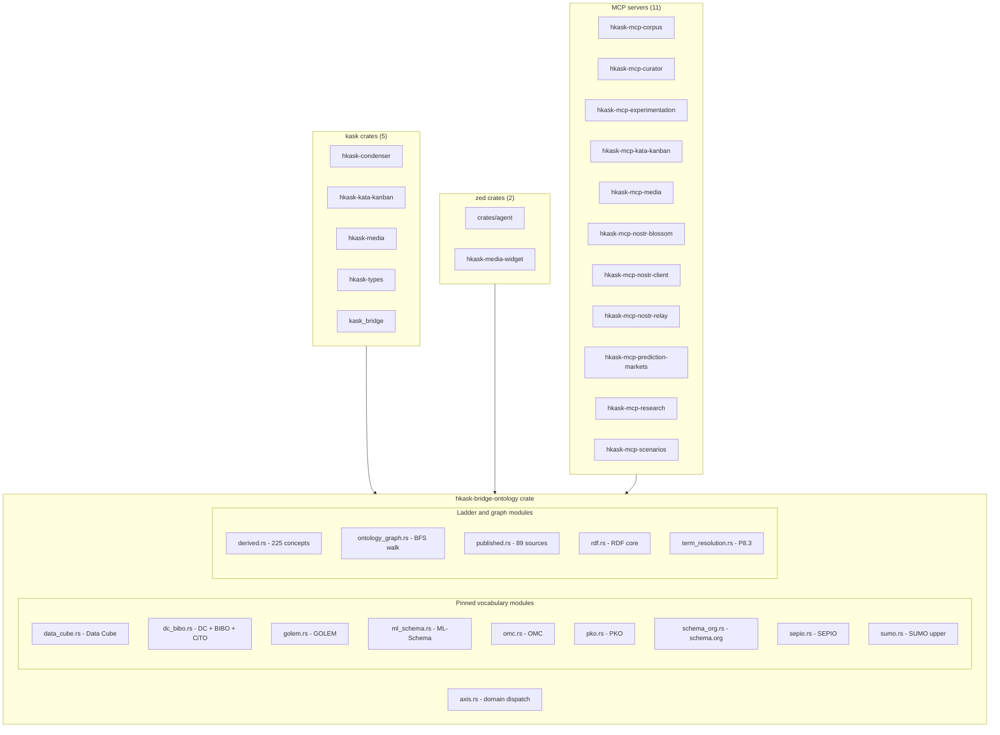
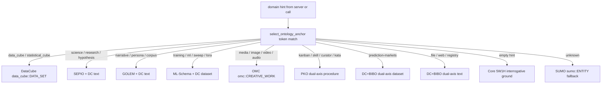
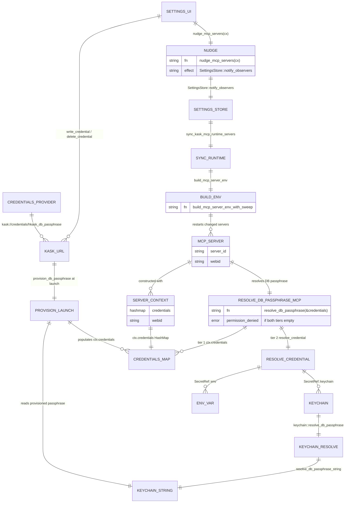
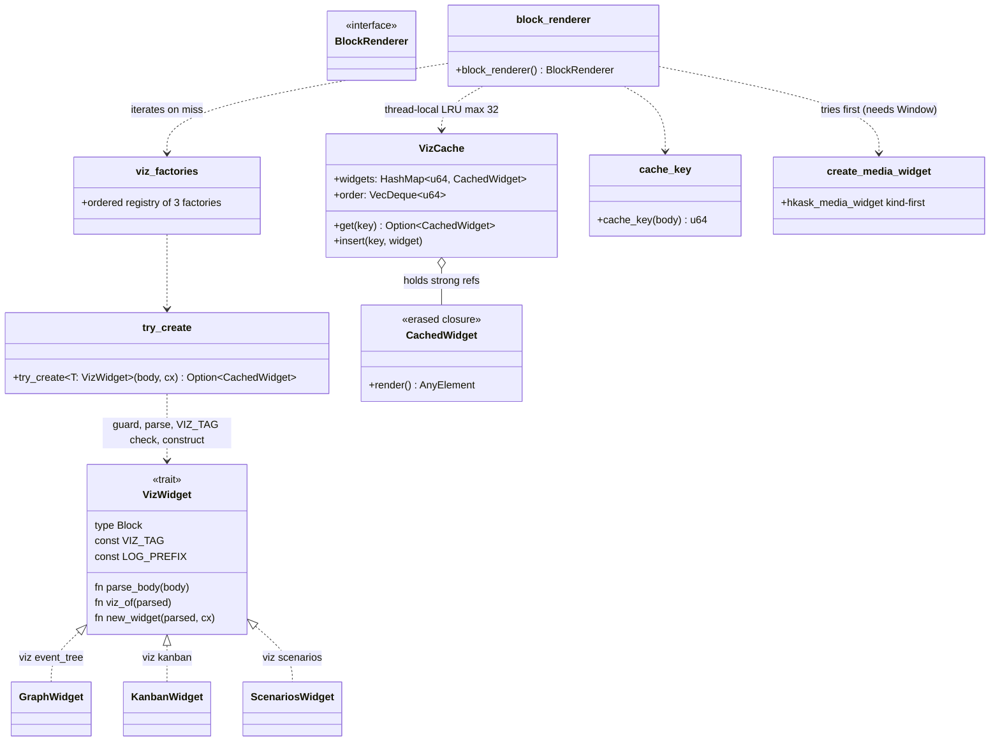
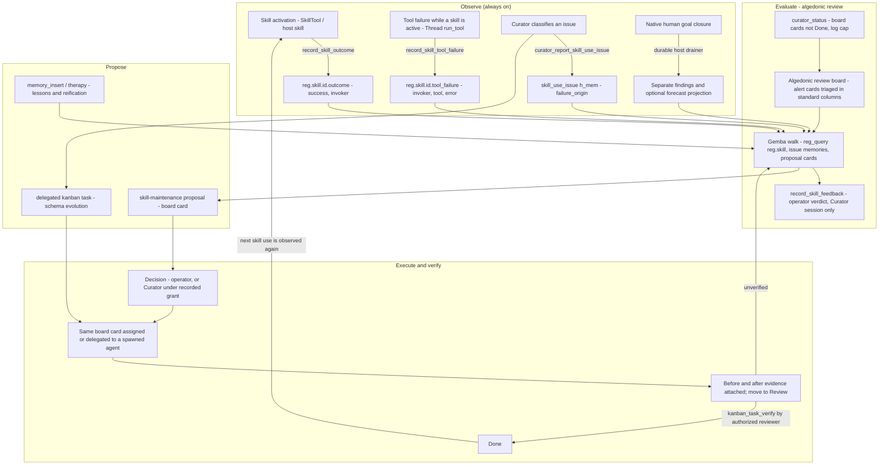

# hKask Architecture Diagrams

Consolidated reference-quadrant architecture diagrams. Each section folds a
former standalone diagram file; unique `DIAGRAM_ALIGNMENT` IDs are preserved
from the originals. Every diagram was re-verified against current code on
2026-09-28; regenerated diagrams carry a note naming what drifted.

## Ontology Bridge

The ontology bridge is a single shared crate (`hkask-bridge-ontology`) that
owns all ontology vocabulary and the domain-selection logic. No ontology
vocabulary lives inside any MCP server; every crate that does tagging or
anchoring depends on this crate.

**Regenerated (2026-11-18):** the crate is organized around the P8.3
ladder — `data_cube.rs` (RDF Data Cube), `derived.rs` (225 `DerivedConcept` entries),
`ontology_graph.rs`, `published.rs` (89 pinned sources in `sources/SOURCES.lock`), `rdf.rs`, `schema_org.rs`,
and `term_resolution.rs` (`kask/crates/hkask-bridge-ontology/src/hkask_bridge_ontology.rs:94-112` —
15 `pub mod` entries). The dependent set now spans **18 crates**: 5 `kask/crates/` (`hkask-condenser`, `hkask-kata-kanban`, `hkask-media`, `hkask-types`, `kask_bridge`), 2 Zed-side crates (`crates/agent`, `crates/hkask-media-widget`), and all 11 built-in MCP servers.



<!-- DIAGRAM_ALIGNMENT
id: DIAG-ONT-001
verified_date: 2026-11-18
verified_against: kask/crates/hkask-bridge-ontology/src/hkask_bridge_ontology.rs:94-112; kask/crates/hkask-condenser/Cargo.toml:14; kask/crates/hkask-kata-kanban/Cargo.toml:16; kask/crates/hkask-media/Cargo.toml:13; kask/crates/hkask-types/Cargo.toml:20; kask/crates/kask_bridge/Cargo.toml:19; crates/agent/Cargo.toml:50; crates/hkask-media-widget/Cargo.toml:31; kask/scripts/build/mcp-servers.txt
status: VERIFIED
-->

### The dual-axis / domain-supplement dispatch

`select_ontology_anchor` matches the domain hint by keyword token (exact,
prefix, or `_`/space-delimited token — no substring false positives) and
returns a `DualAxis` anchor (DC+BIBO or PKO), a `DomainSupplement` anchor
(DataCube, SEPIO, GOLEM, ML-Schema, OMC), the `Core` interrogative
ground for an empty hint, or SUMO for unknown domains.

**Regenerated (2026-10-18):** the FIBO branch is gone with the FIBO rung
(operator ruling — the platform is a general co-researcher); financial
domain hints now fall through to the generalist rungs like any other
unknown domain. Earlier: the SDMX anchor is gone — only explicitly
cube-shaped output (`data_cube` / `data-cube` / `statistical_cube`) takes
the RDF Data Cube anchor, and other statistics fall through to SUMO; an OMC
branch (media tool-name tokens) was added; prediction markets route to
DC+BIBO (a market is a general entity, not a financial instrument);
`wallet` was dropped from the
file/web/registry arm (operator decision 2026-08-29, pinned in `axis.rs`
tests).



<!-- DIAGRAM_ALIGNMENT
id: DIAG-ONT-002
verified_date: 2026-11-18
verified_against: kask/crates/hkask-bridge-ontology/src/axis.rs:207-381
status: VERIFIED
-->

## Skill ↔ MCP ↔ Lisp Capabilities Seam

The three coupled surfaces: the **skill system** (D1, upstream-Zed body
injection), the **MCP server wiring** (D3), and the **Lisp capabilities
layer** (the `lisp_eval` tool's deterministic primitive). Native background
input decoding/evaluation uses one cooperative cancellation flag, mandatory
teardown and cleanup join, with publication/weak pending-owner guards. Raw/pure
APIs are unchanged; titles read form only and copying/display stay foreground.
[Document bounds and nonpreemptible phases](../reference/lisp-eval-dialect.md#numeric-admission-and-limits)
are not hard time/heap/concurrency guarantees. No host/IPC lisp path exists —
native decode/evaluation runs in-process. H8
direct/routed corpus queries share one body: only Lisp options are offloaded and
observe request-context cancellation, leaving downstream inference/retrieval/generation
alone. Explicit rmcp cancel reaches the worker; plain EOF does not immediately
signal it (tested context cancellation follows service-owner teardown after drain).
There is no immediate disconnect or service-shutdown-worker-join promise.
H4C measurements remain deferred; H6 native Stop validation was not performed;
installed live build `1c247be309` predates H7/H8. No new runtime, service,
dependency, cache or configuration. The diagram's native background path does not
imply native cleanup-join semantics for either Tokio adapter.

**Correction (2026-09-28):** the widget→agent compose-back seam (D21) was
retired with commit `fa95c2b8c7` — the `hkask-conversation-injector` crate
and the "I disagree" affordances are deleted. The surviving widget dispatch
path is direct tool dispatch through `hkask_tool_invoker::ToolInvoker` (no
conversation injection).


<!-- DIAGRAM_ALIGNMENT
id: DIAG-ARCH-SKILL-MCP-LISP-001
verified_date: 2026-11-18
verified_against: crates/agent/src/tools/skill_tool.rs; crates/agent_skills/agent_skills.rs; crates/agent/src/tools/lisp_eval_tool.rs; crates/agent/src/tools/render_template_tool.rs; crates/agent/src/thread.rs; crates/agent/src/tools/list_mcp_tools_tool.rs; kask/crates/hkask-lisp/src/hkask_lisp.rs; kask/crates/hkask-mcp/src/tool_port.rs; kask/crates/hkask-mcp/src/runtime.rs; kask/crates/hkask-regulation/src/energy.rs; kask/crates/hkask-types/src/tool_response.rs; kask/crates/kask_bridge/src/mcp_servers/catalog.rs:26-424
status: VERIFIED
-->

The two dispatch paths into `ToolPort::invoke`:

| Caller | Entry point | Action | Resolves to |
| --- | --- | --- | --- |
| Agent tool-use loop (LLM-decided) | `Thread::enabled_tools` (profile + delegation filters, D44 — no per-turn router; a small local model gets six file tools and no MCP tools, D107) | LLM emits a tool_use event | `ToolPort::invoke` under the agent's `WebID` |
| Widget direct dispatch | `hkask_tool_invoker::ToolInvoker` impls | UI gesture (kanban move, scenarios rung) | `ToolPort::invoke` under the `kask-panel` persona |

Both share the same metering (`CallCapManager::charge_metered`), the same
`reg.tool.*` span emission, and the same `unwrap_tool_envelope` result seam.
The only pre-dispatch refusal is `ToolPortError::EnergyBudgetExceeded` (the
runaway-loop breaker). The model decides every tool call; skills do not
dispatch MCP tools deterministically.

The 11 on-disk MCP servers are enumerated by `BUILT_IN_MCP_SERVERS` in
`kask/crates/kask_bridge/src/mcp_servers/catalog.rs:26-424@BUILT_IN_MCP_SERVERS`: `corpus`,
`curator`, `experimentation`, `kata-kanban`, `research`, `scenarios`,
`prediction-markets`, `media`, `nostr-relay`, `nostr-client`, `nostr-blossom`.

## Credential Resolution Chain

API keys are stored in zed's `CredentialsProvider` keychain — one key,
one location: data-service keys under `kask://credentials/<key>`,
inference-provider keys at their provider `api_url` slots.
`build_mcp_server_env` reads both slot kinds and injects as env vars into
MCP server child processes. The server's `resolve_credential` reads API
keys from env only — there is no keychain fallback for API keys.
`HKASK_DB_PASSPHRASE` resolves via the canonical 2-tier helper
(ctx.credentials → env → `kask://credentials/hkask_db_passphrase`) —
one passphrase covers every SQLCipher DB.
Writes/deletes to any credential URL that feeds MCP server env must call
`nudge_mcp_servers` to re-fire the `SettingsStore` observer and restart
changed servers. Verified current 2026-08-31.



<!-- DIAGRAM_ALIGNMENT
id: DIAG-ERD-CREDENTIAL-RESOLUTION-001
verified_date: 2026-11-18
verified_against: kask/crates/hkask-mcp-server/src/server/credentials.rs; kask/crates/hkask-mcp-server/src/server/context.rs; kask/crates/hkask-keystore/src/keychain.rs; kask/crates/kask_bridge/src/identity.rs; kask/crates/kask_bridge/src/mcp_servers/env.rs:93; crates/settings_ui/src/pages/kask_page.rs:328
status: VERIFIED
-->

The 2-tier chain: `hkask_mcp_server::server::resolve_db_passphrase(&credentials)`
returns `McpToolError::permission_denied` naming the env var and keychain URL
when both tiers are empty — a missing credential is an authorization failure,
not a transient unavailability. `provision_db_passphrase`
(`kask/crates/kask_bridge/src/identity.rs:132`) is idempotent (env override →
existing keychain entry → default `"allostery"`) and runs at governed MCP
server launch (`kask/crates/kask_bridge/src/mcp_servers/env.rs:93@build_mcp_server_env_with_sweep`); a failed
provision logs a `tracing::warn!` naming the env var and the server fails
with `permission_denied` at tool time.

## hKask Tool Port

The `ToolPort` dispatch seam lives in `hkask-mcp/src/tool_port.rs` (folded there
from the deleted `hkask-tool-port` crate on 2026-11-07, commit `9b6b648a20`) —
no tokens, no authorization check, no information-flow labels (the per-call
capability gate and the FIDES taint lattice were removed 2026-08-12).
`McpRuntime::invoke` meters the call and dispatches it; the only pre-dispatch
refusal is the runaway-loop breaker. Verified current 2026-11-13.

```mermaid
classDiagram
    class ToolPort {
        <<interface>>
        +invoke(server, tool, args, agent) ToolFuture
    }

    class ToolInfo {
        +name: String
        +description: String
        +input_schema: Value
    }

    class ToolPortError {
        <<enumeration>>
        +EnergyBudgetExceeded(String)
        +NotFound(NotFound)
        +Unavailable(String)
        +Interrupted(String)
        +InvocationFailed {detail, kind}
        +is_retryable() bool
    }

    class McpRuntime {
        -entries: HashMap
        -governance: Option
        +with_governance(cybernetics, sink) McpRuntime
        +start_server_with_env(server, command, env)
        +stop_server(server)
        +tool_surface_changes()
        +get_tool_info(server, tool) Option~ToolInfo~
    }

    class CallCapManager {
        +charge_metered(agent) CallMeterOutcome
    }

    class CallMeterOutcome {
        <<enumeration>>
        Charged
        AutoRegistered
        CeilingReached
    }

    ToolPort ..> ToolPortError : returns
    McpRuntime ..|> ToolPort : implements
    McpRuntime ..> ToolInfo : inherent get_tool_info returns
    McpRuntime ..> CallCapManager : charges via CyberneticsLoop
    CallCapManager ..> CallMeterOutcome : returns
```

<!-- DIAGRAM_ALIGNMENT
id: DIAG-CAP-001
verified_date: 2026-11-13
verified_against: kask/crates/hkask-mcp/src/tool_port.rs (ToolPort trait L120 — invoke only; ToolInfo L142; ToolPortError variants L29-78, is_retryable L80); kask/crates/hkask-mcp/src/runtime.rs (impl ToolPort for McpRuntime L1500, inherent get_tool_info L1463); kask/crates/hkask-regulation/src/energy.rs (CallMeterOutcome L30-40, DEFAULT_RUNAWAY_CALL_CEILING L26)
status: VERIFIED
-->

Authority lives outside this crate: the parent-held delegation grant
(`kask.mcp.delegated_tools` → `delegation_grants.rs`) intersected with the
request's tool narrowing at the inference IPC `create_worktree_thread`
dispatch, and the per-server MCP env/credential allowlists. `invoke`'s
`agent: WebID` is an
accounting identity, not a credential.

## hKask Event Store

The `hkask-event-store` crate was removed 2026-10-31 with the rollout-impact
pathway (operator ruling, completing the D33 swarm retirement): its only
production consumer was the swarm-era rollout regression monitor wired via
`kask_bridge/src/rollout_event_bridge.rs`, and both the monitor and the
swarm server that wrote `mcp/swarm/events.db` were already gone. The
`hkask-regulation` event-source contract was removed in the same pass.

## hKask Viz-Core

`hkask-viz-core` is the D18 composition root for the viz widgets. It
composes every widget into one `BlockRenderer` callback and caches widget
entities by a hash of the block body so state survives the per-token
re-renders of the streaming chat.

**Corrections (2026-08-28, updated 2026-10-28):** the per-widget `create_*`
factory functions were replaced by a `VizWidget` trait (`VIZ_TAG` /
`LOG_PREFIX` / `parse_body` / `viz_of` / `new_widget`) with a shared
`try_create` guard and an ordered `viz_factories()` registry — now of **three**
widgets (graph, kanban, scenarios; the portfolio and spreadsheet widgets
were removed with their capabilities 2026-10-15, and the swarm widget with
the swarm capability 2026-10-28).
`block_renderer` tries the media widget
(`hkask_media_widget::create_media_widget`, discriminates on `kind`, needs
`Window`) first, then the registered viz widgets (discriminate on `viz`).
`CachedWidget` is a single erased render closure (replacing the former
per-variant enum).



<!-- DIAGRAM_ALIGNMENT
id: DIAG-VIZ-CORE
verified_date: 2026-11-18
verified_against: crates/hkask-viz-core/src/hkask_viz_core.rs; crates/hkask-media-widget/src/hkask_media_widget.rs; crates/agent_ui/src/conversation_view.rs
status: VERIFIED
-->

**Selection order** (intentional): media (`kind`) first, then graph
(`viz: "event_tree"`), kanban (`viz: "kanban"`), scenarios
(`viz: "scenarios"`). The viz
tags are disjoint, so factory order is arbitrary. A body claimed by none
returns `None` and falls through to the default code-block renderer.

**Wiring seam:** `crates/agent_ui/src/conversation_view.rs` —
`render_agent_markdown` calls `.media_block_renderer(hkask_viz_core::block_renderer())`.

## Skill Learning Loop

How the agent and the Curator turn skill and tool use into durable
improvements. It is a cybernetic feedback loop (`onto_anchor` → derived
`cybernetic_feedback_loop`: sense → compare against a set point → act → the
effect is sensed again). The **algedonic review** is the one evaluation
mechanism; its second half, the **gemba walk**, is where skills are evaluated
and proposals decided. Evaluation is separated from execution (operator ruling
2026-09-24, Goodhart's law): executing sessions record and propose, but only
the review records verdicts and accepts changes.

Operator rulings 2026-09-26: capture is always on and covers every agent's
skill use; proposal authority is the operator's by default and may be granted
to the Curator; accepted work is executed by a spawned agent with clear
instructions; nothing is done until verified unless the operator or Curator
explicitly skips verification.



<!-- DIAGRAM_ALIGNMENT
id: DIAG-ARCH-LEARNING-LOOP-001
verified_date: 2026-11-26
verified_against: crates/agent/src/tools/skill_tool.rs; crates/agent/src/agent.rs; crates/agent/src/thread.rs; crates/agent/src/kask_thread_state.rs; crates/zed/src/main.rs; kask/crates/kask_bridge/src/memory/curator_stores.rs; kask/mcp-servers/hkask-mcp-curator/src/hkask_mcp_curator.rs; kask/crates/hkask-regulation/src/cybernetics_loop/directive.rs; kask/crates/hkask-regulation/src/metacognition.rs; crates/agent/src/curator_agent_server.rs
status: VERIFIED
-->

| Stage | Surface | Record | Who acts |
|-------|---------|--------|----------|
| Observe | `SkillTool` / `activate_delegated_skill` | `reg.skill.<id>.outcome` with `invoker` (`Curator`, `Zed Agent`, `delegated`) | automatic |
| Observe | `Thread::run_tool` (active skill set) | `reg.skill.<id>.tool_failure` — unclassified evidence | automatic |
| Observe | `curator_report_skill_use_issue` | `skill_use_issue:<skill>` h_mem with `failure_origin` | Curator, unprompted |
| Observe | native `kanban_goal_close` | Retained human choice, blinded findings and optional forecast projection (D58) | human ActionChoice; host drainer |
| Evaluate | `algedonic-review` (triage, then gemba walk) | one Algedonic review board + `reg.skill.<id>.operator_feedback` | operator with Curator |
| Propose | `skill-maintenance`, delegated kanban task (schema evolution), `memory_insert` / `therapy` | proposal card, kanban task, curator memory | Curator / agent |
| Execute | same card assigned or delegated to a spawned agent | card comments and deliverables | delegated agent |
| Verify | `kanban_task_verify` in Review | evidence on card, then Done; unverified stays open | operator or Curator under recorded grant |

The review is started by the operator, or by the Curator when `curator_status`
shows escalations awaiting review or algedonic-log cap pressure. There is no
separate trigger: new records wait for the next review.

## See also

- [Kanban diagrams](./kanban.md) — task status lifecycle, move controller
- [UI widget diagrams](./ui-widgets.md) — per-widget class diagrams
- [MCP dispatch diagrams](./mcp-dispatch.md) — invoke path, tool-call sequence, CMP tool flow
- [Ontology Bridge Reference](../reference/ontology-bridge.md) — the API reference for the crate
