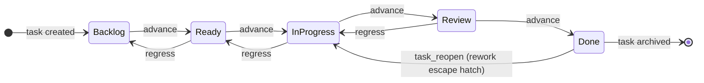
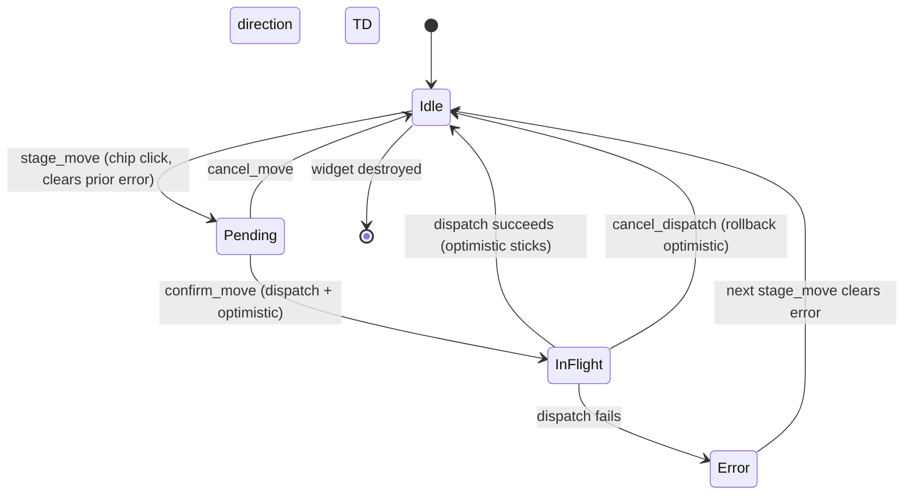
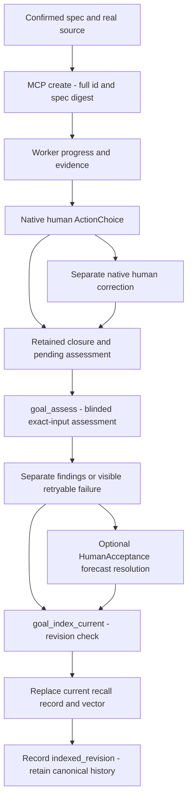

# Kanban Diagrams

Consolidated state diagrams for the kanban system: the task-status wire
lifecycle shared by the `hkask-mcp-kata-kanban` MCP server and the
`hkask-kanban-widget` GPUI view, the widget's move-dispatch state
machine, and the functional-goal lifecycle — the platform's core
improvement loop. Unique `DIAGRAM_ALIGNMENT` IDs are preserved from the
originals.

## Task Status Lifecycle

`TaskStatus` (`kask/crates/hkask-types/src/kanban_status.rs`) is the single
source of truth for the five standard kanban task-status wire strings. Both
the `hkask-mcp-kata-kanban` MCP server and the `hkask-kanban-widget` GPUI
view import it, so the wire strings and transition rules cannot drift
between them.

Column ordering is strict: a move must go to an adjacent column in the
board's configured order (`Board::can_transition`, enforced by
`KanbanService::task_move`). Skipping columns is prohibited. The
one exception is `KanbanService::task_reopen`, which moves Done→InProgress
directly (skipping Review) as an explicit rework escape hatch — the only
sanctioned multi-step transition.

<!-- DIAGRAM_ALIGNMENT
id: DIAG-STATE-TASK-STATUS
verified_date: 2026-09-28
verified_against: kask/crates/hkask-types/src/kanban_status.rs (TaskStatus L24 — Backlog/Ready/InProgress/Review/Done); kask/mcp-servers/hkask-mcp-kata-kanban/src/kanban/types/board.rs (can_transition L51); kask/mcp-servers/hkask-mcp-kata-kanban/src/kanban/service_impl/service.rs (task_move L584, task_reopen L890; these two service edges rechecked 2026-10-20)
status: VERIFIED
-->

## Kanban Move Controller

`KanbanMoveController` (`crates/hkask-kanban-widget/src/move_controller.rs`)
owns the kanban move dispatch state machine. The widget delegates move
lifecycle calls to it and renders the dispatch-status banner by reading
controller state via accessors (`pending_move`, `dispatch_in_flight`,
`dispatch_error`). The controller is a pure state machine — it does not
render.

The lifecycle is: `stage_move` (user clicks a move chip) stages a pending
move — clearing any prior dispatch error — and shows a Confirm/Cancel banner.
`confirm_move` takes the pending move and dispatches it via `shared_tool_invoker()`
(metered against the panel persona's call ceiling; not capability-gated),
applying an optimistic local mutation first. `cancel_move` drops the pending
move without dispatch. `cancel_dispatch` rolls back the optimistic move if the
dispatch is still in flight. Verified current.

**Regenerated (2026-09-28):** the `evaluate_move` transition (compose an
evaluation request and inject it into the active conversation) was removed
with the conversation-injector compose-back seam (commit `fa95c2b8c7`, D21
retirement) — the Pending→Idle evaluate path no longer exists, and the
error banner is a passive label cleared only by the next `stage_move`.

<!-- DIAGRAM_ALIGNMENT
id: DIAG-STATE-KANBAN-MOVE
verified_date: 2026-09-28
verified_against: crates/hkask-kanban-widget/src/move_controller.rs (dispatch_in_flight L62, optimistic_move L69, dispatch_error L73, pending_move L77, accessors L99-122, stage_move L124, confirm_move L145, cancel_move L160, dispatch_move L174, cancel_dispatch L254); crates/hkask-kanban-widget/src/view.rs (KanbanWidget L100, render_dispatch_status L233, dispatch_error banner L317); evaluate_move removed with the D21 conversation-injector seam (commit fa95c2b8c7) — no evaluate path remains in crates/hkask-kanban-widget/src/
status: VERIFIED
-->

## Goal Lifecycle

[GOAL_INTERFACE.md](../../mcp-servers/hkask-mcp-kata-kanban/GOAL_INTERFACE.md)
is the contract for consent, evidence bounds and recovery. Task Done is not
human acceptance; the host administers assessment, optional human-outcome forecast
scoring and one current recall record without deleting canonical history.

<!-- DIAGRAM_ALIGNMENT
id: DIAG-STATE-GOAL-LIFECYCLE
verified_date: 2026-10-20
verified_against: kask/mcp-servers/hkask-mcp-kata-kanban/GOAL_INTERFACE.md; crates/agent/src/tools/goal_tools.rs; kask/crates/kask_bridge/src/goals.rs
status: SOURCE_INSPECTED - diagram is not a live editor deployment receipt
-->
## See also

- [UI widget diagrams](./ui-widgets.md) — the `KanbanWidget` class diagram
- [Architecture diagrams](./architecture.md) — the tool-port metering the move dispatch flows through
