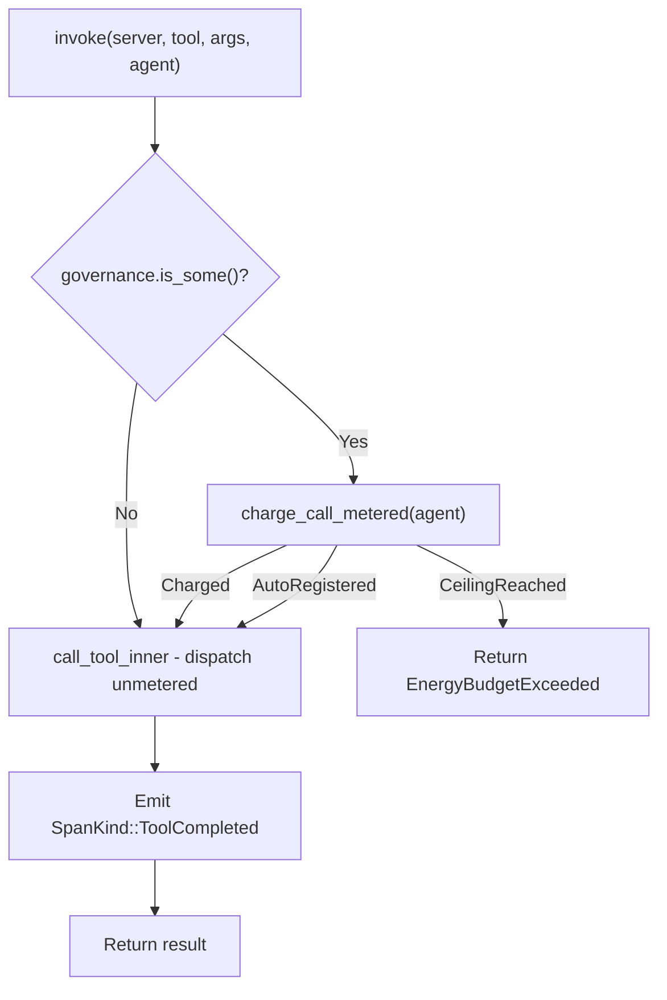
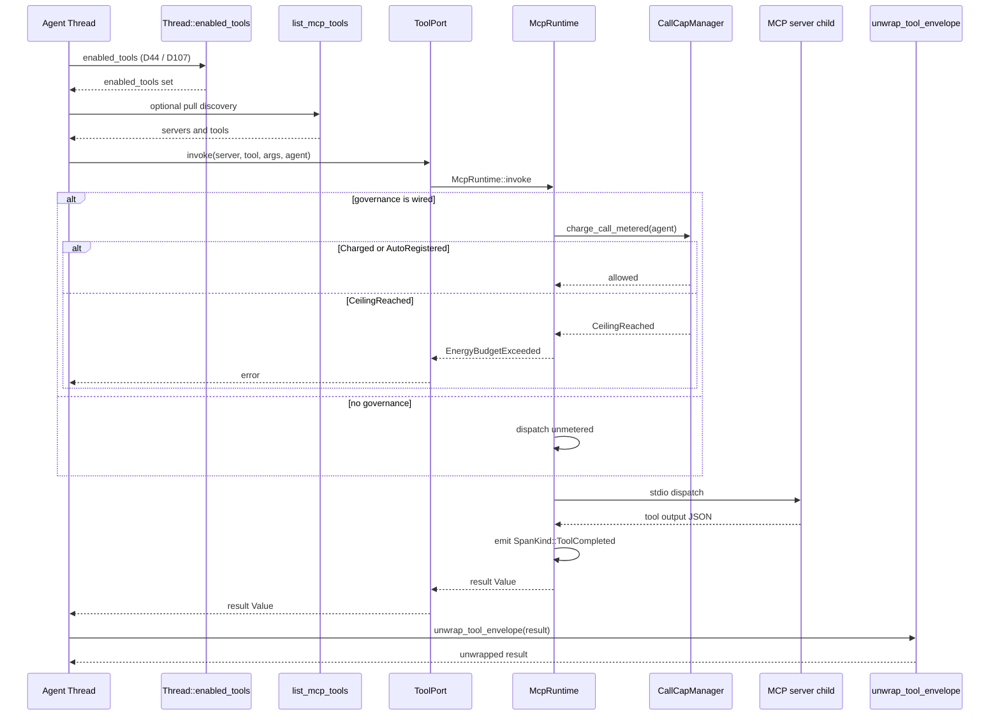

# MCP Dispatch Diagrams

Consolidated diagrams for the MCP dispatch path: the `McpRuntime::invoke`
metering flow, the end-to-end tool-call sequence from the agent's tool-use
loop, and the CMP research tool-call flow across servers. Unique
`DIAGRAM_ALIGNMENT` IDs are preserved from the originals.

## MCP Runtime Invoke — Metering and Dispatch Flow

**`invoke` does not authorize.** It charges one call against the agent's
per-tick runaway ceiling, dispatches, and emits the outcome span. The only
pre-dispatch refusal is an exhausted ceiling. Verified current (unchanged
since the 2026-08-12 capability-gate removal and fail-open breaker correction).

<!-- DIAGRAM_ALIGNMENT
id: DIAG-CAP-002
verified_date: 2026-11-18
verified_against: kask/crates/hkask-mcp/src/runtime.rs:1500; kask/crates/hkask-regulation/src/energy.rs:26,30-40
status: VERIFIED
-->

The call meter is fail-open on an *unregistered* agent: it auto-registers at
`DEFAULT_RUNAWAY_CALL_CEILING` (10 000) and logs the wiring gap rather than
refusing — a missing seed is a wiring omission, not an authorization
decision. A runtime with no governance wired dispatches unmetered
rather than failing closed.

Where authority is enforced instead:

- the parent-held delegation grant (`kask.mcp.delegated_tools`, minted at
  `kask/crates/kask_bridge/src/delegation_grants.rs:16`) intersected with the
  request's tool narrowing at the inference IPC `create_worktree_thread`
  dispatch (`kask/crates/kask_bridge/src/inference_ipc_server.rs:954-961`),
  fail-closed on a missing narrowing
- the per-server MCP env/credential allowlists
  (`kask/crates/kask_bridge/src/mcp_servers/catalog.rs:26-424@BUILT_IN_MCP_SERVERS`)

## MCP Tool Call — enabled_tools to McpRuntime::invoke to unwrap_tool_envelope

The full registered MCP surface is presented every turn (D44, 2026-08-30 —
the LazyToolRouter that once pruned it per turn was removed); tools hidden
by the remaining filter layers (profile allowlists, server scope, curator
gating) are named by the system-prompt visibility marker, and the
`list_mcp_tools` meta-tool enumerates the registered surface on demand.
One exception (D107, 2026-11-12): a thread whose model is served by Zed's
Ollama or llama.cpp provider with a context window below 16,384 tokens is
offered no MCP server tools at all, and only six built-in file and search
tools (`read_file`, `edit_file`, `write_file`, `grep`, `find_path`,
`list_directory`). The cut is fixed per model, not selected per turn.
The enabled set reaches `McpRuntime::invoke`, which meters one call against
the agent's per-tick runaway ceiling and dispatches — it does **not**
authorize. The result is unwrapped from its `{"content": value}` envelope
by `unwrap_tool_envelope`. Verified current.

<!-- DIAGRAM_ALIGNMENT
id: DIAG-SEQ-MCP-TOOL-CALL-001
verified_date: 2026-11-18
verified_against: crates/agent/src/thread.rs; crates/agent/src/tools/list_mcp_tools_tool.rs; kask/crates/hkask-mcp/src/tool_port.rs; kask/crates/hkask-mcp/src/runtime.rs:1500; kask/crates/hkask-regulation/src/energy.rs:26,30-40; kask/crates/hkask-types/src/tool_response.rs:61; kask/crates/kask_bridge/src/mcp_servers/catalog.rs:26-424
status: VERIFIED
-->

The full registered surface is presented every turn (D44), tools hidden by the
remaining filter layers (profile allowlists, server scope, curator gating)
are named by the system-prompt visibility marker, and the `list_mcp_tools`
meta-tool lets the model enumerate the registered surface on demand. A small
local model is the exception (D107, above): it gets neither the MCP surface
nor `list_mcp_tools`.

Every MCP tool response is a `{"content": <value>}` envelope.
`unwrap_tool_envelope` (`kask/crates/hkask-types/src/tool_response.rs:61`) is the single
seam that extracts the inner value; the property
`unwrap_tool_envelope({"content": P}) == P` for all JSON payloads `P` is
pinned by proptest in `kask/crates/hkask-types/src/tool_response.rs`.

## See also

- [Architecture diagrams](./architecture.md) — tool port type system, skill/MCP/lisp seam, credential chain
