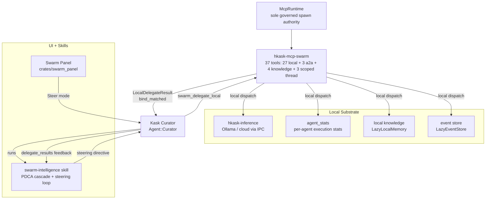
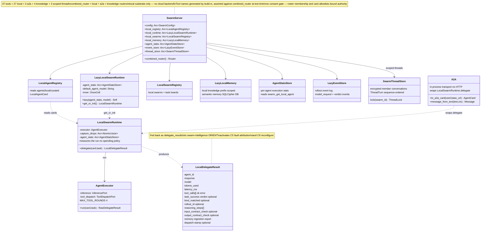
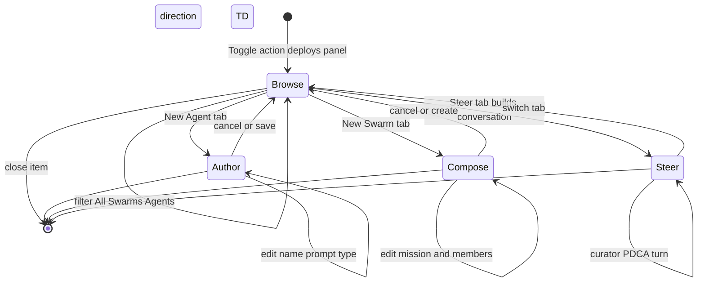
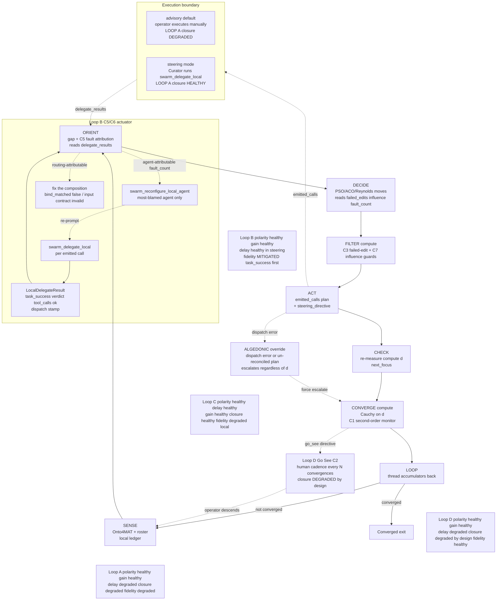
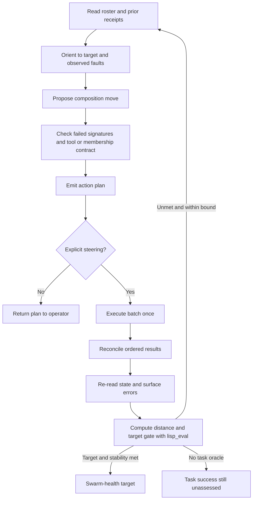

# Swarm Diagrams

Consolidated diagrams for the swarm system: the `hkask-mcp-swarm` server
(architecture + class), the swarm panel modes, the cybernetic feedback-loop
map, the `swarm-intelligence` PDCA cascade, and the steering loop. Unique
`DIAGRAM_ALIGNMENT` IDs are preserved from the originals. On 2026-10-22 the
diagrams were re-verified for the ABW cloud removal (the 48 cloud tools,
consent/spend gates, cloud bridges, and the panel's cloud surfaces all went
together — the server and panel are local-only).

## Swarm MCP Server Architecture

The swarm server (`hkask-mcp-swarm`) exposes **37 tools** across three
routers (local substrate only — no cloud backend). The governed `McpRuntime`
is the sole Kask MCP spawn authority. The agent tool picker reads from that
runtime, not a second per-project `ContextServerStore` child
(`crates/zed/src/main.rs`, the single
spawn authority).

**Current router (2026-10-22):** **37** tools (27 local + 3 A2A
+ 4 knowledge + 3 swarm-scoped thread tools — the 48 cloud tools, their
consent/spend gates, and the four cloud bridges were removed with the ABW
backend, 2026-10-22); the router composition is
`local_router + a2a_router + knowledge_router`
(`hkask_mcp_swarm.rs`) — the former `ledger_router` was removed with
`hkask-ledger` and the local budget system (2026-09-08); `swarm_fleet_digest_local`
was added 2026-09-09 with the fermi absorption (`256f87307c`);
`swarm_select_agent_local` and `swarm_gate_readings` were removed with the
unsupported trust-verdict machinery (2026-10-21, `d3d5cf6`). The tool-name list is generated by `build.rs` from
`pub(crate) async fn swarm_*` signatures and asserted against the live
`combined_router()` surface at test time.



<!-- DIAGRAM_ALIGNMENT
id: DIAG-DIA-SWARM-001
verified_date: 2026-10-22
verified_against: kask/mcp-servers/hkask-mcp-swarm/src/hkask_mcp_swarm.rs (combined_router three-router composition, tool_surface pin asserting 37); crates/zed/src/main.rs (single spawn authority); crates/swarm_panel/src/swarm_panel.rs; .agents/skills/swarm-intelligence/SKILL.md
status: VERIFIED
-->

## Swarm Server Class Diagram

`SwarmServer` composes eight collaborators: the config, the local agent
registry, the lazily-initialized local runtime, the local swarm registry, the
local knowledge memory, the per-agent stats store, the event store, and the
encrypted member-conversation thread store. The
local runtime measures the run (tokens, latency, per-agent stats) — there is
no spending policy on the local substrate: local agents run on the
operator's own substrate, so nothing is priced or gated
(`local_runtime.rs`). The A2A layer wraps the existing `delegate`
in protocol-compliant types over the in-process transport (no HTTP server
required).

**Re-measured (2026-10-22):** the ABW REST client, the consent store, and the
spend-gate module were removed with the ABW cloud backend (2026-10-22 — the
48 cloud tools, consent/session gates, and cloud bridges all went together;
`SwarmConfig` replaces the client as the first construction argument). The
`GateCounterStore` added as a collaborator on 2026-10-10
was earlier removed with the unsupported grounding-gate verdicts (2026-10-21,
`d3d5cf6` — the gate promoted mere tool-call presence to `tool_verified`,
and unrelated or failed tool calls passed it). `LocalDelegateResult` carries the
contract/telemetry fields (`rollout_id`, `reasoning_steps`,
`input_contract_check`, `output_contract_check`, `memory`, `dispatch`)
alongside the C4 `latency_ms` and C5 `task_success`/`bind_matched`
fields — `task_success` is an evaluator's response-match verdict (it
describes the response, not whether the task was accomplished);
`dispatch` is the R6 provenance stamp (`route_reason` + `question_source`,
fermi's `stamp_invocation` port) that splits C6 blame into
routing-attributable vs agent-attributable. The 37-tool pin and the
build.rs-generated `tool_names.gen.rs` asserted against the live
`combined_router()` at test time are unchanged in mechanism.



<!-- DIAGRAM_ALIGNMENT
id: DIAG-DIA-SWARM-006
verified_date: 2026-10-22
verified_against: kask/mcp-servers/hkask-mcp-swarm/src/hkask_mcp_swarm.rs (SwarmServer struct — eight collaborators incl. thread_store, combined_router, 37-tool pin); kask/mcp-servers/hkask-mcp-swarm/src/local_runtime.rs (LazyLocalSwarmRuntime, LocalSwarmRuntime, delegate, LocalDelegateResult — dispatch stamp, no-spending-policy doc); kask/mcp-servers/hkask-mcp-swarm/src/agent_executor.rs (MAX_TOOL_ROUNDS); kask/mcp-servers/hkask-mcp-swarm/src/a2a_tools.rs; kask/mcp-servers/hkask-mcp-swarm/src/local_swarms.rs; kask/mcp-servers/hkask-mcp-swarm/src/local_knowledge.rs; kask/mcp-servers/hkask-mcp-swarm/src/agent_stats.rs; kask/mcp-servers/hkask-mcp-swarm/src/thread_store.rs (SwarmThreadStore, ThreadTurn, lock)
status: VERIFIED
-->

## Swarm Panel Modes

The `SwarmPanel` (`crates/swarm_panel/src/swarm_panel.rs`) has **four**
`PanelMode` states, exposed as a header tab bar. The user can switch freely
between any of them at any time via `set_mode`, which also moves focus to
the target mode's first field.

**Re-measured (2026-10-22):** the panel is local-only. The former `AppAuthor`
mode (App authoring/detail — always cloud) and the App cards/filter were
removed with the ABW cloud backend, along with the per-form `CreateTarget`
cloud/local toggle, the `kask.swarm.mode` observer, and the hire/publish
consent flows. Author creates/edits a local agent card; Compose creates a
local swarm; the destructive actions (delete swarm, remove agent) run
through the `pending_destructive` two-step confirmation with an active-run
warning.



<!-- DIAGRAM_ALIGNMENT
id: DIAG-DIA-SWARM-007
verified_date: 2026-10-22
verified_against: crates/swarm_panel/src/swarm_panel.rs (PanelMode enum — Browse, Author, Compose, Steer; set_mode; select_swarm_for_steer; pending_destructive two-step; Toggle action registration)
status: VERIFIED
-->

## Swarm Feedback Loops — Cybernetic Map

The swarm system runs four coupled feedback loops. **Loop A** (PDCA
convergence) is the planner's inner loop; **Loop B** (C5/C6 steering
execution) closes only when swarm-intelligence's steering loop (the Curator
or a human in steering mode) feeds `delegate_results` back; **Loop C** (execution-error
algedonic) is the strongest — a tool-level dispatch error or an
un-reconciled emitted dispatch
escalates regardless of the swarm-state distance `d` (the "never read as no
deviation" invariant); **Loop D** (Go See) is the intentionally-human outer
meta-loop. The diagram annotates each loop with its 5-property health.



<!-- DIAGRAM_ALIGNMENT
id: DIAG-DIA-SWARM-008
verified_date: 2026-10-22
verified_against: .agents/skills/swarm-intelligence/SKILL.md (ORIENT C5 fault attribution, CHECK/CONV, convergence criterion, delegate_results contract — dispatch stamp + C5/C6 routing-vs-agent blame split); kask/registry/templates/swarm-intelligence/swarm-act.j2 (emitted_calls, steering_directive); kask/registry/templates/swarm-intelligence/swarm-check.j2; kask/mcp-servers/hkask-mcp-swarm/src/local_tools.rs (swarm_execute_plan_local)
status: VERIFIED
-->

## Swarm Intelligence PDCA Cascade

`swarm-intelligence` plans a composition change, not a tool receipt. Advisory
mode returns that plan. Explicit local steering may execute one member-scoped
batch, check the ordered `results` (successes **or** surfaced per-entry
errors), then carry those receipts into CHECK. Dispatch failure and task failure
remain separate. The invoking agent computes distance and the target-plus-
stability gate with `lisp_eval` from observed axes; no registered
registered swarm filter, accumulator, or second-order monitor performs these phases.



<!-- DIAGRAM_ALIGNMENT
id: DIAG-DIA-SWARM-009
verified_date: 2026-10-22
verified_against: .agents/skills/swarm-intelligence/SKILL.md (Steering a local swarm — directive and receipt); kask/mcp-servers/hkask-mcp-swarm/src/local_tools.rs (swarm_execute_plan_local)
status: VERIFIED
-->

## Swarm Steering Loop

Only in explicit steering mode may the Curator execute a plan with
`swarm_execute_plan_local` and feed its checked `results` back to
swarm-intelligence. Advisory mode returns the plan without a dispatch. With `swarm_id`, each roster member reads
preceding committed turns and appends its response to the encrypted member
conversation; the task board separately records progress. Standalone calls
without `swarm_id` do not enter the member conversation. The feedback signal
can include deterministic `task_success` and `tool_calls`; the current
`LocalDelegateResult` does not provide `executed_skills`.

```mermaid
sequenceDiagram
    participant Curator as Kask Curator
    participant SI as swarm-intelligence
    participant Swarm as hkask-mcp-swarm
    participant Thread as Encrypted member conversation
    Curator->>SI: plan for selected swarm
    SI-->>Curator: emitted plan, not executed calls
    alt explicit steering
        Curator->>Swarm: swarm_execute_plan_local with swarm_id and delegations
        loop each submitted delegation in order
            Swarm->>Swarm: check roster membership
            Swarm->>Thread: read prior committed turns
            Thread-->>Swarm: ordered turns
            Swarm->>Swarm: run member or record per-entry error
            Swarm->>Thread: append successful turn only
        end
        Swarm-->>Curator: results array or tool-level error
        Curator->>Curator: reconcile names and order; no replay on uncertain error
        Curator->>SI: re-invoke with checked results as delegate_results
    else advisory
        Curator-->>Curator: present plan; no execution receipt yet
    end
```

<!-- DIAGRAM_ALIGNMENT
id: DIAG-DIA-SWARM-010
verified_date: 2026-10-22
verified_against: kask/mcp-servers/hkask-mcp-swarm/src/local_tools.rs (dispatch_in_thread, swarm_execute_plan_local); kask/mcp-servers/hkask-mcp-swarm/src/thread_store.rs (SwarmThreadStore, ThreadTurn, lock); kask/mcp-servers/hkask-mcp-swarm/src/scoped_dispatch_tests.rs (scoped_plan_broadcast_send_share_history_and_keep_verdict_and_board)
status: VERIFIED
-->

## See also

- [Architecture diagrams](./architecture.md) — tool port, event store, credential chain
- [UI widget diagrams](./ui-widgets.md) — the `SwarmWidget` class diagram
- [Swarm MCP Server Reference](../reference/mcp-servers/swarm.md)
