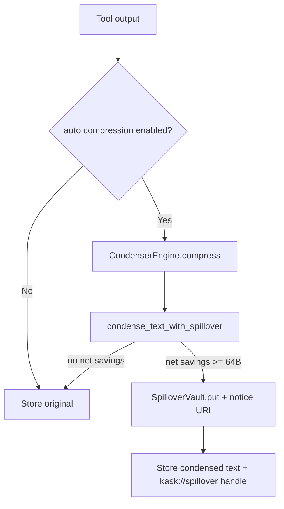

# hkask-condenser — Explanation

`hkask-condenser` is a synchronous domain crate for context condensation
(`cso:data_compression`) and bounded in-memory spillover (`cso:cache_memory`,
`cso:access_control`, `dpv:HashFunctions` / `cso:hash_functions`): it classifies
tool output, applies AST-safe JSON array elision or one of three line-oriented
algorithms under a profile budget and ontology-aware saliency, and provides
`D100`-isolated `BLAKE3` handle retention (`SpilloverVault`). It has no MCP,
HTTP, or async dependency
(`kask/crates/hkask-condenser/src/hkask_condenser.rs:3-7,44-49`).

## One engine, one integration path

The `CondenserEngine` serves one user-visible path:

1. **Incoming tool-result compression.** `compress_tool_result` runs before a
   result is stored only when `auto_compress_tool_results` is enabled
   (`kask/crates/kask_bridge/src/condenser_bridge.rs:42-73`).

Compaction no longer routes through the condenser — see
[Native compaction remains native](#native-compaction-remains-native) below
and `kask/docs/architecture/compaction-pipeline-spec.md`.

<!-- DIAGRAM_ALIGNMENT
id: DIAG-COND-004
verified_date: 2026-11-18
verified_against: kask/crates/kask_bridge/src/condenser_bridge.rs:42-125; kask/crates/hkask-condenser/src/spillover.rs:610-650; crates/agent/src/thread.rs:8875-8947; crates/zed/src/main.rs:2329-2340
status: VERIFIED
-->

Incoming compression preserves user and assistant prose (it never touches
them), and `NO_COMPRESS_TOOLS` exempts source-reading tools at the call site
(`crates/agent/src/thread.rs`). The stored thread is what the condenser
writes; there is no second request-copy path through this package.

## Compression dispatch

`CondenserEngine::compress` uses an explicit `ContextCategory` when supplied,
otherwise derives it with `classify_tool`. An exhaustive match borrows one of
three stateless algorithms as `&dyn CondenserAlgorithm`
(`kask/crates/hkask-condenser/src/engine.rs`, `CondenserEngine::compress`):

- `ShellCommand`, `TestOutput`, `BuildOutput` → `&RtkStyleAlgorithm`.
- `ConversationHistory`, `LogOutput` → `&WordRankAlgorithm`.
- `FileContents`, `StructuredData`, `Unknown` → `&FlashrankAlgorithm`.

The active `Profile` is the engine's only stored state. Before falling back to
line-oriented selection, `CondenserEngine::compress` attempts
`try_compress_structured_json_array` (`kask/crates/hkask-condenser/src/algorithms.rs:845`,
`kask/crates/hkask-condenser/src/engine.rs:48-49`; Priority 2
`exp_a8ceeffd8f6c45bbba76c164ca7302e2`): homogeneous JSON object arrays are
condensed at the AST level so the output remains valid JSON while preserving
head/tail boundaries, numeric extrema, and error/rare-null outliers alongside
`_kask_elided_count` markers. `FlashrankAlgorithm::compress_budgeted`
(`kask/crates/hkask-condenser/src/algorithms.rs:348`) implements incremental
Maximal Marginal Relevance (Carbonell & Goldstein, SIGIR 1998) to balance
relevance, lexical novelty, and brevity without quadratic re-scoring. `Unknown`
is an explicit match alternative, not an algorithm-selection fallback. The
engine derives an ontology anchor, invokes compression through the borrowed
trait object, and calculates the same line and byte metrics. The retained
`CondenserAlgorithm::compress` default body owns the shared line-budget and
passthrough prologue before delegating to each `compress_budgeted`
implementation
(`kask/crates/hkask-condenser/src/algorithms.rs`, `CondenserAlgorithm`).

## D100-isolated BLAKE3 spillover vault

When tool output is condensed at ingestion (`condense_tool_output_with_spillover`,
`crates/agent/src/thread.rs:8875-8909`) or truncated in `TerminalTool`
(`crates/agent/src/tools/terminal_tool.rs`), the unmodified raw output is stored
in the thread-scoped in-memory `SpilloverVault`
(`kask/crates/hkask-condenser/src/spillover.rs:157-164,449-451`; Priority 3
`exp_c710dd80204d43a5b521ec206a6b2e61`) rather than written to `/tmp` files.
Each entry is content-addressed by its 64-hex `BLAKE3` digest
(`kask://spillover/<64-hex>`) under bounded LRU capacity (`128` entries,
`32 MiB` total, `8 MiB` per entry). Compact single-line JSON payloads are
pretty-projected for line-addressable slicing while keeping the raw `BLAKE3`
digest immutable.

Privacy isolation follows a Bell-LaPadula / Goguen-Meseguer `D100`
non-interference lattice (`SpilloverPrivacy::{Public, Private}`,
`kask/crates/hkask-condenser/src/spillover.rs:57-62`): entries inserted under
`Private` provenance are marked `public_seen = false` and return a typed
`SpilloverError::PrivacyBoundary` error if queried from a `Public` turn, while
remaining readable to private turns and inherited subagents (`inherit_from` in
`crates/agent/src/kask_thread_state.rs`). `condense_text_with_spillover`
(`kask/crates/hkask-condenser/src/spillover.rs:610-650`) enforces a strict net
byte-savings guard (`MIN_NET_SAVINGS_BYTES = 64`) so attaching the handle notice
never expands the delivered payload. On thread reload,
`rehydrate_spillover_vault_from_db_messages`
(`crates/agent/src/thread.rs:8911-8947`) calls `SpilloverVault::rehydrate_verified`
(`kask/crates/hkask-condenser/src/spillover.rs:487-491`), admitting persisted
raw tool results only when their `BLAKE3` digest matches the URI. The agent
inspects elided ranges through `read_file` (`crates/agent/src/tools/read_file_tool.rs`)
subject to per-slice line and byte caps (`MAX_SLICE_LINES = 400`,
`MAX_SLICE_BYTES = 32 KiB`).

Profiles set retention and maximum-line budgets: heavy 10%/30, normal 20%/80,
soft 60%/200, and light 95%/unbounded
(`kask/crates/hkask-condenser/src/types.rs:27-78`). These are line budgets, not
a guarantee that a provider token limit will be met. Inputs below
`MIN_COMPRESSIBLE_LINES` (8 lines) pass through uncompressed at every profile:
terminal output arrives fenced, so a one-line command is three lines, and a
retention budget that small elides the payload entirely
(`kask/crates/hkask-condenser/src/algorithms.rs`).

## Native compaction remains native

Compaction no longer routes through the condenser. The deterministic stage is
owned by `kask_compaction::pre_shrink` and runs in-process on the
summarizer's request copy for BOTH manual and automatic compaction:
run-length collapse of repeated lines, then head+tail windowing of any
tool-result text over a budget-derived per-result cap — no protected-tool,
JSON, error, or positional exemptions (windowing cannot corrupt structure
the way the condenser's mid-content ellipsis can, and the stored history
keeps the full text). The condenser package serves ingestion-time
tool-result compression only (`run_tool` + `NO_COMPRESS_TOOLS`). After the
pre-shrink, the compaction path plans against the compaction model's input
capacity, calibrated per thread from the last completed request's reported
input tokens (`kask_compaction.rs::plan_compaction`): a fitting splittable
history splits into two chronological halves; an over-budget history packs
into balanced budget-fitting segments summarized concurrently in batches
of at most 8 and merged chronologically; an indivisible history larger
than the budget is head+tail elided on the summarizer's request copy only
— the stored thread history is never modified. Cancellation, streaming,
usage accounting, and summary persistence remain owned by the native
thread lifecycle. Full specification with diagrams and reference models:
`kask/docs/architecture/compaction-pipeline-spec.md`.

## Protected source-oriented tools

The call site bypasses line elision for source code, searches, listings,
diagnostics, references, code actions, and edits. The exact list is
`NO_COMPRESS_TOOLS` (`crates/agent/src/thread.rs:198-207`). Terminal output is
intentionally eligible because build and test logs are a primary condenser use.
The short-input floor (`MIN_COMPRESSIBLE_LINES`) is the complement of that
decision: eligible output is compressed only when there is enough of it to
tolerate line selection, so a brief command result is never reduced to an
ellipsis.

## Further reading

- [Condenser reference — API surface and tuning procedures](./reference.md)
