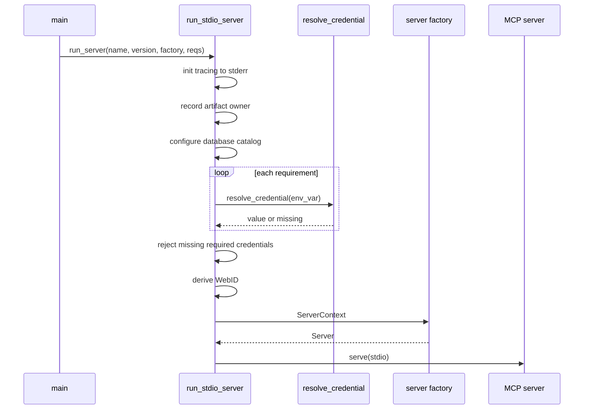

# hkask-mcp-server — Explanation: Why the Framework Is Narrow

`hkask-mcp-server` centralizes construction context, typed tool outcomes, input safety, credential resolution, and stdio bootstrap. It intentionally leaves domain behavior in each MCP server. This keeps the common layer small enough to enforce cross-server invariants without becoming a second application runtime (`kask/crates/hkask-mcp-server/src/hkask_mcp_server.rs:3-11`, `kask/crates/hkask-mcp-server/src/server.rs:22-49`).

## Why construction flows through `ServerContext`

`run_stdio_server` resolves declared credentials and identity before it calls the server factory (`kask/crates/hkask-mcp-server/src/server/transport.rs`, `run_stdio_server`). The factory receives `ServerContext { credentials, webid }` (`kask/crates/hkask-mcp-server/src/server/context.rs`, `ServerContext`). This makes the server's declared dependencies visible and prevents constructors from running before required credentials have been checked.

<!-- DIAGRAM_ALIGNMENT
id: DIAG-MCPSRV-030
verified_date: 2026-09-28
verified_against: kask/crates/hkask-mcp-server/src/hkask_mcp_server.rs:41-54; kask/crates/hkask-mcp-server/src/server/transport.rs (run_stdio_server); kask/crates/hkask-mcp-server/src/server/context.rs (ServerContext)
status: VERIFIED
-->

The boundary is not a claim that no framework code reads environment variables. Bootstrap and credential helpers must read launch configuration (`kask/crates/hkask-mcp-server/src/server/transport.rs:50-60`, `kask/crates/hkask-mcp-server/src/server/transport.rs:91-103`; `kask/crates/hkask-mcp-server/src/server/credentials.rs:25-59`). The design claim is narrower: domain server construction receives resolved dependencies through context rather than independently inventing resolution chains.

## Why `mcp_server!` is a macro

Every server needs a WebID field, a constructor, and a `ToolContext` implementation. `mcp_server!` emits those pieces together, including the optional response-annotation override, so there is no second public macro whose only purpose is to generate one trait impl (`kask/crates/hkask-mcp-server/src/hkask_mcp_server.rs:350-468`). A `macro_rules!` expansion avoids a proc-macro crate and makes the generated shape uniform.

The macro does not register tools or a server globally. Tool discovery remains rmcp's responsibility, and the canonical built-in server registry remains in `kask_bridge` (`kask/crates/hkask-mcp-server/src/hkask_mcp_server.rs:13-17`).

## Why `execute_tool` preserves typed errors

`execute_tool` accepts business logic returning `Result<Value, McpToolError>` and itself returns `Result<String, McpToolError>` (`kask/crates/hkask-mcp-server/src/server/tool_execution.rs:104-149`). Successful values are serialized with `content`, `duration_ms`, and aggregate inference `usage`; errors remain `Err`, so rmcp sets `is_error: true`, emits the human message as text, and puts `{"error", "kind"}` in structured content (`kask/crates/hkask-mcp-server/src/server/error.rs`, `IntoCallToolResult for McpToolError`).

This avoids in-band error sniffing. A client can use protocol error state and the `McpErrorKind` value rather than parse prose. The Model Context Protocol explicitly distinguishes error tool results from successful content.[^mcp]

## Why tool execution has one measured boundary

`execute_tool` owns the work that every successful tool response needs: start-time capture, per-call inference-usage collection, optional server response annotation, and canonical envelope serialization (`kask/crates/hkask-mcp-server/src/server/tool_execution.rs:77-149`). The task-local accumulator is scoped to one invocation, so interleaved calls cannot mix usage. Typed errors bypass success annotation and framing unchanged.

The framework deliberately does not emit a second child-process outcome event. The previous RAII guard wrote `reg.tool` records only to child stderr, which the host logged at debug level and did not ingest into Regulation. Removing it leaves one authoritative feedback path: governed dispatch records `SpanKind::ToolCompleted`, while agent context-server dispatch forwards outcomes through `record_mcp_tool_outcome`. Duration and inference usage remain inspectable in successful result envelopes.

## Why there are two error layers

`McpError` represents server startup and infrastructure failures: missing required credentials, storage, infrastructure, and transport (`kask/crates/hkask-mcp-server/src/server/error.rs`, `McpError`). `McpToolError` represents a completed tool dispatch with a typed `McpErrorKind` and message (`kask/crates/hkask-mcp-server/src/server/error.rs`, `McpToolError`).

The split matches two recovery scopes:

- startup failures are handled by the operator or launcher;
- tool failures are returned to the MCP client, which can react to `not_found`, `invalid_argument`, `permission_denied`, `rate_limited`, `failed_precondition`, `unavailable`, or `internal` (`kask/crates/hkask-mcp-server/src/server/error.rs`, `impl McpToolError`).

Canonical error mappers preserve caller-fixable and transient categories instead of flattening them to `internal` (`kask/crates/hkask-mcp-server/src/server/validation.rs:71-163`).

## Why path and URL safety live in the framework

Caller-controlled files and URLs present the same threat classes in every server. Shared helpers therefore enforce them once:

- path validation rejects control characters and parent traversal (`kask/crates/hkask-mcp-server/src/server/validation.rs:36-69`);
- containment permits reads under the process working directory, hKask data directory, or artifact directory after canonicalization, and confines writes to the running server's own `{server}-mcp/` folder through the artifact owner recorded at bootstrap (`kask/crates/hkask-mcp-server/src/server/validation.rs:258-299,368-381`);
- capped reads check metadata size before reading (`kask/crates/hkask-mcp-server/src/server/validation.rs:778-799`);
- strict URL validation checks syntax and literal addresses, then resolves DNS and checks every result (`kask/crates/hkask-mcp-server/src/security.rs:185-275`, `kask/crates/hkask-mcp-server/src/security.rs:339-353`).

These controls address path traversal, arbitrary file access, resource exhaustion, and server-side request forgery.[^cwe22][^cwe918] Connect-time consumers can pair literal URL validation with `validate_resolved_addresses` to close the DNS resolve-to-connect gap (`kask/crates/hkask-mcp-server/src/security.rs:371-397`).

## Why arbitrary JSON has a dedicated type

The root re-exports `AnyJsonValue` and `find_boolean_schema_positions` from `hkask_types::tool_schema` (`kask/crates/hkask-mcp-server/src/hkask_mcp_server.rs:29-35`). Arbitrary values cross the model boundary as JSON text in a declared string, then decode to structured JSON before handler validation and execution. An unconstrained or open-object schema depends on provider decoding behavior; JSON text removes that dependency without adding provider-specific routing exceptions. Literal strings are encoded as quoted JSON text too, so they cannot be confused with JSON-looking object documents. Native context/environment maps share the codec and retain their object-only requirement. Keeping the codec in `hkask-types` gives native and MCP tools one implementation without depending on the server framework.

## See also

- [Tutorial: build your first MCP server](./tutorial.md)
- [Reference: current API surface and procedures](./reference.md)

---

[^mcp]: Model Context Protocol. (2025). *Tools.* <https://modelcontextprotocol.io/specification/2025-06-18/server/tools>.

[^cwe22]: MITRE. (n.d.). *CWE-22: Improper Limitation of a Pathname to a Restricted Directory.* <https://cwe.mitre.org/data/definitions/22.html>.
[^cwe918]: MITRE. (n.d.). *CWE-918: Server-Side Request Forgery.* <https://cwe.mitre.org/data/definitions/918.html>.
