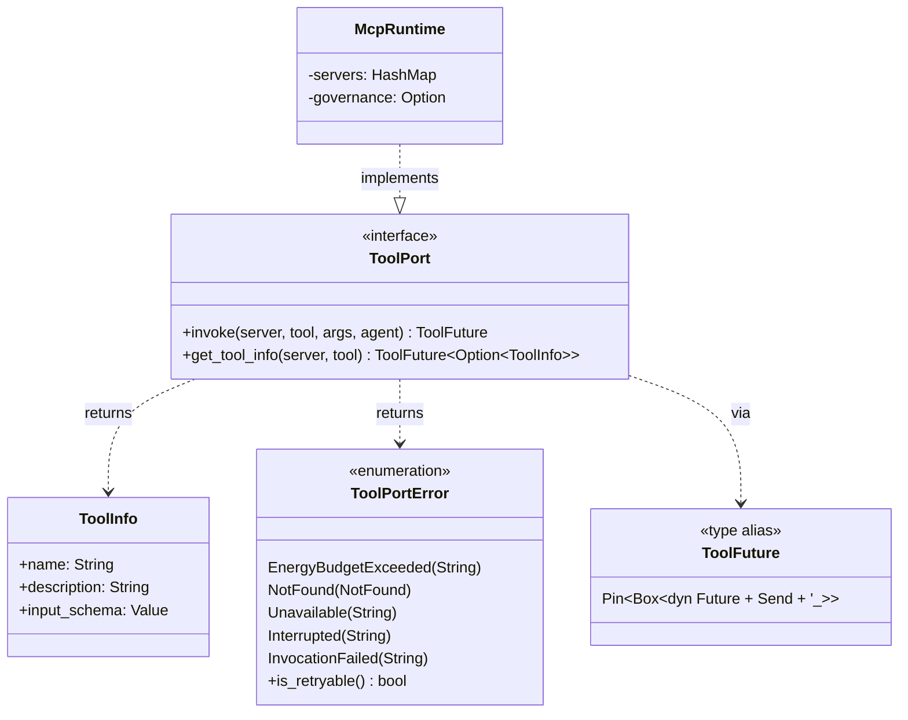
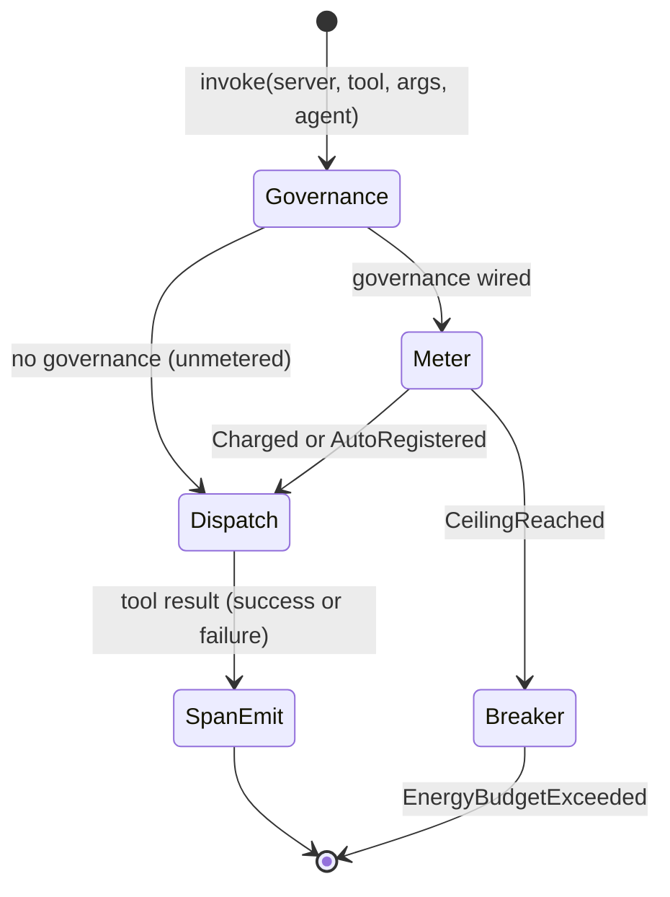
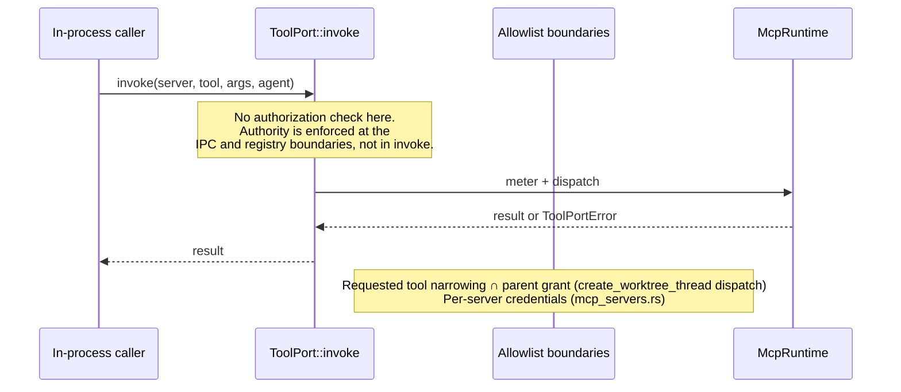

# hkask-tool-port — Reference

`hkask-tool-port` defines the tool dispatch port: the `ToolPort` trait, its
`ToolInfo` metadata, the `ToolFuture` alias, and the `ToolPortError` taxonomy.
That is the entire surface. It contains **no capability tokens, no per-call
authorization check, and no information-flow labels**. Tool authority is
enforced outside this crate, at the allowlist boundaries listed under
[Where authority is enforced](#where-authority-is-enforced).

The port exists to keep tool authority *separated* — to make it structurally
impossible for an agent to reach a tool nobody granted it — without re-checking
that grant on every call. `McpRuntime::invoke` meters the call, dispatches it,
and emits the outcome span; the decision about what an agent may reach is made
earlier, by a list the agent does not write. That is a correction, not a design
preference: the crate once minted a `DelegationToken` per call and checked it
at invoke time, and the check was worthless — every production mint site derived
the token's `resource_id` from the same tool name it passed to `invoke`, so the
comparison was a value against itself
(`kask/crates/hkask-tool-port/src/tool_port.rs:68-83`;
`kask/crates/hkask-mcp/src/runtime.rs`).

## Source citations

| Symbol                       | Location                                                                                       |
| ---------------------------- | ---------------------------------------------------------------------------------------------- |
| `ToolPort` trait             | `kask/crates/hkask-tool-port/src/tool_port.rs:89-116`                                         |
| `ToolPortError` enum         | `kask/crates/hkask-tool-port/src/tool_port.rs:8-38`                                           |
| `ToolPortError::is_retryable`| `kask/crates/hkask-tool-port/src/tool_port.rs:49-53`                                          |
| `ToolFuture` type alias      | `kask/crates/hkask-tool-port/src/tool_port.rs:62`                                             |
| `ToolInfo` struct            | `kask/crates/hkask-tool-port/src/tool_port.rs:118-125`                                        |
| Crate lib root               | `kask/crates/hkask-tool-port/src/hkask_tool_port.rs:1-23`                                     |
| `ToolPort` implementor      | `kask/crates/hkask-mcp/src/runtime.rs` (`impl hkask_tool_port::ToolPort for McpRuntime`) |
| `McpRuntime::invoke` body    | `kask/crates/hkask-mcp/src/runtime.rs`                                               |
| `McpRuntime::with_governance`| `kask/crates/hkask-mcp/src/runtime.rs`                                                     |
| `CallMeterOutcome` enum      | `kask/crates/hkask-regulation/src/energy.rs:30-40`                                             |
| `CallCapManager::charge_metered` | `kask/crates/hkask-regulation/src/energy.rs:176`                                           |
| `DEFAULT_RUNAWAY_CALL_CEILING` | `kask/crates/hkask-regulation/src/energy.rs:26`                                              |
| `CyberneticsLoop::charge_call_metered` | `kask/crates/hkask-regulation/src/cybernetics_loop.rs:675`                          |
| Delegated worktree-tool narrowing ∩ parent grant | `kask/crates/kask_bridge/src/inference_ipc_server.rs:954-961` + `kask/crates/kask_bridge/src/delegation_grants.rs:67` |
| Per-server credential allowlist | `kask/crates/kask_bridge/src/mcp_servers.rs:43` (`BuiltinMcpServer.credentials`)         |


The crate's `src/` directory holds exactly two files: `hkask_tool_port.rs`
(lib root) and `tool_port.rs`.

## Type surface



<!-- DIAGRAM_ALIGNMENT
id: DIAG-CAP-006
verified_date: 2026-09-28
verified_against: kask/crates/hkask-tool-port/src/tool_port.rs:62,89-116,118-125; kask/crates/hkask-tool-port/src/tool_port.rs:8-53; kask/crates/hkask-mcp/src/runtime.rs
status: VERIFIED
-->

## `ToolPort` trait

`ToolPort` is the dispatch boundary for MCP tool invocation. Every method
returns `ToolFuture` (`Pin<Box<dyn Future + Send + '_>>`), so the trait is
object-safe and `Arc<dyn ToolPort>` works — this is why no adapter layer wraps
`McpRuntime` any more (`tool_port.rs:84-88`).

| Method            | Signature                                                                                     |
| ------------------ | --------------------------------------------------------------------------------------------- |
| `invoke`          | `(&self, server: &str, tool: &str, args: Value, agent: WebID) -> Result<Value, ToolPortError>` |
| `get_tool_info`   | `(&self, server: &str, tool: &str) -> Option<ToolInfo>`                                        |

`agent` is the accounting identity for the call meter (`tool_port.rs:90-95`).
`get_tool_info` takes the same server identity `invoke` uses: the lookup is
server-scoped, so tool names are unique per server, never globally
(`tool_port.rs:107-115`).

## `ToolPortError` taxonomy

Five variants and one predicate, `is_retryable`, which is true only for
`Unavailable` — the call provably never reached the tool, so a retry cannot
duplicate a side effect (`tool_port.rs:49-53`).

| Variant                  | Meaning                                                                                       | Retryable |
| ------------------------ | --------------------------------------------------------------------------------------------- | --------- |
| `EnergyBudgetExceeded`   | The runaway-loop breaker tripped: the agent exhausted its per-tick call ceiling.             | No — needs a new regulation tick |
| `NotFound`               | The tool is not registered.                                                                    | No — would fail identically |
| `Unavailable`            | No live connection accepted the request; the tool provably never ran.                         | **Yes** |
| `Interrupted`            | A live peer accepted the request and the connection then dropped. The outcome is unknown.   | No — a retry could duplicate a side effect |
| `InvocationFailed`       | The call reached the tool and the tool failed.                                                | No — repeats the failure |

The `Unavailable` / `Interrupted` split is forced by `rmcp`, which reports both
a failed send and a dropped response channel as the same
`ServiceError::TransportClosed` (`tool_port.rs:26-33`). Once a request has
reached a live peer, a transport loss cannot be read as proof of
non-delivery, so `Interrupted` is never auto-retried at any layer.

## `ToolInfo` struct

Canonical tool metadata (`tool_port.rs:118-125`). Three descriptive fields,
nothing that decides anything: the server identity is the caller's `server`
argument, not a field here.

```rust
pub struct ToolInfo {
    pub name: String,
    pub description: String,
    pub input_schema: serde_json::Value,
}
```

## What `invoke` does

`McpRuntime::invoke` (`kask/crates/hkask-mcp/src/runtime.rs`) performs, in order:

1. **Call metering** — when governance is wired (`with_governance`,
   `kask/crates/hkask-mcp/src/runtime.rs`), charge one call against the agent's per-tick ceiling
   via `CyberneticsLoop::charge_call_metered`
   (`cybernetics_loop.rs:675`), which delegates to
   `CallCapManager::charge_metered` (`energy.rs:176`). Without governance,
   dispatch unmetered (`kask/crates/hkask-mcp/src/runtime.rs`).
2. **Dispatch** — `call_tool_inner` (`kask/crates/hkask-mcp/src/runtime.rs`) checks for a live
   connection, reconnects once if the transport closed, and issues the
   JSON-RPC call.
3. **Span emission** — persist a `SpanKind::ToolCompleted`
   `RegulationRecord` at `CyclePhase::Act` carrying server, tool, call
   count, and success/failure status, through the wired `RegulationSink`
   (`kask/crates/hkask-mcp/src/runtime.rs`), then record the outcome in the
   `RegulationLedger` per-server so the `ToolReliabilitySensor` can sense
   aggregate success rates (`kask/crates/hkask-mcp/src/runtime.rs`).

There is no authorization step. The only way `invoke` returns an error
before dispatch is `EnergyBudgetExceeded` (`kask/crates/hkask-mcp/src/runtime.rs`).



<!-- DIAGRAM_ALIGNMENT
id: DIAG-CAP-004
verified_date: 2026-09-28
verified_against: kask/crates/hkask-mcp/src/runtime.rs (McpRuntime, impl ToolPort for McpRuntime, start_server_with_env, stop_server, tool_surface_changes); kask/crates/hkask-regulation/src/energy.rs:30-40 (CallMeterOutcome)
status: VERIFIED
-->



<!-- DIAGRAM_ALIGNMENT
id: DIAG-CAP-005
verified_date: 2026-10-28
verified_against: kask/crates/hkask-tool-port/src/tool_port.rs:68-83 (invoke does not authorize); kask/crates/kask_bridge/src/inference_ipc_server.rs:954-961 (create_worktree_thread narrowing gate); kask/crates/kask_bridge/src/delegation_grants.rs:16,67 (grant mint + worktree_tools intersection); kask/crates/kask_bridge/src/mcp_servers.rs:43 (credential allowlist)
status: VERIFIED
-->

## Call metering

The meter is a runaway-loop breaker and a usage recorder, not a permission
check. `CallCapManager::charge_metered` (`energy.rs:176`) returns a
`CallMeterOutcome` (`energy.rs:30-40`):

| Outcome                        | Behavior                                                                                    |
| ------------------------------ | ------------------------------------------------------------------------------------------- |
| `Charged` (`energy.rs:32`)     | Headroom remained; the call proceeds.                                                       |
| `AutoRegistered` (`energy.rs:37`) | The agent had no registered ceiling: register at `DEFAULT_RUNAWAY_CALL_CEILING` (10 000, `energy.rs:26`), charge, proceed, and log the wiring gap. |
| `CeilingReached { ceiling }` (`energy.rs:40`) | The per-tick ceiling is exhausted: refuse with `ToolPortError::EnergyBudgetExceeded`. Resets on the next regulation tick. |

Fail-open on an unregistered agent is deliberate: a missing registration is a
composition-root wiring omission, and refusing it fails live paths without
protecting anything (`kask/crates/hkask-mcp/src/runtime.rs` records the incident: the
`kask-panel` and skill execution personas were never seeded, so every IPC and
cascade tool call died at the gate).

## Where authority is enforced

A capability check is only a gate when the authority list is not chosen by the
caller being checked. Two boundaries satisfy that:

| Boundary                                                        | Location                                                       | Note                                        |
| --------------------------------------------------------------- | -------------------------------------------------------------- | ------------------------------------------- |
| Delegated worktree-tool narrowing intersected with the parent-held grant (both fail-closed) | `kask/crates/kask_bridge/src/inference_ipc_server.rs:954-961` `create_worktree_thread` dispatch + `kask/crates/kask_bridge/src/delegation_grants.rs:67` (`worktree_tools`) | The child's request may narrow, never enlarge, the parent's grant (`delegation_grants.rs:16`, minted from `kask.mcp.delegated_tools`, checked at dispatch; a grant without `host/create_worktree_thread` yields no ceiling). A missing narrowing is a protocol violation, never an implicit grant-all; an empty narrowed list deliberately creates an inference-only child. Pinned by `grants_are_stable_until_changed_and_revoked` (`delegation_grants.rs:92`) and `worktree_authority_denies_before_enqueue` (`inference_ipc_server.rs:1697`) |
| Per-server MCP env / credential allowlists                      | `kask/crates/kask_bridge/src/mcp_servers.rs:43`              | Scopes credentials per server (`BuiltinMcpServer.credentials`; `None` means no filtering, `Some(&[])` preferred for new servers) |

There is no third gate. A FIDES `Source`→`Sink` information-flow check used
to be listed here; it was deleted — see
[Information flow](#information-flow-absent-by-decision).

## Information flow: absent by decision

Nothing in this crate or on the invoke path inspects information flow. Defense
**Layer 5 (information flow control) is absent by decision**, recorded in the
same register as Layer 3 (instruction hierarchy): de-advertised rather than
deployed.

The FIDES lattice labelled each tool `Source` / `Sink` / `Pure` / `Endorser`
and blocked `Source → Sink`. It was deleted rather than repaired because the
gate consuming it could not decide anything: every `ToolInfo` was labelled
`Pure` at its only construction site, so the `Sink` arm never matched
(`hkask_tool_port.rs:17-19`). An inert gate is worse than no gate — it invites
reliance on a protection that does not exist.

The machinery must not be re-added in inert form. The bar a real IFC gate must
clear: tools carrying real labels, taint propagated on context write, and a
test showing a `Source → Sink` flow being refused. The same bar applies to any
future trust boundary at this seam: nothing here defends against a hostile
caller already executing inside the process (such a caller can call `invoke`
directly), which is acceptable only because the allowlist gates sit at the IPC
and card boundaries, where the untrusted party actually is. If a genuine
boundary is ever introduced — tokens crossing a process or network edge to an
untrusted verifier — verification must be reintroduced with a **trusted root
key set**, and the change must ship with a test proving that a mismatched
request produced on a path production can actually reach is refused. Do not
re-add a per-call authorization argument to `ToolPort::invoke` without that
proof.


## See also

- [hkask-mcp-server Reference](../hkask-mcp-server/reference.md): server-side
  execution, failure reporting, and applying the port in an MCP server.
- [`kask/docs/architecture/core/PRINCIPLES.md`](../../architecture/core/PRINCIPLES.md):
  P4 (Clear Boundaries) and P4.2 (tool authority is separated, not re-checked
  per call).

---

[^fides-cap]: Microsoft Research. (2025). _FIDES: Information flow control for LLM agents_ (arXiv:2505.23643). The Source/Sink/Pure/Endorser lattice and the Source→Sink endorsement rule. Retained as the academic source for a design this crate no longer implements — the lattice was deleted. Citing it is not a claim that information flow control is deployed.

[^miller-ocap]: Miller, M. S. (2006). _Robust Composition: Towards a Unified Approach to Access Control and Concurrency Control._ Johns Hopkins University. <https://www.erights.org/talks/thesis/markm-thesis.pdf>. The Object Capability model, retained here as the source of the principle that authority must be *separated* by a list the caller cannot choose.