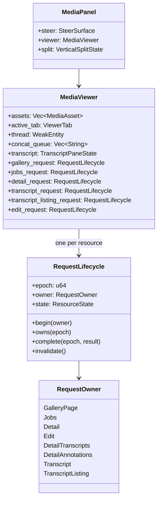

# media_panel — Reference: Media Viewer Interaction Model

The media viewer has five tabs backed by live state — Media, Library, Queue,
Detail, and Transcript (`crates/media_panel/src/media_viewer.rs:315-321`) —
covering selected media, paginated gallery assets, process-local research
jobs, selected-asset detail, and the direct transcript workspace. Each tab
opens with one line of purpose copy (the orientation contract,
`tab_purpose`, 2026-10-27): Media is playback and derivative edits, Library
is browse-and-delete (the listing, never the file), Queue is the async
long-operation path, Detail is the inspector, Transcript is the
workbench. All server calls route through the governed tool invoker to the
`media` server; gallery pages are sized at 100 rows with a one-second queue
poll (`GALLERY_PAGE_LIMIT`/`QUEUE_POLL_INTERVAL`, media_viewer.rs:38-40) and
the transcript recordings list at the server's 500 cap.

## Research-curation scope

The cross-domain Steer conversation drives ingestion, organization, research
annotations, retrieval, transcription, and source-linked excerpt/reel extraction.
Tool advertising derives from the server's generated `TOOL_NAMES`; the approved
integration target is 91 (102 − 20 retired creative tools + 9 annotation/search
tools), not evidence of a running deployment. No creative image/video/TTS models
or generation recipes are offered. Settings → Kask → Media retains STT/vision
only; explicit empty values disable the selected pipeline visibly.

- `gallery_annotation_create` uses stable `gallery_asset_id`, `kind` (`tag` or
  `note`), and `value`. List by asset ID, update with asset/annotation IDs and
  replacement value, delete with both IDs. Positional indices are not identities.
  Since 2026-10-27 the Detail tab exposes this full CRUD directly — the
  Researcher tags & notes section (see "Detail lifecycle").
- `educt_annotation_create` uses `transcript_id`, inclusive immutable-source
  `start_word` / `end_word`, `label`, and `note`; list by transcript ID, update
  with transcript/annotation IDs and all replacement fields, delete with both
  IDs. Supplied observations remain separate from model suggestions and are
  not authenticated human identity or verified evidence.
- `educt_search_transcripts` requires `query` and `mode: "lexical"`. Preserve
  the returned source/transcript IDs, exact excerpts and available timing/
  alignment citations. Search is bounded literal substring matching, not
  semantic retrieval; follow both continuation offsets when `has_more` is true.
  A truncated scan is not an exhaustive absence claim. Corpus export is the
  semantic-search handoff; unavailable timing must remain visible.
- Queue operations are `transcribe`, `audio_trim`, `audio_concat`, `video_clip`,
  and `video_concat`. History is process-local, not durable transcript storage.
  Both the direct transcribe tools and the job path precondition large local
  inputs server-side (speech-track extraction) before provider upload.
- Historical media and lineage remain readable. Face identification requires
  explicit selection. Local educt never silently uploads or falls back to cloud.

Chat remains the agent-mediated surface; the panel's direct-manipulation
surfaces are the Media tab (playback, marks, trim, concat — both media
kinds), the Detail tab (inspection plus annotation CRUD), and the Transcript
tab (browse, synced reading, highlight CRUD, reels). The lifecycles and
security boundaries below govern all five tabs.

## Component and request map



<!-- DIAGRAM_ALIGNMENT
id: DIAG-MEDIA-PANEL-001
verified_date: 2026-10-28
verified_against: crates/media_panel/src/media_panel.rs:101-121 (MediaPanel fields); crates/media_panel/src/media_viewer.rs:46-55 (RequestOwner — eight variants); crates/media_panel/src/media_viewer.rs:222-280 (ResourceState, RequestLifecycle); crates/media_panel/src/media_viewer.rs:323-426 (MediaViewer fields incl. thread, concat_queue, transcript and annotation state, eight request lifecycles)
status: VERIFIED
-->

## Request ownership

Each asynchronous read resource has an independent `RequestLifecycle` with an epoch,
owner, and `Idle | Loading | Ready | Failed` state
(`crates/media_panel/src/media_viewer.rs:46-55,222-280`). `begin` suppresses duplicate
requests for the same loading owner; a newer owner advances the epoch. Callback
handlers mutate state only when they still own that epoch (`apply_gallery_listing`
:905, `apply_jobs_listing` :1062, `apply_detail_result` :1196,
`apply_transcript_result` :1770). This prevents a slow page, job, detail,
annotation, or transcript response from overwriting newer state. Direct edits
are serialized instead: trim, concat, highlight create/rename/delete, strike,
reel compose, and annotation create/replace/disable
while one side effect is active (`begin_edit` rejects overlap at
(`crates/media_panel/src/media_viewer.rs:693`), so no completed operation can
be hidden by a later epoch.

| Resource | Owner key | Latest-response gate | Evidence |
| --- | --- | --- | --- |
| Gallery | requested offset | `gallery_request.owns(epoch)` | `request_gallery_page`/`apply_gallery_listing`, media_viewer.rs:865,899 |
| Jobs | queue resource | `jobs_request.owns(epoch)` | `load_jobs`/`apply_jobs_listing`, :1027,1056 |
| Detail | stable gallery asset ID | `detail_request.owns(epoch)` | `load_detail`/`apply_detail_result`, :1138,1190 |
| Detail transcripts | stable gallery asset ID | `detail_transcripts_request.owns(epoch)` | `load_detail_transcripts`, :1224 |
| Detail annotations | stable gallery asset ID | `detail_annotations_request.owns(epoch)` | `load_detail_annotations`, :1306 |
| Transcript workspace | transcript ID | `transcript_request.owns(epoch)` | `open_transcript`/`apply_transcript_result`, :1691,1764 |
| Recordings listing | listing resource | `transcript_listing_request.owns(epoch)` | `load_transcript_listing`, :1900 |
| Edit | one admitted side-effecting operation | `begin_edit` rejects overlap; `edit_request.owns(epoch)` closes it | :693,701 |

Failures retain last-good data and surface degraded status instead of clearing
the resource: each `apply_*` handler completes its epoch into
`ResourceState::Failed` while leaving the committed rows, queue, detail, or
workspace untouched (the same handlers as above; `resource_status` renders the
the degraded state at :4619, and a transcript reload keeps the last-good
workspace visible rather than flashing the idle browser — `load_transcript_with`
retains the prior state; only an explicit open or the back affordance clears
it, `open_transcript` :1691 / `close_transcript_workspace` :1709).

## Result-derived Library freshness

Published assets, imports, transcript renders, and deletions carry
`gallery_changed: true` only after their durable gallery transition succeeds —
the viewer reads the completed-result field
(`tool_result_changed_gallery`, `crates/media_panel/src/media_viewer.rs:6180`)
inside `ingest_tool_result`
(`crates/media_panel/src/media_viewer.rs:616`). The panel observes that
completed-result field rather than classifying tool names; read-only
`gallery_*` results therefore do not trigger reloads. A mutation-driven or
manual Library reload invalidates an older same-page request before dispatch,
while switching to Library always requests current state. Completed background
jobs carry the same enriched display/mutation result and are ingested exactly
once by stable job identity (`processed_job_results`, a seen-set keyed by job
ID, inside `apply_jobs_listing` :1062).

## Gallery pagination lifecycle

The Library requests 100 rows per page (`GALLERY_PAGE_LIMIT`,
`crates/media_panel/src/media_viewer.rs:39`). A response commits only
when its gallery ID, total, requested offset, positive limit, row count, row
indices, and required asset fields validate (`parse_gallery_listing`,
`crates/media_panel/src/media_viewer.rs:4652`). Failed or superseded page
requests preserve the prior page and cursor (`apply_gallery_listing` :905).

Previous/next navigation uses the server-confirmed page size and total, with
saturating cursor arithmetic
(`crates/media_panel/src/media_viewer.rs:1008,1013). A gallery-root change
removes prior indexed rows, clears pending selection and delete state, and
invalidates detail; a same-gallery refresh reconciles by stable asset source
(`commit_gallery_listing`, `crates/media_panel/src/media_viewer.rs:926`).

```mermaid
stateDiagram-v2
    [*] --> Idle
    Idle --> Loading: request page offset
    Loading --> Loading: newer offset supersedes epoch
    Loading --> Ready: owned response validates and commits
    Loading --> Failed: owned response fails; keep last-good page
    Ready --> Loading: previous, next, or refresh
    Failed --> Loading: retry
```

<!-- DIAGRAM_ALIGNMENT
id: DIAG-MEDIA-PANEL-002
verified_date: 2026-10-28
verified_against: crates/media_panel/src/media_viewer.rs:865-1024 (request, apply, commit, navigation); crates/media_panel/src/media_viewer.rs:4652 (parse_gallery_listing validation)
status: VERIFIED
-->

## Bounded concatenation

Only selected video assets can enter the concat queue. Duplicates are no-ops;
an over-cap addition is rejected without truncating the queue
(`queue_selected_for_concat`, `crates/media_panel/src/media_viewer.rs:760`).
Dispatch requires at least two clips and rechecks the upper bound before
calling `video_concat` (`dispatch_concat`,
`crates/media_panel/src/media_viewer.rs:783`). The shared admission limit is
64 inputs (`MAX_CONCAT_ITEMS`,
`kask/crates/hkask-types/src/media_limits.rs:8`).

## Job lifecycle

The Queue calls `job_list` with the shared default limit of 20
(`DEFAULT_JOB_LIST_LIMIT`, `kask/crates/hkask-types/src/media_limits.rs:16`;
`load_jobs`, `crates/media_panel/src/media_viewer.rs:1027`). Producer and panel
consume one strict `JobListPayload` carrying `jobs`, `total`, `limit`,
`has_more`, `history_scope`, and `restart_behavior`
(`kask/mcp-servers/hkask-mcp-media/src/types.rs:565-572`). Legacy arrays,
incomplete objects, incoherent counts, and unknown statuses surface degradation
while the last-good queue remains visible
(`parse_job_listing`, `crates/media_panel/src/media_viewer.rs:5994`).

While the Queue tab is active and any job remains nonterminal, one GPUI-native
one-second poll task is scheduled (`QUEUE_POLL_INTERVAL`,
`crates/media_panel/src/media_viewer.rs:40`; `should_poll_jobs`/`schedule_queue_poll`
:1114,1118). Polling stops on terminal state, tab change, or failure. Queued
or running jobs can be cancelled through `job_cancel`, followed by a fresh
listing (`cancel_job`, `crates/media_panel/src/media_viewer.rs:2946`). Job
history is process-local, so a server restart may produce an empty ready
queue.

## Detail lifecycle

Detail requests address the selected asset by stable gallery ID, never by its
positional index. Assets not yet indexed surface a remediation message instead
of dispatching (`load_detail`, `crates/media_panel/src/media_viewer.rs:1138`).
Only an owned, object-shaped `gallery_asset_detail` response replaces the
last-good detail; stale and failed responses do not blank it
(`apply_detail_result`, `crates/media_panel/src/media_viewer.rs:1196`). The
renderer exposes image record, tags, lineage, faces when present, linked
transcripts (words/timings per row), reel provenance, and — since 2026-10-27 —
the **Researcher tags & notes** section: the direct annotation CRUD surface
(`render_detail`, `crates/media_panel/src/media_viewer.rs:3590`). The
section lists `gallery_annotation_list` rows under its own request lifecycle
(`load_detail_annotations`, :1306), offers add tag / add note editors
(the label editor's modal input pattern), per-row value replacement through
`gallery_annotation_update` over the stable identity, and delete through
`gallery_annotation_delete` — all under the single edit admission with the
the visible-refusal discipline (`confirm_annotation_edit`, :1490); every completion
reloads the list. The section needs an indexed asset and says why otherwise;
a failed listing surfaces an unavailable note, never silence.

## Transcript surface

The Transcript tab is the direct transcript workspace — no agent turn in the
loop. Its idle state is the recordings browser
(`load_transcript_listing` :1900). Rows lead with a human recording name (a
filename, or “Untitled recording” for generated UUID filenames), duration,
and word count; internal transcript IDs and full paths are not presentation
content. Gated states use plain-language notes
(`transcript_alignment_note` :4969). Clicking a row opens the workspace
(`open_transcript` :1691), and `← Recordings` returns
(`close_transcript_workspace` :1709). Each row also offers a two-click
delete — Delete arms, Confirm delete dispatches `educt_delete_transcript`
(`delete_transcript_recording` :1815 closes the edit lifecycle and reloads
the listing on success, `apply_transcript_deletion_result` :1872); the
server preserves durable exports and rendered reels detached from the
removed record.

- **Workspace**: one strict `educt_get_transcript` dispatch drives paragraph
  blocks (`build_pane_blocks`,
  crates/media_panel/src/media_viewer.rs:7812@build_pane_blocks), speaker
  labels, highlight overlays, and cut line-through marks. The workspace
  media body is the RECORDING's (`workspace_media_body`,
  crates/media_panel/src/media_viewer.rs:4876@workspace_media_body):
  a transcript linked to a live gallery recording renders the recording's
  asset body — a video-keyed transcript plays the video; an unlinked
  transcript falls to its stored media path, keeping the transcript and
  its durable exports reachable. The whole workspace —
  recording title, bounded 140px player, Select text, transcript text,
  highlights/cuts, Create a reel — renders as ONE virtualized `gpui::list`
  (`render_transcript`,
  crates/media_panel/src/media_viewer.rs:4885@render_transcript; item
  dispatch `render_workspace_list_item` :4094), so long recordings render
  only the visible blocks; the pending label editor stays pinned above the
  list. The presentation order is unchanged: recording title → player →
  Select text → transcript → highlights/cuts → Create a reel. Raw layer
  inventories, source indices, and tool/lineage identifiers stay out of this
  workflow; technical lineage remains available in Detail.
- **Sync**: clicking a word seeks the bound shared player to its start
  (`seek_workspace_transcript`,
  crates/media_panel/src/media_viewer.rs:3763@seek_workspace_transcript over
  `MediaWidget::seek_to_secs`); while playing, a 4 Hz GPUI-native follow-along
  marks the containing word and KEEPS IT VISIBLE — the marked paragraph block
  is scrolled into the list's viewport by an item-anchored scroll
  (`start_transcript_follow` :2934@start_transcript_follow →
  `follow_marked_block_into_view` :3018@follow_marked_block_into_view over
  `current_word_index` :5821@current_word_index, gated on
  `MediaWidget::is_transport_playing`), so the mark never rides off the
  viewport during playback. A manual scroll suspends the viewport tracking
  (`note_follow_scroll_tick` :3001@note_follow_scroll_tick); the Follow
  toggle in the workspace header re-enables it and reveals the current mark
  (`toggle_follow_viewport` :3057@toggle_follow_viewport).
- **Annotation**: Select text turns word clicks into a two-click range
  (`handle_word_selection` :1982) opening a label editor (typed or pasted
  labels; Enter confirms, Escape cancels, empty uses “Highlight” —
  `open_label_editor` :2561, `confirm_label_edit` :2587). Create/rename/delete
  dispatch `educt_annotation_create`/`update`/`delete`; progress text never
  exposes annotation UUIDs. Hand highlights exist only on index-identical
  views — the pure five-state gate `highlight_range_gate` (:5181) surfaces a
  human-readable reason otherwise; the panel never re-implements the server's
  projection (D5). Highlight rows show an excerpt, with Include in reel,
  Rename, and Delete actions rather than source-word indices.
- **Cuts (R2, 2026-10-27)**: the same two-click range can be cut instead of
  labeled (`strike_selected_range` :2148, `create_workspace_strike` :2169).
  Struck words render line-through on index-identical views
  (`block_word_char_range` :5303; overlapping marks compose field-wise —
  `resolved_highlight_runs` :5252). The Cuts list shows excerpts and a
  Restore action through the shared kind-dispatched delete. The pane parses
  strikes only under the server's strike identity (user +
  researcher_annotation + exactly one Cut op), so compose EDLs and model EDLs
  never render as strikes.
- **Reels (R3, 2026-10-27)**: three compose modes build the reel EDL
  directly from the pane's annotations (`compose_reel_params` :5431 over
  `union_word_ranges` :5403) — included highlights, the whole recording with
  cuts applied, or included highlights with cuts applied. The actions render
  after the transcript and annotation sections and appear only when their
  inputs exist. Each chains `educt_store_layer` → `educt_render_edl`
  (`compose_workspace_reel` :2285) under the single edit admission. Compose
  provenance remains `pane_reel_compose`, so its output never re-parses as a
  researcher strike. The rendered reel lands as a playable asset through
  display-hint ingestion. Membership still keys on provenance and per-clip
  inclusion, never label text.

## Playback and layout contracts

The selected media entity is owned directly by the viewer so trim marks and the
playback clock remain reachable; selection replacement resolves through the
stable-asset weak registry (`crates/media_panel/src/media_viewer.rs:322-345).
The panel remains a vertically split viewer/director surface with a draggable
split (`MediaPanel`, `VerticalSplitState`, and `MediaPanel::render` in
`crates/media_panel/src/media_panel.rs`).

The edit toolbar serves **both media kinds** (2026-10-27 unification):
`MediaWidget::transport_position_secs` is the one position accessor, so marks,
the position label, and Trim-to-Marks work on audio exactly as on video. Trim
dispatches `video_clip`, which stream-copies video to mp4 and decodes audio
inputs to wav server-side — the published asset's kind follows the input, so
an audio excerpt never masquerades as video. Concat stays video-only in the
panel (the audio path is the Queue's `audio_concat` op).

The viewer pane must retain `min_h_0` and `min_w_0` so media and toolbars shrink
inside the dock instead of propagating intrinsic dimensions
(`MediaPanel::render` in `crates/media_panel/src/media_panel.rs`); paragraph
text wraps at the dock's definite width, pinned by
`transcript_pane_wraps_within_narrow_dock` and
`label_editor_fits_narrow_dock` in `viewer_layout_tests`. The selected media uses the
shared media widget, preserving aspect ratio through the widget's contain fit.
Playback timing is source-driven: source PTS and the audio-master clock decide
when frames are due; a 4 ms decoder poll (`DECODE_POLL_INTERVAL`,
`crates/hkask-media-widget/src/video_decoder.rs:51`) provides deadline headroom,
while an 8 ms foreground poll (`DISPLAY_POLL_INTERVAL`,
`crates/hkask-media-widget/src/video_decoder.rs:54`) follows GPUI's 120 Hz
frame cadence and renders only on a new source frame or state change
(`crates/hkask-media-widget/src/media_widget.rs:591`). The production benchmark
requires one visible 30 fps player to present at least 89 of 90 source frames
(`MIN_PRESENTED_FRAMES_AT_30_FPS`,
`crates/hkask-media-benchmarks/benches/playback.rs:10,285-286`). Volume and
mute are intentionally delegated to the operating system's default output
device; the widget keeps unity application gain and provides no competing
mixer (`crates/hkask-media-widget/src/audio_player.rs:137-138`). Audio
decode covers MP3, AAC/MP4, Ogg/Vorbis, FLAC, and Opus/MP4 through the
rodio/symphonia stack (`decode_bytes`,
`crates/hkask-media-widget/src/audio_player.rs:86-95`, one regression
fixture per format at :225-245); a failed load renders as a compact
dismissible status line rather than a full-pane takeover
(`crates/hkask-media-widget/src/media_widget.rs:906`), and in the
transcript workspace the `← Recordings` affordance is the workspace list's
first row — the first thing in view — and a failed player never dead-ends
navigation or transcript text (`render_workspace_header_item`,
crates/media_panel/src/media_viewer.rs:5029@render_workspace_header_item). Playback speed,
zoom, and fullscreen controls are not implemented in `media_panel` or the
widget as of this edit (method: grep for `playback_speed`, `set_rate`,
`fullscreen`, `zoom` over `crates/media_panel/src/` and
`crates/hkask-media-widget/src/` — zero hits).

## The synced recording

The operator's unit of work is **the synced recording**: a gallery recording
(a video or audio asset) whose word-timed transcript is synced to its media,
so text and media address each other — the reference model's
capability (1) holding in experience, not just in data. Its lifecycle is
the panel's complete loop, entirely in the panel:

**import → organize → transcribe → read along → highlight → cut →
compose and render a reel → play the reel.**

Its capabilities and the surfaces that carry them:

| Capability | Surface |
| --- | --- |
| Import (from conversation tool results) | Library + Media |
| Play / pause / seek / stop / trim marks (both media kinds) | Media |
| Per-recording transcription status (`Not transcribed` / `Transcribing…` / `Transcribed`) | Transcript (recording-first browse) |
| Transcribe affordance (recording → transcript without a chat turn) | Transcript (per-recording row) |
| Follow-along viewport tracking (manual scroll suspends; Follow re-enables) | Transcript workspace |
| Word-click seek (text → media, both directions) | Transcript workspace |
| Highlight create / rename / delete (labeled selections) | Transcript workspace (label editor) |
| Cut selection with line-through overlay and Restore | Transcript workspace |
| Reel compose (assemble / reduce / mixed), render, and play | Transcript workspace |
| Delete (two-click confirm; transcripts and renders survive, detached) | Library + Transcript |
| Tags and notes (researcher annotations) | Detail |

An unlinked transcript (its recording left the gallery index) keeps its
durable exports and its reel renders; the browser trails it in its own
section with the same open and delete affordances.

## Capability summary

| Capability | State |
| --- | --- |
| Play/pause, seek, stop, trim marks | supplied (both media kinds) |
| Volume and mute | operating-system controlled |
| Paginated gallery selection and refresh | supplied |
| Stable-ID detail and delete operations | supplied |
| Bounded video concatenation | supplied |
| Job list, polling, status, and cancellation | supplied |
| Recordings browse + transcript workspace with synced reading | supplied |
| Recording-first browse with per-recording transcription status and Transcribe affordance (R2/R5, operator ruling 2026-10-28) | supplied |
| Transcribe affordance: recording to transcript without a chat turn | supplied (2026-10-28, operator ruling) |
| Follow-along viewport tracking with manual-scroll suspend + Follow toggle | supplied (2026-10-28) |
| Researcher highlight create/rename/delete via label editor | supplied |
| Per-recording alignment flag on the browser and Detail rows | supplied (2026-10-27) |
| Cut selection with line-through overlay and Restore | supplied (2026-10-27) |
| Reel compose (assemble/reduce/mixed), clip toggles, render, and play | supplied (2026-10-27) |
| Researcher tags/notes create/replace/delete in Detail | supplied (2026-10-27) |
| Trim on audio through the same Media-tab marks | supplied (2026-10-27) |
| Per-tab purpose copy | supplied (2026-10-27) |
| Playback speed, zoom, fullscreen | absent |