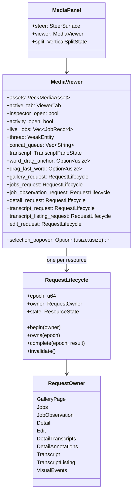

# media_panel — Reference: Media Viewer Interaction Model

The media viewer has two task modes backed by live state — Library and the
Asset workspace (`ViewerTab`, `crates/media_panel/src/media_viewer.rs:670`) —
plus one ambient activity layer, never a navigation destination: an
"Activity (N)" toolbar chip over any mode (live-job count,
`crates/media_panel/src/media_viewer.rs:11381`) opening an on-demand
drawer at the viewer root (`render_activity_drawer`, :6471), and per-asset
job badges on the Library rows (`asset_activity_verb`, :9012). The workspace
is the selected asset in one screen — the player and derivative-edit toolbar
as the primary area, with a toggleable inspector pane whose pane-internal
tabs (`InspectorTab::ALL`, :606) render the asset's record, tags, lineage,
faces, transcript links, researcher annotations, and reel provenance;
opening a transcript renders the workspace's transcript sub-surface
(`render_transcript_workspace`, :7094) and the header toggle restores the
pane in one click. The Library is browse: every indexed asset as rows, the
recordings' transcription states with the Transcribe affordance, their
stored transcripts nested beneath them, and unlinked transcripts in their
own degradation-honest section (`render_library`, :6083). Each surface
opens with one line of purpose copy (the orientation contract, `tab_purpose`
:9085, 2026-10-27): the workspace is playback and derivative edits beside the
the inspector, the Library is browse-and-delete (the listing, never the
file), the drawer is watch-and-cancel. All server calls route through the
governed tool invoker to the `media` server; gallery pages are sized at 100
rows with a one-second job poll (`GALLERY_PAGE_LIMIT`/`QUEUE_POLL_INTERVAL`,
media_viewer.rs:55-56) and the transcript recordings list at the server's
500 cap.

## Navigation principle (pinned 2026-11-02)

**Primary navigation mirrors user tasks, never server subsystems.**
Top-level modes are the user's tasks — browse the library; work on one
asset — not the server's tool families. Job status is ambient (badges on
affected assets, progress, an on-demand activity drawer), because a job
is process state the user checks, not a destination. The inspector is a
supporting pane of the asset workspace, because it is meaningful only in
relation to the selected object (Android canonical layouts, "supporting
pane"; Apple HIG, "Split views"). Tabs are reserved for alternate views
of one object, never for different content sets. The pre-redesign five-tab
model (Media, Library, Queue, Detail, Transcript) is gone: the operator-ruled
redesign (kask/docs/plans/media-panel-redesign-plan-2026-11-02.md) landed in
phases A–D, and the sections below document the landed two-mode +
activity-layer model.

## Research-curation scope

The cross-domain Steer conversation drives ingestion, organization, research
annotations, retrieval, transcription, and source-linked excerpt/reel extraction.
Tool advertising derives from the server's generated `TOOL_NAMES`; the approved
integration target is 91 (102 − 20 retired creative tools + 9 annotation/search
tools), not evidence of a running deployment. No creative image/video/TTS models
or generation recipes are offered. Settings → Kask → Media retains STT/vision
only; explicit empty values disable the selected pipeline visibly.

- `gallery_annotation_create` uses stable `gallery_asset_id`, `kind` (`tag` or
  `note`), and `value`. List by asset ID, update with asset/annotation IDs and
  replacement value, delete with both IDs. Positional indices are not identities.
  Since 2026-10-27 the inspector pane exposes this full CRUD directly — the
  Annotations tab (see "Inspector lifecycle").
- `educt_annotation_create` uses `transcript_id`, inclusive immutable-source
  `start_word` / `end_word`, `label`, and `note`; list by transcript ID, update
  with transcript/annotation IDs and all replacement fields, delete with both
  IDs. Supplied observations remain separate from model suggestions and are
  not authenticated human identity or verified evidence.
- `educt_search_transcripts` requires `query` and `mode: "lexical"`. Preserve
  the returned source/transcript IDs, exact excerpts and available timing/
  alignment citations. Search is bounded literal substring matching, not
  semantic retrieval; follow both continuation offsets when `has_more` is true.
  A truncated scan is not an exhaustive absence claim. Corpus export is the
  semantic-search handoff; unavailable timing must remain visible.
- Queue operations are `transcribe`, `audio_trim`, `audio_concat`, `video_clip`,
  and `video_concat`. History is process-local, not durable transcript storage.
  Both the direct transcribe tools and the job path precondition large local
  inputs server-side (speech-track extraction) before provider upload.
- Historical media and lineage remain readable. Face identification requires
  explicit selection. Local educt never silently uploads or falls back to cloud.

Chat remains the agent-mediated surface; the panel's direct-manipulation
surfaces are the Asset workspace (playback, marks, trim, concat — both media
kinds — beside the toggleable inspector pane with inspection and annotation
CRUD) and the Library (browse, delete, recordings with their transcription
states and transcripts, and entry into the synced-reading workspace). The
lifecycles and security boundaries below govern both modes and the activity
drawer.

## Component and request map



<!-- DIAGRAM_ALIGNMENT
id: DIAG-MEDIA-PANEL-001
verified_date: 2026-11-06
verified_against: crates/media_panel/src/media_panel.rs:97-118 (MediaPanel fields); crates/media_panel/src/media_viewer.rs:107-117 (RequestOwner — ten variants); crates/media_panel/src/media_viewer.rs:565-577 (ResourceState, RequestLifecycle); crates/media_panel/src/media_viewer.rs:773-1004 (MediaViewer fields incl. thread, concat_queue, live_jobs, inspector/activity state, the S2 drag-selection state at :909,:914, the selection popover at :920, the S3 transcript search at :927, and the ten request lifecycles at :803,:819,:823,:833,:839,:844,:862,:895,:972,:987)
status: VERIFIED
-->

## Request ownership

Each asynchronous read resource has an independent `RequestLifecycle` with an epoch,
owner, and `Idle | Loading | Ready | Failed` state
(`crates/media_panel/src/media_viewer.rs:565-577`). `begin` suppresses duplicate
requests for the same loading owner; a newer owner advances the epoch. Callback
handlers mutate state only when they still own that epoch (`apply_gallery_listing`
:1581, `apply_jobs_listing` :1746, `apply_live_observation` :1847,
`apply_detail_result` :2053, `apply_transcript_result` :3229). This prevents a
slow page, job, observation, detail, annotation, or transcript response from
overwriting newer state. Direct edits are serialized instead: trim, concat,
highlight create/rename/delete, strike, reel compose, transcript
correction, and annotation create/replace/disable while one side effect is
active (`begin_edit` rejects overlap at
`crates/media_panel/src/media_viewer.rs:1354`), so no completed
operation can be hidden by a later epoch.

| Resource | Owner key | Latest-response gate | Evidence |
| --- | --- | --- | --- |
| Gallery | requested offset | `gallery_request.owns(epoch)` | `request_gallery_page`/`apply_gallery_listing`, media_viewer.rs:1581,1575 |
| Jobs (drawer page) | jobs resource | `jobs_request.owns(epoch)` | `load_jobs`/`apply_jobs_listing`, :1746,1740 |
| Live-job observation | one battery per tick | `job_observation_request.owns(epoch)` | `observe_live_jobs`/`apply_live_observation`, :1847,1900 |
| Detail | stable gallery asset ID | `detail_request.owns(epoch)` | `load_detail`/`apply_detail_result`, :2053,2047 |
| Detail transcripts | stable gallery asset ID | `detail_transcripts_request.owns(epoch)` | `load_detail_transcripts`, :2082 |
| Detail annotations | stable gallery asset ID | `detail_annotations_request.owns(epoch)` | `load_detail_annotations`, :2164 |
| Transcript workspace | transcript ID | `transcript_request.owns(epoch)` | `open_transcript`/`apply_transcript_result`, :3229,3223 |
| Recordings listing | listing resource | `transcript_listing_request.owns(epoch)` | `load_transcript_listing`, :3378 |
| Edit | one admitted side-effecting operation | `begin_edit` rejects overlap; `edit_request.owns(epoch)` closes it | :1354 |

Failures retain last-good data and surface degraded status instead of clearing
the resource: each `apply_*` handler completes its epoch into
`ResourceState::Failed` while leaving the committed rows, jobs, detail, or
workspace untouched (the same handlers as above; `resource_status` renders the
degraded state at :9129, and a transcript reload keeps the last-good
workspace visible rather than flashing the idle browser — `load_transcript_with`
:3184 retains the prior state; only an explicit open or the back affordance clears
it, `open_transcript` :2553 / `close_transcript_workspace` :2626).

### Wire contract with the server (mcp-tool-review, 2026-11-12/13)

Every argument object a viewer builder produces decodes into the media
server's own request type for the tool it is sent to, and a layer it carries
parses as the server's layer type
(`every_argument_builder_decodes_into_the_servers_request_type`,
`crates/media_panel/src/media_viewer.rs`). The pin exists because the review
measured the installed server refusing the reel-compose, correction, tag and
redaction builders: they send `layer` and `payload` as JSON objects and the
server decoded JSON text only ("invalid type: map, expected a string"); the
server accepts both forms since `a41c7e0fa7`, pinned on both sides. Two
server-side changes the panel inherits without a code change: all 90 request
schemas are now closed (an argument the server does not declare is refused as
`invalid_argument`, not dropped — the builders send no undeclared key,
measured by `panel-args.sh` over every `call_tool` site), and Trim-to-Marks
over `video_clip` follows the probed streams rather than the file name, so an
audio-only `.mp4` publishes a WAV, a start past the end is refused, and an end
past the end comes back as the cut end in `end_sec`/`duration_sec`. A clip,
gif, caption or concat request that names a file of the wrong kind (audio to a
video tool) or clips that cannot be joined is `invalid_argument` naming the
file — the panel shows it on the status line like any other refused edit.

## Result-derived Library freshness

Published assets, imports, transcript renders, and deletions carry
`gallery_changed: true` only after their durable gallery transition succeeds —
the viewer reads the completed-result field
(`tool_result_changed_gallery`, `crates/media_panel/src/media_viewer.rs:11578`)
inside `ingest_tool_result`
(`crates/media_panel/src/media_viewer.rs:1277`). The panel observes that
completed-result field rather than classifying tool names; read-only
`gallery_*` results therefore do not trigger reloads. A mutation-driven or
manual Library reload invalidates an older same-page request before dispatch,
while switching to Library always requests current state. Completed background
jobs carry the same enriched display/mutation result and are ingested exactly
once by stable job identity (`processed_job_results`, a seen-set keyed by job
ID at :835, retained and re-filled inside `apply_jobs_listing` :1746).

## Gallery pagination lifecycle

The Library requests 100 rows per page (`GALLERY_PAGE_LIMIT`,
`crates/media_panel/src/media_viewer.rs:55`). A response commits only
when its gallery ID, total, requested offset, positive limit, row count, row
indices, and required asset fields validate (`parse_gallery_listing`,
`crates/media_panel/src/media_viewer.rs:9106`). Failed or superseded page
requests preserve the prior page and cursor (`apply_gallery_listing` :1581).

Previous/next navigation uses the server-confirmed page size and total, with
saturating cursor arithmetic (`previous_gallery_page`/`next_gallery_page`,
`crates/media_panel/src/media_viewer.rs:1683,1688`). A gallery-root change
removes prior indexed rows, clears pending selection and delete state, and
invalidates detail; a same-gallery refresh reconciles by stable asset source
(`commit_gallery_listing`, `crates/media_panel/src/media_viewer.rs:1596`).

```mermaid
stateDiagram-v2
    [*] --> Idle
    Idle --> Loading: request page offset
    Loading --> Loading: newer offset supersedes epoch
    Loading --> Ready: owned response validates and commits
    Loading --> Failed: owned response fails; keep last-good page
    Ready --> Loading: previous, next, or refresh
    Failed --> Loading: retry
```

<!-- DIAGRAM_ALIGNMENT
id: DIAG-MEDIA-PANEL-002
verified_date: 2026-11-06
verified_against: crates/media_panel/src/media_viewer.rs:1535-1698 (request, apply, commit, navigation); crates/media_panel/src/media_viewer.rs:9106 (parse_gallery_listing validation)
status: VERIFIED
-->

## Bounded concatenation

Only selected video assets can enter the concat queue. Duplicates are no-ops;
an over-cap addition is rejected without truncating the queue
(`queue_selected_for_concat`, `crates/media_panel/src/media_viewer.rs:1427`).
Dispatch requires at least two clips and rechecks the upper bound before
calling `video_concat` (`dispatch_concat`,
`crates/media_panel/src/media_viewer.rs:1450`). The shared admission limit is
64 inputs (`MAX_CONCAT_ITEMS`,
`kask/crates/hkask-types/src/media_limits.rs:8`).

## Job lifecycle (activity layer)

Job state is ambient process state — never a place the operator visits. The
toolbar's "Activity (N)" chip shows the live-job count over any mode
(`crates/media_panel/src/media_viewer.rs:11381`) and opens an on-demand
drawer at the viewer root (`render_activity_drawer`, :6471): the observed
live set under an "Active" heading, the page's recent history under
"Recent", and Cancel on queued/running rows (`cancel_job`, :5673). The
drawer footer carries the process-local history disclosure verbatim from the
strict listing parse (`jobs_restart_behavior`, :6560); opening the drawer
refreshes the listing so it never opens on stale history
(`toggle_activity`, :1983).

The page asks `job_list` for the shared default limit of 20
(`DEFAULT_JOB_LIST_LIMIT`, `kask/crates/hkask-types/src/media_limits.rs:12`;
`load_jobs`, `crates/media_panel/src/media_viewer.rs:1705`). Producer and panel
consume one strict `JobListPayload` carrying `jobs`, `total`, `limit`,
`has_more`, `history_scope`, and `restart_behavior`
(`kask/mcp-servers/hkask-mcp-media/src/types.rs:657-663`). Legacy arrays,
incomplete objects, incoherent counts, and unknown statuses surface degradation
while the last-good page remains visible (`parse_job_listing`,
`crates/media_panel/src/media_viewer.rs:11331`).

While any nonterminal job is observed — anywhere in the bounded store, on any
mode — one single-flight GPUI-native one-second poll task is armed
(`QUEUE_POLL_INTERVAL`, `crates/media_panel/src/media_viewer.rs:56`;
`should_poll_jobs`/`schedule_queue_poll` :1826,1820). The newest-first page
alone cannot see a live job hidden behind newer completions, so when the page
reports `has_more` three status-filtered probes — one per nonterminal status
(`NONTERMINAL_JOB_STATUSES`, :63), each filtered server-side before the
newest-first sort and limit — observe the complete live set past the page
limit (`observe_live_jobs` :1900 → `apply_live_observation` :1900), and the
activity tick settles once per battery (`settle_activity_tick`, :1953),
arming or stopping the poll by the observed-anywhere condition. A failed
probe battery proves nothing about deeper jobs: previously observed live
entries are retained and the poll keeps observing (:1839-1852). A landed
transcribe job reloads the recordings' transcript listing once while the
Library is showing (R5, :1878). The deep-observation contract is pinned
by `deep_running_job_behind_a_full_page_stays_observed_and_updated` (:12734)
— the loop-register L11 page-visibility impedance, settled (2026-11-02).
Job history is process-local, so a server restart may produce an empty page.

## Inspector lifecycle

The workspace's inspector pane addresses the selected asset by stable gallery
ID, never by its positional index. Assets not yet indexed surface a remediation
message instead of dispatching (`load_detail`,
`crates/media_panel/src/media_viewer.rs:1989`). Only an owned, object-shaped
`gallery_asset_detail` response replaces the last-good detail; stale and
failed responses do not blank it (`apply_detail_result`,
`crates/media_panel/src/media_viewer.rs:2047`). The pane is a supporting pane
of the workspace — the header's toggle hides or returns it in one click
without touching the player or selection (`toggle_inspector`, :1129;
`workspace_inspector_toggle`, :6051) — and its pane-internal tabs
(`InspectorTab::ALL` :606: Record, Tags, Lineage, Faces, Transcripts,
Annotations, Reel) are alternate views of the same selected object, rendering
the image record, tags, lineage, faces when present, linked transcripts
(words/timings per row), reel provenance, and — since 2026-10-27 — the
researcher tags & notes CRUD surface (`render_inspector`,
`crates/media_panel/src/media_viewer.rs:6659`). The Annotations tab lists
`gallery_annotation_list` rows under its own request lifecycle
(`load_detail_annotations`, :2164), offers add tag / add note editors
(the label editor's modal input pattern), per-row value replacement through
`gallery_annotation_update` over the stable identity, and delete through
`gallery_annotation_delete` — all under the single edit admission with the
visible-refusal discipline (`confirm_annotation_edit`, :2348); every completion
reloads the list. The pane needs an indexed asset and says why otherwise;
a failed listing surfaces an unavailable note, never silence.

## Transcript surface

Transcripts live on the surfaces that use them — the Library's recordings
section and the asset workspace — never a standalone destination. The
Library lists the recordings' stored transcripts nested beneath each
recording's row (`educt_list_transcripts` at the server's 500 cap,
lifecycle-protected at `load_transcript_listing`,
`crates/media_panel/src/media_viewer.rs:3372`); rows carry the five-state
alignment note before the click (`transcript_alignment_note` :9485). The
alignment is the same working-transcript computation the workspace gate uses,
so the rows never disagree with the opened view. Unlinked transcripts —
their recordings left the gallery index — trail in their own section below
the rows with honest degradation copy (:5679, never silently hidden), and
each row offers a two-click delete — Delete arms, Confirm delete dispatches
`educt_delete_transcript` (`delete_transcript_recording` :3293 closes the
edit lifecycle and reloads the listing on success,
`apply_transcript_deletion_result` :3350); the server preserves durable
exports and rendered reels detached from the removed record. Opening a
transcript — from a Library row or the inspector's Transcripts tab —
renders the workspace's transcript sub-surface (`open_transcript` :2553 →
`render_transcript_workspace` :7094), and the header's close affordance
returns (`close_transcript_workspace` :2626). The inspector pane yields its
screen share on open; the header toggle restores it in one click (:2488).

- **Workspace**: one strict `educt_get_transcript` dispatch drives paragraph
  blocks (`build_pane_blocks`,
  crates/media_panel/src/media_viewer.rs:10783), speaker
  labels, highlight overlays, and cut line-through marks. The sub-surface's
  media body is the RECORDING's (`workspace_media_body`,
  crates/media_panel/src/media_viewer.rs:7073`):
  a transcript linked to a live gallery recording renders the recording's
  asset body — a video-keyed transcript plays the video; an unlinked
  transcript falls to its stored media path, keeping the transcript and
  its durable exports reachable. The sub-surface composes as a PINNED
  INTERACTION BAND above ONE virtualized `gpui::list` (the composed
  two-pane fix, 2026-11-07 — `render_transcript_workspace`,
  crates/media_panel/src/media_viewer.rs:7094): the bounded player row,
  the surface/mode chips (Words/Events, Select-text, Follow), and the
  search input pin at the top as the persistent master object, while the
  status row, the section label, the transcript blocks, the
  highlights/cuts sections, and Create a reel scroll beneath as the
  navigated detail (item dispatch `render_workspace_list_item` :7433),
  so long recordings render only the visible blocks AND deep follow-along
  reveals never displace the player — the one-list design rendered the
  player as list item 0, so every deep seek scrolled the primary media
  object out of the pane (the operator's "pushes the video from the
  view", 2026-11-07); the composed fix reverses that judgment with the
  height budget answered by composition: the band caps at 55% of the
  workspace (`max_h(relative(0.55))` + `overflow_hidden`, the S1
  visible-truncation backstop), the player row is the band's flexible
  member (flex_1, min_h_0 — the widget's own pins keep the transport
  visible at every height), and the reading area keeps at least the
  45% majority at every pane height (the bounded-player ruling), pinned
  by `follow_scroll_keeps_the_pinned_player_in_view`. The pending label
  editor and selection popover stay pinned above the list. Raw layer
  inventories, source indices, and tool/lineage identifiers stay out of this
  workflow; technical lineage remains available in the inspector.
- **Sync**: clicking a word seeks the bound shared player to its start
  (`seek_workspace_transcript`,
  crates/media_panel/src/media_viewer.rs:5463 over
  `MediaWidget::seek_to_secs`); while playing, a 4 Hz GPUI-native follow-along
  marks the containing word and KEEPS IT VISIBLE — the marked paragraph block
  is scrolled into the list's viewport by an item-anchored scroll
  (`start_transcript_follow` :5477 →
  `follow_marked_block_into_view` :5561 over
  `current_word_index` :10689, gated on
  `MediaWidget::is_transport_playing`), so the mark never rides off the
  viewport during playback. A manual scroll suspends the viewport tracking
  (`note_follow_scroll_tick` :5544); the Follow
  toggle in the sub-surface header re-enables it and reveals the current mark
  (`toggle_follow_viewport` :5602).
- **Search (S3, 2026-11-04)**: an input in the pinned interaction band (words
  surface only; the composed two-pane fix, 2026-11-07 — previously list
  header item 2, which kept a placeholder row on the events surface for
  reading-position stability; pinning removes that hack: the input is
  never a list item and never scrolls away mid-reading) runs lexical search over the open transcript
  entirely in-pane — no server dispatch. The trimmed query matches
  case-insensitively for ASCII, exactly for non-ASCII (the server's
  `educt_search_transcripts` rule, so the panel and the server agree on what
  a match is), over the working words joined by single spaces (the same join
  the blocks render), and each occurrence maps to the inclusive word range it
  covers — phrases mark and jump as one range
  (`transcript_search_matches` :10729, pinned by
  `transcript_search_matches_orders_maps_and_edges`). Typing rescans once per
  burst, 150 ms after the last keystroke (a GPUI-native timer;
  `schedule_transcript_search_rescan` :4881 / `rescan_transcript_search`
  :4901, pinned by `transcript_search_rescan_debounces_the_burst`); the
  stabilized query lands the first match in view, and Enter/Shift-Enter
  cycle forward/back (wrapping), each jump revealing the match's block
  through the follow reveal's item-anchored scroll
  (`reveal_transcript_search_match` :4922, pinned by
  `transcript_search_finds_cycles_and_lands_the_current_match`). Matches
  paint after the researcher overlays so a match stays visible inside a
  highlight, the field-wise composition keeps a struck match's
  line-through, and the current match paints stronger than the plain ones
  (`render_workspace_block`; pinned by
  `search_marks_compose_with_highlight_and_strike_overlays`). The count
  beside the input is honest at every state — `current+1/total` while
  matches exist, "No matches" for zero results, "Search needs a word-timed
  view" on text-only views, nothing for a blank query
  (`transcript_search_status` :10765). Focus in the search box suspends
  viewport tracking (the manual-scroll precedent — typing and the
  auto-landed matches must not fight the follow-along); blur restores
  tracking only when the search took it, and a manually suspended follow
  stays suspended (`ensure_transcript_search_focus_listeners` :5020,
  registered idempotently on the workspace's first render — render-time
  registration works (the deferred activation rides the normal effect
  cycle), and registering at render rather than from the click handler
  covers keyboard focus arrivals at the input). Escape clears the query and
  its marks immediately. The search tears down with the surface — close,
  fresh open, and reload all clear it (`reset_transcript_search` :5004,
  pinned by `transcript_search_resets_with_the_surface`).
- **Annotation**: word selection is two gestures into the same action tray —
  the selection popover. Press-and-release drag across words (S2, 2026-11-04)
  is the one-gesture path, active in both interaction modes: the surface root
  arms a pending drag from the exact hovered word (`word_drag_anchor` :915;
  `drag_last_word` :920, so a release outside words cancels a stale drag), a
  release anywhere in the surface completes it, live marks show the anchor
  and the release target during the drag, and the pure state machine
  dispatches the outcome (`handle_word_drag` :3542, `enum WordDragOutcome`
  :8877 — Inert/Click/CompleteRange; consumed by `word_drag_released` :3563,
  pinned by `word_drag_state_machine` :14717). Cross-word outcomes and the
  two-click fallback (`handle_word_selection` :3460) complete the ordered
  union range under the tray-mode gate (`selection_tray_mode` :9758 — S5,
  2026-11-06: original/aligned views open the FULL tray, re_anchored views
  open the CORRECTION tray, unaligned/untimed views keep the visible
  refusal) and open the selection popover (`selection_popover` :926, opened
  by `open_selection_popover` :4489, rendered pinned above the list by
  `render_selection_popover` :5216). The full tray offers Highlight / Cut /
  Copy time / Suggest correction / Include in reel / Strike in reel clip
  (the strike arm only when the range sits inside exactly one included
  clip) — Delete cuts, Enter
  highlights, Escape dismisses; the correction tray offers Suggest
  correction + Copy time — Enter corrects, Delete is inert (cut needs an
  index-identical view), Escape dismisses — keys bound on the tray while it
  holds focus (`handle_selection_popover_key` :4546 — Delete never binds
  on the label input, where it is text editing). The
  index-identical-only actions (Highlight, Cut, Include in reel, Strike in
  reel clip) refuse on
  re_anchored views at every selection entry — the popover's actions and
  their keys, and the editor paths that open from them — because working
  indices never anchor source-word tools (the 2026-10-25 overshoot trap).
  The highlight row's Include-in-reel toggle stays available on re_anchored
  views: it flips membership over the stored highlight's own source anchors,
  never a working selection. Same-word
  releases stay plain clicks (InteractiveText seeks through its own click).
  The tray is not modal: a fresh anchor dismisses it, a newer completed
  range replaces it, seek clicks keep it (seeking is preview), and opening
  the label editor
  range replaces/dismisses it, seek clicks leave it
  be, and opening the label editor
  supersedes it. Highlight opens the label editor over the same range; the
  editor takes typed or pasted labels; Enter confirms, Escape cancels, empty
  uses "Highlight" (`open_label_editor` :4318, `confirm_label_edit` :4359).
  Cut dispatches the strike immediately (`popover_cut` :4628); Copy time
  writes the selection's span in the panel's marks vocabulary ("in 2.0s out
  5.9s", `popover_copy_time` :4646, with honest degradation when the view
  carries no word timings); Include in reel flips the composed clip's include
  flag over its range (the highlights row's toggle path — one source of
  truth, no dispatch) or creates the highlight with the default label over
  a fresh range — the reload re-matches every researcher highlight into the
  composer, so the one click carries the range into the reel
  (`popover_toggle_reel_include` :4792, pinned by
  `popover_include_toggles_reel_membership`); Strike in reel clip — offered
  when the completed range sits inside exactly one included clip — records
  the sub-range on that clip as an in-reel strike, which the compose bakes
  into the clip's Keep op (`popover_strike_in_reel` :4837, refusing
  honestly when the range spans clips or sits in none); Suggest correction
  opens the correction editor — the same label-editor machinery with a
  replacement field (`popover_correct` :4578).
  Create/rename/delete
  dispatch `educt_annotation_create`/`update`/`delete`; progress text never
  exposes annotation UUIDs. Hand highlights exist only on index-identical
  views — the tray-mode gate (`selection_tray_mode` :9758, S5) opens the
  correction tray instead on re_anchored views and surfaces a human-readable
  reason on the unselectable states; the panel never re-implements the
  server's projection (D5). Highlight rows show an excerpt, with Include in
  reel, Rename, and Delete actions rather than source-word indices.
- **Right-click context menu (S8)**: the pointer alternative to the
  select-then-tray gesture — right-click the word surface and the menu
  offers Highlight / Strike out / Copy time / Include in reel over the
  range under the pointer (`context_menu_range`: an open selection popover
  owns its range, else a pending two-click anchor completes to the
  right-click target word, else that word alone). The entries reuse the
  tray's dispatchers (`open_highlight_editor`, `strike_selected_range`,
  `copy_time_range`, `include_reel_range`); Escape dismisses.
- **Cuts (R2, 2026-10-27)**: the same completed range can be cut instead of
  labeled — from the popover's Cut (or its Delete key) or the editor's Cut
  selection (`strike_selected_range` :3905, `create_workspace_strike`
  :3926). Struck words render line-through on index-identical views
  (`block_word_char_range` :9994; overlapping marks compose field-wise —
  `resolved_highlight_runs` :9943). The Cuts list shows excerpts and a
  Restore action through the shared kind-dispatched delete. The pane parses
  strikes only under the server's strike identity (user +
  researcher_annotation + exactly one Cut op), so compose EDLs and model EDLs
  never render as strikes.
- **In-panel layered correction (S5, 2026-11-06)**: a misheard range is
  corrected in the panel without rewriting the source — the correction is
  a LAYER over the immutable source words. The flow: select the misheard
  words → Suggest correction → type the replacement → one edit admission
  covers the whole chain (`dispatch_workspace_correction` :3681): the
  selection's SOURCE range resolves (identity on original/aligned views;
  `educt_locate` basis "source" on re_anchored views — the server's own
  re-anchored index map does the translation, never a panel-side
  projection), the new edit merges over the live correction layer's edits
  (disjoint priors carried verbatim, overlapping priors superseded and
  SURFACED in the status — the silent-revert guard), the merged layer
  stores through `educt_store_layer` under the researcher authoring path
  (model "user", template `researcher_correction`, the server's own serde
  types building the request so the schema cannot drift), and
  `educt_realign_transcript` names the stored layer (an honest no-op when
  the layer is one-for-one; the equal-slice interpolation otherwise)
  before the workspace reloads with the corrected working view. A blank
  replacement refuses client-side — a correction replaces text; deletions
  belong to Cut. The reloaded alignment note updates through the existing
  five-state gate (a cardinality-changing correction leaves the view
  `re_anchored`, "Estimated timings · review only"). Pinned end-to-end:
  `correction_appears_in_the_working_view` (original view),
  `reanchored_correction_translates_and_chains_realign` (the source-range
  trap pin — the stored edit anchors the TRANSLATED source range, never
  the working range), and the admission extension in
  `label_editor_confirm_and_cancel_lifecycle`.
- **Reels (R3 2026-10-27; S6 composer 2026-11-06)**: the reel is an editable
  object — the composer's ordered clip list
  (`reel_clips: Vec<ReelClip>` :958, the ONE membership-and-order source of
  truth; the unordered `reel_selection` set it replaces is deleted). Each
  clip is a researcher highlight with its own include flag and in-reel
  strike sub-ranges; the reel section renders the clips in composed order
  with ↑/↓ reorder, the include toggle, a duration readout, and per-strike
  Restore (`render_workspace_reel_section` :8316). Composer state survives
  every workspace reload, keyed to highlight identity — annotation id +
  source range (`rematch_reel_clips` :4678 on every
  `apply_transcript_result` :3229): order, inclusion, and strikes keep
  their deltas across annotation edits, new researcher highlights join
  included at the tail, deleted highlights drop their clips. The ordered
  builder (`composed_keep_ranges` :10100) emits Keep ops in composer order
  through the server's own difference math (`union_ranges` + the published
  `subtract_cuts_from_range`, never a panel fork — the panel's
  `union_word_ranges` mirror is deleted): in-reel strikes bake into the
  clip's Keep op, and a later clip that overlaps an earlier one keeps only
  its unplayed remainder — so a composer EDL carries no Cut ops in the
  assemble form (a per-clip strike as a Cut would strike EVERY clip
  overlapping the range). Three compose modes build the reel EDL directly
  (`compose_reel_params` :10632) — assemble (the ordered clips), reduce
  (the whole recording with cuts applied), mixed (clips + global cuts) —
  each chaining `educt_store_layer` → `educt_render_edl`
  (`compose_workspace_reel` :4042) under the single edit admission, visible
  only when their inputs exist. Compose provenance remains
  `pane_reel_compose`, so its output never re-parses as a researcher
  strike. The rendered reel lands as a playable asset through display-hint
  ingestion. The preview (`toggle_reel_preview` :5342) plays the composed
  order on the shared player without rendering — the span plan is
  `edl_to_clip_plan`'s output over the stored SOURCE bundle words
  (`reel_preview_plan` :10142 over `source_words` :505, parsed from the
  get-transcript bundle — never the working view's interpolated timings),
  so preview and rendered reel agree on `re_anchored` views; the auto-seek
  chain (`start_reel_preview` :5366 → `reel_preview_tick` :5407 →
  `step_reel_preview` :5438) polls `transport_position_secs` on the
  follow-loop's task pattern, holds while paused, and tears down at every
  sub-surface site — surface switch, open, close, reload — and on
  widget-None (`stop_reel_preview`).

## Playback and layout contracts

The selected media entity is owned directly by the viewer so trim marks and the
playback clock remain reachable; selection replacement resolves through the
stable-Asset weak registry (`crates/media_panel/src/media_viewer.rs:789-790).
The panel remains a vertically split viewer/director surface with a draggable
split (`MediaPanel`, `VerticalSplitState`, and `MediaPanel::render` in
`crates/media_panel/src/media_panel.rs`).

The edit toolbar serves **both media kinds** (2026-10-27 unification):
`MediaWidget::transport_position_secs` is the one position accessor, so marks,
the position label, and Trim-to-Marks work on audio exactly as on video. Trim
dispatches `video_clip`, which stream-copies video to mp4 and decodes audio
inputs to wav server-side — the published asset's kind follows the input, so
an audio excerpt never masquerades as video. Concat stays video-only in the
panel (the audio path is the activity layer's `audio_concat` op).

The viewer pane must retain `min_h_0` and `min_w_0` so media and toolbars shrink
inside the dock instead of propagating intrinsic dimensions
(`MediaPanel::render` in `crates/media_panel/src/media_panel.rs`); paragraph
text wraps at the dock's definite width, pinned by
`transcript_pane_wraps_within_narrow_dock` and
`label_editor_fits_narrow_dock` in `viewer_layout_tests`. The selected media uses the
shared media widget, preserving aspect ratio through the widget's contain fit.
Playback timing is source-driven: source PTS and the audio-master clock decide
when frames are due; a 4 ms decoder poll (`DECODE_POLL_INTERVAL`,
`crates/hkask-media-widget/src/video_decoder.rs:53`) provides deadline headroom,
while an 8 ms foreground poll (`DISPLAY_POLL_INTERVAL`,
`crates/hkask-media-widget/src/video_decoder.rs:56`) follows GPUI's 120 Hz
frame cadence and renders only on a new source frame or state change
(`start_playback_loop`,
`crates/hkask-media-widget/src/media_widget.rs:588`). The production benchmark
requires one visible 30 fps player to present at least 89 of 90 source frames
(`MIN_PRESENTED_FRAMES_AT_30_FPS`,
`crates/hkask-media-benchmarks/benches/playback.rs:10,285`). Volume and
mute are intentionally delegated to the operating system's default output
device; the widget keeps unity application gain and provides no competing
mixer (`crates/hkask-media-widget/src/audio_player.rs:148-149`). Audio
decode covers MP3, AAC/MP4, Ogg/Vorbis, FLAC, and Opus/MP4 through the
rodio/symphonia stack (`decode_bytes`,
`crates/hkask-media-widget/src/audio_player.rs:101-110`, one regression
fixture per format in `transcript_audio_regression_formats_decode`);
audio output and player construction defer to the first play or seek —
the load decodes and parses duration only, so machines without an audio
device (headless sessions, CI runners) still load, read durations, and
land pre-play seeks, with a parked seek's target reported as the
position until a player exists (2026-11-07, pinned by
`audio_load_defers_the_output_device`); a failed
load renders as a compact dismissible status line rather than a full-pane
takeover (`crates/hkask-media-widget/src/media_widget.rs:939`), and in the
transcript sub-surface the close affordance and recording name live in the
header row above the workspace list — the first thing in view — and a failed
player never dead-ends navigation or transcript text
(`render_workspace_header_item`,
crates/media_panel/src/media_viewer.rs:7484). Playback speed is a
transport affordance on both media kinds (2026-11-06, S4): the transport's
speed button cycles 0.5×/1×/1.25×/1.5×/2× (`SPEED_STEPS`/`next_speed`,
`crates/hkask-media-widget/src/transport.rs:18,23`), and the widget applies
the rate to the live player — rodio `Player::set_speed` on the audio path
(`crates/hkask-media-widget/src/audio_player.rs:212`) and on the video
decoder's audio pipeline, which is the audio-master clock, so the clock then
advances at rate on its own; the audio-less wall-clock arm of the video
position scales through the same pure conversions (`media_elapsed`/
`wall_deadline`, `crates/hkask-media-widget/src/transport.rs:34,42`).
Rodio reports positions in wall time under `Speed`, so every media-time read
is scaled back per call and seeks convert to wall-equivalent targets —
position, marks, and the transcript clock stay in media seconds at every
rate (`crates/hkask-media-widget/src/audio_player.rs:256,285`). The rate is
resampling, not time-stretch: pitch scales with it (2× doubles pitch).
Zoom and fullscreen controls remain unimplemented in `media_panel` and the
widget.

## The synced recording

The operator's unit of work is **the synced recording**: a gallery recording
(a video or audio asset) whose word-timed transcript is synced to its media,
so text and media address each other — the reference model's
capability (1) holding in experience, not just in data. Its lifecycle is
the panel's complete loop, entirely in the panel:

**import → organize → transcribe → read along → highlight → cut → order
and strike in the reel composer → preview → render a reel → play the reel.**

Its capabilities and the surfaces that carry them:

| Capability | Surface |
| --- | --- |
| Import (from conversation tool results) | Library + workspace |
| Play / pause / seek / stop / trim marks (both media kinds) | Asset workspace |
| Per-recording transcription status (`Not transcribed` / `Transcribing…` / `Transcribed`) | Library (recording rows) |
| Transcribe affordance (recording → transcript without a chat turn) | Library (per-recording row) |
| Follow-along viewport tracking (manual scroll suspends; Follow re-enables) | Workspace transcript sub-surface |
| In-transcript lexical search with jump-to-match (debounced, cycles, honest zero-match) | Workspace transcript sub-surface |
| Word-click seek (text → media, both directions) | Workspace transcript sub-surface |
| Word selection: press-and-release drag or two-click range, then the mode-aware selection popover's action tray (full: Highlight / Cut / Copy time / Suggest correction / Include in reel; corrected views: Suggest correction / Copy time) | Workspace transcript sub-surface |
| In-panel layered correction: select misheard words → type the replacement → merged correction layer + realign chain, translated through the server on corrected views | Workspace transcript sub-surface |
| Highlight create / rename / delete (labeled selections) | Workspace transcript sub-surface (label editor) |
| Cut selection with line-through overlay and Restore | Workspace transcript sub-surface |
| Reel composer: ordered clips with include toggles, in-reel strikes, and preview; compose (assemble / reduce / mixed), render, and play | Workspace transcript sub-surface |
| Delete (two-click confirm; transcripts and renders survive, detached) | Library + workspace |
| Tags and notes (researcher annotations) | Inspector pane (Annotations tab) |

An unlinked transcript (its recording left the gallery index) keeps its
durable exports and its reel renders; the Library trails it in its own
section with the same open and delete affordances.

## Capability summary

| Capability | State |
| --- | --- |
| Play/pause, seek, stop, trim marks | supplied (both media kinds) |
| Volume and mute | operating-system controlled |
| Paginated gallery selection and refresh | supplied |
| Stable-ID detail and delete operations | supplied |
| Bounded video concatenation | supplied |
| Activity layer: job observation (status-filtered probes past the page limit), badges, drawer, and cancellation | supplied |
| Recordings browse + transcript workspace with synced reading | supplied |
| Recording-first browse with per-recording transcription status and Transcribe affordance (R2/R5, operator ruling 2026-10-28) | supplied |
| Transcribe affordance: recording to transcript without a chat turn | supplied (2026-10-28, operator ruling) |
| Follow-along viewport tracking with manual-scroll suspend + Follow toggle | supplied (2026-10-28) |
| Researcher highlight create/rename/delete via label editor | supplied |
| Press-and-release drag selection over words + selection popover with keyboard shortcuts (one gesture, both interaction modes) | supplied (2026-11-04, S2) |
| In-transcript lexical search with jump-to-match | supplied (2026-11-04, S3) |
| In-panel layered transcription correction (merged layers, supersession surfaced, re_anchored selections translated server-side) | supplied (2026-11-06, S5) |
| Per-recording alignment flag on the Library rows and the inspector's Transcripts tab | supplied (2026-10-27) |
| Cut selection with line-through overlay and Restore | supplied (2026-10-27) |
| Reel composer: ordered clip list, per-clip include, in-reel strikes baked into Keep ops, source-words preview, compose (assemble/reduce/mixed), render, and play | supplied (2026-11-06, S6 — replaces the unordered membership set) |
| Researcher tags/notes create/replace/delete in the inspector pane | supplied (2026-10-27) |
| Trim on audio through the same workspace marks | supplied (2026-10-27) |
| Per-surface purpose copy | supplied (2026-10-27) |
| Playback speed 0.5×–2× on both media kinds (resampling — pitch scales with rate) | supplied (2026-11-06, S4) |
| Zoom, fullscreen | absent |