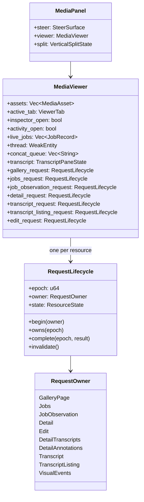

# media_panel — Reference: Media Viewer Interaction Model

The media viewer has two task modes backed by live state — Library and the
Asset workspace (`ViewerTab`, `crates/media_panel/src/media_viewer.rs:569`) —
plus one ambient activity layer, never a navigation destination: an
"Activity (N)" toolbar chip over any mode (live-job count,
`crates/media_panel/src/media_viewer.rs:9207-9211`) opening an on-demand
drawer at the viewer root (`render_activity_drawer`, :5151), and per-asset
job badges on the Library rows (`asset_activity_verb`, :7180). The workspace
is the selected asset in one screen — the player and derivative-edit toolbar
as the primary area, with a toggleable inspector pane whose pane-internal
tabs (`InspectorTab::ALL`, :594) render the asset's record, tags, lineage,
faces, transcript links, researcher annotations, and reel provenance;
opening a transcript renders the workspace's transcript sub-surface
(`render_transcript_workspace`, :5763) and the header toggle restores the
pane in one click. The Library is browse: every indexed asset as rows, the
recordings' transcription states with the Transcribe affordance, their
stored transcripts nested beneath them, and unlinked transcripts in their
own degradation-honest section (`render_library`, :4752). Each surface
opens with one line of purpose copy (the orientation contract, `tab_purpose`
:7253, 2026-10-27): the workspace is playback and derivative edits beside
the inspector, the Library is browse-and-delete (the listing, never the
file), the drawer is watch-and-cancel. All server calls route through the
governed tool invoker to the `media` server; gallery pages are sized at 100
rows with a one-second job poll (`GALLERY_PAGE_LIMIT`/`QUEUE_POLL_INTERVAL`,
media_viewer.rs:54-55) and the transcript recordings list at the server's
500 cap.

## Navigation principle (pinned 2026-11-02)

**Primary navigation mirrors user tasks, never server subsystems.**
Top-level modes are the user's tasks — browse the library; work on one
asset — not the server's tool families. Job status is ambient (badges on
affected assets, progress, an on-demand activity drawer), because a job
is process state the user checks, not a destination. The inspector is a
supporting pane of the asset workspace, because it is meaningful only in
relation to the selected object (Android canonical layouts, "supporting
pane"; Apple HIG, "Split views"). Tabs are reserved for alternate views
of one object, never for different content sets. The pre-redesign five-tab
model (Media, Library, Queue, Detail, Transcript) is gone: the operator-ruled
redesign (kask/docs/plans/media-panel-redesign-plan-2026-11-02.md) landed in
phases A–D, and the sections below document the landed two-mode +
activity-layer model.

## Research-curation scope

The cross-domain Steer conversation drives ingestion, organization, research
annotations, retrieval, transcription, and source-linked excerpt/reel extraction.
Tool advertising derives from the server's generated `TOOL_NAMES`; the approved
integration target is 91 (102 − 20 retired creative tools + 9 annotation/search
tools), not evidence of a running deployment. No creative image/video/TTS models
or generation recipes are offered. Settings → Kask → Media retains STT/vision
only; explicit empty values disable the selected pipeline visibly.

- `gallery_annotation_create` uses stable `gallery_asset_id`, `kind` (`tag` or
  `note`), and `value`. List by asset ID, update with asset/annotation IDs and
  replacement value, delete with both IDs. Positional indices are not identities.
  Since 2026-10-27 the inspector pane exposes this full CRUD directly — the
  Annotations tab (see "Inspector lifecycle").
- `educt_annotation_create` uses `transcript_id`, inclusive immutable-source
  `start_word` / `end_word`, `label`, and `note`; list by transcript ID, update
  with transcript/annotation IDs and all replacement fields, delete with both
  IDs. Supplied observations remain separate from model suggestions and are
  not authenticated human identity or verified evidence.
- `educt_search_transcripts` requires `query` and `mode: "lexical"`. Preserve
  the returned source/transcript IDs, exact excerpts and available timing/
  alignment citations. Search is bounded literal substring matching, not
  semantic retrieval; follow both continuation offsets when `has_more` is true.
  A truncated scan is not an exhaustive absence claim. Corpus export is the
  semantic-search handoff; unavailable timing must remain visible.
- Queue operations are `transcribe`, `audio_trim`, `audio_concat`, `video_clip`,
  and `video_concat`. History is process-local, not durable transcript storage.
  Both the direct transcribe tools and the job path precondition large local
  inputs server-side (speech-track extraction) before provider upload.
- Historical media and lineage remain readable. Face identification requires
  explicit selection. Local educt never silently uploads or falls back to cloud.

Chat remains the agent-mediated surface; the panel's direct-manipulation
surfaces are the Asset workspace (playback, marks, trim, concat — both media
kinds — beside the toggleable inspector pane with inspection and annotation
CRUD) and the Library (browse, delete, recordings with their transcription
states and transcripts, and entry into the synced-reading workspace). The
lifecycles and security boundaries below govern both modes and the activity
drawer.

## Component and request map



<!-- DIAGRAM_ALIGNMENT
id: DIAG-MEDIA-PANEL-001
verified_date: 2026-11-02
verified_against: crates/media_panel/src/media_panel.rs:97-118 (MediaPanel fields); crates/media_panel/src/media_viewer.rs:97-109 (RequestOwner — ten variants); crates/media_panel/src/media_viewer.rs:463-476 (ResourceState, RequestLifecycle); crates/media_panel/src/media_viewer.rs:672-852 (MediaViewer fields incl. thread, concat_queue, live_jobs, inspector/activity state, and the ten request lifecycles at :702,:718,:722,:732,:738,:743,:761,:794,:821,:836)
status: VERIFIED
-->

## Request ownership

Each asynchronous read resource has an independent `RequestLifecycle` with an epoch,
owner, and `Idle | Loading | Ready | Failed` state
(`crates/media_panel/src/media_viewer.rs:463-476`). `begin` suppresses duplicate
requests for the same loading owner; a newer owner advances the epoch. Callback
handlers mutate state only when they still own that epoch (`apply_gallery_listing`
:1412, `apply_jobs_listing` :1577, `apply_live_observation` :1731,
`apply_detail_result` :1884, `apply_transcript_result` :3052). This prevents a
slow page, job, observation, detail, annotation, or transcript response from
overwriting newer state. Direct edits are serialized instead: trim, concat,
highlight create/rename/delete, strike, reel compose, and annotation
create/replace/disable while one side effect is active (`begin_edit` rejects
overlap at `crates/media_panel/src/media_viewer.rs:1191`), so no completed
operation can be hidden by a later epoch.

| Resource | Owner key | Latest-response gate | Evidence |
| --- | --- | --- | --- |
| Gallery | requested offset | `gallery_request.owns(epoch)` | `request_gallery_page`/`apply_gallery_listing`, media_viewer.rs:1372,1412 |
| Jobs (drawer page) | jobs resource | `jobs_request.owns(epoch)` | `load_jobs`/`apply_jobs_listing`, :1542,1577 |
| Live-job observation | one battery per tick | `job_observation_request.owns(epoch)` | `observe_live_jobs`/`apply_live_observation`, :1678,1731 |
| Detail | stable gallery asset ID | `detail_request.owns(epoch)` | `load_detail`/`apply_detail_result`, :1826,1884 |
| Detail transcripts | stable gallery asset ID | `detail_transcripts_request.owns(epoch)` | `load_detail_transcripts`, :1913 |
| Detail annotations | stable gallery asset ID | `detail_annotations_request.owns(epoch)` | `load_detail_annotations`, :1995 |
| Transcript workspace | transcript ID | `transcript_request.owns(epoch)` | `open_transcript`/`apply_transcript_result`, :2384,3052 |
| Recordings listing | listing resource | `transcript_listing_request.owns(epoch)` | `load_transcript_listing`, :3200 |
| Edit | one admitted side-effecting operation | `begin_edit` rejects overlap; `edit_request.owns(epoch)` closes it | :1191 |

Failures retain last-good data and surface degraded status instead of clearing
the resource: each `apply_*` handler completes its epoch into
`ResourceState::Failed` while leaving the committed rows, jobs, detail, or
workspace untouched (the same handlers as above; `resource_status` renders the
degraded state at :7297, and a transcript reload keeps the last-good
workspace visible rather than flashing the idle browser — `load_transcript_with`
:3007 retains the prior state; only an explicit open or the back affordance clears
it, `open_transcript` :2384 / `close_transcript_workspace` :2454).

## Result-derived Library freshness

Published assets, imports, transcript renders, and deletions carry
`gallery_changed: true` only after their durable gallery transition succeeds —
the viewer reads the completed-result field
(`tool_result_changed_gallery`, `crates/media_panel/src/media_viewer.rs:9405`)
inside `ingest_tool_result`
(`crates/media_panel/src/media_viewer.rs:1114`). The panel observes that
completed-result field rather than classifying tool names; read-only
`gallery_*` results therefore do not trigger reloads. A mutation-driven or
manual Library reload invalidates an older same-page request before dispatch,
while switching to Library always requests current state. Completed background
jobs carry the same enriched display/mutation result and are ingested exactly
once by stable job identity (`processed_job_results`, a seen-set keyed by job
ID at :728, retained and re-filled inside `apply_jobs_listing` :1577).

## Gallery pagination lifecycle

The Library requests 100 rows per page (`GALLERY_PAGE_LIMIT`,
`crates/media_panel/src/media_viewer.rs:54`). A response commits only
when its gallery ID, total, requested offset, positive limit, row count, row
indices, and required asset fields validate (`parse_gallery_listing`,
`crates/media_panel/src/media_viewer.rs:7341`). Failed or superseded page
requests preserve the prior page and cursor (`apply_gallery_listing` :1412).

Previous/next navigation uses the server-confirmed page size and total, with
saturating cursor arithmetic (`previous_gallery_page`/`next_gallery_page`,
`crates/media_panel/src/media_viewer.rs:1520,1525`). A gallery-root change
removes prior indexed rows, clears pending selection and delete state, and
invalidates detail; a same-gallery refresh reconciles by stable asset source
(`commit_gallery_listing`, `crates/media_panel/src/media_viewer.rs:1433`).

```mermaid
stateDiagram-v2
    [*] --> Idle
    Idle --> Loading: request page offset
    Loading --> Loading: newer offset supersedes epoch
    Loading --> Ready: owned response validates and commits
    Loading --> Failed: owned response fails; keep last-good page
    Ready --> Loading: previous, next, or refresh
    Failed --> Loading: retry
```

<!-- DIAGRAM_ALIGNMENT
id: DIAG-MEDIA-PANEL-002
verified_date: 2026-11-02
verified_against: crates/media_panel/src/media_viewer.rs:1372-1536 (request, apply, commit, navigation); crates/media_panel/src/media_viewer.rs:7341 (parse_gallery_listing validation)
status: VERIFIED
-->

## Bounded concatenation

Only selected video assets can enter the concat queue. Duplicates are no-ops;
an over-cap addition is rejected without truncating the queue
(`queue_selected_for_concat`, `crates/media_panel/src/media_viewer.rs:1264`).
Dispatch requires at least two clips and rechecks the upper bound before
calling `video_concat` (`dispatch_concat`,
`crates/media_panel/src/media_viewer.rs:1287`). The shared admission limit is
64 inputs (`MAX_CONCAT_ITEMS`,
`kask/crates/hkask-types/src/media_limits.rs:8`).

## Job lifecycle (activity layer)

Job state is ambient process state — never a place the operator visits. The
toolbar's "Activity (N)" chip shows the live-job count over any mode
(`crates/media_panel/src/media_viewer.rs:9207-9211`) and opens an on-demand
drawer at the viewer root (`render_activity_drawer`, :5151): the observed
live set under an "Active" heading, the page's recent history under
"Recent", and Cancel on queued/running rows (`cancel_job`, :4352). The
drawer footer carries the process-local history disclosure verbatim from
the strict listing parse (`jobs_restart_behavior`, :5229); opening the drawer
refreshes the listing so it never opens on stale history
(`toggle_activity`, :1814).

The page asks `job_list` for the shared default limit of 20
(`DEFAULT_JOB_LIST_LIMIT`, `kask/crates/hkask-types/src/media_limits.rs:12`;
`load_jobs`, `crates/media_panel/src/media_viewer.rs:1542`). Producer and panel
consume one strict `JobListPayload` carrying `jobs`, `total`, `limit`,
`has_more`, `history_scope`, and `restart_behavior`
(`kask/mcp-servers/hkask-mcp-media/src/types.rs:629-636`). Legacy arrays,
incomplete objects, incoherent counts, and unknown statuses surface degradation
while the last-good page remains visible (`parse_job_listing`,
`crates/media_panel/src/media_viewer.rs:9158`).

While any nonterminal job is observed — anywhere in the bounded store, on any
mode — one single-flight GPUI-native one-second poll task is armed
(`QUEUE_POLL_INTERVAL`, `crates/media_panel/src/media_viewer.rs:55`;
`should_poll_jobs`/`schedule_queue_poll` :1651,1657). The newest-first page
alone cannot see a live job hidden behind newer completions, so when the page
reports `has_more` three status-filtered probes — one per nonterminal status
(`NONTERMINAL_JOB_STATUSES`, :62), each filtered server-side before the
newest-first sort and limit — observe the complete live set past the page
limit (`observe_live_jobs` :1678 → `apply_live_observation` :1731), and the
activity tick settles once per battery (`settle_activity_tick`, :1784),
arming or stopping the poll by the observed-anywhere condition. A failed
probe battery proves nothing about deeper jobs: previously observed live
entries are retained and the poll keeps observing (:1746-1775). A landed
transcribe job reloads the recordings' transcript listing once while the
Library is showing (R5, :1785-1803). The deep-observation contract is pinned
by `deep_running_job_behind_a_full_page_stays_observed_and_updated` (:10515)
— the loop-register L11 page-visibility impedance, settled (2026-11-02).
Job history is process-local, so a server restart may produce an empty page.

## Inspector lifecycle

The workspace's inspector pane addresses the selected asset by stable gallery
ID, never by its positional index. Assets not yet indexed surface a remediation
message instead of dispatching (`load_detail`,
`crates/media_panel/src/media_viewer.rs:1826`). Only an owned, object-shaped
`gallery_asset_detail` response replaces the last-good detail; stale and
failed responses do not blank it (`apply_detail_result`,
`crates/media_panel/src/media_viewer.rs:1884`). The pane is a supporting pane
of the workspace — the header's toggle hides or returns it in one click
without touching the player or selection (`toggle_inspector`, :961;
`workspace_inspector_toggle`, :4720) — and its pane-internal tabs
(`InspectorTab::ALL` :594: Record, Tags, Lineage, Faces, Transcripts,
Annotations, Reel) are alternate views of the same selected object, rendering
the image record, tags, lineage, faces when present, linked transcripts
(words/timings per row), reel provenance, and — since 2026-10-27 — the
researcher tags & notes CRUD surface (`render_inspector`,
`crates/media_panel/src/media_viewer.rs:5345`). The Annotations tab lists
`gallery_annotation_list` rows under its own request lifecycle
(`load_detail_annotations`, :1995), offers add tag / add note editors
(the label editor's modal input pattern), per-row value replacement through
`gallery_annotation_update` over the stable identity, and delete through
`gallery_annotation_delete` — all under the single edit admission with the
visible-refusal discipline (`confirm_annotation_edit`, :2179); every completion
reloads the list. The pane needs an indexed asset and says why otherwise;
a failed listing surfaces an unavailable note, never silence.

## Transcript surface

Transcripts live on the surfaces that use them — the Library's recordings
section and the asset workspace — never a standalone destination. The
Library lists the recordings' stored transcripts nested beneath each
recording's row (`educt_list_transcripts` at the server's 500 cap,
lifecycle-protected at `load_transcript_listing`,
`crates/media_panel/src/media_viewer.rs:3200`); rows carry the five-state
alignment note before the click (`transcript_alignment_note` :7653). The
alignment is the same working-transcript computation the workspace gate uses,
so the rows never disagree with the opened view. Unlinked transcripts —
their recordings left the gallery index — trail in their own section below
the rows with honest degradation copy (:4781, never silently hidden), and
each row offers a two-click delete — Delete arms, Confirm delete dispatches
`educt_delete_transcript` (`delete_transcript_recording` :3114 closes the
edit lifecycle and reloads the listing on success,
`apply_transcript_deletion_result` :3171); the server preserves durable
exports and rendered reels detached from the removed record. Opening a
transcript — from a Library row or the inspector's Transcripts tab —
renders the workspace's transcript sub-surface (`open_transcript` :2384 →
`render_transcript_workspace` :5763), and the header's close affordance
returns (`close_transcript_workspace` :2454). The inspector pane yields its
screen share on open; the header toggle restores it in one click (:2415).

- **Workspace**: one strict `educt_get_transcript` dispatch drives paragraph
  blocks (`build_pane_blocks`,
  crates/media_panel/src/media_viewer.rs:8657), speaker
  labels, highlight overlays, and cut line-through marks. The sub-surface's
  media body is the RECORDING's (`workspace_media_body`,
  crates/media_panel/src/media_viewer.rs:5753):
  a transcript linked to a live gallery recording renders the recording's
  asset body — a video-keyed transcript plays the video; an unlinked
  transcript falls to its stored media path, keeping the transcript and
  its durable exports reachable. The whole sub-surface —
  recording title, bounded 140px player, Select text, transcript text,
  highlights/cuts, Create a reel — renders as ONE virtualized `gpui::list`
  (`render_transcript_workspace`,
  crates/media_panel/src/media_viewer.rs:5774; item
  dispatch `render_workspace_list_item` :5972), so long recordings render
  only the visible blocks; the pending label editor stays pinned above the
  list. The presentation order is unchanged: recording title → player →
  Select text → transcript → highlights/cuts → Create a reel. Raw layer
  inventories, source indices, and tool/lineage identifiers stay out of this
  workflow; technical lineage remains available in the inspector.
- **Sync**: clicking a word seeks the bound shared player to its start
  (`seek_workspace_transcript`,
  crates/media_panel/src/media_viewer.rs:4143 over
  `MediaWidget::seek_to_secs`); while playing, a 4 Hz GPUI-native follow-along
  marks the containing word and KEEPS IT VISIBLE — the marked paragraph block
  is scrolled into the list's viewport by an item-anchored scroll
  (`start_transcript_follow` :4156 →
  `follow_marked_block_into_view` :4240 over
  `current_word_index` :8611, gated on
  `MediaWidget::is_transport_playing`), so the mark never rides off the
  viewport during playback. A manual scroll suspends the viewport tracking
  (`note_follow_scroll_tick` :4223); the Follow
  toggle in the sub-surface header re-enables it and reveals the current mark
  (`toggle_follow_viewport` :4281).
- **Annotation**: Select text turns word clicks into a two-click range
  (`handle_word_selection` :3281) opening a label editor (typed or pasted
  labels; Enter confirms, Escape cancels, empty uses "Highlight" —
  `open_label_editor` :3860, `confirm_label_edit` :3892). Create/rename/delete
  dispatch `educt_annotation_create`/`update`/`delete`; progress text never
  exposes annotation UUIDs. Hand highlights exist only on index-identical
  views — the pure five-state gate `highlight_range_gate` (:7871) surfaces a
  human-readable reason otherwise; the panel never re-implements the server's
  projection (D5). Highlight rows show an excerpt, with Include in reel,
  Rename, and Delete actions rather than source-word indices.
- **Cuts (R2, 2026-10-27)**: the same two-click range can be cut instead of
  labeled (`strike_selected_range` :3447, `create_workspace_strike` :3468).
  Struck words render line-through on index-identical views
  (`block_word_char_range` :7993; overlapping marks compose field-wise —
  `resolved_highlight_runs` :7942). The Cuts list shows excerpts and a
  Restore action through the shared kind-dispatched delete. The pane parses
  strikes only under the server's strike identity (user +
  researcher_annotation + exactly one Cut op), so compose EDLs and model EDLs
  never render as strikes.
- **Reels (R3, 2026-10-27)**: three compose modes build the reel EDL
  directly from the pane's annotations (`compose_reel_params` :8546 over
  `union_word_ranges` :8093) — included highlights, the whole recording with
  cuts applied, or included highlights with cuts applied. The actions render
  after the transcript and annotation sections and appear only when their
  inputs exist. Each chains `educt_store_layer` → `educt_render_edl`
  (`compose_workspace_reel` :3584) under the single edit admission. Compose
  provenance remains `pane_reel_compose`, so its output never re-parses as a
  researcher strike. The rendered reel lands as a playable asset through
  display-hint ingestion. Membership still keys on provenance and per-clip
  inclusion, never label text.

## Playback and layout contracts

The selected media entity is owned directly by the viewer so trim marks and the
playback clock remain reachable; selection replacement resolves through the
stable-Asset weak registry (`crates/media_panel/src/media_viewer.rs:684-688).
The panel remains a vertically split viewer/director surface with a draggable
split (`MediaPanel`, `VerticalSplitState`, and `MediaPanel::render` in
`crates/media_panel/src/media_panel.rs`).

The edit toolbar serves **both media kinds** (2026-10-27 unification):
`MediaWidget::transport_position_secs` is the one position accessor, so marks,
the position label, and Trim-to-Marks work on audio exactly as on video. Trim
dispatches `video_clip`, which stream-copies video to mp4 and decodes audio
inputs to wav server-side — the published asset's kind follows the input, so
an audio excerpt never masquerades as video. Concat stays video-only in the
panel (the audio path is the activity layer's `audio_concat` op).

The viewer pane must retain `min_h_0` and `min_w_0` so media and toolbars shrink
inside the dock instead of propagating intrinsic dimensions
(`MediaPanel::render` in `crates/media_panel/src/media_panel.rs`); paragraph
text wraps at the dock's definite width, pinned by
`transcript_pane_wraps_within_narrow_dock` and
`label_editor_fits_narrow_dock` in `viewer_layout_tests`. The selected media uses the
shared media widget, preserving aspect ratio through the widget's contain fit.
Playback timing is source-driven: source PTS and the audio-master clock decide
when frames are due; a 4 ms decoder poll (`DECODE_POLL_INTERVAL`,
`crates/hkask-media-widget/src/video_decoder.rs:51`) provides deadline headroom,
while an 8 ms foreground poll (`DISPLAY_POLL_INTERVAL`,
`crates/hkask-media-widget/src/video_decoder.rs:54`) follows GPUI's 120 Hz
frame cadence and renders only on a new source frame or state change
(`start_playback_loop`,
`crates/hkask-media-widget/src/media_widget.rs:575`). The production benchmark
requires one visible 30 fps player to present at least 89 of 90 source frames
(`MIN_PRESENTED_FRAMES_AT_30_FPS`,
`crates/hkask-media-benchmarks/benches/playback.rs:10,285`). Volume and
mute are intentionally delegated to the operating system's default output
device; the widget keeps unity application gain and provides no competing
mixer (`crates/hkask-media-widget/src/audio_player.rs:137-138`). Audio
decode covers MP3, AAC/MP4, Ogg/Vorbis, FLAC, and Opus/MP4 through the
rodio/symphonia stack (`decode_bytes`,
`crates/hkask-media-widget/src/audio_player.rs:86-95`, one regression
fixture per format in `transcript_audio_regression_formats_decode`); a failed
load renders as a compact dismissible status line rather than a full-pane
takeover (`crates/hkask-media-widget/src/media_widget.rs:906`), and in the
transcript sub-surface the close affordance and recording name live in the
header row above the workspace list — the first thing in view — and a failed
player never dead-ends navigation or transcript text
(`render_workspace_header_item`,
crates/media_panel/src/media_viewer.rs:6022). Playback speed,
zoom, and fullscreen controls are not implemented in `media_panel` or the
widget as of this edit (method: grep for `playback_speed`, `set_rate`,
`fullscreen`, `zoom` over `crates/media_panel/src/` and
`crates/hkask-media-widget/src/` — zero hits).

## The synced recording

The operator's unit of work is **the synced recording**: a gallery recording
(a video or audio asset) whose word-timed transcript is synced to its media,
so text and media address each other — the reference model's
capability (1) holding in experience, not just in data. Its lifecycle is
the panel's complete loop, entirely in the panel:

**import → organize → transcribe → read along → highlight → cut →
compose and render a reel → play the reel.**

Its capabilities and the surfaces that carry them:

| Capability | Surface |
| --- | --- |
| Import (from conversation tool results) | Library + workspace |
| Play / pause / seek / stop / trim marks (both media kinds) | Asset workspace |
| Per-recording transcription status (`Not transcribed` / `Transcribing…` / `Transcribed`) | Library (recording rows) |
| Transcribe affordance (recording → transcript without a chat turn) | Library (per-recording row) |
| Follow-along viewport tracking (manual scroll suspends; Follow re-enables) | Workspace transcript sub-surface |
| Word-click seek (text → media, both directions) | Workspace transcript sub-surface |
| Highlight create / rename / delete (labeled selections) | Workspace transcript sub-surface (label editor) |
| Cut selection with line-through overlay and Restore | Workspace transcript sub-surface |
| Reel compose (assemble / reduce / mixed), render, and play | Workspace transcript sub-surface |
| Delete (two-click confirm; transcripts and renders survive, detached) | Library + workspace |
| Tags and notes (researcher annotations) | Inspector pane (Annotations tab) |

An unlinked transcript (its recording left the gallery index) keeps its
durable exports and its reel renders; the Library trails it in its own
section with the same open and delete affordances.

## Capability summary

| Capability | State |
| --- | --- |
| Play/pause, seek, stop, trim marks | supplied (both media kinds) |
| Volume and mute | operating-system controlled |
| Paginated gallery selection and refresh | supplied |
| Stable-ID detail and delete operations | supplied |
| Bounded video concatenation | supplied |
| Activity layer: job observation (status-filtered probes past the page limit), badges, drawer, and cancellation | supplied |
| Recordings browse + transcript workspace with synced reading | supplied |
| Recording-first browse with per-recording transcription status and Transcribe affordance (R2/R5, operator ruling 2026-10-28) | supplied |
| Transcribe affordance: recording to transcript without a chat turn | supplied (2026-10-28, operator ruling) |
| Follow-along viewport tracking with manual-scroll suspend + Follow toggle | supplied (2026-10-28) |
| Researcher highlight create/rename/delete via label editor | supplied |
| Per-recording alignment flag on the Library rows and the inspector's Transcripts tab | supplied (2026-10-27) |
| Cut selection with line-through overlay and Restore | supplied (2026-10-27) |
| Reel compose (assemble/reduce/mixed), clip toggles, render, and play | supplied (2026-10-27) |
| Researcher tags/notes create/replace/delete in the inspector pane | supplied (2026-10-27) |
| Trim on audio through the same workspace marks | supplied (2026-10-27) |
| Per-surface purpose copy | supplied (2026-10-27) |
| Playback speed, zoom, fullscreen | absent |