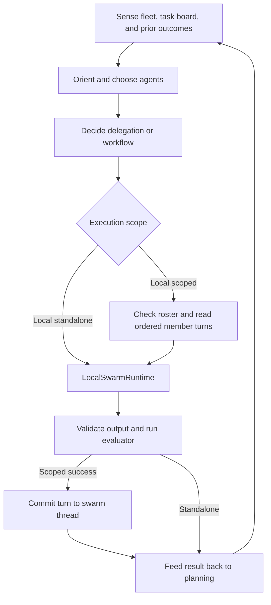

# Swarm Systems — Explanation: Why the Loops Are Shaped This Way

The swarm system separates local execution, type admission,
and result evaluation so each decision has one enforcement point. Its live MCP
surface is 37 local tools (7 delegation/workflow, 3 swarm-scoped thread,
6 fleet/evaluation, 6 agent-registry, 8 swarm-lifecycle, 4 knowledge, 3 A2A
— count by the pinning test for the total and per-file grep for
the partition; `kask/mcp-servers/hkask-mcp-swarm/src/hkask_mcp_swarm.rs`).
The Zed-side Steer surface renders its tool prompt from the same
build-generated name consts, never a hand-maintained list
(`crates/swarm_panel/src/parse.rs`).

## Planner, execution, and feedback

The planning skills produce and steer a delegation plan; the server executes
that plan through the local tools. A local call with `swarm_id` first checks
roster membership, reads the encrypted ordered member conversation, runs the
member with its previous turns, then commits the successful turn. Without a
swarm id, the local agent call is standalone. The task board and event store
track progress and observed handoffs; neither is the member conversation
(`kask/mcp-servers/hkask-mcp-swarm/src/local_tools.rs` (roster check,
ordered turn read, commit; the dispatch tools);
`kask/mcp-servers/hkask-mcp-swarm/src/thread_store.rs`).

<!-- DIAGRAM_ALIGNMENT
id: DIAG-SWARM-030
verified_date: 2026-10-22
verified_against: kask/mcp-servers/hkask-mcp-swarm/src/local_tools.rs (dispatch_in_thread: roster check, ordered turns, commit; thread, delegate tools; fanout); kask/mcp-servers/hkask-mcp-swarm/src/thread_store.rs (lock, turns, append); kask/mcp-servers/hkask-mcp-swarm/src/scoped_dispatch_tests.rs (scoped_plan_broadcast_send_share_history_and_keep_verdict_and_board)
status: VERIFIED
-->

Local operations use the operator's configured inference substrate and do
not require any spend consent. They remain bounded by delegation and
evaluation caps in the local tools (`MAX_FANOUT` at
`kask/mcp-servers/hkask-mcp-swarm/src/local_runtime.rs`;
`MAX_EVAL_TASKS`, `MAX_EVAL_REPEATS`, `MAX_EVAL_ROLLOUTS` at
`kask/mcp-servers/hkask-mcp-swarm/src/local_tools.rs`), and the eval
harness rolls out and scores through the same local dispatch path
(`kask/mcp-servers/hkask-mcp-swarm/src/local_tools.rs`).

## Why the tool surface is router-derived

The build script discovers every `pub(crate) async fn swarm_*` function and
emits the `TOOL_NAMES` const from the annotated router functions
(`kask/mcp-servers/hkask-mcp-swarm/build.rs`). The live-router tests then
compare the total name set against the registered routers
(`kask/mcp-servers/hkask-mcp-swarm/src/hkask_mcp_swarm.rs`).

The 37-tool surface is 7 delegation/workflow tools, three swarm-scoped thread
tools, six fleet/evaluation tools, six agent-registry tools, eight
swarm-lifecycle tools, four knowledge tools, and three A2A tools (per-file
grep over the same signature pattern). `swarm_get_local_agent`
supplies one-card detail and execution statistics; `swarm_workflow_check_local`
validates a card's declared workflow before execution
(`kask/mcp-servers/hkask-mcp-swarm/src/local_tools.rs`).

## Why port labels are registered types

An agent card's `accepts` and `produces` values are type references, not free
labels. Admission rejects unresolved types, and output schemas are checked after
execution when the produced type has a supported schema
(`kask/mcp-servers/hkask-mcp-swarm/src/local_registry.rs:46-63`;
`kask/mcp-servers/hkask-mcp-swarm/src/port_registry.rs:41-170`). Unsupported
JSON Schema keywords surface as `UnsupportedSchema`, not success
(`kask/mcp-servers/hkask-mcp-swarm/src/schema_validate.rs:10-18,222-229`).

The runtime does not infer structured port types from task prose. Its bind
check (`check_bind`) recognizes only universal `text`; all other requests
remain unclassified rather than being guessed
(`kask/mcp-servers/hkask-mcp-swarm/src/local_runtime.rs:551-556`).

## Why the result verdict is produced once

The local runtime is the point where the card, response, tool evidence, schema
verdict, and deterministic evaluator coexist. It stamps the task-success and
contract-check data there — one producer, `LocalSwarmRuntime::delegate` — so fanout,
pipelines, plans, and workflows read the same `LocalDelegateResult` rather
than recomputing it downstream
(`kask/mcp-servers/hkask-mcp-swarm/src/local_runtime.rs`;
batch parity in `delegate_batch`,
`kask/mcp-servers/hkask-mcp-swarm/src/local_runtime.rs`).

## Why the feedback channel is the error surface

The local substrate has no wallet or credit ledger: dispatches are bounded by
roster membership, card allowlists, and the batch caps. A failed dispatch is
surfaced as an error at the tool boundary (`tracing::warn!`, per-variant MCP
error kinds — see the swarm server reference's error model) rather than
collapsed to a silent zero — the feedback loop's closure depends on the
error being visible, never assumed absent.

## Further reading

- [Swarm tool and component reference — with procedures](./reference.md)
