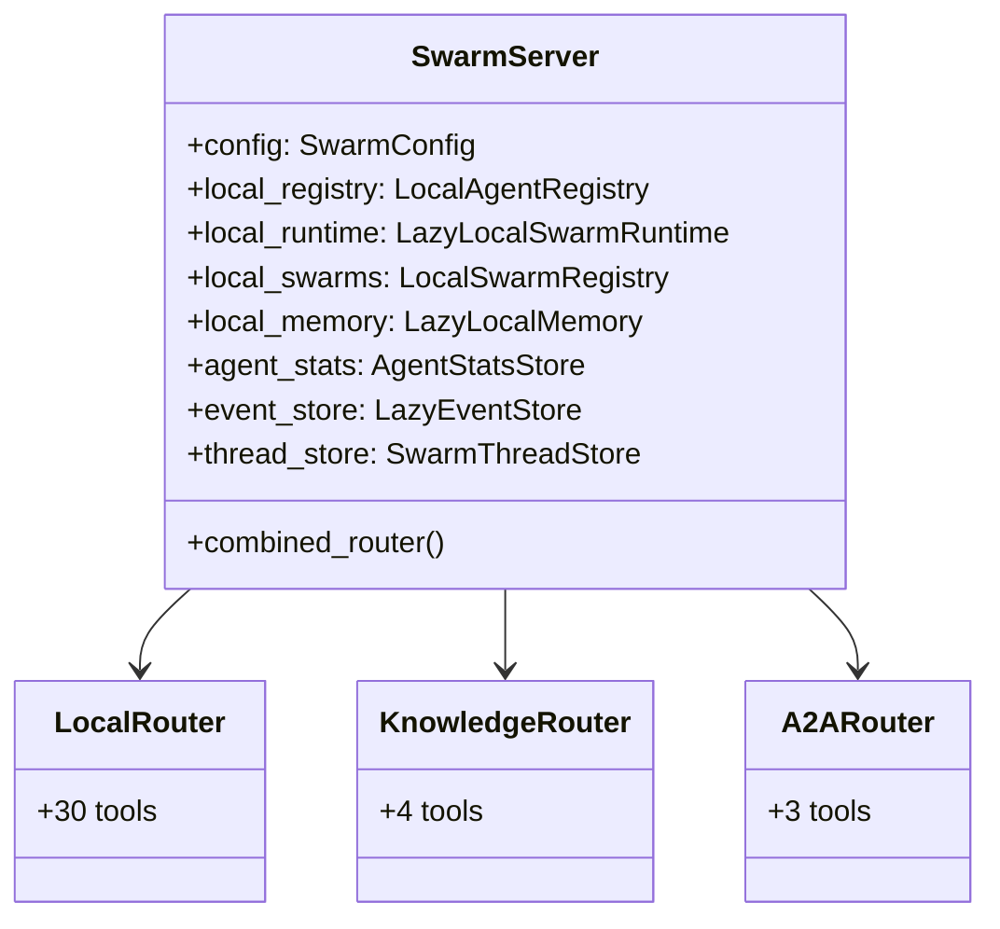
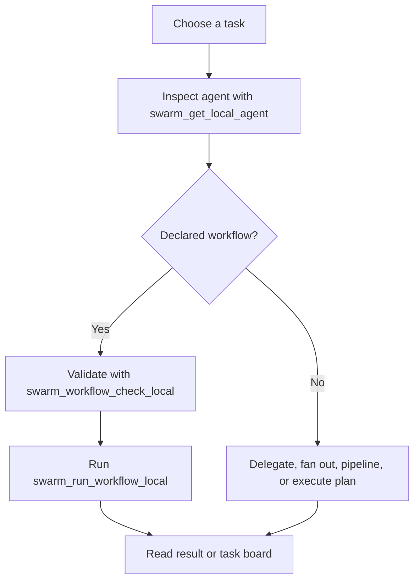

# Swarm Systems — Reference: Tools and Components

`hkask-mcp-swarm` registers 37 tools: 30 local (delegation, workflow, fleet,
evaluation, registry, and swarm lifecycle), 4 knowledge, 3 A2A. The server pins
the live count and name-set equality in its `tool_surface_tests`
(`kask/mcp-servers/hkask-mcp-swarm/src/hkask_mcp_swarm.rs`; the 30/4/3
partition is the per-file count of the same `pub(crate) async fn swarm_*`
signature pattern). The build script derives the list from `swarm_*` function
signatures and router annotations (`kask/mcp-servers/hkask-mcp-swarm/build.rs`).

## Component map

<!-- DIAGRAM_ALIGNMENT
id: DIAG-SWARM-020
verified_date: 2026-10-22
verified_against: kask/mcp-servers/hkask-mcp-swarm/src/hkask_mcp_swarm.rs (SwarmServer fields; tool_surface_tests); kask/mcp-servers/hkask-mcp-swarm/src/local_tools.rs (local_router); kask/mcp-servers/hkask-mcp-swarm/src/knowledge_tools.rs (knowledge_router); kask/mcp-servers/hkask-mcp-swarm/src/a2a_tools.rs (a2a_router)
status: VERIFIED
-->

## Local tools — 30

All 30 are defined in
`kask/mcp-servers/hkask-mcp-swarm/src/local_tools.rs` (the `local_router` is
declared in that module):

| Group | Tools |
| --- | --- |
| Delegation and workflow | `swarm_delegate_local` (standalone), `swarm_delegate_in_thread_local` (member), `swarm_fanout_local`, `swarm_pipeline_local`, `swarm_workflow_check_local`, `swarm_run_workflow_local`, `swarm_observed_seams_local`, `swarm_execute_plan_local`, `swarm_thread_local`, `swarm_list_local_threads` |
| Fleet and evaluation | `swarm_fleet_digest_local`, `swarm_who_answers_local`, `swarm_evaluate_local`, `swarm_task_board`, `swarm_eval_suite_local`, `swarm_eval_agent_local` |
| Agent registry | `swarm_list_local_agents`, `swarm_get_local_agent`, `swarm_remove_local`, `swarm_create_local_agent`, `swarm_reconfigure_local_agent`, `swarm_ai_assist` |
| Local swarms | `swarm_create_local_swarm`, `swarm_list_local_swarms`, `swarm_get_local_swarm`, `swarm_delete_local_swarm`, `swarm_add_agent_local`, `swarm_remove_agent_local`, `swarm_update_local_swarm`, `swarm_clone_local_swarm` |

`swarm_get_local_agent` returns the full local card and measured execution
statistics (`kask/mcp-servers/hkask-mcp-swarm/src/local_tools.rs`;
stats persistence at `kask/mcp-servers/hkask-mcp-swarm/src/agent_stats.rs`).
`swarm_workflow_check_local` validates a declared workflow before execution
(`kask/mcp-servers/hkask-mcp-swarm/src/local_tools.rs`). A provided
`swarm_id` binds supported dispatches to roster membership and the ordered
encrypted member conversation; without it they remain standalone
(the binding mechanism `dispatch_in_thread` at
`kask/mcp-servers/hkask-mcp-swarm/src/local_tools.rs` and its dispatch callers). The eval
suite's
`swarm_id` only selects the task board.

### Knowledge tools — 4

Defined in `kask/mcp-servers/hkask-mcp-swarm/src/knowledge_tools.rs`:

- `swarm_search_knowledge_local`
- `swarm_recall_local`
- `swarm_generate_prompt_local`
- `swarm_generate_ontology_local`

### A2A tools — 3

Defined in `kask/mcp-servers/hkask-mcp-swarm/src/a2a_tools.rs`:

- `swarm_a2a_send`
- `swarm_a2a_card`
- `swarm_a2a_broadcast`

## Typing and validation

The built-in port registry and schema-bearing types live in
`kask/mcp-servers/hkask-mcp-swarm/src/port_registry.rs`. Agent-card
admission rejects unresolved `accepts` or `produces` labels
(`kask/mcp-servers/hkask-mcp-swarm/src/local_registry.rs`). Runtime task
classification is deliberately not guessed; only universal `text` is a
positive bind (`check_bind`,
`kask/mcp-servers/hkask-mcp-swarm/src/local_runtime.rs`).

The minimal schema validator supports `type`, `properties`, `required`,
`items`, `enum`, `const`, and `oneOf`; unsupported keywords produce
`UnsupportedSchema`
(`kask/mcp-servers/hkask-mcp-swarm/src/schema_validate.rs`).

## Local result model

`LocalDelegateResult` carries response text, execution observations, bind and
structural contract checks. The historical `task_success` key records only
response-predicate matches, not task accomplishment or factual accuracy.
Without an evaluator, the task board stays `pending`; unevaluated suite cases remain
`PENDING`, not passed. Local-agent statistics expose `completed_executions`,
errors, tokens, and latency, with no competence ranking. Plan/fanout `succeeded`
counts returned responses only. See `local_runtime.rs`, `agent_stats.rs`, and
`task_board.rs` in the swarm crate.
The event store records rollout and observed-seam evidence through the local
tools; task progress is read through `swarm_task_board`
(`kask/mcp-servers/hkask-mcp-swarm/src/local_tools.rs`).

## Configuration and storage

`SwarmServer` owns the config, local registries/runtime,
local knowledge, statistics, event store, and thread store
(`kask/mcp-servers/hkask-mcp-swarm/src/hkask_mcp_swarm.rs`). The server
resolves the one shared `HKASK_DB_PASSPHRASE` through the canonical MCP helper
before opening encrypted local memory
(`kask/mcp-servers/hkask-mcp-swarm/src/hkask_mcp_swarm.rs`).

## Zed-side surfaces

`crates/swarm_panel` is the editor-side face of the swarm system: a center-pane
`Item` listing local agents and local swarms as cards, plus a Steer-mode
conversation framed around swarm work
(`crates/swarm_panel/src/swarm_panel.rs`). All calls flow through the
governed tool invoker to this server — never ad-hoc HTTP from the UI. The
panel's lifecycle actions (create/reconfigure/remove local agents, create and
edit local swarms, add/remove members) wire to `invoke_tool` calls; its Steer
prompt renders `parse::SWARM_TOOLS` from the generated name consts, never a
hand-maintained list (`crates/swarm_panel/src/parse.rs`). The panel decomposes
into ten feature modules beside its root — `agent_edit`, `ai_assist`,
`author`, `card`, `compose`, `fetch`, `member_turns`,
`panel_button`, `parse`, `swarm_ops` — each extracted from the original panel
body (`crates/swarm_panel/src/swarm_panel.rs`).

The local-swarm public surface is also consumed by `hkask-mcp-kata-kanban`,
which imports `LocalAgentCard`, `LocalAgentRegistry`, and the delegation
result types (`kask/mcp-servers/hkask-mcp-kata-kanban/src/hkask_mcp_kata_kanban.rs`;
`kask/mcp-servers/hkask-mcp-kata-kanban/src/types.rs`).

## Procedures

These procedures use the current 37-tool local surface
(`kask/mcp-servers/hkask-mcp-swarm/src/hkask_mcp_swarm.rs`).

### Choose the execution path

<!-- DIAGRAM_ALIGNMENT
id: DIAG-SWARM-010
verified_date: 2026-10-22
verified_against: kask/mcp-servers/hkask-mcp-swarm/src/local_tools.rs (get agent, workflow check); kask/mcp-servers/hkask-mcp-swarm/src/local_tools.rs (delegation and plan dispatch)
status: VERIFIED
-->

### Delegate to a local swarm member

1. Select a local swarm and inspect its roster with `swarm_get_local_swarm`.
2. Call `swarm_delegate_in_thread_local` with `swarm_id`, a roster member's
   `agent_name`, and the task. Nonmembers are refused before inference. The
   next member receives the earlier committed turns as ordered chat messages
   (`kask/mcp-servers/hkask-mcp-swarm/src/local_tools.rs`).
3. Read the same durable conversation with `swarm_thread_local`
   (`kask/mcp-servers/hkask-mcp-swarm/src/local_tools.rs`); Steer shows
   the selected local swarm's turns beside the Curator conversation. Use
   `swarm_list_local_threads` to find retained history after swarm deletion
   (`kask/mcp-servers/hkask-mcp-swarm/src/local_tools.rs`). A cloned
   swarm begins with an empty conversation.

`swarm_delegate_local` is a **standalone** agent call: it accepts an agent
name and task without a swarm and neither reads nor writes member turns
(`kask/mcp-servers/hkask-mcp-swarm/src/local_tools.rs`). Local calls
require no consent token — authority is roster membership and the card's
declared allowlists. Declared tool and output-contract checks still
apply (`kask/mcp-servers/hkask-mcp-swarm/src/local_runtime.rs`).

### Run a declared workflow safely

1. Inspect the agent with `swarm_get_local_agent`
   (`kask/mcp-servers/hkask-mcp-swarm/src/local_tools.rs`).
2. Call `swarm_workflow_check_local`; do not start execution if the declared
   workflow is invalid
   (`kask/mcp-servers/hkask-mcp-swarm/src/local_tools.rs`).
3. Call `swarm_run_workflow_local` with `swarm_id` when its stages must
   participate in that swarm's ordered conversation; omitting it runs a
   standalone workflow. The tool also records observed handoff seams
   (`kask/mcp-servers/hkask-mcp-swarm/src/local_tools.rs`).
4. Use `swarm_observed_seams_local` to compare observed handoffs with declared
   ports (`kask/mcp-servers/hkask-mcp-swarm/src/local_tools.rs`).

### Fan out, pipeline, or execute a plan

- `swarm_fanout_local`, `swarm_pipeline_local`, and `swarm_run_workflow_local`
  use the shared conversation when `swarm_id` is supplied; without it they
  run standalone. Scoped fanout is ordered, so `parallel: true` with
  `swarm_id` is rejected instead of silently changing its meaning
  (`kask/mcp-servers/hkask-mcp-swarm/src/local_tools.rs`;
  the fanout cap `MAX_FANOUT` at
  `kask/mcp-servers/hkask-mcp-swarm/src/local_runtime.rs`).
- `swarm_execute_plan_local` uses the shared conversation when `swarm_id` is
  supplied; it also records task progress on the swarm's task board
  (`kask/mcp-servers/hkask-mcp-swarm/src/local_tools.rs`).
  Omitting `swarm_id` keeps execution standalone.
- `swarm_task_board` reports progress and verdicts, **not** the conversation
  (`kask/mcp-servers/hkask-mcp-swarm/src/local_tools.rs`).

### Measure agent or swarm reliability

Use `swarm_eval_agent_local` for repeated single-agent rollouts and
`swarm_eval_suite_local` for multi-delegation cases
(`kask/mcp-servers/hkask-mcp-swarm/src/local_tools.rs`, capped by
`MAX_EVAL_TASKS`/`MAX_EVAL_REPEATS`/`MAX_EVAL_ROLLOUTS`). These
are standalone evaluations, not member conversation turns. The suite's optional
`swarm_id` selects task-board progress only; it does not admit members to the
thread.

### Manage local cards and swarms

- `swarm_create_local_agent`, `swarm_reconfigure_local_agent`, and
  `swarm_remove_local` manage local cards
  (`kask/mcp-servers/hkask-mcp-swarm/src/local_tools.rs`;
  registry listing/detail in the same module).
- Local swarm CRUD and membership tools are defined at
  `kask/mcp-servers/hkask-mcp-swarm/src/local_tools.rs`.
- `swarm_clone_local_swarm` copies a swarm's mission and roster to a fresh id
  (`kask/mcp-servers/hkask-mcp-swarm/src/local_tools.rs`).

## Further reading

- [Swarm explanation](./explanation.md)