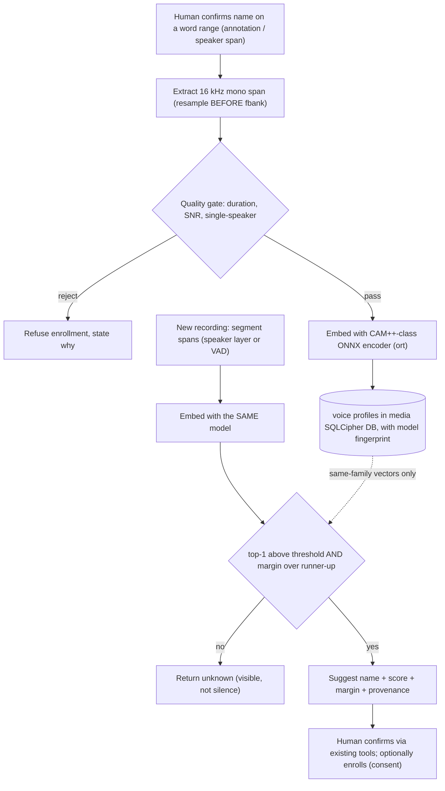

# educt cross-recording speaker identity — research findings and implementation plan

Status: **ratified 2026-10-27 ("please proceed") — Phase 0 (goal, pre-registered evaluation) and the Phase 1 backlog are in execution; no implementation code yet.**
Date: 2026-10-27 · Basis: bounded deep-research run `e99d0ff4045bfb64` (completed 2026-10-28;
~90 server-recorded sources; 12 web searches + 8 full extractions + 5 paper identity
resolutions; 14 core artifacts evaluated across 11 domains, average evidence confidence
0.84, semantic duplication tier "stable"; 7 load-bearing sources agent-annotated `verified`
with recorded basis) plus live tree reads of `kask/mcp-servers/hkask-mcp-media/src/`.
Author: Z-K agent (technical program manager) · Operator: principal investigator
(review, go/veto).

Claim tags used throughout: **[tree]** verified in the working tree · **[ref]** inspected
primary source (numbered in §11) · **[vendor]** vendor-reported claim · **[snippet]**
search-result-level only · **[inference]** reasoning from tagged evidence ·
**[proposed]** design proposal, not built. Every performance number below is
source-reported under its stated evaluation conditions and is claimed for `educt`
by no one until the §8 evaluation runs.

## 0. Done means (functional outcome)

- You can confirm a speaker's name once, on an exact word range of one recording —
  the confirming human act is the consent record (§5.5) — and that confirmation
  becomes a durable, locally stored **voice profile** (never an LLM-produced
  vector; never leaving the machine).
- On any other stored recording, speaker spans surface as **scored identity
  suggestions** — name, similarity, margin, model identity, matched profile — or an
  explicit **`unknown`**, visible either way; nothing is silently guessed and nothing
  auto-applies (suggest-only mode is the recorded decision).
- A human confirms or rejects suggestions through the annotation and speaker-label
  tools that already exist; human-confirmed labels and machine suggestions remain
  visibly distinguishable forever (score + provenance).
- Removal of a profile sweeps its embeddings and every derived suggestion layer in
  the same change; exports and the corpus handoff never carry voiceprint data; and
  a profile that stops being matched ages out under the same decay valve as any
  other memory.
- Independent of the identity feature: transcripts carry confidence-flagged
  "review recommended" markers; the text speaker pass can repair short-span
  attribution errors without touching long monologues; a selected word range can be
  re-transcribed and reconciled without corrupting the immutable source words.

## 1. Decisions

Operator decisions recorded 2026-10-27:

| # | Decision (functional) | State |
|---|---|---|
| D1 | Adopt cross-recording speaker identification at all | **Yes** |
| D2 | Suggest-only vs auto-apply above a calibrated threshold | **Suggest-only** — auto-apply is not adopted; any future revisit is gated on the §8 measured calibration |
| D3 | Consent and retention policy for voiceprints | **Resolved 2026-10-27 (operator ruling): voice profiles are memories** — consent inherits the existing human-act interaction pattern; retention inherits the memory decay pattern (§5.5). Not a blocker. |
| D4 | Backlog the three cheap wins now, independent of identity | **Confirmed 2026-10-27: yes, ordered 1a → 1b → 1c (§7 Phase 1)** |

Technical decisions (TPM's, presented for functional veto): T1 ONNX encoder path
(§6), T2 model-fingerprint comparability, T3 durable SQLCipher profile storage,
T4 threshold+margin matching semantics, T5 distinct identification layer, T6
pattern inheritance with storage separation (voice profiles as memories).

## 2. Definitions and ontology status

`speaker diarization` and `speaker embedding` resolve only to the coarse 5W1H core
anchor in the local ontology ladder (verified via `onto_anchor` this run);
`speaker identification` resolves on CSO 3.5 (`cso:speaker_identification`).
This plan therefore uses published research definitions and files an ontology-ruling
follow-up (§10), not a private taxonomy.

| Term | Working definition (source) |
|---|---|
| Speaker diarization | Partitioning an audio stream into homogeneous segments by speaker identity — "who spoke when" [2][4]. Output is recording-local cluster labels (`SPEAKER_00`, `spk_0`), never names [2][14] |
| Speaker clustering | Grouping per-segment embeddings into per-recording clusters (pipeline stage; community-1 = powerset segmentation + WeSpeaker embedding + VBx clustering [1]) |
| Speaker identification (closed-set) | 1:N classification among enrolled speakers [10] |
| Speaker identification (open-set) | Closed-set plus rejecting non-enrolled speakers → `unknown` — the correct model for `educt` |
| Speaker verification | 1:1 same-voice decision; the building block under open-set ID [10] |
| Voice/speaker embedding | Fixed-length vector from a speaker-discriminative encoder (ECAPA-TDNN 192-d, WeSpeaker ResNet34 256-d, CAM++ 192-d [10]); **not comparable across models or versions** [10] |
| Enrollment | Registering reference embeddings for a person (multi-segment enrollment is the NIST-standard structure [19][20]) |

**Diarization ≠ identity.** Measured, not rhetorical: a text-only LLM asked to
correct speaker labels broke 1,547 accurately diarized words while fixing 328 on
≥6-word monologues in 4-speaker meetings, "because text alone carries no acoustic
voiceprint information" [3]. Diarization gives `SPEAKER_00`; only enrollment +
acoustic matching, or a human, gives a name.

## 3. Findings (condensed; full citations §11)

### 3.1 Diarization state of the art, by evaluation condition

The independent ETH benchmark [4] (five systems, out-of-the-box, 196.6 h across
CALLHOME/VoxConverse/AMI/AliMeeting; EN/zh/de/ja/es; DER 0.25 s collar,
`skip_overlap=False`) found:

- **pyannoteAI (commercial cloud)** best overall at 11.2% DER, most stable across
  speaker counts (2 spk 9.9% → 5+ spk 6.6%).
- **DiariZen (open-source hybrid: WavLM EEND + pyannote clustering)** best open
  alternative at 13.3% DER; best on VoxConverse (5.2%) and at 5+ speakers (7.1%).
- **Sortformer v1/v2 (NVIDIA E2E)**: hard **4-speaker architectural limit**,
  degrading at 5+ (22.7%); best per-language on Mandarin (9.2%) and Japanese
  (12.7%); fastest (RTF 214.3× vs pyannote 45.0×, DiariZen 20.2×); needs 12-minute
  chunking for long audio.
- **pyannote 3.1 open model**: weakest of the five in this out-of-box setting
  (e.g., 19.8% zh, 28.8% ja per-language).
- **Dominant failure mode across all systems: missed speech** — ~350 ms boundary
  errors on segment onsets/offsets, not missed short segments; speaker confusion
  dominates only in high-speaker-count out-of-envelope conditions.

The successor **pyannote community-1** model card [1] (CC-BY-4.0, gated; powerset
segmentation + WeSpeaker embedding + VBx clustering) self-reports no-collar,
no-skip DERs: DIHARD-3 20.2, VoxConverse 11.2, AMI IHM 17.0, CALLHOME 26.7,
AliMeeting 20.3, AISHELL-4 11.7, MSDWild 22.8, REPERE 8.9, and the hard in-the-wild
sets AVA-AVD 44.6 / Ego4D dev 46.8 — plus offline use via local clone, CPU-default
processing, `num_speakers`/`min`/`max` hints, and an **exclusive-diarization output**
purpose-built to ease reconciliation with ASR word timestamps. The two evaluations
use different collars/overlap handling — their numbers are not comparable.

Condition-specific lineage [7][8][9][25]: EEND (overlap-native, speaker-count/length
limited); Transcribe-to-Diarize SA-ASR (joint diarization + *attribution* for
unlimited speakers); overlap-aware resegmentation; PixIT; Streaming Sortformer [5]
(arrival-order speaker cache for streaming).

- **Overlapping speech**: the hardest axis everywhere — benchmark sets average
  12.58% (CALLHOME) to 19% (AliMeeting) overlap [4]; every inspected local stack
  declines to resolve it (WhisperX: "not handled particularly well" [2]; LocalAI:
  "overlapping speech is not resolved" [10]; meetily: one label per VAD segment
  even with two speakers [15]).
- **Short turns**: two measured mechanisms — boundary-timing misses [4], and
  short-segment embedding degradation (DiarizationLM attributes disfluency-turn
  errors to low-quality embeddings from very short segments [3]). ERes2NetV2 [23]
  is explicitly designed for short-duration verification.
- **Multilingual**: per-language DER varies by system (Mandarin/Japanese favor
  Sortformer; English/German/Spanish favor pyannoteAI [4]); encoders are acoustic
  and largely language-agnostic, but composition stacks are not (WhisperX
  alignment models are language-specific [2]; vendor language claims [26] are
  vendor-reported).
- **Recording quality / channel shift**: DER roughly doubles on in-the-wild sets
  (AVA-AVD, Ego4D [1]); NIST SRE designs explicitly study variable-duration
  enrollment, short probes, multi-person recordings, low-false-alarm operating
  points, and cross-lingual trials [19][20].
- **Long-form**: batched VAD-segmented inference (WhisperX, 70× real time [2]);
  Sortformer chunking beyond 12 min [4]; LLM prompt segmentation for context
  limits [3]. `educt`'s canonical 16 kHz mono assets and word-timed bundles
  [tree] match this stack's input assumptions exactly.

### 3.2 Local voice-identity stacks (the enrollment side)

| Stack | Models | Deployment | Matching semantics (source) | Comparability discipline | Documented gaps to avoid |
|---|---|---|---|---|---|
| sherpa-onnx [11] | wespeaker-voxceleb CAM++/ResNet, 3D-Speaker ERes2Net(V2); ONNX | **Local CPU** (onnxruntime; x86_64/ARM/embedded; no internet) | caller-built | caller-built | DIY contract |
| LocalAI voice-detect [10] | ECAPA-TDNN 192-d, WeSpeaker ResNet34 256-d, ERes2Net, CAM++ (Apache-2.0; GGUF C++ engine, no Python) | **Local** | cosine-distance ≈0.25 (ECAPA) / ≈0.30 (WeSpeaker) / ≈0.28 (ERes2Net); diarization naming: threshold 0.5 + **margin 0.05 over runner-up** | **encoder fingerprint: family string + sha256 weights; different-dimension stores never cross-compared** | in-memory registry lost on restart; global shared registry; overlap unresolved; no anti-spoofing head; "permission does not establish biometric consent" (their words) |
| meetily PR #511 [15] | WeSpeaker CAM++ ~28 MB ONNX via Rust `ort`; pure-Rust fbank | **Local, on-device, Rust** | online cosine clustering; persistent voice profiles (`speaker_profiles` table) | single-model profiles | VAD-segment granularity; similar voices merge; caught 48 kHz→16 kHz resample bug that silently corrupted embeddings |

Cloud-only alternatives (pyannoteAI Precision-2 [1][4]; Amazon Transcribe 30-speaker
`spk_0..29` [14]; AssemblyAI/Deepgram [26] `[vendor]`) exist but transmit audio off
machine and are excluded by D2's local-first consequence.

**Synthesis [inference]:** for a local Rust MCP under the kask no-Python rule, the
practical SOTA path is an ONNX speaker encoder (WeSpeaker CAM++ class) behind
`ort` — exactly what meetily proved works in pure Rust [15] — not
pyannote-in-Python.

### 3.3 The LLM/agentic layer: orchestration, not acoustics

- **DiarizationLM** [3] (full v13 text inspected): ASR+diarization outputs → compact
  `<spk:N>` text → optionally finetuned LLM → **Transcript-Preserving Speaker
  Transfer** (Levenshtein align + Hungarian assignment) re-attaches corrected
  labels to the *original* ASR words (WER untouched). Finetuned PaLM 2-S: Fisher
  WDER 5.32→2.37, Callhome 7.72→4.25. **Zero-/one-shot LLMs made things worse**
  (11.96 vs 5.32 baseline — they delete text); task-finetuning is required. The
  **multi-speaker paradox**: naive SFT degrades 4+-speaker meetings (AMI
  15.68→17.61) via long-monologue speaker collapse; the fix is locality gating
  (accept LLM edits only on short disagreement spans, ≤5 words). Appendix B
  demonstrates LLM autofill of speaker **names from metadata** and roles — naming
  from text context, not voice.
- **SpeakerLM** [6]: one multimodal LLM for diarization *and named recognition*
  end-to-end (AAAI-26). Research artifact; weights/deployment not inspected —
  directional signal only.
- **Transcript correction in production** is targeted re-processing, not LLM
  rewriting: Reduct re-transcribes flagged sections with a specialized noisy-audio
  model [12]; WhisperX added context-aware interleaved batching for
  punctuation/proper-noun accuracy [2]; `educt`'s correction pass already follows
  the same never-mutate-source discipline [tree].
- **Agentic video analysis** (2025–26 pattern: planner → grounder → answerer with
  temporal grounding): VideoMind [21], VideoExplorer [22], VideoExpert/TimeChat/
  VTG-LLM [30]`[snippet]`. `educt`'s `video_caption` is the same architectural
  class at small scale — sampled frames through a vision model with explicit
  visual-only limitations [tree]; what it lacks versus the reference agents is the
  retrieval/grounder loop over its own stored layers.

**Consequence for `educt` [inference]:** LLM passes legitimately correct short-span
word attribution and propagate names given by humans or metadata; voice identity
must come from embeddings + enrollment. The two compose: embeddings propose the
name candidates; the LLM pass cleans boundary errors; humans confirm.

### 3.4 Reduct baseline vs current `educt` (separated capability classes)

Reduct reference behavior, inspected [12][13]: voice-based Speaker 1/2 grouping;
rename propagates to all instances by default; per-paragraph speaker correction;
confidence-scored "Review recommended" flags; section re-transcribe; advanced
word-timing correction; text-deletion = video-editing; highlights → cross-recording
reels. (Product-page accuracy/language claims are `[vendor]`.)

**Demonstrated in tree [tree]** (paths under `kask/mcp-servers/hkask-mcp-media/src/`):
transcript persistence keyed to media path + gallery asset with word-level timing
bundles (`transcript_store.rs`: `transcripts`, `transcript_layers`,
`transcript_exports`, `transcript_renders`); six layer kinds
(speaker/paragraph/correction/highlight/edl/realignment) with provenance
(`templates.rs`, `transcript_layers.rs`); speaker pass with audio-source default
and per-span `speaker`+`confidence`, overlapping spans rejected
(`hkask_mcp_media.rs` tests `educt_speaker_pass_*`); correction → apply →
realignment with re-anchored timings and working-view→source index translation;
paragraph pass; semantic highlight pass; researcher annotations over immutable
source-word indices; EDL compose from highlights and lossless ffmpeg render;
exports (SRT, highlights CSV, corpus_text); bounded lexical search; gallery vision
pipelines and a validated face registry (`faces.rs`, `gallery/store.rs`
`face_registry`) with **no stored embeddings by recorded design** (`faces.rs`
documents that an LLM-produced-"embedding" cosine path was removed because LLMs
cannot emit geometrically consistent vectors); media jobs; transcription via
cloud `OpenRouter/openai/whisper-large-v3-turbo` (sole default STT).

**Externally demonstrated reference behavior, not yet in tree [ref]**: review
flags; section re-transcribe; any acoustic diarization; any voice identity;
enrollment. Everything in §5 below is **[proposed]**.

## 4. Why this feature, evidence-first

- The need is real: Reduct's whole correction flow exists because voice-based
  auto-grouping is imperfect and humans must rename clusters [12]; once renamed,
  Reduct remembers the name only within (implicitly) its project context —
  cross-recording voice persistence is the open complement, and every 2025–26
  local stack we inspected is converging on exactly this feature [10][15].
- The acoustic half is deployable locally under house rules: ONNX encoder + Rust
  `ort` + pure-Rust fbank, proven in the wild at ~28 MB model size [15].
- The failure boundaries are documented and mitigable: overlap [2][4][10][15],
  short segments [3][4][23], similar voices [15], voice conversion [16][17][18] —
  all mitigated by suggest-only mode + visible `unknown` + human confirmation (D2).
- The tree already enforces the two disciplines the feature needs:
  layer-stamped provenance, and no-LLM-embeddings [tree].

## 5. Feature design: cross-recording speaker identification (suggest-only)

The core mechanism: a name confirmed once on a word range in bundle A — the
confirming human act is the consent record (§5.5) — becomes a durable voice
profile; later bundles get their spans embedded with the *same* model and matched;
matches surface as **scored suggestions** that a human confirms through the tools
that already exist.

<!-- DIAGRAM_ALIGNMENT
id: DIAG-ARCH-SPEAKER-IDENT-001
verified_date: 2026-10-27
verified_against: the existing-tree nodes — the human-confirmation act over word ranges (kask/mcp-servers/hkask-mcp-media/src/tools/educt.rs:672 `educt_annotation_create`), the validated speaker layers and their attribution spans (educt.rs:1034 `educt_store_layer`, educt.rs:1131 `educt_speaker_pass`), the 16 kHz mono canonical-asset path (kask/mcp-servers/hkask-mcp-media/src/tools/audio.rs:4 `CAPTURE_SAMPLE_RATE`), and the SQLCipher profile-table placement beside `face_registry` (kask/mcp-servers/hkask-mcp-media/src/faces.rs:399). The quality-gate, CAM++-class enrollment, voice-profile-table, and threshold/margin-matching nodes are this document's §5 design contract (operator decisions D1–D4) — planned, not yet-implemented code; Phase 1a (`transcript_review.rs` review flags) is the only landed phase.
status: VERIFIED
-->

### 5.1 Enrollment

Source of truth is a human act: `educt_annotation_create` with the person's name
over a confirmed word range, or a human-confirmed span of an existing speaker
layer [tree provides both]. Word timings give exact audio spans from the media
path stored on the transcript row [tree]. Extract 16 kHz mono PCM via the existing
ffmpeg decode path — **resample before feature extraction** (meetily's caught bug:
48 kHz fed to a 16 kHz fbank produced garbage embeddings silently [15]). Quality
gate: minimum enrollment duration over several segments (community practice
~10–30 s `[snippet]`; short-segment embedding degradation is the mechanism [3]),
an SNR check, and a single-speaker check once any diarization layer exists.
**Retain full provenance**: transcript_id, word range, media path + gallery asset,
extraction parameters, embedding model identity + version — mirroring the
OMC-provenance discipline applied to rendered reels [tree].

### 5.2 Voice profiles (storage)

One encoder, pinned (T1): a WeSpeaker CAM++-class ONNX model through `ort`
(Apache-2.0 [11][15]; ~28 MB [15]); ERes2NetV2 [23] as the short-duration
alternative. Store per-segment vectors *and* a duration-weighted profile centroid
in new SQLCipher tables beside `face_registry` — durable across restarts
(LocalAI's in-memory registry is the documented anti-pattern [10]; multi-segment
enrollment is the NIST-standard structure [19]). **Comparability is model-scoped
(T2)**: every vector carries `model_family` + weights hash (LocalAI's fingerprint
pattern [10]); cross-model/cross-version comparison is rejected with a named
reason; a model change means re-enrollment — never silent interop. No
LLM-generated embeddings (faces.rs precedent [tree]). At expected scale (tens of
profiles) linear scan suffices [inference]; keep the door open for indexing.

### 5.3 Matching (suggest-only, D2)

Segment candidate audio using the existing speaker layer when present
(sub-splitting long spans), else simple speech segmentation. Embed with the
**same** model; cosine similarity against all profile vectors and centroids.
Decide with inspected starting parameters — threshold ≈0.25–0.30 cosine distance
(per-encoder) and **margin ≈0.05 over the runner-up** [10] — plus a minimum probe
duration. Below threshold/margin: **`unknown`, returned visibly** (degradation is
surfaced, never silent — house rule). Multiple enrolled speakers: the margin rule;
very similar voices are a documented merge risk [15]. Overlap-flagged segments:
return `unknown`/mixed rather than guess [10][15]. Channel/recording variation:
expect degradation [19][20]; thresholds are calibrated per-condition locally, and
LocalAI's "check the threshold on your own audio" is the governing rule [10].
**Voice conversion is an explicit out-of-scope threat in v1**: no anti-spoofing
head exists in the inspected local stacks [10], and VoicePrivacy 2026 trains
attackers on large-scale converted speech [16] — a strong reason suggest-only
(D2) is the right first mode. Suggested-but-wrong matches are corrected by
confirming the right name (which itself may enroll — the same human act is its
consent).

### 5.4 Identity application

Matches propagate as a **distinct identification layer** (T5) carrying name,
score, margin, threshold version, model fingerprint, matched profile id — never
mutating human-confirmed speaker layers or annotations. Reduct's
rename-all-instances UX [12] is the confirmation-flow target; machine-suggested
and human-confirmed labels stay visibly distinguishable (score + provenance),
preserving the human-judgment / machine-evidence separation.

### 5.5 Correction and governance — voice profiles are memories (D3, resolved 2026-10-27)

The operator ruling resolves D3 without new policy machinery: **voice profiles are
memories and inherit the system's existing memory governance** (pragmatic-cybernetics
feedback discipline + pragmatic-semantics IS/OUGHT: the OUGHT "invent a consent and
retention policy" was the wrong framing — the IS is that the system already governs
remembered things about people).

- **Consent = the existing human-act interaction pattern.** Enrollment already *is*
  a human act — a name confirmed on a word range. The confirming human is the
  consent authority; the annotation plus provenance (who, which words, which media,
  which model) *is* the consent record; the profile exists for one purpose
  (transcript-workflow suggestions). This satisfies the standing curator prior on
  voice enrollment exactly: opt-in and purpose-specific; unknown/reject outcomes
  retained (§5.3); retention and deletion controls (below); no silent linking
  across recordings (D2 suggest-only + visible provenance).
- **Retention = the memory decay pattern.** Profile rows carry
  `last_confirmed_match_at`; a human-confirmed match is a recall event that
  refreshes the decay clock; unmatched profiles age toward the same prune-valve
  semantics the memory system uses (age-based pruning that spares recently
  recalled items). Prune parameters surface as the same class of knob as the
  curator's memory prune valve, applied where the embeddings live.
- **Deletion control.** A `voice_remove` analog to `face_remove` sweeps embeddings,
  centroids, and derived identification layers in the same change (orphan-cleanup
  house rule) — the standing prior's deletion control.
- **Boundary (T6):** the *pattern* is inherited; the *storage* is never merged.
  Voiceprints are biometric artifacts and stay in the media SQLCipher DB — never
  inserted into the curator memory store, exports, or the corpus_text handoff.
  Only the suggestion-layer records (name, score, provenance) are ordinary
  non-biometric transcript layers.
- Every match decision records its threshold version for audit.

## 6. Technical decisions (TPM; functional consequence stated)

- **T1 — ONNX encoder via `ort`, pure-Rust fbank.** Consequence: no Python
  service, no GPU requirement, audio never leaves the machine — a Python/pyannote
  dependency could not offer this under the kask no-Python rule. Alternative
  encoder (ERes2NetV2) remains a drop-in for short-duration-heavy material [23].
- **T2 — model-scoped comparability.** Consequence: a future model upgrade means
  re-enrollment with a visible reason, never silently mixed vector spaces.
- **T3 — durable SQLCipher storage in the media DB.** Consequence: profiles
  survive restarts (LocalAI's loss-on-restart is their own documented gap [10]);
  protected by the existing `HKASK_DB_PASSPHRASE` chain.
- **T4 — threshold + margin + min-duration semantics.** Consequence: matches are
  conservative by default; ambiguity surfaces as `unknown` instead of a wrong name.
- **T5 — distinct identification layer.** Consequence: suggestions are diffable,
  revertible, and never contaminate human-confirmed records.
- **T6 — pattern inheritance, storage separation.** Consequence: voice profiles get
  memory lifecycle semantics (decay + recall-refresh + removal) with zero new
  policy machinery, while embeddings stay out of every memory/export surface.

## 7. Phases and acceptance criteria

Work state lives on the **educt speaker identity** kanban board (created
2026-10-27); every task cites the goal criterion it advances, and live
identifiers are recorded in §12.

### Phase 0 — governance gates (no build)

- On operator ratification: create the kanban goal from §0 Done-means with this
  plan as the immutable specification source (the transcript-bench governance
  pattern); pre-register the §8 evaluation experiment (fixed eval set, metrics,
  and to-be-calibrated thresholds) via `experiment_propose` before any Phase 2/3
  code. **Acceptance:** goal exists with criterion ids; experiment registered and
  linked to the goal before any Phase 2/3 code. (Seal timing, corrected against
  the experiment server's P2 contract, 2026-10-27: `experiment_seal` requires a
  recorded baseline fitness, so the seal lands in Phase 4 immediately after the
  first baseline measurement — attesting a non-saturated baseline — before any
  final evaluation or selection. Registration, not the seal, is the pre-build
  gate.)
- D3 recorded: voice-as-memory policy (§5.5) — consent via the existing human-act
  pattern; retention via decay + recall-refresh + removal.

### Phase 1 — cheap wins track (independent of identity; D4 confirmed)

- **1a Review flags.** Acceptance: paragraph blocks in the panel and exports show
  a review-recommended marker with the pass's stored confidence [12][tree];
  absence of confidence data surfaces "no confidence recorded", never a fake
  green. No new model dependencies.
- **1b Gated lexical speaker post-pass.** Acceptance: the text speaker pass gains
  an optional correction mode gated to short spans (≤5-word contiguous
  disagreements — the DiarizationLM locality boundary [3]); long-span edits are
  refused and the refusal surfaced; a spot-check on at least one real
  multi-speaker recording with human-confirmed labels shows no long-monologue
  damage before merge.
- **1c Section re-transcribe.** Acceptance: a selected word range can be
  re-transcribed; the result lands as a candidate correction layer reconciled
  through the existing realignment path [tree]; source words never mutated;
  conflicts surfaced, not silently merged [12].

### Phase 2 — enrollment + voice profiles

Acceptance: a confirmed speaker can be enrolled with the confirming human act
recorded as the consent record (full provenance, §5.5); the profile survives a
server restart; profile rows carry `last_confirmed_match_at` and the decay valve
spares recently matched profiles (test); `voice_remove` sweeps all embeddings and
derived layers in one change; embeddings are asserted absent from all export
paths; the resample-before-fbank invariant is pinned by test [15]; cross-model
comparison is rejected with a named reason (test).

### Phase 3 — matching, suggest-only

Acceptance: on any stored recording, spans surface scored suggestions or explicit
`unknown`; suggestions live in a distinct identification layer with score,
margin, threshold version, and profile id; the panel and exports render them as
suggestions with provenance; human confirmation flows through the existing
annotation tools; any pipeline failure degrades to unlabeled (meetily safety
pattern [15]) — never to a guess.

### Phase 4 — local evaluation and threshold calibration

Acceptance: the §8 protocol runs on session-disjoint local recordings; results
are recorded; thresholds re-pinned from local data (source thresholds are
starting points only [10]); a report is filed. **No accuracy claim about `educt`
voice identity may exist anywhere before this phase reports.**

## 8. Evaluation plan (pre-registered before build)

- **Dev set:** session-disjoint recordings from the operator's own media: enroll
  from recording A, probe recordings B/C; include non-enrolled speakers as
  unknowns.
- **Metrics (NIST practice [19][20]):** top-1 identification accuracy;
  false-accept / false-reject at the operating point; unknown-rejection rate;
  EER/minDCF curves for threshold selection; per-condition breakdowns (duration
  buckets, overlap, noise, channel). Component metrics: DER for any added
  diarization stage; WDER/cpWER for word attribution [3].
- **Gate:** the eval contract is frozen at registration (experiment
  `exp_1d2d6140796a481eba7deb63fbfaf1f2`, baseline variant
  `var_2caa24f72efd4059adbf10c70b22f3de`); the seal is applied after the first
  baseline fitness record — the server's P2 requires a measured baseline —
  before final evaluation. Phase 4 results are the only permitted basis for any
  accuracy statement; a future auto-apply revisit (not adopted, D2) would
  additionally require a measured false-accept rate at the chosen operating
  point below an operator-set ceiling.

## 9. Risks and mitigations

| Risk | Evidence | Mitigation |
|---|---|---|
| 48 kHz→16 kHz resample silently corrupts fbank embeddings | caught live in meetily [15] | invariant + test at the extraction seam |
| Cross-model embedding comparison | LocalAI dedicates its whole fingerprint section to this [10] | T2 fingerprint + typed rejection |
| Overlapping speech mis-attribution | every inspected stack declines to resolve [2][4][10][15] | `unknown`/mixed for overlap-flagged spans; later overlap-aware resegmentation (backlog) |
| Similar voices merge | meetily known limit [15] | margin rule + suggest-only (D2) |
| Voice conversion / spoofed probes | [16][17][18] | out of scope v1; suggest-only + human confirmation mitigates |
| Biometric privacy | LocalAI's own consent warning [10] | voice-as-memory governance (§5.5): human-act consent, decay + removal, local-only storage, export exclusion (T6) |
| Gated HF model friction (pyannote path) | [1] | T1 uses sherpa ONNX releases [11]; pyannote-class weights remain an optional later import |
| Vendor numbers treated as local claims | [26] and all §3 tables | completion gate: only Phase 4 measures speak for `educt` |

## 10. Coverage gaps and follow-ups carried forward

- VoicePing multilingual open-set benchmark (extraction failed — JS shell): consult
  when writing the Phase 4 protocol; its 4 s-probe / 4-enrollment-sample framing
  remains `[snippet]`.
- "Aurora" speech foundation model: unverifiable via bibliographic resolution —
  excluded from all claims.
- NIST SRE24 full text (excerpt-level), SpeakerLM artifact availability, ECAPA
  original paper, pyannote-audio code license (model card inspected: CC-BY-4.0
  gated [1]): open for a follow-up pass if they become load-bearing.
- **Ontology ruling request:** improve the coarse 5W1H anchors for
  `speaker diarization` and `speaker embedding` — proposal: pin to the Park et
  al. (2022) review definition as cited in [4] and the [1] model-card framing.

## 11. References

Verification levels: **[verified-extraction]** full page/paper read server-side
under the run ledger; **[resolved-identity]** typed bibliographic identity
resolved; **[metadata]** arXiv/provider metadata; **[vendor]** vendor-reported;
**[snippet]** search-result-level only.

1. pyannoteAI / H. Bredin (2025). *pyannote/speaker-diarization-community-1 (model card).* Hugging Face. https://huggingface.co/pyannote/speaker-diarization-community-1 — [verified-extraction]
2. M. Bain et al. (2023–2026). *WhisperX: Automatic Speech Recognition with Word-level Timestamps (& Diarization).* GitHub, BSD-2-Clause. https://github.com/m-bain/whisperX — [verified-extraction]
3. Q. Wang, Y. Huang, G. Zhao, E. Clark, W. Xia, H. Liao (2024). *DiarizationLM: Speaker Diarization Post-Processing with Large Language Models.* Interspeech 2024; arXiv:2401.03506 (v13, 2026-10-11). https://arxiv.org/abs/2401.03506 — [verified-extraction]
4. L. A. Lanzendörfer, F. Grötschla, C. Blaser, R. Wattenhofer (2025). *Benchmarking Diarization Models.* arXiv:2509.26177. https://arxiv.org/abs/2509.26177 — [verified-extraction]
5. I. Medennikov, T.-J. Park, W. Wang, H. Huang, K. Dhawan, J. Wang, J. Balam, B. Ginsburg (2025). *Streaming Sortformer: Speaker Cache-Based Online Speaker Diarization with Arrival-Time Ordering.* Interspeech 2025. doi:10.21437/interspeech.2025-2244 — [resolved-identity]
6. H. Yin, Y.-F. Chen, C. Deng, L. Cheng, H. Wang, C.-H. Tan, Q. Chen, W. Wang, X. Li (2026). *SpeakerLM: End-to-End Versatile Speaker Diarization and Recognition with Multimodal Large Language Models.* AAAI-26. doi:10.1609/aaai.v40i40.40745 — [resolved-identity]
7. N. Kanda, X. Xiao, Y. Gaur, X. Wang, Z. Meng, Z. Chen, T. Yoshioka (2022). *Transcribe-to-Diarize: Neural Speaker Diarization for Unlimited Number of Speakers Using End-to-End Speaker-Attributed ASR.* ICASSP 2022. doi:10.1109/icassp43922.2022.9746225 — [resolved-identity]
8. Y. Fujita, N. Kanda, S. Horiguchi, K. Nagamatsu, S. Watanabe (2019). *End-to-End Neural Speaker Diarization with Permutation-Free Objectives.* arXiv:1909.05952 — [metadata]
9. H. Bredin, A. Laurent (2021). *End-to-end speaker segmentation for overlap-aware resegmentation.* arXiv:2104.04045 — [metadata]
10. E. Di Giacinto / LocalAI (2026, updated 2026-10-22). *Voice Recognition (LocalAI documentation).* https://localai.io/docs/features/voice-recognition/index.html — [verified-extraction]
11. k2-fsa / next-gen Kaldi (accessed 2026-10-27). *Speaker Identification — sherpa-onnx documentation.* https://k2-fsa.github.io/sherpa/onnx/speaker-identification/index.html — [verified-extraction]
12. Reduct.Video (accessed 2026-10-27). *Correcting AI Transcripts.* https://help.reduct.video/en/articles/correct-ai-transcript — [verified-extraction]
13. Reduct.Video (2026). *Product & Features.* https://reduct.video/product/ — [vendor]
14. AWS (accessed 2026-10-27). *Partitioning speakers (diarization) — Amazon Transcribe.* https://docs.aws.amazon.com/transcribe/latest/dg/diarization.html — [verified-extraction]
15. KrtinShet (2026). *feat(diarization): local speaker identification with persistent voice profiles.* meetily PR #511. https://github.com/Zackriya-Solutions/meetily/pull/511 — [verified-extraction]
16. M. Todisco, M. Panariello, N. Evans (2026). *The VoicePrivacy 2026 challenge evaluation plan.* EURECOM. https://www.eurecom.fr/en/publication/8676 — [snippet]
17. Z. Li, Y. Lin, T. Yao, H. Suo, M. Li (2024). *The Database and Benchmark for Source Speaker Verification Against Voice Conversion.* arXiv:2406.04951 — [metadata]
18. X. Liu, X. Wang, M. Sahidullah, J. Patino, H. Delgado, T. Kinnunen, M. Todisco, J. Yamagishi (2022). *ASVspoof 2021: Towards Spoofed and Deepfake Speech Detection in the Wild.* arXiv:2210.02437 — [metadata]
19. C. Greenberg, L. Diduch, A. Tong, E. Singer, T. Nguyen, R. Dunn, L. Mason, B. Matys (2025). *The 2024 NIST Speaker Recognition Evaluation.* Interspeech 2025 / ISCA Archive. https://www.isca-archive.org/interspeech_2025/greenberg25_interspeech.pdf — [snippet]
20. NIST ITL/IAD Multimodal Information Group (2021). *NIST 2021 Speaker Recognition Evaluation Plan.* https://www.nist.gov/system/files/documents/2021/07/12/2021_SRE_Evaluation_Plan_V5.pdf — [snippet]
21. Y. Liu, K. Q. Lin, C. W. Chen, M. Z. Shou (2025). *VideoMind: A Chain-of-LoRA Agent for Temporal-Grounded Video Reasoning.* arXiv:2503.13444 — [metadata]
22. Z. Dou et al. (2025). *VideoExplorer: Think With Videos For Agentic Long-Video Understanding.* arXiv:2506.10821 — [snippet]
23. Y. Chen, S. Zheng, H. Wang, L. Cheng, T. Zhu, R. Huang, C. Qian, Q. Chen, W. Zhang, Y. Wang (2024). *ERes2NetV2: Boosting Short-Duration Speaker Verification Performance with Computational Efficiency.* Interspeech 2024; arXiv:2406.02167 — [metadata; ID via community model card]
24. H. Wang, C. Liang, S. Wang, Z. Chen, B. Zhang, X. Xiang, Y. Deng, Y. Qian (2023). *WeSpeaker: A research and production oriented speaker embedding learning toolkit.* ICASSP 2023 — as cited in [1] — [verified via cited card]
25. X. He, J. Whitehill (2025). *Survey of End-to-End Multi-Speaker Automatic Speech Recognition for Monaural Audio.* arXiv:2505.10975 — [metadata]
26. AssemblyAI (accessed 2026-10-27). *Speaker Diarization API.* https://www.assemblyai.com/features/speaker-diarization — [vendor]
27. pyannote.ai (accessed 2026-10-27). *pyannote vs NVIDIA NeMo Sortformer: Diarization.* https://www.pyannote.ai/blog/pyannote-vs.-nvidia-nemo-diarization-accuracy-setup-and-production-readiness — [vendor]
28. phoenix124 (accessed 2026-10-27). *kept-models (ERes2NetV2 int8 for sherpa-onnx; community CAM++ meeting observation).* https://huggingface.co/phoenix124/kept-models — [snippet]
29. corti-transcribe-local (accessed 2026-10-27). *Local on-device transcription backend (Parakeet-TDT via ONNX).* https://docs.rs/crate/corti-transcribe-local — [snippet]
30. marinero4972 (accessed 2026-10-27). *Awesome-HumanView-VideoUnderstanding survey listing (VideoExpert, TimeChat, VTG-LLM, …).* https://github.com/marinero4972/Awesome-HumanView-VideoUnderstanding — [snippet]

Research ledger: run `e99d0ff4045bfb64` (status completed 2026-10-28) — every
source above is recorded server-side with excerpt copies; per-source confidence is
recomputable from the ledger.

## 12. Execution record

- 2026-10-27 — Plan ratified ("please proceed"); D3 resolved voice-as-memory
  (§5.5); D4 confirmed (§1); document revised to v1.1.0 for the ruling. Work
  board: **educt speaker identity** (`0e97bd22-fbe2-4b10-a7ce-8342ff18dca0`).
- 2026-10-27 — Phase 0 complete: goal `2294d470-63be-4fe1-8dfe-3aa61076ce97`
  created with criteria 1–4 (this plan as the immutable spec; source recorded as
  the operator ratification; session ids honestly marked unavailable on the
  agent surface rather than fabricated). Evaluation experiment
  `exp_1d2d6140796a481eba7deb63fbfaf1f2` registered and linked to the goal (key
  `educt-voice-identity-eval-v1`; baseline variant
  `var_2caa24f72efd4059adbf10c70b22f3de`); seal deferred to Phase 4 per the
  server's measured-baseline P2 contract (§7 Phase 0). Phase 1 tasks filed on
  the board, each advancing criterion 4: 1a review flags
  (`09ba1b37-b95a-4814-ad39-025192faf1fc`), 1b gated lexical post-pass
  (`943ef3ff-2410-4a05-891e-36a3dbc70e42`), 1c section re-transcribe
  (`bf891388-20ea-457b-b7fb-e424c57a9c4a`).
- 2026-10-28 — Task 1a (review flags) worker-delivered, green-gated,
  **uncommitted**: `educt_get_transcript` carries the derived `review`
  view; `review_csv` export added; the panel renders per-block markers
  with the stored confidence and names every absence. Suites:
  hkask-mcp-media 480/480, media_panel 73/73; `./script/clippy` exit 0;
  fmt clean. Task card in Review
  (`09ba1b37-b95a-4814-ad39-025192faf1fc`); goal judged `continue`
  (criterion 4 partial).
- 2026-10-28 — 1a live-verified after the operator's rebuild:
  `educt_get_transcript` on the Vonnegut sample returns the derived
  `review` view (named no-speaker-layer state, 14 blocks from the
  paragraph layer) — the running server carries the feature, not just
  the tree.
- 2026-10-28 — Task 1b (gated lexical speaker post-pass)
  worker-delivered, green-gated, **uncommitted**: `educt_speaker_pass`
  gains `correct_existing` (text source) with the deterministic ≤5-word
  locality gate — long rewrites revert with a surfaced refusal; typed
  preconditions for the missing layer and the wrong source. Suites:
  hkask-mcp-media 517/517 (shared tree also green with the concurrently
  landing shot-pass stream); `./script/clippy` exit 0; fmt clean. Task
  card Done (`943ef3ff-2410-4a05-891e-36a3dbc70e42`); the live
  multi-speaker spot-check is named open on the card (no such recording
  in the store; the Phase 2/4 dev set supplies it).
- 2026-10-28 — 1b **committed** by the operator with the shot-pass work
  (`7fcf115f94` "Land the layer pass core, shot pass, and speaker 1b") —
  the live multi-speaker spot-check stays the named open item, now
  transferring to the Phase 2/4 dev set.
- 2026-10-28 — Task 1c (section re-transcribe) worker-delivered,
  green-gated, **uncommitted**: new tool `educt_retranscribe_section`
  (surface 76; the compliance pin caught and now names the arithmetic) —
  ffmpeg-clip span extraction, STT via the shared `transcribe_to_bundle`
  path, and a candidate correction layer in which disjoint prior edits
  survive verbatim and overlapping ones are superseded and listed
  (`superseded_edits`), never silently merged; source words immutable
  (pinned); typed rejections for bad ranges and untimed transcripts.
  Suites: hkask-mcp-media 535/535; `./script/clippy` exit 0; fmt clean.
  Task card Done (`bf891388-20ea-457b-b7fb-e424c57a9c4a`); goal
  criterion 4 judged **passed** at the worker level (limitations named) —
  the cheap-wins track is complete; next is Phase 2 after the operator's
  rebuild/commit.
- 2026-10-28 — 1c **committed** (`6056178075` "Land section
  re-transcription (speaker 1c)"); operator rebuilt + restarted; fresh
  suite on the committed tree 535/535. **All three cheap wins live-verified
  in the running server** on the fresh JFK sample (transcript 19bde400):
  the text speaker pass stored a layer live; the 1b correction mode ran
  with the gate reporting zero runs (a clean one-speaker clip — the
  honest no-op); the 1c loop ran end-to-end (ffmpeg span clip →
  configured STT → candidate correction layer, "my fellow Americans."
  landing as a one-for-one aligned edit, source words immutable); and the
  1a review view now shows two **scored** blocks (min_confidence 0.9,
  ok) over the paragraph layer — the probe artifacts are real layers on
  the gallery asset, visible in the panel.
- 2026-10-28 — Phase 2 kickoff: the T1 encoder is provisioned and
  fingerprint-verified — `wespeaker_en_voxceleb_CAM++.onnx` (Apache-2.0,
  via the k2-fsa/sherpa-onnx `speaker-recongition-models` release;
  sha256 `c46fad10b5f81e1aa4a60c162714208577093655076c5450f8c469e522ec54ef`,
  matching the release's own checksum.txt) at
  `~/Documents/zk-data/media-mcp/models/`. The same release carries the
  short-duration ERes2NetV2 alternative (`3dspeaker_speech_eres2netv2_sv_zh-cn_16k-common.onnx`)
  and the 3D-Speaker EN CAM++ packaging — candidate encoders for the
  Phase 4 comparison. Remaining Phase 2 slices (next build turn): the
  `ort` + pure-Rust fbank encoder module (the resample-before-fbank
  invariant is a pinned test), the fingerprint-scoped voice-profile
  storage beside `face_registry` (decay fields per §5.5), and the
  enrollment tools mirroring `face_register`/`face_list`/`face_remove`.
- 2026-10-28 — Phase 2 worker-delivered. The enrolled profile persists in
  a separate SQLCipher store with exact transcript/media/operator/model
  provenance; `voice_enroll`, `voice_list`, `voice_remove`, and explicit
  `voice_prune` form the 80-tool media surface. Removal deletes derived
  layers first and retains the profile as a retry handle on failure;
  pruning shares that cleanup path and spares recently confirmed profiles.
  Real pinned-CAM++ enrollment passed with 8 kHz stereo resampling, 512-D
  persistence across reopen, no annotation side effect, and no voiceprint
  leakage through SRT, highlights CSV, review CSV, or corpus export. Gates:
  media 554/554; panel 74/74; bridge MCP 35/35; both real-model tests
  explicitly passed; `./script/clippy -p hkask-mcp-media` exit 0. Bulk work
  landed in `9a62f6a0bc` and `41c95ecd07`; final review fixes and this
  record are uncommitted. No matching, auto-apply, recognition accuracy,
  fbank-parity, or diarization claim is made. Before Phase 3 adds a
  production confirmation caller, serialize confirmation against prune
  candidate selection/removal and add a paused-after-selection regression;
  no such caller exists in Phase 2. A deterministic fake-encoder enrollment
  test remains test-infrastructure follow-up, not a substitute for the
  explicitly run real-model checks. CAM++ artifact licensing stays open.
- 2026-10-29 — Phase 3 prerequisites worker-delivered. Voice confirmation
  and removal now serialize through the storage driver's `BEGIN IMMEDIATE`
  transaction across independent opens of the same database; stale recheck
  distinguishes removed/refreshed/missing, and controlled SQLITE_BUSY plus
  failure/retry tests cover both orderings and gallery cleanup. The corrected
  evaluation contract is
  `educt-speaker-identity-evaluation-design-v2-2026-10-28.md`: all-trial
  overlap scoring, majority/CAM++/ERes2NetV2 arms, development/final session
  partitions, explicit cluster-bootstrap intervals and paired sign-flip
  inference. HT-R returned `registry_schema_mismatch` because the real
  manifest and executor do not exist; no registry write, fitness, seal, or
  accuracy claim resulted. Bulk work landed in `77fffe2131` and
  `207466f90c`; the final busy-wait timeout and paired-null clarification
  remain uncommitted. Gates: 23 focused voice checks, both real-model tests,
  and clippy pass. The broader run had 398 passes and one unrelated ffmpeg
  range-extraction failure, which also fails in isolation and keeps the full
  suite gate open (reported on Media layers t2).
