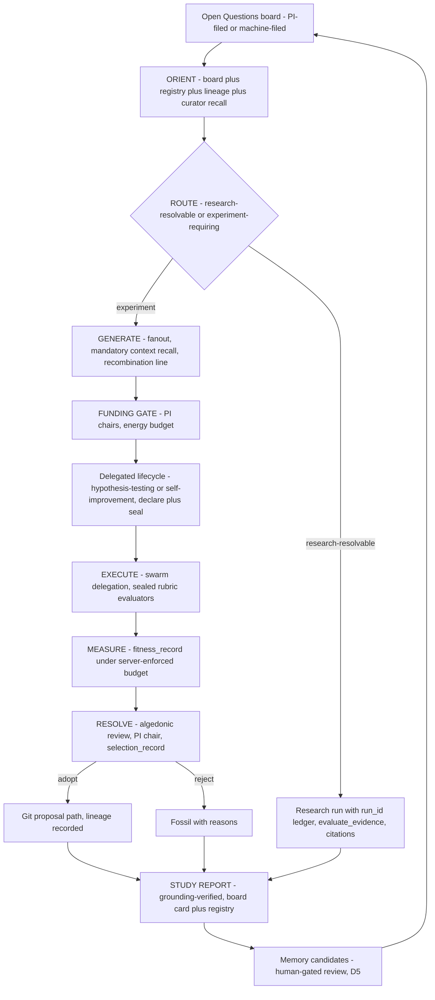

# Eureka-cycle implementation plan — 2026-10-23

Status: **draft, awaiting operator review** (no implementation edit has been made; this
document is the change)
Date: 2026-10-23 · Census basis: live tree reads this session — `kanban_board_list`
(9 boards, none a discovery backlog), `population_query` (4 resolved experiments),
skill-outline reads (`hypothesis-testing`, `local-research-swarm`), script enumeration,
docs-governance surfaces — plus completed research run `12a94d05e473d5d5` (the
Socher/Recursive referent, six server-recorded verified sources) and the prior
session's recommendation.
Author: Z-K agent (technical program manager) · Operator: principal investigator
(review, go/veto).

Goal (operator's words, restated): build a version of the capability Socher's Recursive
calls the "Eureka Machine" into zed-kask, **as recommended** — adopting the three
recommended defaults (§1). The deliverable of this document is the plan;
implementation runs only on operator go (§8).

## 0. Done means (functional outcome)

- You can file a research question at any time onto a durable Open Questions board
  (PI-filed or machine-filed) and it does not get lost between sessions.
- One invocation of the `eureka-cycle` skill runs one full human-chaired discovery
  cycle: intake → routing (research-resolvable vs experiment-requiring) → generation
  with mandatory prior-experiment recall → your funding gate → a delegated lifecycle
  (`hypothesis-testing`, `self-improvement`, or a research run) → measurement under
  sealed, pre-registered contracts → resolution at the algedonic review → a
  grounding-verified study report whose memory candidates go to the human-chaired
  review.
- Every discovery carries its pre-registered prediction (Brier-scored), sealed eval
  contract, resolution record (adopt / fossil / answer), and cited lineage — and the
  second cycle's candidates must cite the first cycle's artifacts.
- Zero new server surface, zero code. The capability is one skill, four templates,
  one kanban board.

## 1. Standing decisions adopted (per recommendation; each veto-able)

| Decision | Adopted default | Basis | Revisit trigger |
| --- | --- | --- | --- |
| Loop autonomy | Session-chaired — one cycle per invocation; no background scheduler | Co-research charter (`architecture/core/co-research-environment.md`) + Q1=b scope (budgeted auto-run covers deterministic-fitness *experiments*, not whole cycles) | Registry throughput meta-metric over ≥3 cycles shows your session time is the bottleneck |
| First aperture | Platform-self (skill quality, tool reliability, GPUI latency — the tightest feedback loop) | Recursive's own sequencing argument (AI science first); the existing E-cycle domain | Your call at any time; scientific-hypothesis questions (FEDFUNDS-class) are equally routable — the default only names the first cycle's question |
| Backlog host | Kanban board (kata-kanban server; standard 5-column shape) | Extend-first ruling (curator memory record `0933a502`); no dedicated server | Board semantics proven insufficient (e.g. provenance queries the labels cannot serve) → typed question entity proposal |

## 2. Research grounding (verified this session)

### 2.1 The external referent

"The Eureka Machine" — pinned by research run `12a94d05e473d5d5` (completed
2026-10-23; six verified sources, retrieval 2026-10-23):

- **The vision** (the book): "a full-stack scientific superintelligence: a living map
  of human knowledge, a model of physical reality, high-fidelity simulations,
  autonomous labs, and an agent swarm of AI scientists on top", starting with the
  science of AI itself because "that's where the feedback loop is tightest"
  (Socher, LinkedIn book announcement).
- **The system** (Recursive's product): it "automates the full research loop:
  proposing ideas, implementing them, testing them, and using the results to decide
  what to try next. It explores multiple directions in parallel, builds on earlier
  experiments, and combines promising ideas" (recursive.com/updates/introducing-recursive-flint).
- **Design commitments**: many research threads over long horizons; keeps useful
  context from prior experiments; combines promising branches; validates results
  "for reward hacks and variance before treating improved performance as real
  progress"; "as the search became stronger, the evaluator had to become stronger
  too" (recursive.com/updates/first-steps-toward-automated-ai-research).
- **Proof points**: SOTA on NanoChat Autoresearch (0.9109 BPB), NanoGPT Speedrun
  (77.5 s, after 83 human records over two years), SOL-ExecBench (0.754); then Flint
  (40B total / 2.5B active MoE, NVFP4 within 0.7 pts of 16-bit, 125+ tok/s on M4
  Pro, built from scratch in under four months with the system proposing,
  implementing and testing "nearly every part").

zed-kask's translation inverts exactly one pole: Recursive removes the human from
the loop; this platform seats the human as PI. The loop topology is the same; the
question, the funding gate and selection stay human. That is not a handicap —
Recursive's own hardest engineering problem is reward hacking, and zed-kask's
pre-registered predictions, sealed eval contracts and human-chaired selection are
precisely the instruments for that problem.

### 2.2 Organ census — the loop mapped onto verified surfaces

| Eureka phase (their words) | zed-kask organ | Verification (this session) |
| --- | --- | --- |
| propose ideas, multiple directions in parallel | `swarm_fanout_local` / `swarm_execute_plan_local`; `scenario_brainstorm` personas; the `hypothesis-framer` → `falsifiability` chain | tool schemas live in the session surface; pipeline named at `.agents/skills/hypothesis-testing/SKILL.md:15-27` |
| keep context from prior experiments | `population_query`, `lineage_read`, curator recall (`curator_semantic_search` / `curator_federated_search`), `swarm_recall_local` | live: `population_query` returned 4 resolved experiments with full rubrics, budgets and pre-registered predictions |
| implement + run an experiment | swarm delegation to coding agents; in-tree terminal/edit tools; job execution | live surface |
| validate (reward hacks + variance) | `experiment_seal` (SHA-256 fingerprint + headroom pre-check), deterministic evaluators (`swarm_eval_agent_local`), `lean_check`, noise bands, the anti-gaming trio | `kask/docs/research/experimentation-reference-model.md` §3 step 3 (:71), §4 (:77) |
| use results to choose the next experiment | `selection_record` (typed verdicts incl. `scientific_outcome`), `final_evaluation_record`, and the machine-side agenda generator (regulation signals + Brier history → `proposed` experiments) | reference model §3 step 4 (:72); `si-agenda-generator` (`.agents/skills/self-improvement/SKILL.md`, Plan-step extension; repair plan §P8.5 :569-572) |
| retention / compounding | git germline + registry fossil record, `lineage_read`, curator memory via human-gated candidates, therapy reification | reference model §1 (:30); D5 ruling (curator memory record `04735a35`) |
| the recursion (each output improves the researcher) | GEPA prompt evolution (`self-improvement`); prediction-Brier calibration of the agenda loop | repair plan §P8.5 :569-572 (E3: "0/3 claims held — the next agenda's confidences calibrate against a demonstrated hit rate of zero") |

### 2.3 The three genuine gaps (all verified)

1. **No durable question queue.** `kanban_board_list` (live, 2026-10-23) shows 9
   boards; none is a discovery backlog. Intake today is in-session and ad hoc.
2. **No mandatory prior-experiment recall at generation time.** `hypothesis-testing`
   has no generation step at all (its scope is one lifecycle — SKILL.md :8 "the one
   end-to-end scientific inquiry lifecycle"); the agenda generator carries registry
   history for machine-side improvement candidates, but no recall discipline applies
   to PI-filed questions.
3. **No cross-lineage recombination operator and no evaluator-evolution loop.**
   "Combines promising branches" and "the evaluator had to become stronger too" have
   no encoded step in any skill.

### 2.4 Live current-state numbers

- Registry (`population_query`, 2026-10-23): 4 resolved experiments — two DesignSpec
  seal-fingerprint contract probes (lisp_eval harness, `max_runs` 6, zero scientific
  spend), one skill-layer experiment (prompt-enhance; baseline artifact pinned at a
  git hash; linked goal), one scientific-hypothesis cycle (FEDFUNDS directional
  accuracy; FRED harness; linked goal). Layers in live use: `skill`,
  `scientific_hypothesis`.
- The E3–E7 agenda-cycle history (first live headroom-gate operation; first measured
  refutation, prediction Brier 0.25; the E4 measurement-void marker) is recorded in
  the repair plan §P8.5/§P8.9. The live registry view returns the four above; the
  throughput baseline is therefore low but non-zero, and the E3 calibration note is
  the honest prior for cycle-prediction confidence.

## 3. Design

### 3.1 What the capability is — and is not

The `eureka-cycle` skill is a **loop orchestrator and router**. It owns no
lifecycle; each funded question routes to an existing owner:

- scientific hypothesis → the `hypothesis-testing` lifecycle (pipeline per its
  SKILL.md :17: hypothesis-framer → falsifiability → experimental-design → domain
  executor → experimentation registry → grounding-verify → algedonic review);
- artifact / self-improvement experiment → the `self-improvement` lifecycle (it
  shares the registry and owns that path — hypothesis-testing SKILL.md :39);
- research-resolvable question (answerable by evidence, no experiment needed) → the
  research-server path (`begin_research_run` → run-scoped `web_search`/`web_extract`
  → `evaluate_evidence` → `annotate_research_run` → `finish_research_run`).

Boundaries (each load-bearing):

- **The board is the question queue only** (intake, triage state, funding). **The
  registry is the only experiment mutation ledger.** **The algedonic review is the
  only selection surface** (Q4=A, reference model §5 :91). The board's `Done`
  column means "question answered/closed", never "variant adopted".
- **The agenda generator keeps its own path** (regulation signals → `proposed`
  experiments in the registry, within budget). The cycle's ORIENT step *reads* both
  queues (board + `population_query` status `proposed`); it never re-hosts agenda
  candidates onto the board. No duplication, one selection surface.
- **Memory candidates only, never writes** (D5 ruling): cycle memory = the registry
  + the study report; durable lessons are proposed at the human-chaired review.

### 3.2 The cycle protocol (one invocation = one cycle)

<!-- DIAGRAM_ALIGNMENT
id: DIAG-ARCH-EUREKA-001
verified_date: 2026-10-23
verified_against: the live tool surface (experimentation server's eight tools, kanban, swarm, research, curator); .agents/skills/hypothesis-testing/SKILL.md:8,15-27,39 (pipeline and lifecycle ownership); kask/docs/research/experimentation-reference-model.md:69-73 (P8 protocol steps), :91 (Q4 single selection surface). Depicts the v1 design contract over existing tools, not yet-implemented code.
status: VERIFIED
-->

The ten steps (D/P per P8.4; every P output collapses at a named gate before
becoming durable state):

| # | Step | D/P | Oracle / gate |
| --- | --- | --- | --- |
| 1 | ORIENT — read the board (`kanban_task_list`), the agenda queue (`population_query`), prior lineage (`lineage_read`), curator memory | D | kanban + experimentation servers (deterministic reads) |
| 2 | ROUTE — research-resolvable vs experiment-requiring, per funded question | P:propose-verify | your confirmation at the funding gate (step 4); nothing routes to spend unconfirmed |
| 3 | GENERATE — fan out N candidates across personas; **mandatory context recall**: every candidate cites ≥1 prior artifact (experiment id, fossil, memory) or is dropped; one recombination prompt line (components of previously selected lineages) | P:propose-verify | the triage brief's grounding check (uncited candidates dropped); fanout via swarm |
| 4 | FUNDING GATE — the PI chairs: rank candidates, fund K within an energy budget | human chair | the gate for steps 2-3; the board's `ready` state records it |
| 5 | FRAME — per funded candidate: hypothesis-framer (FINER/PICO) → falsifiability (admission, rivals, counterfactuals, discriminating tests) → experimental-design (versioned DesignSpec) | P:propose-verify | `falsifiability-admit` + the declare boundary (step 6 schema validation) |
| 6 | DECLARE + SEAL — `experiment_propose` (pre-registered prediction + confidence, rubrics, `budget.max_runs`, optional `linked_goal_id`) → `variant_register` (baseline) → `experiment_seal` (fingerprint + headroom pre-check) | D | experimentation server (schema validation, SHA-256 fingerprint, typed no-headroom refusal) |
| 7 | EXECUTE — the delegated lifecycle runs the bound protocol (swarm delegation, harness runs, data pulls) | P execution, D measurement | sealed rubric evaluators (`swarm_eval_agent_local`), `lean_check`, pin suites |
| 8 | MEASURE — `fitness_record` under the server-enforced budget | D | experimentation server (typed `BudgetExhausted` refusal — surface it, never retry silently) |
| 9 | RESOLVE — `final_evaluation_record` on the selection set; verdict at the algedonic review (the human chair); `selection_record` | human chair, D record | the algedonic review board (single selection surface) |
| 10 | DEPOSIT + BACK-EDGE — grounding-verified study report (on the question's board card + the registry; **no per-cycle doc file**); memory candidates proposed for review (D5); evaluator-hardening candidate filed if gaming was detected (`evolve_mcp_tool_schema`); follow-up questions spawned/filed | P report, D gates | `grounding-verify` over the report's claims; the human review for memory; kanban state moves |

Two encoded rules: **one row-mutating kanban call per task per tool batch** (parallel
batched moves race — observed 3× 2026-10-09; a batched comment can silently revert a
move — 2026-10-11), and **empty generation files a finding** on the card and ends the
cycle — no silent retry loop.

### 3.3 Templates (four; each has a real render site)

`kask/registry/templates/eureka-cycle/`:

- `eureka-generate.j2` — the fanout generation prompt (context-recall requirement +
  recombination line baked in);
- `eureka-triage-brief.j2` — candidates → PI: ranked, each with citations,
  expected-value sketch, budget ask;
- `eureka-study-report.j2` — the cycle-report skeleton (every claim cites a registry
  id or research-run id; grounding-verify fields);
- `eureka-memory-candidate.j2` — the memory-candidate form (evidence h_mem citation
  required).

### 3.4 Skill metadata obligations (a missing one is a review finding, never a
load-time failure)

The SKILL.md carries the house skeleton: name/description frontmatter; **Reference
models** (Recursive's two posts; the P8 protocol,
`kask/docs/research/experimentation-reference-model.md`; the hypothesis-testing
pipeline; Tetlock triage via `scenario_triage`); **Initial and target condition**
(initial: funded question(s) on the board + operator authority; target: every funded
question reaches a resolution record + study report, or a typed stop); **Step types
(D/P labelling)** (the §3.2 table); **Registry Templates**; **Regression case** (the
T0 rehearsal receipt + the T3 first-cycle record); **Constraints** (single selection
surface; D5; the one-row-mutation rule; no per-cycle doc files;
proposes-never-commits).

## 4. The eight disciplines' findings (applied to this plan)

### 4.1 hypothesis-framer — FINER, PICO, H1-H5

FINER (0-10, with rationale):

- **Feasible 9** — organs verified live this session; zero server code; the only
  artifacts are text + a board.
- **Interesting 8** — your own question throughput at the bench.
- **Novel 7** — the loop idea is published and actively pursued (Recursive; Sakana
  v3 already landed here); the delta is the human-chaired composition and its
  verification instruments, not the loop.
- **Ethical 9** — human-in-loop by charter; memory writes human-gated (D5); energy
  budgets price the loop.
- **Relevant 9** — answers the charter test directly (deepens the human's seat;
  raises throughput without removing judgment).

HF-1 receipt (live `lisp_eval`, env `{f:9, i:8, n:7, e:9, r:9}`): min = 7 →
**"adequate"** — honest: feasible, relevant, ethical; moderately novel.

PICO — Population: research questions filed on this platform (first aperture:
platform-self). Intervention: the eureka-cycle loop (board + composing skill,
session-chaired, mandatory recall). Comparison: the current ad-hoc practice
(in-session declaration; baseline = the registry's live cadence, §2.4). Outcome:
primary — cycle completion rate (filed question → resolution record); secondary —
candidate context-citation rate; per-cycle prediction Brier.

Structured question: *"In research questions filed on the zed-kask platform [P], does
a human-chaired discovery loop with a durable backlog and mandatory context recall
[I], compared with in-session ad-hoc declaration [C], increase the rate of questions
reaching sealed resolution with compounding context [O]?"*

### 4.2 falsifiability — admission, hypotheses, coverage

FAL-1 receipt (live, env as recorded in the run): **admitted** — IS-mode,
declarative, concrete falsifying observation named.

| # | Claim | Pre-registered prediction (confidence) | Falsifier | Discriminating test |
| --- | --- | --- | --- | --- |
| H1 | Composition sufficiency: the existing tool surface runs one full cycle with zero new server code | a dry-run completes board → resolution with no step lacking tool coverage (0.90) | a step with no covering tool, or a stage-N → N+1 shape mismatch | T0 rehearsal |
| H2 | Throughput: one session-chaired invocation completes a full cycle | the first live cycle completes with ≥1 sealed experiment and a delivered study report within one working session-pair (0.70) | the cycle stalls at a human gate with no decision protocol, or exceeds budget without a typed refusal | T3 |
| H3 | Compounding: mandatory recall makes the second cycle cite the first | ≥1 second-cycle candidate cites a first-cycle artifact (0.60) | second-cycle candidates cite no prior artifacts despite the recall step | the second cycle's triage-brief audit (fires after this plan's window — named limitation) |
| H4 | No reward-hack regression under sealed rubrics + human selection | no gamed rubric passes selection unnoticed (0.80) | a gamed rubric passes and is caught only by later audit | study-report audit + selection outcomes, each cycle |
| H5 | (null) Without the loop, the registry cadence stays at its current rate | — | — | irreducible in-world (cannot both adopt and not adopt); honest proxy: the pre-2026-10-23 window vs the post-adoption window on the throughput meta-metric |

H5 carries falsifiability's irreducible flag — it survives as the reference-class
anchor, with the proxy comparison named, not claimed as a clean intervention.

### 4.3 pragmatic-cybernetics — loop, variety, VSM

Loop properties (five): **polarity** — negative (prediction error drives the next
cycle); **delay** — session-scale *by design* (the PI chairs; background cadence is
the deferred Phase-3 decision, not a defect); **gain** — bounded (`budget.max_runs`
server-enforced + the funding gate); **closure** — closed (study report → board and
memory → next ORIENT); **fidelity** — high (pre-registered predictions Brier-scored;
deterministic evaluators carry measurement). None broken.

Ashby audit — ten disturbance classes ↔ ten response classes:

| Disturbance | Response (instrument) |
| --- | --- |
| reward hacking / rubric gaming | sealed eval contract + headroom pre-check (`experiment_seal`) |
| fitness variance | noise bands + disjoint feedback/selection splits |
| context-free ideation | mandatory recall; citation-required candidates |
| question starvation (empty backlog) | machine-side intake (agenda generator files candidates) + PI filing |
| unfunded backlog growth | the funding gate (board `ready` state; the PI chairs) |
| mid-cycle budget exhaustion | typed `BudgetExhausted` surfaced, never retried silently |
| concurrent board-row races | one-row-mutation rule in skill text |
| automated memory writes (drift) | memory-candidate discipline (D5 ruling) |
| duplicate experiments on one question | ORIENT dedup (`population_query` + `lineage_read`) |
| rubric staleness as the search strengthens | evaluator-hardening candidates (`evolve_mcp_tool_schema`) filed on detection |

PC-1 receipt (live, env `{observed_states:10, system_variety:10,
regulator_variety:10, critical_threshold:3}`): **"satisfied"** (deficit 0). The class
enumeration is design-time judgment (P); the gate over the counted outputs is D.

VSM map — S5: the PI (question, values via the Magnifica Humanitas charter,
closure). S4: generation fanout + personas + the agenda generator's signal scan
(future-facing). S3: the eureka-cycle skill (orchestration, routing, funding
allocation). S2: the registry + the board (shared ledgers, dedup, one selection
surface — anti-oscillation). S1: executors (swarm agents, `swarm_eval_agent_local`,
`lean_check`, research runs, FRED/DBnomics/WB pullers). Algedonic channel: the
algedonic review board + curator alert log → the PI (open; verified live: the board
exists among the 9, escalations surface via `curator_status`).

PC-2 receipt (live, env `{s1:5, s2:2, s3:1, s4:4, s5:1, algedonic_channel:true}`):
**true**. Convergence receipt (live, env `{broken_properties:0, regulator_variety:10,
system_variety:10, algedonic_channel:true}`): **"viable"**.

### 4.4 pragmatic-semantics — routing, IS/OUGHT, constraint forces

PS-3 receipt (live, env `{total_statements:10, d_routed_count:4, p_routed_count:6,
unrouted_count:0, ungated_p_steps:0}`): **true** — every cycle step routed (§3.2),
every P step gated; no D step claims an oracle it lacks; no P step is ungated.

IS (declarative, verified): the census rows (§2.2–2.4). OUGHT (the design), by
constraint force:

- **Prohibition**: single selection surface (operator ruling Q4=A); no automated
  memory writes (D5); proposes-never-commits (P8 guardrail).
- **Guardrail**: session-chaired cadence (charter + Q1=b scope; revisitable, §1);
  board-not-entity (extend-first ruling; revisit trigger named); no per-cycle doc
  files (docs count gate).
- **Guideline**: mandatory recall before generation; one recombination prompt line;
  study-report citation discipline.

### 4.5 grill-me — the stress test and the fixes it forced

- **L1 Recall**: every "what exactly exists" question is answered by live reads
  (board list, registry population, skill outlines, script enumeration).
- **L2 Mechanism**: compounding = registry fossil record + memory candidates →
  next-cycle mandatory recall. Edge: if you reject every memory candidate, the
  registry alone still compounds (fossils + lineage are recallable) — the design does
  not depend on memory adoption.
- **L3 Rationale**: skill-not-server (extend-first ruling); board-not-entity (same);
  router-not-owner (two lifecycle owners exist — hypothesis-testing :8, :39; a third
  would duplicate them).
- **L4 Edge cases** (each forced a design fix): research-resolvable questions → the
  ROUTE step + the research-server path; empty generation → file-a-finding rule;
  budget exhaustion → typed refusal surfaced, no silent retry; board races →
  one-row-mutation rule; multi-experiment questions → the card links multiple
  experiment ids and stays open; duplicate funding → ORIENT dedup;
  unoperationalizable questions → parked with a named gap, never dropped; goal
  linkage → optional at declare, never automatic; rubric gaming mid-cycle →
  evaluator-hardening candidate at DEPOSIT.
- **L5 Synthesis**: the minimal complete loop is intake + router +
  generation-with-recall + funding + delegated lifecycle + study report + back-edge.
  Nothing less closes the loop; nothing more is v1.

### 4.6 essentialist — the cut list (advisory mode; you ratify at review)

| Candidate | Verdict | Reason |
| --- | --- | --- |
| New MCP server / typed question entity | CUT | Exist: board + registry cover all state; a typed entity today is a pass-through state layer (deletion test: delete it, board + registry still serve everything). Revisit trigger in §1. |
| Background scheduler / daemon | CUT | Exist: no evidence session time is the bottleneck; Phase-3 decision-gated. |
| Dedicated ideator agent type | CUT | Surface: existing agents + personas + fanout carry generation; no measured variety deficit justifies new registry surface. Revisit on a measured generation-diversity deficit. |
| New lisp forms / new D/P machinery | CUT | Contract: existing gates suffice; a one-consumer form is a single-use abstraction. |
| Per-cycle study-report doc files | CUT | Contract: the board card + registry are the record; docs count gate. |
| A eureka dashboard / panel | CUT | Exist: the board is the surface. |
| The skill itself | SURVIVES | G1 deletion test: deleting it scatters orchestration back into ad-hoc sessions — complexity reappears in every future cycle. Deep-module shape: one interface ("run one cycle on the funded questions") hiding eight tool systems. |
| The board | SURVIVES | Exist: verified — no durable question queue exists among the 9 live boards. |
| The four templates | SURVIVE | Contract: each renders an actually-distinct prompt with a real render site. |

### 4.7 coding-guidelines — the four principles as authoring constraints

The seven anti-patterns are forbidden in the skill text (no speculative steps; no
unrequested flexibility — especially no cadence knobs beyond the adopted default; no
telemetry steps). **Simplicity First**: the skill composes; it never reimplements the
methods of the skills it routes to. **Surgical Changes**: T1 touches exactly one new
skill dir + one new template dir; every existing SKILL.md, template, crate and
server is `files_not_to_touch`. **Think Before Coding**: this document.
**Goal-Driven Execution**: per-task acceptance criteria in §5. The CG-1/CG-2 gates
are defined over code diffs and run at implementation time over the real diff (the
skill's own boundary: non-coding work takes the principles, not the gates).

### 4.8 refactor-architecture — the deepening candidate and the verification discipline

Ranked candidate: the eureka-cycle skill — **Strong** recommendation (leverage: one
interface over eight systems; locality: the loop's orchestration knowledge in one
SKILL.md; testability: the loop is end-to-end verifiable through T0/T3).
Strangler-fig: not applicable — greenfield composition over existing services, not
extraction from duplicated surfaces (there is no existing loop code to strangle; the
replaced surface is a practice, §7). Verification discipline: unmeasured-never-pass —
every §5 gate names its observed evidence; a missing output is `unmeasured`, never a
pass; a green run with the friction still present (no completed cycle) is `continue`,
not `done`.

## 5. Implementation phases (dependency-ordered; per-phase gate)

| Phase | Work | files_to_touch | files_not_to_touch | Lines | Gate |
| --- | --- | --- | --- | --- | --- |
| T0 | Board + dry-run rehearsal: create the Open Questions board (standard 5 columns); file one small platform-self question; run the loop **manually as a tool-call sequence** with a cheap deterministic-fitness experiment (the DesignSpec-probe pattern: lisp_eval gate branches, `max_runs` ≤ 6, zero scientific spend): propose → register baseline → seal → fitness → selection (or park to next review) | none in repo (runtime state) | everything in repo | 0 | all eight experimentation tools + ≥4 kanban tools exercised in one pass; every step's I/O shape recorded in the rehearsal receipt (the composition-seam defense: verify stage N's output shape is what stage N+1 consumes, *before* authoring the skill) |
| T1 | Author the skill + templates to match the rehearsed sequence | `.agents/skills/eureka-cycle/SKILL.md` (new, ~220 lines — flagged >50: text artifact, bounded by house SKILL.md sizes, essentialist-audited); `kask/registry/templates/eureka-cycle/{eureka-generate,eureka-triage-brief,eureka-study-report,eureka-memory-candidate}.j2` (new, 4 × ~50) | every existing SKILL.md; every existing template; all `kask/mcp-servers/`; all `crates/` | ~420 text lines | `kask/scripts/audit/skill-corpus-prescreen.sh` green; `kask/scripts/check-skill-crossrefs.sh` green; D/P + reference-model + calibration sections present; goal lines terminal-punctuated; the seven anti-patterns absent |
| T2 | Docs governance | `kask/docs/reference/skills/README.md` (registry row); `kask/docs/README.md` (plans-table status: Draft → Active); this plan doc (execution record appended) | everything else | ~40 | the skills-registry row renders; README count reconciles (`find kask/docs -type f \| wc -l`); DIAGRAMS_INDEX unchanged unless the diagram moves |
| T3 | The live first cycle — **the capability verification** (operator ruling 2026-09-09: the deliverable is the capability functioning, verified by running the task through it): one real platform-self question through the skill, session-chaired, you holding question / funding / selection | none in repo (runtime; the study report lives on the board card + registry) | everything in repo | 0 | one question → resolution record (adopt / fossil / answer) + grounding-verified study report + ≥1 memory candidate proposed; the cycle's own pre-registered prediction recorded via `experiment_propose` |
| T4 | Post-cycle reconciliation | none | everything | 0 | registry readback matches the study report; cycle-prediction Brier computed; H1/H2 adjudicated; H3 left open (fires at cycle two); docs drift check |

This change (the plan itself) touches: `kask/docs/plans/eureka-cycle-implementation-plan.md`
(new), `kask/docs/README.md` (plans-table row + corpus-size sentence),
`kask/docs/DIAGRAMS_INDEX.md` (one registration — `DIAG-ARCH-EUREKA-001` — the
count-sentence reconciliation to the measured 92 fences / 92 records / 92 rows, and
the removal of four stale rows `DIAG-CAP-003`, `DIAG-MCPSRV-031`,
`DIAG-RF-SWARM-001`, `DIAG-SWARM-031` left behind by the 2026-10-18→22 removal
waves, which had left the diagram parity gate red on main; verified green after this
pass). All inside `kask/`; no D-seam (fork-owned content; zed-side untouched).

## 6. Risks and guardrails

| Risk | Guardrail |
| --- | --- |
| Reward hacking (Recursive's own hardest problem) | sealed eval contract + headroom pre-check; deterministic evaluators; anti-gaming trio; human selection chair |
| Selection-surface duplication (board vs review) | Prohibition: the algedonic review is the only adoption surface; the board's Done = question answered, never variant adopted |
| Concurrent board mutations racing | the one-row-mutation rule in skill text (observed live 3×, plus the comment-revert case) |
| Memory-loop drift (automated writes) | D5: memory candidates only, at the human-chaired review |
| Skill bloat | the protocol is exactly ten steps; each addition must survive the essentialist gates; SKILL.md bounded by house sizes |
| Docs count pressure | +1 now (81 files, under the 85 gate; plan docs are deleted when executed, per the house lifecycle); no per-cycle doc files |

## 7. What this replaces; net surface

Procedural replacement (P5.5 honesty): the ad-hoc intake practice — experiments
declared in-session when someone thinks of them, with no queue, no mandatory recall,
no cycle memory — is superseded by board-gated intake with mandatory recall. No code
path is deleted (nothing existed to delete). Net surface: +1 plan doc (this change),
+1 skill dir with one file + four templates (T1), +1 board (runtime). Zero deletions,
zero new server surface, zero new Cargo dependencies.

## 8. Decision requests (yours)

1. Ratify or veto the three adopted defaults (§1).
2. Authorize T0–T1 (goal registration on go — the goal's observable criteria: T3's
   gate).
3. Name the first funded question for T3, or confirm the machine may propose one
   from live regulation signals (the agenda-generator path) at the T0 session.
4. Confirm Phase-3 deferral (cadence graduation needs ≥3 cycles of throughput
   evidence; no decision now).

## 9. Deferred follow-ons (decision-gated, out of scope here)

- **Phase 2 graduations**, each on a measured deficit: a formal recombination
  operator (if the one-line prompt proves thin — measured via candidate diversity);
  a formal evaluator-evolution loop (if gaming detections exceed a threshold);
  generation-variety instruments (if a deficit is measured).
- **Phase 3**: background cadence (the §1 trigger); aperture expansion beyond
  platform-self (your call anytime); a typed question entity (the §1 trigger).