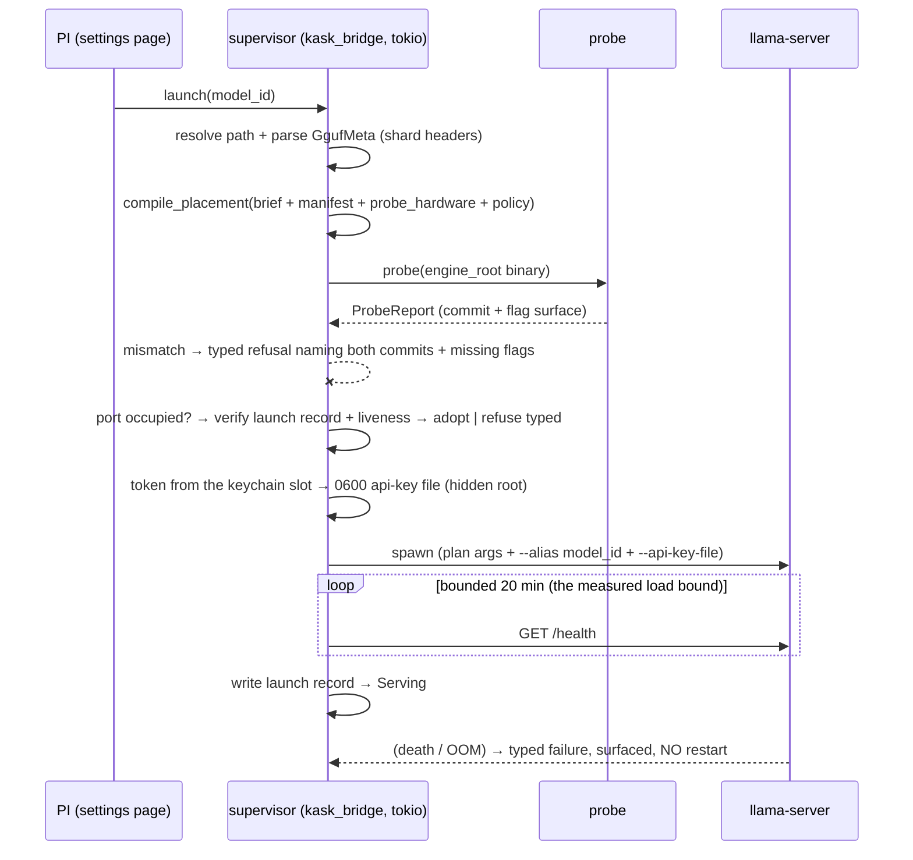

# Private-inference local leg — P1 supervisor slice design (draft)

**Scope.** The L4 supervisor of the drift-absorption stack: spawn / probe /
version-refuse / stop / drain, the typed refusal surface, the launch record,
the stub-server test seam, and the zed-side launch surface (the Serving
section of the Private Inference settings page). This extends the committed
local-leg plan (2026-11-04) — it does not reopen M3 (configured
`openai_compatible` instance), M6 (routing hook, separate phase), M7 (the
settings home, landed at `98499104aa`), or the core-service ruling (no MCP
server, no agent-callable tool surface).

**Provenance.** Grounded at draft time (2026-11-04) against the live tree
(`98499104aa` plus the generalization/relocation commits
`1cb517349d`/`e91fdae7f7`) and the installed engine (the Good Regulator
probe, run at draft time against
`~/.local/share/zed-kask/private-inference/engine/llama.cpp/build-hip/bin/llama-server`:
`--version` → `version: 0.9.0-dev (build 1, commit 9e2a04a)`; `--help` carries
`--api-key-file FNAME` and `--alias STRING` (env `LLAMA_ARG_ALIAS`) — both
verified live, no `-not_checked` labels needed for these three). The parent
plan's adjudications carry over: streaming stays P2/unroutable (the
variety-deficit attenuation, plan §6); the typed refusal is itself a response
class.

## 1. Direction (kata step 1)

Frozen requirements binding this slice (from the committed plans, not
re-derived here):

- The L4 row: "Supervisor (L4) | thin Rust | spawn / probe / version-floor /
  stop / drain; typed refusals; stub-server test seam" — deletion test: delete
  → PI hand-runs llama-server: no version gate, no fail-closed supervision
  (local-leg plan §5, L102).
- Startup probe (plan §10 delta 8): `--version` + `--help` parsed against the
  manifest vocabulary; mismatch → typed refusal naming the missing flags and
  the manifest version; the manifest is never trusted alone (Good Regulator).
- Edge cases on record (plan §10): OOM mid-session → the supervisor detects
  death → typed failure to the surface, no silent fallback, restart policy
  operator-owned; manifest lag behind a newly installed build → version
  refusal, fail-closed.
- Launcher backend policy (baseline record §5, measured 2026-11-04): HIP is
  the primary serving backend (13.0–15.0 tok/s decode, agent-turn 18.4–21.5 s),
  Vulkan the fallback, CPU the control; backend choice is **launcher policy,
  not compiler policy** — the plan's `binary` stays the manifest's
  backend-agnostic `llama-server`.
- S2 coordination (plan §10 delta 9): fixed port allocation — one serving
  instance at a time on the policy port (8010).
- The measurement harness precedent (baseline record §4, L144-145): the P0
  legs already poll `/health` with a 20-minute bound to first healthy — the
  load bound the supervisor inherits.

## 2. Current condition (kata step 2) — measured over the tree and machine

**Landed (commit-anchored):** the core crate's placement compiler with folded
guards (incl. the D1 quantized-KV guard), the manifest decode home + CI
fixture gates
(`kask/crates/hkask-private-inference/src/local_leg/manifest.rs:17-59,166`),
the typed model-brief errors, the fleet embed
(`kask/crates/hkask-private-inference/src/local_leg/fleet.rs:21,48`), the
endpoint construction home
(`kask/crates/hkask-private-inference/src/local_leg/launch.rs:26,34`), and
the M7/Seam-B settings surface at `98499104aa`:
`KaskPrivateInferenceSettings` (`kask/crates/kask_bridge/src/settings.rs:598-632`,
host/port delegated to `PlacementPolicy::default()` by construction), the
provider-entry emission (`kask/crates/kask_bridge/src/private_inference.rs:56,87,95`),
the token slot == the provider `api_url` slot, and the settings page
(`crates/settings_ui/src/pages/kask_page/private_inference.rs`, Register action
at `:159`).

**Live defects found at draft time** (the honest gaps this slice must close —
both measured, not assumed):

1. `probe_backend()` is **non-functional as committed**: `LLAMA_CPP_ROOT`
   still names the retired `~/models/llama.cpp`
   (`kask/crates/hkask-private-inference/src/local_leg/placement.rs:93`), and
   `PathBuf::from("~/...")` never expands `~`
   (`kask/crates/hkask-private-inference/src/local_leg/placement.rs:104-118`) — the
   probe has always answered `GpuBackend::None` on every machine. The
   relocation (`e91fdae7f7`) moved the engine to the canonical hidden root
   and the three builds are verified present at
   `~/.local/share/zed-kask/private-inference/engine/llama.cpp/{build,build-hip,build-vulkan}/bin/llama-server`
   (checked at draft time). The repair routes through
   `hkask_types::agent_paths::resolve_under_data_dir`
   (`kask/crates/hkask-types/src/agent_paths.rs:99` — the helper **exists**;
   the storage doc's "not yet in `agent_paths.rs`" wording is stale on this
   point and is corrected in the same change).
2. No shipped-manifest home: the manifest has the one decode home
   (`kask/crates/hkask-private-inference/src/local_leg/manifest.rs:166`)
   but nothing embeds the registry TOML for an installed
   binary (tests embed via `include_str!` only) — the same
   installed-binary gap the fleet layer closed with
   `SHIPPED_BRIEF_SOURCES`
   (`kask/crates/hkask-private-inference/src/local_leg/fleet.rs:21`).
3. No model_id → GGUF path resolution: the fleet briefs carry ids, not
   paths; the on-disk model dirs under the artifacts root are
   `qwen38-flash-next/`, `flint/`, `gemma4/`, `muse-glimmer/` (checked at
   draft time), and only two of the four have briefs
   (`kask/registry/model-briefs/`).
4. The manifest lacks the supervisor's surface: no `alias`/`api_key_file`
   flag spellings, no machine-comparable version pin (the current
   `engine_version_pin` is prose), no probe expectations (health/models
   paths).

**Live-probed design facts** (the pinned binary, verified at draft time):
`--version` emits a machine-parsable line whose commit token matches the
manifest pin; `--api-key-file FNAME` exists — the token reaches the server
from a file, never a command-line arg (no `/proc/<pid>/cmdline` leak) and
never an env var (none exists for the key — verified against `--help`);
`--alias STRING` lets the server serve the loaded model under the brief's
`model_id`, matching the provider entry's card `name` — the identity seam
the settings surface needs. `/health` is verified live from the P0 matrix
(the harness polls it on every leg).

## 3. Target condition (kata step 3) — the first increment

`launch(model_id)` → `Serving { model, backend, endpoint }` **or a typed
refusal** — `ProbeFailed { missing_flags, binary_commit, manifest_commit }`,
`PortOccupied { holder }`, `TokenMissing` (fail-closed, names the keychain
slot), `FleetUnknown { model_id }`, `GuardDenied` (from the compiler —
already typed). `stop()` drains and stops, typed. `status()` snapshots the
serving state. The Private Inference page's Serving section shows the live
state (serving model / stopped / the typed refusal reason); the agent-panel
cards dispatch to the serving model; the supervisor **never restarts on its
own** (operator-owned, the edge-case record) and **never substitutes** a
different model silently.

**Focus obstacle (the one):** the launch path must be verifiable without the
79 GB weights — the stub-server test seam is the slice's instrument. Metrics:
(1) every refusal class reproduced against a stub (probe mismatch, occupied
port, missing token) — zero live-launch dependencies in CI; (2) a killed
stub surfaces as a typed failure within one poll interval; (3) one live
launch on HIP (operator checkpoint) reaches healthy within the measured
20-minute bound and serves an agent-panel turn.

## 4. Module design + essentialist verdicts (post-critique)

| Module | Verdict | Deletion test |
|---|---|---|
| `local_leg/probe.rs` — the startup probe: `--version`/`--help` parsed against pin + vocabulary → `ProbeReport` | EARNS | delete → wrong-flag launches; the version floor is unenforced (the Good Regulator repair gone) |
| `local_leg/supervisor.rs` — spawn, health-poll, stop/drain, the launch record | EARNS, thin | delete → the PI hand-runs llama-server (the L4 row's test) |
| Launch record (a field of the supervisor, not a module) — JSON under the hidden root: pid, model_id, plan digest, endpoint, started_at | EARNS, minimal | delete → adopt-vs-refuse degrades to blind refuse (a measured-20-minute reload after every editor restart) or unsafe adopt |
| `shipped_manifest()` — the embedded manifest home (decode stays the one home) | EARNS, minimal | delete → an installed binary cannot load the manifest (the same gap the fleet layer already closed) |
| Model path resolution — a `local_paths` table on the fleet layer (model_id → dir + artifact under the artifacts models root) | EARNS, data-first | delete → the supervisor hand-globs the models root; adding a model must stay a data edit |
| The zed-side Serving surface — the Private Inference page section + a kask_bridge supervisor handle | EARNS, minimal | delete → the PI launches from a terminal (exactly what this slice removes) |
| `engine_root()` — `resolve_under_data_dir("private-inference/engine/llama.cpp")` | EARNS (repairs defect 1) | delete → the backend probe stays dead |
| Stub-server test fixture (feature-gated test bin: answers the probe, serves `/health` + `/v1/models`, dies on demand, misbehaves per test) | EARNS | delete → CI needs the real engine + weights to test the launch path |

**Deliberately not built** (essentialist, take away): restart automation
(operator-owned; the supervisor surfaces, never relaunches); telemetry (P2
trigger unchanged); a panel (future); multi-server ports (S2: one fixed
port); the M6 routing hook (its own phase); a "serve all fleet models"
promise (one instance serves one model — surfaced honestly, see D-S4).

## 5. The launch loop (cybernetic closure)

Sense (probe) → decide (pin + vocabulary match; the guards already ran at
compile) → act (spawn) → return (health poll). The loop's closure is the
typed-failure path: a dead server is never silently retried, never silently
substituted.

## 6. Design decisions — proposals for PI adjudication

- **D-S1 token transport: `--api-key-file`.** The token is read from the
  provider `api_url` keychain slot (`credential_url`,
  `kask/crates/kask_bridge/src/private_inference.rs:87` — the slot identity
  is pinned) through the async credentials-provider path at launch, written
  to a 0600 file under `{data_dir}/private-inference/`, passed by path,
  removed on stop. Tradeoff vs `--api-key`: no `/proc` leak (single-user
  loopback lowers but does not zero the cost of the leak). Verified live —
  the flag exists on the pinned build; no change expected.
- **D-S2 version semantics: exact-commit refusal, not "older than".** Commit
  hashes are not orderable; the parent plan's "refuses builds older than
  `engine_version_pin`" is not computable as stated. The honest v1: the
  manifest gains a structured pin (`commit`, `version`) and the probe
  refuses **any other commit** — a different commit is an unverified
  surface, newer included. Stricter, simpler, honest; the manifest's prose
  pin becomes display text.
- **D-S3 occupied port: adopt-iff verified.** At launch, an occupied policy
  port triggers: live pid + launch-record digest match + `/health` ok →
  adopt (surface Serving, no reload — the measured load bound is minutes,
  not seconds); anything else → `PortOccupied` naming the holder. The record
  is **verified, never trusted** (liveness + digest, not file presence).
  Alternative: always-refuse (simpler, pays the reload every session) —
  rejected on the measured bound; PI may overrule.
- **D-S4 one active model, surfaced.** The cards list the fleet; one
  instance serves one model on the fixed port (S2). The page states the
  serving model; dispatch to a non-serving id is the server's error,
  surfaced as the provider failure — **never silent model substitution**.
  llama-server's unknown-model request behavior is unknown-to-this-draft →
  pinned at the live-launch checkpoint (probe item, not an assumption).
- **D-S5 process placement: in-editor tokio task; the child outlives the
  editor.** The supervisor runs on the kask tokio runtime
  (`gpui_tokio::Tokio::spawn` — never `cx.background_spawn` for
  tokio-dependent futures); the llama-server child persists across editor
  exits (a machine-local service; D-S3 adoption recovers it next session).
  Kill-on-exit is rejected: it burns the measured 20-minute load on every
  editor restart.
- **D-S6 UI state: a kask_bridge handle, never sync HTTP on render.** A
  supervisor handle (the house OnceLock-hook pattern) exposes `status()`;
  state transitions call `cx.refresh_windows()`; the page reads the
  snapshot. The page polls nothing on render.

## 7. Claim labels (pragmatic semantics — this draft's own claims)

| Claim | Mode | Force | Provenance |
|---|---|---|---|
| "`--api-key-file` / `--alias` exist on the pinned build" | IS | Evidence | verified live at draft time (`--help`) |
| "`/health` is served and load reaches healthy in ≤20 min" | IS | Evidence | P0 matrix (baseline record §4) — the bound, not a per-launch promise |
| "HIP is the primary serving backend" | IS | Evidence | measured matrix (baseline record §5) |
| "`probe_backend()` is dead as committed" | IS | Evidence | tree + machine, draft time (placement.rs:93,104-118) |
| "llama-server errors (not substitutes) on an unknown model id" | UNKNOWN | — | probe item at the live-launch checkpoint; never assumed in the design |
| "The supervisor never restarts or substitutes on its own" | OUGHT | Prohibition | the edge-case record + FR-3 spirit |
| "The probe refuses every wrong-surface build" | — | **Hypothesis H-P1.1** | not admitted until the stub suite runs |
| "Adoption never takes a foreign server" | — | **Hypothesis H-P1.3** | not admitted until the adopt/refuse fixtures run |

## 8. Routing plan (steps, regions, gates)

| # | Step | Region | Gate |
|---|---|---|---|
| 1 | Repair the backend probe: `engine_root()` via `resolve_under_data_dir`, `~` expansion deleted, HIP→Vulkan→None order kept; storage-doc wording corrected | SD | unit pin over a stubbed data dir; the `GpuBackend` order test |
| 2 | Manifest additions: `alias`/`api_key_file` spellings, the structured pin, probe expectations; fixture updates | SD | decode round-trip + the admission fixture gate (closed vocabulary, sorted-denial equality — the existing gate shape) |
| 3 | `shipped_manifest()` embed (the fleet precedent) | SD | the embedded bytes decode + the fixture gate runs over the shipped manifest |
| 4 | Model path resolution: the fleet `local_paths` table | SD | round-trip + fail-closed on a missing dir/artifact (typo in a path is a typed refusal, not a glob guess) |
| 5 | `probe.rs` | Sem-D | canned `--version`/`--help` fixtures: match / wrong-commit / missing-flags, each → the typed report |
| 6 | `supervisor.rs` + launch record | Sem-D | stub-server integration (`--features test-fixture`, `--test-threads=1`): launch→healthy→stop; wrong-version stub → refusal; killed stub → typed death within one interval; occupied port → the adopt/refuse matrix |
| 7 | The stub-server fixture | SD | the fixture answers the probe, serves both endpoints, dies on demand |
| 8 | The zed-side Serving surface (page section + the handle) | Sem-D | the page source-pin pattern + the bridge emission seam tests |
| 9 | Live launch on HIP, real weights | Sem-P | **operator checkpoint**: one launch within the measured bound + one agent-panel turn; the unknown-model probe item resolves here |

Every generating step carries its named deterministic gate; step 9 is the
only Sem-P step (verification states, never silent passes).

## 9. Hypotheses and falsifiers

- **H-P1.1 (high):** the startup probe refuses every wrong-surface build —
  *prediction:* stubs with missing/renamed flags and wrong commits all fail
  the probe; *falsifier:* any wrong-surface stub passes.
- **H-P1.2 (high):** death surfaces within one poll interval as a typed
  failure — *falsifier:* a killed stub leaves `status()` Serving.
- **H-P1.3 (medium-high):** adoption never takes a foreign server —
  *falsifier:* a stub with a forged or stale record is adopted (the record
  path must verify liveness + digest; trusting the file is the bug class).
- **H-P1.4 (medium):** the guards + probe cover the abort class before
  spawn — *falsifier:* a live launch aborts with a condition the compiler
  could compute (the parent plan's H1, now at the spawn boundary).

## 10. Kata record (step 4)

*Next step:* PI review of this draft → the implementation engagement. *Prediction:*
the slice lands inside its gates with engine-surface changes absorbed as
manifest data edits (the H2 replay continues — `alias`/`api_key_file` are the
first supervisor-driven additions). *Measurement method:* the stub suite
(step 6) + the live checkpoint (step 9). *When to check:* at implementation,
per-step.

## 11. Open items for the operator

1. **Draft approval** — this document is Proposed; implementation is a
   separate engagement (the standing plan discipline).
2. **D-S2 ruling** — exact-commit refusal (stricter than the plan's
   "older than"): confirm or overrule.
3. **D-S3 ruling** — adopt-iff-verified vs always-refuse: confirm
   adopt-iff (the measured 20-minute load bound is the argument).
4. **Live-launch checkpoint (step 9) ownership** — operator-run or
   delegated with the launch bound recorded.

## 12. Implementation record (2026-11-04, the same day — the approved draft executed)

Steps 1–8 landed and step 9's server-side half ran live, same day.
Attribution: the core-crate work (steps 1–7) was swept into the
concurrent stream's commit `593bfe07e2` while its gates were being
re-run (the shared-tree `git add -A` instance the `.rules` records —
the work landed intact under a faithful message); the zed-side surface
(step 8), the gate-driven refinements and this record landed in the
follow-up commit.

**Rulings executed as proposed:** D-S2 (exact-commit refusal — the
manifest gained the structured `[version_pin]`; the probe refuses any
other commit, newer included), D-S3 (adopt-iff-verified — liveness +
digest + endpoint + health, never the file), D-S4 (one serving
instance; `ServingOtherModel` is a typed refusal), D-S5 (in-editor
tokio via `gpui_tokio::Tokio::spawn`; the child outlives the editor),
D-S1 (`--api-key-file`, 0600 under the hidden root).

**Step outcomes:** 1 — the dead `probe_backend` repaired
(`engine_root()` via `resolve_under_data_dir`; the HIP build found live
at the canonical root — the defect's counter-evidence); 2–3 — the
manifest carries `alias`/`api_key_file`, `[version_pin]`, `[probe]` +
the embedded `shipped_manifest()` home; 4 — the fleet `local_paths`
layer (fail-closed resolution); 5 — `probe.rs` with the
identifier-boundary flag match (the extension-rename drift class,
found by the probe's own falsifier); 6–7 — the supervisor + the
stub-llama-server fixture (`--features test-fixture --test-threads=1`,
8/8); 8 — `kask_bridge::private_inference_supervisor` + the page's
Serving section.

**Step 9 (server-side), measured 2026-11-04:** the full production
path on the real machine — HIP backend at the canonical root, serving
in **8s** (warm cache; the 20-minute bound held with ~150× headroom,
cold-start measured 35s on the first run), `/v1/models` listing exactly
`qwen3-8-flash-next` (the alias identity — the served name IS the card
name), a 28-token completion (`content="OK"`, reasoning present),
clean stop with the record and token removed, 13s total wall
(`tests/live_supervisor.rs`, `HKASK_P1_LIVE=1`).

**Hypotheses adjudicated:** H-P1.1 corroborated (the wrong-commit and
dropped-flag stubs both refuse, naming both commits / the exact
missing spellings); H-P1.2 corroborated (a killed stub surfaces as a
typed `Failed` within one poll interval); H-P1.3 corroborated (the
foreign holder is refused naming "no launch record"; the verified
record is adopted and stopped by pid); H-P1.4 not adjudicated at the
spawn boundary this slice (no live launch reached a runtime abort —
every guard passed; the falsifier stands armed for the first refusal).

**Remaining operator checkpoint:** the agent-panel turn — select the
private model in the panel's model picker (after the page's Register)
and run one turn; that GUI leg is the operator's, per §11 item 4.

## 13. The "downloaded = available" amendment (operator UX ruling, 2026-11-05)

The operator's expectation mismatch, recorded honestly: the P1 arc
shipped manual steps (token typing, Register, a typed one-model
refusal) where the expectation was "models in the folder are available,
like every other provider." The ruling: the expectation is the target
UX; the fixes are four; the physics that does not bend is one model
resident at a time (the flagship's ~72 GB exclude the rest on the 96 GB
machine — llama-server is one model per process; the measured warm
swap is 8s, which the swap UX rides).

The four-part slice (implemented same day):

1. **Auto-mint** — `ensure_endpoint_token` (`kask_bridge`): the
   operator's explicit token wins; an absent/blank slot is first-run
   provisioning (minted `pi-<uuid>`, written to the provider `api_url`
   slot — the `provision_db_passphrase_string` precedent). No typing.
2. **Auto-register** — `ensure_registered`, wired in `main.rs`'s
   deferred task: write-only-if-absent (an operator's hand-edited
   entry wins; a deliberate deletion returns at restart — the row is
   system-owned, like the seeded templates); when present, only the
   token is provisioned. The settings-store notification registers
   the provider live, so the cards appear with zero manual steps.
3. **Launch = swap** — launching another model while one serves stops
   and drains the current server, then loads the new one (the explicit
   click is the intent; the `ServingOtherModel` refusal is deleted);
   a fresh session swaps a previous session's server by pid ONLY
   after verifying the recorded process identity (argv[0] == the
   recorded binary — the pid-recycling kill guard; a foreign pid is
   never killed).
4. **Fleet completion** — `flint` + `muse-glimmer-30b` briefs
   (parse-sourced: Flint 39.8B MoE, 256 experts / 6 used, native
   context 262,144; Muse Glimmer dense, native context 131,072),
   both cross-checked live by `tests/fleet_parse.rs` — all four
   downloaded models card.

D-S4's "never a silent substitution" narrows to where it always
belonged: the swap is explicit (the click); silent substitution at
dispatch remains the M6 routing hook's concern (Seam A).

Hypotheses: **H-P1.5** (the swap path never kills an unverified pid)
— corroborated by the foreign-pid stub test; H-P1.3's record trust
narrows to identity-verified trust (the pid-recycling hazard was
found at design time, guarded before it was ever hit live).
