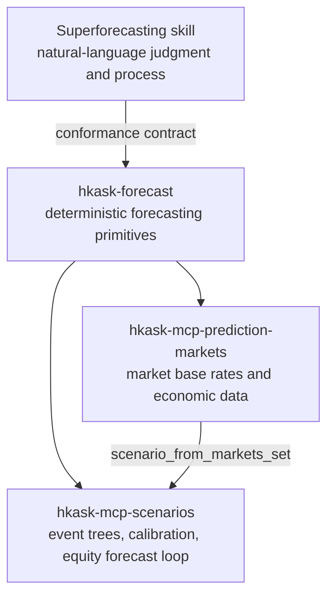
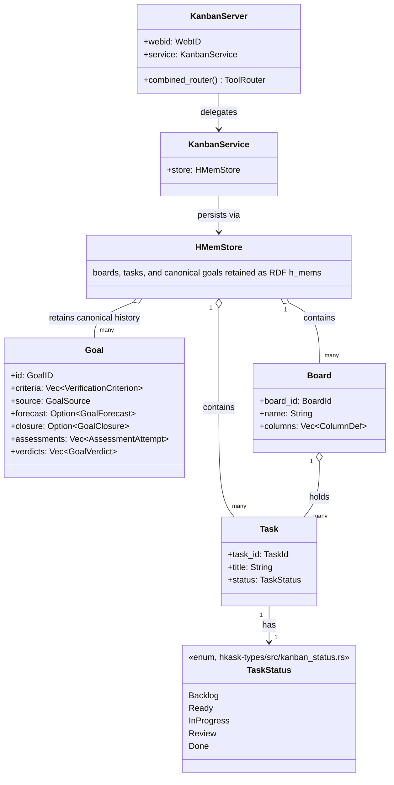

# MCP Server Registry

**Diataxis type:** Reference
**Status:** Active (v0.43.0)

> Built-in MCP servers shipped with hKask and launched by the in-process governed
> `McpRuntime` as child processes over stdio (D3 — single spawn authority since 2026-08-29; kask
> servers are not registered with zed's per-project `ContextServerStore`). Each server is a thin surface over domain crates. The binary
> entrypoint (`src/main.rs`) is a one-line `#[tokio::main]` wrapper around `<crate>::run()`; the
> library root exposes `pub async fn run()` that calls `hkask_mcp_server::run_server(name,
> version, factory, credentials)`, where `factory` receives a `ServerContext` and constructs the
> server struct. (The `McpRuntime` that dispatches and meters tool calls runs
> in-process; the MCP servers themselves are child processes over stdio.)
>
> **Hosting note (v0.32.2):** hKask runs in-process inside zed-kask. The standalone `kask mcp start
> <id>` and `kask serve` CLI surfaces have been **deleted**. The `BUILT_IN_MCP_SERVERS` constant in
> `kask/crates/kask_bridge/src/mcp_servers.rs` enumerates the 8 on-disk servers.

## Server Catalog

8 built-in MCP servers, **238 registered tools** fleet-wide (all rows reconciled 2026-10-28 against the live `tool_surface_pin!` tests — every server pins its exact count and generated tool-name set; unified by `ede1ba0ca8`, CI-gated by `kask/scripts/check-mcp-registration.sh`). `KaskMcpSettings::default()` sets `load_default: true`, so all eight auto-load unless the operator disables the fleet or an individual server (`kask/crates/kask_bridge/src/settings.rs:140-165`; `kask/crates/kask_bridge/src/mcp_servers.rs`).

| Server | Crate | Purpose | Tools |
|--------|-------|---------|------:|
| [Corpus](corpus.md) | `kask/mcp-servers/hkask-mcp-corpus` | Corpus gathering, document processing, QA generation, style replicas | 25 |
| Curator | `kask/mcp-servers/hkask-mcp-curator` | Curator agent metacognition (memory, regulation query, algedonic signals, skill-use issue reporting) | 15 |
| [Experimentation](experimentation.md) | `kask/mcp-servers/hkask-mcp-experimentation` | Experiment registry for the sharded experimentation program: registered experiments with pre-registered predictions, variant lineages, fitness records (caller-asserted report references), selection fossils | 8 |
| Kata Kanban | `kask/mcp-servers/hkask-mcp-kata-kanban` | Toyota Kata task boards and retained canonical goals with separate human closure | 26 |
| [Media](media.md) | `kask/mcp-servers/hkask-mcp-media` | Research evidence ingestion, annotation, transcription, source-linked excerpts, and time-keyed media layers | 90 |

| [Prediction Markets](prediction-markets.md) | `kask/mcp-servers/hkask-mcp-prediction-markets` | Polymarket/Kalshi base rates, calibration, residuals | 27 |
| [Research](research.md) | `kask/mcp-servers/hkask-mcp-research` | Web search, extraction, browsing, RSS feeds, evidence scoring, research-run ledger, paper identity | 27 |
| [Scenarios](scenarios.md) | `kask/mcp-servers/hkask-mcp-scenarios` | Event-tree forecasting (Tetlock/Schwartz/Chermack) with prospective declaration, equity persistence and raw loss | 22 |

### Count verification (unified 2026-10-05; re-verified 2026-10-28)

Every server pins its exact tool surface with the shared `tool_surface_pin!` macro (landed `ede1ba0ca8`, 2026-10-05): one macro call pins the exact tool count and the generated `TOOL_NAMES` set against the live router, so additions, drops, and same-count renames fail CI instead of degrading to tool-not-found. `kask/scripts/check-mcp-registration.sh` gates on the pin's presence for every server in `mcp-servers.txt` (CI: `.github/workflows/kask-invariants.yml`). Live pin sites (re-verified 2026-10-30): corpus 25 (`hkask_mcp_corpus.rs:325`), curator 15 (`hkask_mcp_curator.rs:1684`), experimentation 8 (`hkask_mcp_experimentation.rs:87`), kata-kanban 26 (`hkask_mcp_kata_kanban.rs:1630`), media 90 (`hkask_mcp_media.rs:486`), prediction-markets 27 (`hkask_mcp_prediction_markets.rs:1350`), research 27 (`hkask_mcp_research.rs:2322`), scenarios 22 (`hkask_mcp_scenarios.rs:1726`).

Per-server specifics that survive the unification: the curator pin additionally asserts the removed escalation/advice-review tools stay unregistered (`curator_escalations`, `curator_escalation_resolve`, `curator_escalation_dismiss`, `curator_escalation_dismiss_by_pattern`, `curator_advice_mark_applied`, `curator_advice_reviews`); the experimentation tool-behavior suite drives every tool end-to-end over the real engine actor (`tests/tool_behavior.rs`).

Arithmetic: `25 + 15 + 8 + 26 + 90 + 27 + 27 + 22 = 240`.

## Common Patterns

All servers follow these patterns:

1. **Bootstrap:** `main.rs` calls `<crate>::run()`, which calls `hkask_mcp_server::run_server(name, version, factory, credentials)`. The `factory: FnOnce(ServerContext) -> Result<S, McpError>` closure receives a `ServerContext` (no ambient authority — all deps injected) and constructs the server struct. There is no separate `bootstrap_mcp_server` / `MCPBootstrap` step; that API was removed along with the `HKASK_MCP_HOST` / userpod identity concept.
2. **Identity:** `ServerContext.webid: WebID` is the sole agent-identity source, resolved in transport from `HKASK_WEBID` (or an anonymous fallback). The `mcp_server!` macro generates a struct with `pub webid: WebID` plus the caller's custom domain fields — and nothing else (no `userpod`, no `daemon` field; the daemon was deleted in the 2026-07-25 cleanup and `DaemonClient` / `record_via_daemon` / `RealMemoryPort` are no longer part of the server contract).
3. **Tool dispatch:** wrap each tool body in `execute_tool(self, "tool_name", async { ... })`. It emits the `reg.tool` span and serializes errors; ontology concepts belong in structured tool output, not span tags (`kask/crates/hkask-mcp-server/src/server.rs`). Thread-level memory is the richer narrative path; per-tool debug logging remains available at the call site.
4. **Tool routing:** use rmcp's `#[tool(description = "...")]` on tool methods and `#[tool_router(...)]` on the impl blocks that generate routers. Servers with multiple tool impls sum those sub-routers and wire the result with `#[tool_handler(router = Self::combined_router())]`; single-router servers may use `#[tool_router(server_handler)]` directly. Current examples are Scenarios (`kask/mcp-servers/hkask-mcp-scenarios/src/hkask_mcp_scenarios.rs`, which sums `scenario_router` + `equity_forecast_router`) and Research (`kask/mcp-servers/hkask-mcp-research/src/hkask_mcp_research.rs:210`).
5. **Error type:** `McpToolError` for tool-level errors, domain `Error` enums (via `thiserror`) for computation errors.
6. **Governance:** `McpRuntime::invoke` (`kask/crates/hkask-mcp/src/runtime.rs`) **meters and dispatches; it does not authorize.** The pipeline is: charge one call against the agent's per-tick runaway ceiling → dispatch → emit the `reg.tool` span. Its fourth argument, `agent: WebID`, is an accounting identity, not a credential, and the only pre-dispatch refusal is `EnergyBudgetExceeded` (the runaway-loop breaker; resets each regulation tick). Tool authority is enforced at boundaries whose list the caller does not choose: the per-request `tool_allowlist` on the inference IPC `CreateWorktreeThread` dispatch (`kask/crates/kask_bridge/src/inference_ipc_server.rs`, fail-closed on missing narrowing) and the per-server MCP env/credential allowlists. The composition root passes the `Arc<McpRuntime>` directly wherever a `ToolPort` is needed (no adapter).

## Testing standard

Every MCP server MUST include **tool-behavior contract tests** that invoke tools through their public `Parameters<T>` seam (e.g. `server.fs_read(Parameters(FsReadRequest { ... }))`), covering at minimum: the happy path, invalid input, boundary/edge cases, and error-specificity. Helper-seam-only tests (testing `sandbox_path`/services/infrastructure in isolation) are necessary but **not sufficient** — a helper-seam-only suite cannot catch tool-contract bugs (slice-index panics on bad input, canonicalize-on-non-existent, silent no-ops, error-swallowing). The kata-kanban contract test suite is the exemplar pattern.

**Visibility step when adding a suite.** The `mcp_server!` macro generates `pub struct Server { pub field: Type, ... }` and `pub fn new(...)`, but a server's field types are `pub(crate)` by default — they are internal state, not composition surface (cross-crate composition is via library modules and the MCP tool surface, not via constructing `Server::new` in another crate). To construct the server in an external `tests/` crate, widen the field types (and any transitively-required types) to `pub`; narrow any `pub` method that would then expose a `pub(crate)` type to `pub(crate)`. This is the per-server enablement step already done for kata-kanban, scenarios, curator, and research; apply the same when bringing a new server onto the standard (the ramp-up allowlist emptied 2026-08-26 — `check-mcp-tool-tests.sh` now fails an untested server instead of allowlisting it).

## The Forecasting Stack: Three-Layer Architecture

> Folded from the deleted `explanation/forecasting-and-scenarios.md` (2026-08-28). This section
> explains how the [scenarios](scenarios.md) and [prediction-markets](prediction-markets.md)
> servers layer with the superforecasting skill and the
> `hkask-forecast` library.

Forecasting in hKask appears in four places — a natural-language skill, a pure-math Rust
library, and domain MCP servers — all describing the same Tetlock methodology at different
resolutions. The scenarios MCP server additionally integrates Schwartz's scenario planning
and Chermack's assessment framework.[^tetlock][^schwartz][^chermack]

### Three methodologies, one pipeline

The scenarios server implements three methodologies as an integrated pipeline:

- **Tetlock — forecast accuracy** (Tetlock & Gardner, 2015): the calibration engine —
  triage (well_specified/goldilocks/needs_refinement specification-quality
  classification), Fermi decomposition, outside-view base rates
  with a shrinkage estimator, Bayesian updating, dragonfly-eye synthesis
  (explicit equal weights; unmatched raw loss is not reliability), Brier scoring, calibration tracking.
- **Schwartz — scenario imagination** (Schwartz, 1991): the construction approach —
  focal question, STEEP driving forces, 2×2 axis matrix, implications. In the scenarios
  server this is the framing/brainstorming surface (`scenario_frame`, `scenario_frame_document`,
  `scenario_brainstorm`).
- **Chermack — project assessment** (Chermack, 2011): the five-phase evaluation framework
  (Preparation, Exploration, Development, Implementation, Project Assessment); the
  `scenario_assess` tool evaluates a project across all five phases.

The pipeline flows from imagination (Schwartz: `scenario_frame`, `scenario_brainstorm`,
`scenario_build`) through computation (Tetlock: `scenario_quantify`, `scenario_calibrate`,
`scenario_update`, `scenario_synthesize`, `scenario_declare`, `scenario_score`, `scenario_calibration`) to
evaluation (Chermack: `scenario_assess`).

### Event-tree model (MAIA)

The scenarios server uses a binomial event-tree model (MAIA methodology):[^bayesian-forecasting]
each event is a yes/no question with a deadline; events can depend on other events via
conditional probability tables; marginal probabilities are computed via full joint-table
marginalization under parent independence; the "all events occur" path probability is the
product of all-node-occur conditionals. The validation-and-marginalization contract is
machine-checked in `kask/lean/event_tree_marginalization.lean` (see the scenarios
reference's Formal specification section).

### The layer diagram

The separation of skill, canonical-math, and domain-server layers follows the deep-module
discipline: each module has a narrow interface and deep implementation, and domain logic
stays where it is entangled with domain types and I/O.[^ousterhout-deep]

<!-- DIAGRAM_ALIGNMENT
id: DIAG-RF-003
verified_date: 2026-10-18
verified_against: kask/crates/hkask-forecast/src/hkask_forecast.rs; kask/mcp-servers/hkask-mcp-scenarios/src/hkask_mcp_scenarios.rs; kask/mcp-servers/hkask-mcp-prediction-markets/src/hkask_mcp_prediction_markets.rs:70
status: VERIFIED
-->

### What each layer owns

**Skill layer** (`registry/templates/superforecasting/`) — owns the full Tetlock pipeline as
LLM prompts: triage into the Goldilocks zone, Fermi decomposition, outside-view base-rate
anchoring, inside-view hypothesis generation + counterfactual analysis (delegated to
`falsifiability`), Bayesian evidence update, dragonfly-eye MCDA synthesis, forward-looking
calibration, structured record, independent quality gate, and convergence check. These
stages are not reducible to pure math — "steelman the strongest opposing argument" is LLM
judgment, not a formula.

**Canonical-math layer** (`kask/crates/hkask-forecast/`) — owns the deterministic primitives:
confidence-weighted averaging (Fermi), shrinkage estimation (outside view), Bayes' theorem
(evidence update), and Brier scoring (calibration tracking). Pure math, no domain types, no
NLP, no I/O. The MCP servers consume it via `hkask_forecast::*`.

**Domain MCP servers** (`hkask-mcp-scenarios`,
`hkask-mcp-prediction-markets`) — own the domain applications that compose the canonical
primitives with domain-specific types and I/O. Domain logic stays here, not in
`hkask-forecast`, because it is entangled with domain types and I/O — moving it up would
violate the deep-module discipline. The prediction-markets server is the outside-view sense
arm: its `MarketRecord`s feed `scenario_from_markets_set` in the scenarios server, and
its economic-data tools (FRED, World Bank, DBnomics) supply the macro context.

### Why `SubQuestion` survives in scenarios

Scenarios defines a local `SubQuestion { question, estimate, confidence }`
byte-identical to `hkask_forecast::FermiQuestion`. The essentialist deletion test retains
it:[^ousterhout-deletion]

- **Scenarios** embeds `SubQuestion` inside domain aggregates (`ScenarioEvent.sub_questions`,
  `Perspective.fermi_sub_questions`). Replacing it would be a wide type migration across many
  struct definitions for a 3-line saving. **Retained** — the adapter is the cheaper seam.
  (The companies server, which held `SubQuestion` standalone and was **eliminated** in favour
  of `hkask_forecast::FermiQuestion`, was removed 2026-10-18.)

### The conformance contract

The contract lives in `registry/templates/superforecasting/README.md` as the "Deterministic
Primitives" table. It maps each skill stage to the `hkask-forecast` function that implements
its deterministic core, or marks the stage "natural-language only". The contract is
mechanically verified by `scripts/check-forecast-conformance.sh` (run in CI), which
asserts:[^fagan-inspection]

1. Every `hkask-forecast` public function is referenced in the contract table (no orphan
   primitives).
2. Every primitive the contract table names actually exists in `hkask-forecast` (no dangling
   references).

### Prospective forecasts and separate interpretation

1. **Declare:** `scenario_declare` freezes `forecast_id`, full events/marginals,
   required `resolution_at` mapping every event ID exactly to an RFC 3339 UTC
   cutoff and named `resolver`. UTC cutoff dates match descriptive deadlines;
   declaration strictly precedes them. Whole manifest journals as one synced
   event; identical same-ID retries remain idempotent after cutoff, changed
   declarations conflict. A template ID is not admission.
2. **Resolve:** `scenario_score` requires exact frozen events/resolver and scores
   stored probabilities at/after each cutoff. Date-only/undeclared legacy records
   are unscored history. The
   caller-reported resolver name is not authenticated evidence.
3. **Describe:** `scenario_calibration` reports eligible-history bins/counts.
   `signed_probability_error` includes sample/qualifying-bin/min-count scope; it
   can cancel and does not diagnose confidence. Raw loss is not calibration (Murphy 1973,
   DOI `10.1175/1520-0450(1973)012<0595:ANVPOT>2.0.CO;2`). No universal bands,
   synthetic historical priors, inverse-loss weights or automatic bias correction.
4. **Compare:** use declared references on matched events/weights/lead times,
   retaining unresolved fractions and dependence. A lower historical score alone
   does not demonstrate learning. Skill is undefined for zero reference loss.
### The `compute` action

The deterministic `hkask_forecast::*` primitives are invoked by the model directly via the
`lisp_eval` agent tool (wrapping `hkask_lisp::eval_sandboxed_with_budget`) when a SKILL.md
instructs it to. Within the superforecasting skill's eight-stage pipeline, `lisp_eval` drives
six deterministic checks (executed live through `lisp_eval`; receipts in the skill-audit records):

| Stage | Tool | Form | Role |
|-------|------|------|------|
| stage 2 | `lisp_eval` | rate check | Validates a reported historical rate against its own outcomes/sample_size arithmetic; `invalid` on a degenerate record |
| stage 2 | `lisp_eval` | anchor check | Bounds the selected `starting_probability` to [0, 1] before stage 3 renders |
| stage 4 | `lisp_eval` | Bayes posterior | `(/ (* prior likelihood_ratio) (+ (* prior likelihood_ratio) (- 1 prior)))` — the LR-form update; the template's `evidence_likelihood`/`evidence_base_rate` feed `scenario_update` when the forecast is tracked in the event tree |
| stage 5 | `lisp_eval` | MCDA weighted average | `(/ (+ (* m1 c1) ...) (+ c1 ...))` — the dragonfly-eye synthesis over model probabilities weighted by criterion-score composites |
| gate | `lisp_eval` | pass rule | `(and (>= s1 0.6) ...)` — all four quality dimensions ≥ 0.60 |
| Market-prior check | `lisp_eval` | calibration gate | `(and (= stale_buckets 0) (< without_snapshot_rate 0.2))` — the scan-cadence health check |

The server-side deterministic computations: `scenario_quantify` (the tree
marginalization — the outcome node's `marginal_probability` is stage 4's
prior), `scenario_calibrate` (Fermi/outside/inside-view estimate without automatic historical correction), `scenario_declare` (frozen prospective admission), and `scenario_score` (raw loss against that declaration at resolution).

### Common drift and how this model prevents it

| Drift | How the model catches it |
|-------|---------------------------|
| A MCP server reimplements a canonical primitive instead of delegating. | The conformance test surfaces un-delegated math; the canonical layer is the only place the formulas live. |
| The skill describes a formula the Rust lib no longer implements. | The contract table's named functions are checked to exist; a removed function fails CI. |
| `hkask-forecast` grows a primitive the skill's pipeline doesn't use. | The conformance test flags orphan primitives. |
| Stage names diverge between the skill and the servers. | The contract table is the authoritative stage↔primitive map. |

### Non-goals

- This model does not require `hkask-forecast` to implement every Tetlock stage. Stages that
  are inherently LLM judgment (triage, inside-view hypothesis generation, synthesis, forward
  calibration, record, quality gate, convergence) have no pure-math core and correctly have
  no Rust counterpart.
- This model does not make the skill call Rust. The skill remains a natural-language
  pipeline; the contract is about consistency of formulas, not runtime invocation.
- This model does not merge the forecasting servers. They serve different domains (event
  trees vs financial valuation vs market base rates) and share only the canonical-math
  layer.

## Cross-links

- [Corpus MCP Server Reference](corpus.md) — 26 `#[tool]` methods: corpus gathering, document processing, QA generation, style replicas
- [Prediction Markets MCP Server Reference](prediction-markets.md) — 32 `#[tool]` methods: Polymarket/Kalshi base rates, calibration loop, CMP curves
- [Scenario Forecasting Pipeline Diagram](scenarios.md) — 21 `#[tool]` methods, scenarios tool flow plus the equity forecast loop (DIAG-RF-005 inline)
- [The Forecasting Stack: Three-Layer Architecture](#the-forecasting-stack-three-layer-architecture) — how scenarios + prediction-markets layer over `hkask-forecast`
- [MCP Tool Dispatch Sequence](../../diataxis/hkask-mcp-server/explanation.md) — MCP dispatch and governance (replaces the deleted `explanation/architecture-patterns.md`)
- The point-in-time adversarial reviews of the scenarios and research servers (2026-07) are archived in git history; they are not current-state references.

## Kata-Kanban Server Architecture (DIAG-IC-017)

<!-- DIAGRAM_ALIGNMENT
id: DIAG-IC-017
verified_date: 2026-09-28
verified_against: kask/mcp-servers/hkask-mcp-kata-kanban/GOAL_INTERFACE.md; kask/mcp-servers/hkask-mcp-kata-kanban/src/kanban/types/goal.rs; kask/crates/kask_bridge/src/goals.rs
status: VERIFIED
-->

The Kata-Kanban server persists boards, tasks and canonical functional goals in
its DB-backed `HMemStore`. MCP create/judge/get/list are worker surfaces; native
host closure/correction obtain real human ActionChoice, never model-authored
outcomes. The [canonical goal contract](../../../mcp-servers/hkask-mcp-kata-kanban/GOAL_INTERFACE.md)
defines consented blinded assessment, optional `HumanAcceptance` forecasts and
revision-safe current recall. The host handles retries and scoring administration;
indexing never deletes canonical history. Task status is not goal achievement.
Kata prompts remain per-task `kanban_task_kata_prompt`.
## Footnotes

[^tetlock]: Tetlock, P. E., & Gardner, D. (2015). *Superforecasting: The Art and Science of Prediction*. Crown Publishers.
    Cited as the primary methodology the forecasting stack maps onto the three-layer implementation.

[^schwartz]: Schwartz, P. (1991). *The Art of the Long View*. Doubleday.
    Cited for the scenario-construction methodology (focal question, driving forces, 2×2 axis matrix) integrated into the pipeline.

[^chermack]: Chermack, T. J. (2011). *Scenario Planning in Organizations: Breakthroughs in Decision Making*. Berrett-Koehler Publishers.
    Cited for the five-phase project-assessment framework the `scenario_assess` tool implements.

[^bayesian-forecasting]: Howson, C., & Urbach, P. (2006). *Scientific Reasoning: The Bayesian Approach* (3rd ed.). Open Court Publishing.
    Cited for the conditional-probability marginalization the event-tree model uses.

[^ousterhout-deep]: Ousterhout, J. (2018). *A Philosophy of Software Design*. Yakny Press.
    Cited for the deep-module discipline that keeps domain logic in the server layer, not in the canonical-math library.

[^ousterhout-deletion]: Ousterhout, J. (2018). *A Philosophy of Software Design*. Yakny Press.
    Cited for the deletion-test heuristic that governs whether a duplicate type is eliminated or retained as an adapter seam.

[^fagan-inspection]: Fagan, M. E. (1976). Design and code inspections to reduce errors in program development. *IBM Systems Journal*, 15(3), 182–211. https://doi.org/10.1147/sj.153.0182
    Cited for the mechanical-conformance-inspection principle the conformance contract applies to skill–library consistency.

[^brier-1950]: Brier, G. W. (1950). Verification of forecasts expressed in terms of probability. *Monthly Weather Review*, 78(1), 1–3. https://doi.org/10.1175/1520-0493(1950)078<0001:VOFERT>2.0.CO;2
    Cited for the Brier scoring formula the closed feedback loop uses to measure probabilistic loss, not calibration by itself.

[^tetlock-record]: Tetlock, P. E., & Gardner, D. (2015). *Superforecasting: The Art and Science of Prediction*. Crown Publishers.
    Cited as forecasting practice context, not evidence that automatic correction is effective here.

[^deming-pdca-compute]: Deming, W. E. (1986). *Out of the Crisis*. MIT Center for Advanced Engineering Study.
    Cited for the PDCA cycle that `lisp_eval` embeds as a deterministic step within the LLM-driven skill process.
