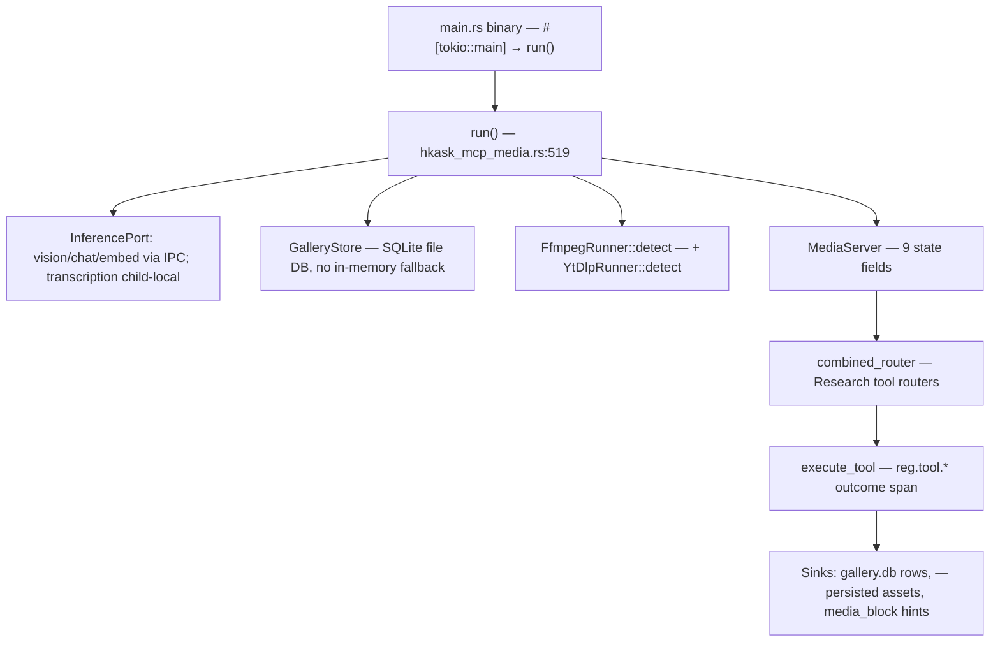
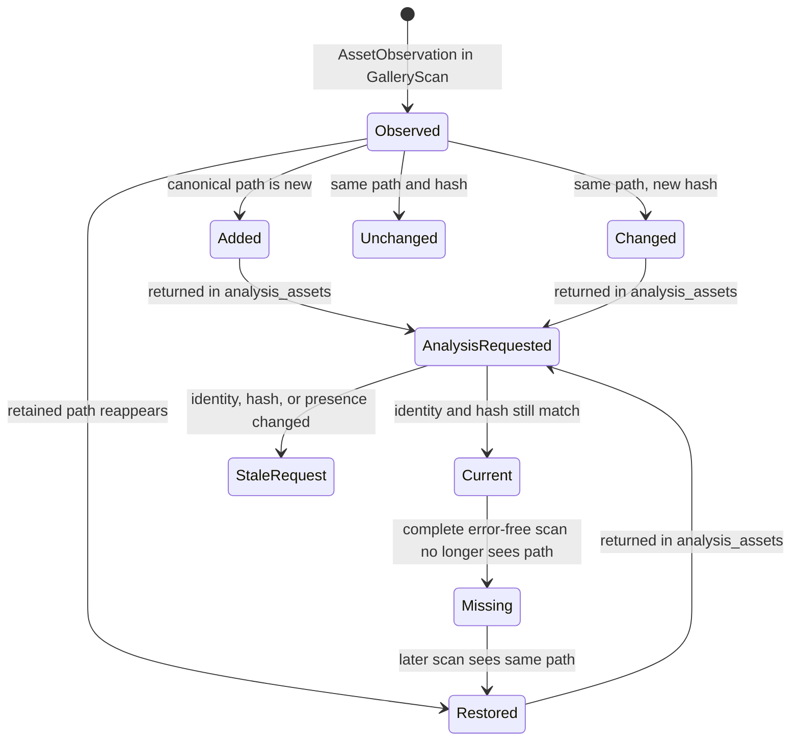
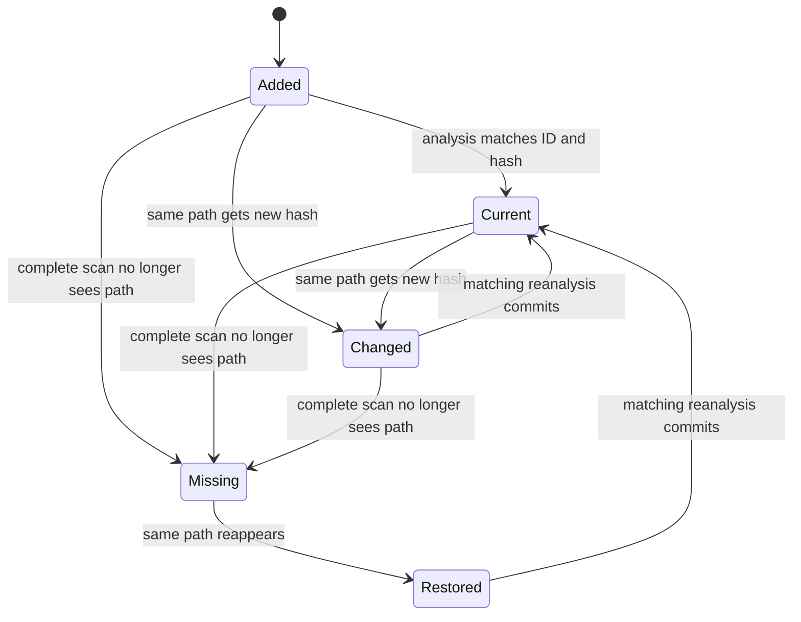

# Media MCP Server Reference

**Crate:** `kask/mcp-servers/hkask-mcp-media`
**Tools:** 71 (102 - 20 retired creative operations + 9 research annotation/search operations - 20 Reduct cloud tools, removed 2026-10-22). The generated `TOOL_NAMES` and `MediaServer::combined_router()` are the inventory authority; the count is pinned from the observed router (the schema-compliance test and the media panel both assert it), not a lexical census. The source router and schemas are tested together; an editor session still using an older child must rebuild/restart before it exposes this surface.
**Registration:** built-in server `id: "media"`, `binary: "hkask-mcp-media"` in `BUILT_IN_MCP_SERVERS` (`kask/crates/kask_bridge/src/mcp_servers.rs:352-396`).

The canonical tool-name list is generated by
`kask/mcp-servers/hkask-mcp-media/build.rs` into `tool_names.gen.rs` and
included by `hkask_mcp_media.rs`; `tool_names_match_live_router` checks the
live-router equality. Its existence is not evidence of a test run.

## Architecture

The thin binary calls `hkask_mcp_media::run()`, which opens the durable gallery
and registers the research tool routers. The single `InferencePort` separates
vision/chat/embed over IPC to zed's `LanguageModelRegistry` from child-local
transcription through `LazyInferencePort` and `MediaRouter` with env-injected
provider keys (D35). Creative image/video/TTS dispatch is retired, not a second
research-evidence source.

<!-- DIAGRAM_ALIGNMENT
id: DIAG-RF-006
verified_date: 2026-10-22 (Reduct.cloud surface removed; local surface re-verified — 71-tool pin + suite green)
verified_against: kask/mcp-servers/hkask-mcp-media/src/main.rs:6-9; kask/mcp-servers/hkask-mcp-media/src/hkask_mcp_media.rs:154-177,424-518,519-631; kask/mcp-servers/hkask-mcp-media/src/tools/
status: VERIFIED
-->

### Server struct

`MediaServer` is declared via the `mcp_server!` macro with eight state fields (`kask/mcp-servers/hkask-mcp-media/src/hkask_mcp_media.rs:154-177`):

| Field | Role |
|-------|------|
| `vision_port: Arc<dyn InferencePort>` | Vision/chat/embed and child-local transcription; no creative generation tools |
| `gallery_state: Arc<Mutex<Option<GalleryState>>>` | Currently-organized gallery; `None` until `gallery_organize` runs |
| `gallery_store: Arc<GalleryStore>` | Durable SQLite-backed store (tags, faces, lineage, albums) |
| `template_env: minijinja::Environment` | Jinja2 prompt templates for vision calls |
| `ffmpeg: FfmpegRunner` | ffmpeg availability probe (`kask/mcp-servers/hkask-mcp-media/src/video/ffmpeg.rs:130`) |
| `ytdlp: YtDlpRunner` | yt-dlp availability probe (`kask/mcp-servers/hkask-mcp-media/src/video/ytdlp.rs:19`), used by `video_fetch` |
| `job_store: jobs::JobStore` | Process-local research-job lifecycle (`kask/mcp-servers/hkask-mcp-media/src/jobs.rs`) |
| `serpapi_key: Option<String>` | Credential for structured YouTube search metadata; never used to download media |

### Router composition

`combined_router()` sums the research sub-routers, one per registered `tools/` module: `gallery_router` + `processing_router` + `audio_router` + `models_router` + `jobs_router` + `educt_router` + `youtube_router`. The handler attribute wires that sum as the runtime surface (`kask/mcp-servers/hkask-mcp-media/src/hkask_mcp_media.rs:424-432`).

## Bootstrap and configuration

**Bootstrap pattern:** `kask/mcp-servers/hkask-mcp-media/src/main.rs:6-9` (`#[tokio::main] async fn main` → `hkask_mcp_media::run()`) → `run()` at `kask/mcp-servers/hkask-mcp-media/src/hkask_mcp_media.rs:519` → `hkask_mcp_server::run_server("hkask-mcp-media", env!("CARGO_PKG_VERSION"), ...)` at `kask/mcp-servers/hkask-mcp-media/src/hkask_mcp_media.rs:597`.

**Gallery DB:** durable file-backed SQLite at `{kask_data_dir}/mcp/media/gallery.db` (D28 — Standardized Artifact Storage), overridable via `HKASK_MEDIA_DB`. There is **no in-memory fallback**: a DB open failure aborts startup, because the fallback would make an outage look like an empty gallery. The file DB is unencrypted and therefore does **not** use `HKASK_DB_PASSPHRASE` (`kask/mcp-servers/hkask-mcp-media/src/hkask_mcp_media.rs:532-562`).

**Routing decision (2026-09-06):** `params.model` overrides the operation's
env model. Selectable ops require full `OpenRouter/...` or `DeepInfra/...`
qualification (ASCII case-insensitive provider name, nonempty local model,
no whitespace). No bare/short-alias fallback, scoring, registration-order
selection, or automatic cross-provider retry remains. This supersedes
`d660f3b754` and `8cc79c797e`; child-local media (`f86cf19a70`) and foreground
transcription behavior remains unchanged. Creative and fixed background-removal/
upscale operations are no longer exposed by this server.
Invalid model selection maps to `invalid_argument`; missing config/key or
provider 401/403 maps to `permission_denied`. For migration, qualify saved
research model settings and remove retired creative model overrides. See the
[inference policy](../../diataxis/hkask-inference/reference.md#configure-strict-media-routing).

**Credentials:** the media server's registration allowlists `OPENROUTER_API_KEY`, `DEEPINFRA_API_KEY`, and `HKASK_SERPAPI_API_KEY` (`kask/crates/kask_bridge/src/mcp_servers.rs:354-358`). The first two serve the child-local `MediaRouter`; SerpApi supplies structured YouTube discovery metadata. Vision/chat/embed use the IPC bridge to zed's `LanguageModelRegistry`. The routes are distinct — `yt-dlp` is not a metadata provider and needs no credential.

**Environment variables** (all optional; the two research `HKASK_MEDIA_*_MODEL` vars resolve through the server's `models` module — `None` when unset, no constant fallback; callers fail visibly naming the env var, `kask/mcp-servers/hkask-mcp-media/src/hkask_mcp_media.rs:89-106`):

| Variable | Purpose | When unset |
|----------|---------|-------------|
| `HKASK_INFERENCE_SOCKET` | IPC bridge socket — routes vision/chat/embed through zed's `LanguageModelRegistry` | falls back to a standalone router with env-var keys |
| `HKASK_DATA_DIR` | Data dir for gallery DB path resolution | — |
| `HKASK_MEDIA_DB` | Gallery DB path override (`kask/mcp-servers/hkask-mcp-media/src/hkask_mcp_media.rs:547`) | `{data_dir}/mcp/media/gallery.db` |
| `HKASK_MEDIA_STT_MODEL` | STT model — transcription (`models::stt_model()`) | not configured — STT calls fail visibly |
| `HKASK_MEDIA_PASS_MODEL` | Text-layer pass model (correction/paragraph/highlight/speaker); an explicit per-call model override wins over it (`models::pass_model()`) | falls back to the configured analysis model `HKASK_MEDIA_VISION_MODEL` |
| `HKASK_MEDIA_VISION_MODEL` | Vision model (`models::vision_model()`) | not configured — vision calls fail visibly |
| `HKASK_EMBEDDING_MODEL` | Embedding model for gallery similarity search (`kask/mcp-servers/hkask-mcp-media/src/hkask_mcp_media.rs:396-408`) | not configured — embedding-dependent calls fail visibly naming `kask.models.embedding_model` |
| `HKASK_SERPAPI_API_KEY` | SerpApi credential for `youtube_search` metadata | `youtube_search` returns `permission_denied` naming the missing key |

`build_model_list` lists only configured models — an unset modality is absent from the list, never a hidden default (`kask/mcp-servers/hkask-mcp-media/src/tools/models.rs:15-30`).

Settings → Kask → Media configures only `stt_model` and `vision_model` via
`KaskMediaSettings` → `emit_media_env`. Absent settings use settings-layer
constants; explicitly empty values clear those defaults and fail visibly.
There is no TTS/image-generation/video-generation setting or hidden fallback.
Text-layer passes (correction, paragraph, highlight, speaker) resolve their
model as an explicit per-call override, then `HKASK_MEDIA_PASS_MODEL`
(operator process env — no settings field yet), then the configured
analysis model (`HKASK_MEDIA_VISION_MODEL`); the STT model serves
transcription only (2026-10-25 repair, commit `f6a786cdcb`).

**System dependencies:**

- **ffmpeg** — required by all local video tools and `audio_trim`/`audio_concat`. `require_ffmpeg` returns `McpToolError::unavailable("ffmpeg not found on system PATH — video tools unavailable.")` when absent (`kask/mcp-servers/hkask-mcp-media/src/hkask_mcp_media.rs:323-331`). `video_info` additionally uses ffprobe, bundled with ffmpeg (`kask/mcp-servers/hkask-mcp-media/src/tools/processing.rs:928` (`video_info`)).
- **SerpApi** — required by `youtube_search` for structured discovery metadata. Search never invokes `yt-dlp`; missing credentials return `permission_denied` naming `HKASK_SERPAPI_API_KEY`.
- **yt-dlp** — required only by `video_fetch` to retrieve media bytes for durable local publication from platform URLs (YouTube, Vimeo). It is not used for search or metadata. `require_yt_dlp` returns `unavailable` with install instructions when absent.
- **Vision-capable provider** — required by describe/analyze/caption tools. `require_vision` resolves `HKASK_MEDIA_VISION_MODEL` (`kask.models.media_vision_model`) and returns `permission_denied` naming `HKASK_MEDIA_VISION_MODEL` when unset (`kask/mcp-servers/hkask-mcp-media/src/hkask_mcp_media.rs:347-355`).

**Image size cap:** gallery images larger than 32 MiB are rejected before base64 encoding to prevent OOM (`MAX_IMAGE_READ_BYTES`, `kask/mcp-servers/hkask-mcp-media/src/hkask_mcp_media.rs:56`).

### Resource bounds and lifecycle presentation

`hkask_types::media_limits` is the shared cardinality-policy authority. A concrete
four-slot heavy-operation admission authority is shared by direct provider,
FFmpeg/ffprobe/yt-dlp, analysis, capture/transcription, and transcript-pass RPCs
and by background jobs. Admission is try-only: the fifth combined operation
fails before external work and is never queued. Job list/status/cancel and cheap
gallery reads do not consume a slot. Requests outside cardinality bounds also
fail before allocation or external work; no caller input is clamped or silently
truncated.

| Surface | Bound |
|---|---:|
| combined direct heavy operations + background jobs | 4 active, fail-fast |
| audio/video concat inputs | 64 |
| extracted keyframes | 256 |
| `job_list` rows | default 20, maximum 256 |

Frame extraction reports `completed`, `partial`, or `failed` and retains
per-item causes. It owns and removes its scratch batch on every terminal
path, removes failed durable copies, and aggregates failures rather than
emitting one warning per frame.

The media panel uses latest-request ownership for Library, Queue, and Detail.
Mutation-driven and manual Library reloads supersede older same-page reads.
Direct trim/concat edits are serialized and conflicting controls stay disabled
until the admitted operation completes or fails. Both success and failure
callbacks are epoch-gated; a malformed or failed refresh preserves the
atomically committed last-good snapshot. Library pagination is user-reachable.
Loading, ready/empty, degraded, and failed states are distinct, and progress
does not use error styling. Queue polling is
single-flight and uses a GPUI-native timer only while the Queue tab is active
and a nonterminal job exists; it stops on hide, terminal completion, or error.
Job responses use one strict typed payload containing `jobs`, `total`, `limit`,
`has_more`, `history_scope`, and `restart_behavior`; process-local restart loss
plus bounded terminal-record retention are disclosed. Legacy arrays and
incomplete objects are rejected.

The media widget validates untrusted block locators before loading: local paths
must be under the artifacts root or exactly approved by a successful gallery
result, data URIs are MIME-checked and decoded under a 32 MiB limit, public
image/audio fetches reject redirects, and platform inputs plus resolved stream
URLs receive DNS/private-address validation. yt-dlp and FFmpeg still own their
connect-time DNS, so preflight cannot eliminate subprocess DNS-rebinding TOCTOU;
this is a documented transport limitation. The widget clears stale failures on retry, synchronizes Pause/Stop into
the visible transport immediately, surfaces missing image/SVG filesystem causes,
and invalidates in-flight remote resolution when suspended so hidden media
cannot restart polling. A visible panel or inline lookup reactivates the shared
Asset without autoplay and restarts an initial load interrupted by suspension,
preventing a visible player from remaining at Loading/0:00. The production
benchmark treats cached/hidden media as a suspension case: players load visibly,
start playback, leave the render tree, and must reach suspended/no-polling rather
than completing offscreen.

## Gallery lifecycle — ratified 2026-09-06

The operator approved **retain-and-mark-missing**, not deletion or compatibility
shims. This restores the restart-hydration intent stated in `a3496b7164` and
supersedes the create-only activation / insert-only rescan behavior.

- `gallery_organize(path)` validates a canonical, readable directory, opens or
  creates that identity, reconciles, then activates it. Restart alone selects no
  gallery. Reopening preserves the existing mode and reports `requested_mode`,
  effective `mode`, and `mode_preserved`; failure preserves the prior activation.
- Identity is `(gallery_id, canonical absolute path)`. Same-path observations keep
  IDs and `added_at`; a changed hash updates physical attributes and marks retained
  annotations `metadata_stale`. Distinct paths with equal bytes remain distinct.
- Missing records retain tags, albums, face associations and lineage. Normal
  active counts/list/search/timeline/album positions exclude them; reappearance
  restores the same ID. `gallery_asset_detail` accepts exactly one of active
  `image_index` or stable `image_id`, so missing records remain inspectable.
- Scans never mutate source bytes. Only complete coverage can infer absence:
  supported images inside the root and selected depth. External imports/generated
  files, audio/video and `.hkask-gallery` metadata directories are excluded.
  Decode/read/walk errors and skipped symlinks produce a degraded report and
  suppress all absence inference for that scan.
- Active counts and size derive from SQLite rows. List and index lookup share
  `(added_at, id)` ordering. Listing exposes `gallery_id`, `id`, `missing`,
  `metadata_stale`; tag/semantic search exposes `image_id` and `metadata_stale`.
  The existing Detail inspector renders these flags without a layout redesign.
- Scans and vision target captured galleries/asset records. New records begin
  analysis-pending. Auto-analysis consumes actual added/changed/restored records,
  not guessed index ranges. Complete successful analysis clears staleness only
  when the captured hash still matches; partial analysis remains retryable and
  reports `partial`. Reanalysis atomically replaces prior model-derived tags for
  requested pipelines while preserving user-authored tags. Invalid modes,
  pipelines, bounds, and selection indices fail before inference. Structurally
  invalid vision output (missing colors array, empty composition object, blank
  caption) errors and retains staleness; legitimate empty face/object detections
  are valid.
  Every file the server produces (research jobs, local processing, fetched
  video, extracted frames) is filed under the gallery whose folder contains it;
  produced media lives in `media-mcp/generated/`, so it is indexed in that
  gallery whatever gallery is active (`assets::owning_gallery_id`).
- The consumer boundary carries identity: the panel reconciles listings by
  `gallery_id` (a root switch clears the old gallery's rows and pending
  selection/deletion actions), drops superseded listing responses (request
  epochs), reconciles exhausted page tails against the payload `total`, and
  addresses detail/delete by stable `image_id` (`gallery_delete_image` accepts
  exactly one of `image_id` or `image_index`). Asset deletion preserves linked
  transcripts, clears only their live gallery link in the same database statement,
  and retains immutable source identity. Index-only deletion leaves path-backed
  transcripts usable; requested file deletion fails before row deletion when the
  filesystem operation fails. Local-vs-network classification is syntactic rather
  than existence-based, so a missing local source reaches the filesystem/FFmpeg
  boundary and retains its original cause instead of becoming a URL syntax error.
  - Canonicalization of an absent path resolves its existing symlink ancestors
  (deepest existing prefix canonicalized, absent remainder appended lexically),
  so alias and real spellings of a missing file denote one identity.

Enforcement: `GalleryStore::{open,reconcile,persist_analysis,get_by_id,list_assets}`
in `kask/mcp-servers/hkask-mcp-media/src/gallery/store.rs`; `GalleryState::scan` in
`kask/mcp-servers/hkask-mcp-media/src/gallery/state.rs`; activation in `kask/mcp-servers/hkask-mcp-media/src/tools/gallery.rs`; analysis snapshots
in `kask/mcp-servers/hkask-mcp-media/src/images.rs`; generated completion in `kask/mcp-servers/hkask-mcp-media/src/assets.rs`.

The schema defines `missing` and `metadata_stale` directly, enforces `(gallery_id, absolute_path)` uniqueness, and derives active counts/size from SQLite rows with no migration shims or legacy read paths. Storage API callers use `open` and pass one canonical asset path to insertion. No providers, research-job lifecycle, or D35 child-local routing changes are part of this decision. See the server README's gallery lifecycle section for regression test names.

## Gallery store identity and reconciliation

The gallery store moved from `hkask-storage` to this crate (2026-10-13, commit
`c85b1e4896`); this server is its sole consumer. The gallery is an index over
user-owned files, not a content-addressed copy. A `GalleryScan` carries
physical `AssetObservation`s plus explicit coverage and errors;
`GalleryStore::reconcile` applies all observations and safe missing
transitions in one immediate transaction
(`kask/mcp-servers/hkask-mcp-media/src/gallery/store.rs:106-136,678-774`). Distinct
paths with equal content remain distinct assets. A changed hash preserves the
stable image ID and marks metadata stale; a missing asset retains its row and
can later be restored
(`kask/mcp-servers/hkask-mcp-media/src/gallery/store.rs:645-672,678-774`).

<!-- DIAGRAM_ALIGNMENT
id: DIAG-RF-008
verified_date: 2026-10-14
verified_against: kask/mcp-servers/hkask-mcp-media/src/gallery/store.rs:106-136,645-672,678-774,788-841
status: VERIFIED
-->

`ReconcileResult::analysis_assets` names the exact added, changed, or restored
records that need analysis; callers do not infer positional ranges
(`kask/mcp-servers/hkask-mcp-media/src/gallery/store.rs:127-136,678-774`). Analysis
persistence checks image ID, gallery ID, hash, and non-missing state before
replacing model metadata, so a response for an old request cannot annotate a
newer file revision (`kask/mcp-servers/hkask-mcp-media/src/gallery/store.rs:788-841`).

Historical lineage, OMC creation-graph, album, face, and tag records hang
from the same durable asset identity
(`kask/mcp-servers/hkask-mcp-media/src/gallery/store.rs:206-287,323-410`). Deleting an
image therefore relies on foreign-key cascades instead of leaving detached
lifecycle metadata.

## Gallery store entities

All entities are defined in `kask/mcp-servers/hkask-mcp-media/src/gallery/store.rs`
and re-exported through the server's `gallery` module
(`kask/mcp-servers/hkask-mcp-media/src/gallery.rs`).

| Entity | Role | Evidence |
|---|---|---|
| `GalleryMode` | read-only, copy-on-write, or destructive policy | `kask/mcp-servers/hkask-mcp-media/src/gallery/store.rs:41-48` |
| `GalleryRecord` | durable canonical root and aggregate view | `kask/mcp-servers/hkask-mcp-media/src/gallery/store.rs:76-84` |
| `ImageRecord` | stable path identity, content revision, presence, metadata freshness | `kask/mcp-servers/hkask-mcp-media/src/gallery/store.rs:87-102` |
| `AssetObservation` | one physical observation supplied by a scan request | `kask/mcp-servers/hkask-mcp-media/src/gallery/store.rs:106-114` |
| `GalleryScan` | request coverage, observations, and errors | `kask/mcp-servers/hkask-mcp-media/src/gallery/store.rs:118-124` |
| `ReconcileResult` | lifecycle counts plus exact assets requiring analysis | `kask/mcp-servers/hkask-mcp-media/src/gallery/store.rs:127-136` |
| `TagRecord` | persisted annotation | `kask/mcp-servers/hkask-mcp-media/src/gallery/store.rs:206-217` |
| `FaceRegistryRecord` | named face reference and status | `kask/mcp-servers/hkask-mcp-media/src/gallery/store.rs:222-231` |
| `AlbumRecord` | nested metadata-only grouping | `kask/mcp-servers/hkask-mcp-media/src/gallery/store.rs:252-259` |
| `GenerationRecord` | historical and source-derived operation lineage | `kask/mcp-servers/hkask-mcp-media/src/gallery/store.rs:260-285` |
| `OmcCreationGraphRecord` | canonical MovieLabs OMC graph for one asset | `kask/mcp-servers/hkask-mcp-media/src/gallery/store.rs:283-287` |

<!-- DIAGRAM_ALIGNMENT
id: DIAG-RF-007
verified_date: 2026-10-14
verified_against: kask/mcp-servers/hkask-mcp-media/src/gallery/store.rs:87-136,645-672,678-774,788-841
status: VERIFIED
-->

`GalleryStore::reconcile` commits observations and safe absence transitions in
one transaction (`kask/mcp-servers/hkask-mcp-media/src/gallery/store.rs:678-774`). Errors
in scan coverage suppress absence inference. `persist_analysis_for_tag_types`
applies a response only while image ID, gallery ID, hash, and non-missing
state still match (`kask/mcp-servers/hkask-mcp-media/src/gallery/store.rs:788-841`). Active
list/count/index surfaces exclude missing records, while stable-ID inspection
can include them (`kask/mcp-servers/hkask-mcp-media/src/gallery/store.rs:777-903`).

### Gallery scan and analysis requests

When adding gallery-facing work, carry exact lifecycle entities rather than
positional guesses: `AssetObservation` describes one physical asset;
`GalleryScan` carries observations plus coverage and errors; `ReconcileResult`
reports added, changed, restored, missing, and unchanged counts and returns
exact `analysis_assets`. These types are defined at
`kask/mcp-servers/hkask-mcp-media/src/gallery/store.rs:106-136` and consumed atomically by
`GalleryStore::reconcile` at
`kask/mcp-servers/hkask-mcp-media/src/gallery/store.rs:678-774`. Persist an analysis response
through `persist_analysis_for_tag_types`; it refuses to apply an old request
when image identity, hash, or presence no longer matches
(`kask/mcp-servers/hkask-mcp-media/src/gallery/store.rs:788-841`).

## Transcript-as-timeline model

The 16 `educt_*` tools implement the interaction model published by Reduct.video:
word-timed transcript selections become media ranges; labeled highlights compose
into ordered Reel Keep operations; Cut operations implement strikethrough editing;
and render/export are non-destructive projections. These tools remain local
and never fall back to a cloud request.

Transcript, layer, document-export, and rendered-Asset relationships share the
media database. Deleting a transcript atomically removes its editable layers while
preserving document exports and rendered EDL Assets; preserved outputs retain
immutable source transcript/layer IDs while live links become null. Export
publication and canonical EDL publication record these typed relationships before
releasing rollback ownership. `educt_get_transcript` enumerates live exports and
renders, and `gallery_asset_detail` exposes a rendered Asset's transcript origin.

The latest correction layer now supplies the working transcript for inspection,
locate, semantic highlighting, SRT, and corpus export. One-to-one replacement
tokens inherit the corresponding cloned source word's timing; the stored source
bundle never changes. Cardinality-changing corrections remain readable and
text-exportable, and `educt_realign_transcript` (2026-10-06, MF-2) projects
re-anchored timings by slicing each edit's source span equally so all timed
consumers work again without modifying the immutable source bundle. Without a
realignment layer, timing-dependent tools return `FailedPrecondition`.

Official reference surface:
<https://reduct.video/product/edit-video/> and
<https://help.reduct.video/en/articles/2528101-how-do-i-correct-a-transcript>.

## Tool reference

Grouped by full repository-relative `tools/` source path. Descriptions are condensed from each tool's current `#[tool(description = ...)]` descriptor; live registration is pinned by the router tests cited above.

**Publication contract.** File-producing research operations publish durable
source-derived assets through the rollback-armed aggregate in
`kask/mcp-servers/hkask-mcp-media/src/assets.rs`. The persisted path, stable
Asset identity, effective source parameters, lineage, and OMC creation graph
commit together; failure removes coupled files/rows rather than returning an
unindexed scratch file or raw provider payload. Outputs remain under
`{artifacts_dir}/media-mcp/generated/`: that historical directory name does
not imply synthetic generation. Large payloads stay out of model context
(the 2026-08-31 base64 context-overflow incident remains the rationale).
Historical lineage stays inspectable, never a command to rerun retired tools.

**Display-hint contract (approved wire cleanup, 2026-09-05):** `media_block`
and `media_block_with_omc` serialize JSON rather than interpolating paths.
Every indexed Asset hint carries `gallery_asset_id`; gallery listing reconciliation
injects that same ID into the renderer body, so panel and inline presentations use
one stable bounded-registry key. Renderer lookups provide a visibility heartbeat;
loading or playback suspends when the Asset stops rendering.
`display_hint` is one fenced media block; `display_hints` is an array of them.
Structured raw outputs use `hkask_types::tool_response::display_hints_from_output_value`;
the live text transport uses `display_hints_from_output_text` as its adapter.
Both viewer and widget use `MediaBlockBody` plus its media-kind resolver,
rejecting missing `src` and unsupported kinds consistently. Ontology and
provenance remain intentional optional metadata. The viewer retains the
original body, including dimensions and additional metadata. Pins:
`media_blocks_round_trip_escaped_paths` (server),
`server_hint_round_trips_through_viewer_and_widget` and
`ingest_tool_result_accepts_structured_and_text_transports` (viewer).
No routing or layout change is part of this repair.

### Gallery management (`kask/mcp-servers/hkask-mcp-media/src/tools/gallery.rs`)

| Tool | Description |
|------|-------------|
| `gallery_organize` | Organize a photo gallery: create the index, scan a folder for images, return status. Run before `gallery_search`. |
| `gallery_status` | Gallery status: path, mode, image count, total size. |
| `gallery_search` | Search the gallery by description. Mode `tags` (default): fuzzy-matches AI-generated tags (objects, faces, colors, composition). Mode `semantic`: caption-embedding cosine similarity against the query text or a reference `image_index` (requires `gallery_analyze` first). The former `gallery_find_similar` tool, folded in as the semantic mode. Query and candidate-caption embeddings are compared within one request — width-agnostic at the model's native width (no `dimensions` parameter). |
| `gallery_refresh` | Rescan for new/removed images and update all AI metadata; face detection OFF by default, `include_faces=true` also scans the face reference folder and auto-matches against the face registry. |
| `describe_image` | Describe an image in detail; styles: descriptive, artistic, technical, alt_text. |
| `gallery_analyze` | Analyze source objects, colors, composition, and scenes. Faces require explicit pipeline selection; model tags remain distinct from researcher annotations. |
| `gallery_name_face` | Name a face group from `gallery_analyze`, by free-text name or registry `face_id`; after naming, `gallery_search` finds photos of that person. |
| `face_validate` | Validate a gallery image as a face reference: exactly 1 face, coverage ≥15%, frontal pose, good lighting, no occlusion, sharp focus; structured pass/fail with reasons. |
| `face_register` | Register a face reference with a person's name; auto-validates 6 criteria, `--force` skips validation; stored in `face_registry` for matching during `gallery_refresh`. |
| `face_scan_folder` | Scan a folder of reference face images (with YAML sidecars) and register each in `face_registry`; default `mcp/media/faces/`. |
| `face_list` | List registered faces; optional status filter (valid / rejected). |
| `face_remove` | Remove a face from the registry by ID. |
| `gallery_timeline` | Organize gallery images by time period using EXIF dates; grouped by year, month, or decade. |
| `gallery_lineage` | Read historical or source-derived lineage plus any retained historical workflow graph; `lineage: null` if none recorded. This never executes a saved creative operation. |
| `gallery_list_assets` | List gallery assets in stable index order with pagination. |
| `gallery_asset_detail` | Complete details by active `image_index` or stable `image_id` (exactly one), including missing/status fields, lineage, structured OMC v2.8 creation graph, and typed transcript-render origin; the inspector-panel data source. |
| `gallery_delete_image` | Delete an Asset from the gallery index by stable `image_id` or active `image_index` (exactly one); linked transcripts detach and survive. Index-only deletion preserves source bytes in every mode. `delete_file=true` requires destructive gallery mode; read-only/copy-on-write refuse before mutation. Unlink failure preserves the index/link; a later database failure explicitly reports that the source was already deleted and requires reconciliation (`src/tools/gallery.rs:1395–1444`; pinned by `gallery_deletion_mode_matrix` and `asset_file_deletion_failure_preserves_gallery_and_transcript_identity`). |
| `gallery_add_media` | Import a video or audio file into the gallery whose folder contains it (not the active gallery; a file outside every gallery folder is refused) (media_type selects the kind); SHA-256 hash for deduplication. The former `gallery_add_video`/`gallery_add_audio` pair, merged. |
| `gallery_create_album` | Create an album; metadata-only grouping, assets stay in place, an asset can be in multiple albums. |
| `gallery_list_albums` | List all albums in the current gallery. |
| `gallery_move_to_album` | Add a gallery asset to an album; idempotent. |
| `gallery_remove_from_album` | Remove a gallery asset from an album; idempotent. |
| `gallery_delete_album` | Delete an album; assets remain in the gallery. |
| `gallery_list_album_members` | List all image indices in an album. |

### YouTube discovery (`kask/mcp-servers/hkask-mcp-media/src/tools/youtube.rs`, 1 tool)

| Tool | Description |
|------|-------------|
| `youtube_search` | Search one YouTube provider page through exactly one paid SerpApi request. `max_results` caps that page; the response reports requested/returned cardinality, continuation availability, pages fetched, and request limit. It does not download media. |

### Image and video processing (`kask/mcp-servers/hkask-mcp-media/src/tools/processing.rs`)

| Tool | Description |
|------|-------------|
| `image_create_collage` | Create a collage from gallery images (local composition via `image` crate); three modes: `search_terms`, `similar_to_index`, or `image_indices`. Published through the canonical storage contract (PR-M2, 2026-10-06): the output is gallery-indexed with lineage (op `image_create_collage`) at a durable artifacts path — the result carries `gallery_asset_id` + `display_hint`; the scratch write is consumed by the publication. |
| `video_clip` | Trim a video to start/end times using local ffmpeg, then durably publish and index the result in the generated gallery. |
| `video_to_gif` | Convert a video segment to GIF using local ffmpeg, then durably publish it in the generated gallery. |
| `video_add_caption` | Add a text caption overlay with local ffmpeg, then durably publish the MP4 in the generated gallery. |
| `video_concat` | Concatenate clips with ffmpeg, then durably publish the MP4 in the generated gallery. |
| `video_caption` | Describe video content by extracting keyframes and analyzing them with a vision LLM. |
| `video_extract_frames` | Publish sampled source frames as searchable assets, recording source identity/hash, matching indexed parent when available, and actual source PTS. Returns stable asset IDs and explicit partial failures; no timestamps are inferred from ordinal position. |
| `video_info` | Probe a video file for metadata — duration, dimensions, codec, fps, bit rate — via ffprobe. |
| `video_fetch` | Validate a selected public video URL, download through yt-dlp, and atomically publish one durable indexed gallery asset. Download, file, lineage, or OMC failure leaves no residue; successful degradation is returned as a warning. |

The local final-media tools `video_clip`, `video_to_gif`,
`video_add_caption`, and `video_concat`
return a stable identity. Each consumes the processor/downloader-owned temporary
MP4 or GIF into `media-mcp/generated/`, indexes the durable path in the generated
gallery, marks `gallery_changed: true`, and returns the same `gallery_asset_id` in the result object
and fenced media block. The final file therefore survives `FfmpegRunner` and
server teardown.

Each operation records generation lineage under its own tool name with complete
resolved source and effective parameter JSON. `parent_image_id` remains unset:
a source path is not a verified gallery identity, and multiple image indices
cannot truthfully become one parent. OMC (`omc:Sequence`) and invocation
provenance remain in the media block. File publication, gallery insertion, and
lineage recording form one rollback-armed operation: any failure preserves the
causal error and removes the generated file and coupled gallery row/lineage.

### Audio capture and transcription (`kask/mcp-servers/hkask-mcp-media/src/tools/audio.rs`, 6 tools)

| Tool | Description |
|------|-------------|
| `transcribe_bundle` | Transcribe audio into a synchronized `TranscriptBundle` with word-level timings (full_text carries the plain text) — the single transcription entry point, and the ingest format for the educt layers. The former raw-JSON `transcribe` tool was removed (the bundle is a strict superset). |
| `audio_capture` | Capture audio from the default microphone and publish it as a canonical durable WAV asset (16 kHz mono); callers cannot select an output path. |
| `record_and_transcribe` | Record from microphone and transcribe in one call; returns linked audio file path and transcript. |
| `transcribe_and_store` | Transcribe audio AND store the `TranscriptBundle` server-side in one call, returning only the transcript summary (id, words_count, has_word_timings) — the ingest entry point when the educt layers will be used afterwards. |
| `audio_trim` | Trim an audio file to start/end times and publish the result as a canonical durable WAV asset; ffmpeg stream copy is fast and lossless. |
| `audio_concat` | Concatenate audio files and publish one canonical durable WAV asset; ffmpeg uses the lossless concat demuxer. |

### Model browser (`kask/mcp-servers/hkask-mcp-media/src/tools/models.rs`, 2 tools)

| Tool | Description |
|------|-------------|
| `model_list` | List configured research STT and vision models with provider, modality, capabilities, default status; optional provider filter. |
| `model_info` | Detailed information about a specific media model by id. |

### Async job queue (`kask/mcp-servers/hkask-mcp-media/src/tools/jobs.rs`, 4 tools)

**Lifecycle and response contract (2026-09-13):** the controller admits at
most four active jobs and retains at most 256 terminal records. `job_cancel`
enters `cancelling`, drops provider/staging work, rolls back staged or published
files and gallery rows, releases its slot, and only then returns terminal
`cancelled`; cleanup failure is surfaced instead of falsely acknowledging
cancellation. Panic and task abort become terminal `failed` states and release
the slot. `job_list` returns the strict object `{ jobs, total, limit, has_more,
history_scope, restart_behavior }`, newest first, with optional request status
and limit. Legacy arrays, missing fields, incoherent counts, and unknown statuses
fail decoding. The history scope is explicitly
`ephemeral_process_local`; `job_list`, `job_status`, and `job_cancel` all expose
that restart limitation. `parse_job_list_response` consumes the shared wire
shape, and malformed data or tool errors remain visible at the panel boundary.
The controller, cancellation, staged-publication, panic/abort, retention, and
response contracts are pinned in `jobs.rs`, `tools/jobs.rs`, and `assets.rs`.

| Tool | Description |
|------|-------------|
| `job_submit` | Admit `transcribe`, `audio_trim`, `audio_concat`, `video_clip`, or `video_concat` with serialized operation-specific `params`; returns a job ID or a typed rate-limit error when four combined heavy operations are active. |
| `job_list` | List retained jobs plus explicit process-local history scope and restart behavior. |
| `job_status` | Return one job and explicit history scope; missing jobs name restart data loss. |
| `job_cancel` | Cancel queued/running work and acknowledge only after teardown, rollback, and slot release. |

### Researcher annotations and recording search

These are author-supplied observations, not authenticated human identity or
verified source evidence. Model-derived metadata/suggestions remain distinct.

| Tool | Request identity and fields |
|---|---|
| `gallery_annotation_create` | stable `gallery_asset_id`, `kind` (`tag` or `note`), `value` |
| `gallery_annotation_list` | stable `gallery_asset_id` |
| `gallery_annotation_update` | `gallery_asset_id`, `annotation_id`, replacement `value` |
| `gallery_annotation_delete` | `gallery_asset_id`, `annotation_id` |
| `educt_annotation_create` | `transcript_id`, inclusive immutable-source `start_word`, `end_word`, `label`, `note`; optional `kind`: `highlight` (default) or `strike` (an unannotated cut — a single-Cut EDL; `label` and `note` must be blank) |
| `educt_annotation_list` | `transcript_id` (highlights and strikes; multi-op EDLs excluded) |
| `educt_annotation_update` | `transcript_id`, `annotation_id`, all replacement range/label/note fields; dispatches on the stored kind (a strike takes a new range with blank `label`/`note`) |
| `educt_annotation_delete` | `transcript_id`, `annotation_id` (highlight or strike) |
| `educt_search_transcripts` | `query`, `mode: "lexical"`; optional `limit`, `recording_limit`, `recording_offset`, `start_byte`, `gallery_asset_id` |

Gallery indices are positional and must not replace stable IDs. Transcript
annotation IDs identify researcher highlight layers; source indices are not
corrected-text indices. An explicitly selected annotation layer can feed
`educt_edl_from_highlights` using `layer_id: annotation_id`.

Search is literal substring retrieval (ASCII case-insensitive, non-ASCII exact),
not semantic search. The query is nonblank and at most 256 UTF-8 bytes; `limit`
is 1–100 (default 20), `recording_limit` 1–500 (default 100), and matching scans
at most 4 MiB per call. The byte budget bounds matching, not loading/projection
of one recording. Hits carry exact working-text excerpts, transcript/source
identities and available word/time citations with alignment/degradation. Missing
or unaligned timing is not invented. `has_more`, `search_complete`, result/byte
limit flags and `recordings_scanned` disclose coverage; continue with both
`next_recording_offset` and `next_start_byte`. Cursors refer to current order
and working text, not a frozen snapshot. Corpus-text export is the semantic
retrieval handoff. A lexical hit is not verified evidence.

### Transcript timeline (`kask/mcp-servers/hkask-mcp-media/src/tools/educt.rs`, 21 tools)

`educt_store_transcript`, `educt_list_transcripts`, `educt_get_transcript`, `educt_delete_transcript`, `educt_store_layer`, `educt_list_layers`, `educt_paragraph_pass`, `educt_speaker_pass`, `educt_correction_pass`, `educt_apply_corrections`, `educt_realign_transcript`, `educt_highlight_pass`, `educt_edl_from_highlights`, `educt_render_edl`, `educt_export`, and `educt_locate` implement the non-destructive transcript/layer/EDL model described above (`kask/mcp-servers/hkask-mcp-media/src/tools/educt.rs`).

### Support modules (no registered tools)

Non-tool modules hold the shared implementation: `assets.rs` provides rollback-armed Asset/lineage/OMC publication; `faces.rs` provides explicitly selected identity matching; `templates.rs` supplies analysis prompts; transcript modules supply immutable bundles, working views, layers, selection, export and persistence; gallery modules supply storage, scans and vision; video modules supply FFmpeg and yt-dlp; `media_block.rs` serializes display hints; `jobs.rs` provides queue state and shared admission; `omc.rs` and `ontology.rs` map response identities. Creative generation, saved-workflow execution, style and meme-text implementation modules are removed.

## Error classification

`kask/mcp-servers/hkask-mcp-media/src/error.rs` replaces `Result<_, String>` with a structured `MediaError` enum (17 variants, `kask/mcp-servers/hkask-mcp-media/src/error.rs:13-80`) and classifies errors into MCP wire-level `McpToolError` kinds. Per-variant, not blanket-internal:

| Mapper | Classification |
|--------|----------------|
| `map_media_error` (`kask/mcp-servers/hkask-mcp-media/src/error.rs:108`) | `ImageNotFound` → `not_found` (caller-named image missing); `GalleryNotInitialized` → `failed_precondition` (absent state, remedy named — canonical classification, operator ruling 2026-10-05); `FfmpegUnavailable`, `YtDlpUnavailable`, `YtDlpExtractor` → `unavailable`; `YtDlpAuthorization` → `permission_denied`; `YtDlpVideoUnavailable` → `not_found`; `YtDlpFailed`, `Io`, `FfmpegFailed`, `VisionApi`, `VisionParse`, `Template`, `AssetPersistence`, `SidecarNotFound`, `SidecarInvalid`, `FaceRegistration` → `internal` |
| `map_gallery_store_error` (`kask/mcp-servers/hkask-mcp-media/src/error.rs:136`) | `NotFound` → `not_found`; infra errors → shared `map_infra_error`; `InvalidMode`, `InvalidPath`, `Conflict` → `invalid_argument` (caller-fixable) |
| `map_image_open_error` (`kask/mcp-servers/hkask-mcp-media/src/error.rs:154`) | missing file → `not_found`; permission failure → `permission_denied`; other I/O and decode failures → `internal` |
| `classify_inference_error` (`kask/mcp-servers/hkask-mcp-media/src/error.rs:196-209`) | typed `InferenceError::NotConfigured`/`Auth` → `permission_denied` (missing or rejected credential, matching the canonical `hkask-mcp-swarm` pattern); `Model` → `invalid_argument`; `Overloaded` → `rate_limited`; `Timeout` → `timeout`; every other failure → `unavailable` |
| `classify_embedding_error` (`kask/mcp-servers/hkask-mcp-media/src/error.rs`) | the typed `EmbeddingGenerationError::NotConfigured` variant (emitted by `hkask-inference`'s direct-embedding fallback when the model has no provider prefix or the provider's credential env var is unset) → `permission_denied`; every other variant → `unavailable`. Classification follows the variant, never the message text (the string-matcher was deleted with the variant's arrival, 2026-10-06) |

## OMC ontology anchoring

Every tool maps to exactly one MovieLabs OMC concept via `omc::tool_to_omc` (`kask/mcp-servers/hkask-mcp-media/src/omc.rs:100-162`); the concept vocabulary lives in the shared `hkask-bridge-ontology` crate (`kask/mcp-servers/hkask-mcp-media/src/omc.rs:9-12`). The concept is baked into the tool output JSON's `"ontology"` field by `media_block::enrich_with_omc_and_provenance` (`kask/mcp-servers/hkask-mcp-media/src/media_block.rs`), which the media widget consumes for type-aware feedback routing. Regulation spans are emitted by the ordinary `execute_tool` path; ontology remains structured output data.

| Concept | Tools |
|---------|-------|
| `omc:CreativeWork` | `image_create_collage` (source-derived composition, not synthetic evidence) |

| `omc:Scene` | `describe_image`, `gallery_analyze`, `video_caption` |
| `omc:Asset` | gallery management + retrieval (`gallery_search` … `youtube_search` and `video_fetch`), all face tools — faces are gallery assets (people identified within images), not OMC `Participant`, which is a production-side concept about who made the media (`kask/mcp-servers/hkask-mcp-media/src/omc.rs:113-133`) |
| `omc:Capture` | `audio_capture`, `record_and_transcribe`, `transcribe_and_store`, `transcribe_bundle`, `audio_trim`, `audio_concat` |
| `omc:Sequence` | `video_clip`, `video_to_gif`, `video_concat`, `video_add_caption`, `video_info` |
| `omc:Shot` | `video_extract_frames` |
| `omc:Task` | historical lineage (`gallery_lineage`) and research job queue (`job_submit` … `job_cancel`) |
| `omc:Participant` | `model_list`, `model_info` — the model/provider is a participant in the creation task |

Canonical publication persists a typed creation graph per output asset using official OMC v2.8 relationships: `Asset → hasProvenance → Provenance`, `Asset → isCreatedByTask → Task`, `Task → hasState → State → hasStateDescriptor → StateDescriptor`, `Provenance → isCreatedBy → Participant`, and `Role → hasTask/hasParticipant → Task/Participant`. The participant is the hkask media service for local operations. The graph is returned by `gallery_asset_detail` and cascades with asset deletion.

Three tests pin the mapping: `omc_mapping_covers_all_registered_tools` (every registered tool maps to a concept — catches a new tool added without an `omc::tool_to_omc` arm, `kask/mcp-servers/hkask-mcp-media/src/hkask_mcp_media.rs`), `omc_mapping_distinguishes_tool_families` (nine families map to nine distinct concepts, `kask/mcp-servers/hkask-mcp-media/src/hkask_mcp_media.rs`), and `omc_module_present_with_consumer` (the `media_block::enrich_with_omc_and_provenance` call site must keep referencing `omc::tool_to_omc` — a module without a consumer is dead surface, `kask/mcp-servers/hkask-mcp-media/src/hkask_mcp_media.rs`).

## Key paths

- **Gallery lifecycle:** `gallery_organize` → `gallery_analyze` (persist tags) → `gallery_search` (tags or semantic mode) / `gallery_timeline`; `gallery_refresh` after adding files; `gallery_add_media` for non-image assets
- **Face pipeline:** `face_validate` → `face_register` (or `face_scan_folder` in bulk) → `gallery_refresh` with `include_faces=true` → `gallery_name_face` → `gallery_search` by person name. **Design decision (2026-08-29, tightened 2026-10-14):** face recognition relies on vision-LLM calls, not local code — the implementation surface is the minijinja (j2) templates `validate_face_ref` and `match_faces` (`kask/mcp-servers/hkask-mcp-media/src/templates.rs`) dispatched through the inference port. `run_face_matching` (`src/faces.rs`) groups reference portraits by `(first_name, last_name)` for best-of multi-reference matching, replaces unnamed `face` tags in place via `GalleryStore::replace_tag` with `bbox` preserved, skips already-named `face` tags on subsequent refreshes, and surfaces crop failures instead of sending uncropped images.
- **Research annotations:** stable gallery Asset → `gallery_annotation_create` / list / update / delete; transcript source-word ranges → `educt_annotation_create` / list / update / delete (highlights carry a label and note; strikes are unannotated single-Cut EDLs that render as transcript-minus-struck-range). User observations remain distinct from model metadata.
- **Recording retrieval:** `educt_search_transcripts` (`mode: "lexical"`) → exact excerpt plus source/timing citations; export corpus text for semantic retrieval.
- **Historical lineage:** `gallery_lineage` / `gallery_asset_detail` inspect prior provenance without restoring creative execution.
- **YouTube discovery and acquisition:** `youtube_search` (SerpApi metadata and ranking) → select URL → `video_fetch` (yt-dlp binary retrieval) → `video_clip` / `video_add_caption` / `video_to_gif`; `video_extract_frames` turns keyframes back into searchable assets
- **Async research processing:** `job_submit` (`transcribe`, `audio_trim`, `audio_concat`, `video_clip`, or `video_concat`) → `job_status` → `job_cancel` if needed; process-local history is not durable transcript storage.

## Media panel — transcript surface (2026-10-26)

The zed-side media panel consumes this server's educt tool surface as a
direct-manipulation workspace — no agent turn in the loop
(`crates/media_panel/src/media_viewer.rs`).

- **Browse**: the Transcript tab's idle state lists every stored recording
  (`educt_list_transcripts` at the server's 500 cap; media path + words +
  timings + the five-state alignment per row, lifecycle-protected at
  `load_transcript_listing`, media_viewer.rs:1764) — hand-annotatable rows
  (original/aligned) carry no extra flag; gated rows say so before the
  click (`transcript_alignment_note`: "re-anchored — read view (annotation
  gated)", "unaligned — needs a realignment layer"; untimed rows carry the
  no-timings text). The alignment is the same working-transcript
  computation the workspace gate uses, so the browser never disagrees
  with the opened view. Click opens the workspace, and an in-workspace
  `← all recordings` affordance returns to the browser
  (`close_transcript_workspace`, :1663). Per-asset transcripts remain
  visible in Detail's section alongside reel provenance, carrying the same
  alignment note.
- **Workspace**: one strict-parsed `educt_get_transcript` dispatch
  (`parse_transcript_payload`, media_viewer.rs:5338) drives everything:
  paragraph blocks (`build_pane_blocks`, :5227), speaker labels, the layers
  strip, highlight overlays, and strike line-through marks. The bound player is the same shared widget
  the Media tab and inline renders use (one player per media identity);
  clicking a word seeks to its start (`seek_workspace_transcript`, :2688);
  follow-along marks the word containing playback at 4 Hz, polling only
  while playing (`current_word_index`, :5218, over `MediaWidget::transport_position_secs`
  + `is_transport_playing` — the cross-media position and playing sources).
  A reload keeps the last-good workspace visible; only an explicit open or
  the back affordance clears it.
- **Annotate**: an explicit Select-range mode turns word clicks into a
  two-click range (`handle_word_selection`, :1835) that opens a label
  editor (`open_label_editor`, :2416; `render_label_editor`, :2530) —
  a focused input over the range; Enter confirms, Escape cancels, an
  empty create confirm keeps the default label `research-highlight`
  (`confirm_label_edit`, :2442, single-flight: an in-flight edit refuses
  visibly and keeps the typed buffer), and clipboard text pastes
  (control characters dropped). Create dispatches
  `educt_annotation_create` (`create_workspace_highlight`, :1921);
  researcher-authored rows (layer-provenance identified — the pane's
  detection mirrors the server's researcher-annotation list guard
  exactly (the mutate guards additionally require exactly one entry), so
  the legacy gather layers and compose EDLs never render as annotations) also offer
  rename via `educt_annotation_update` with the typed label over the
  unchanged range and note (`rename_workspace_highlight`, :2328) and delete
  via `educt_annotation_delete` (`delete_workspace_annotation`, :2239 —
  kind-dispatched: highlight or strike).
  Every completion reloads the workspace so overlays, rows, and label
  colors reflect it (`apply_workspace_annotation_result` names its subject
  and verb).
- **Strike (2026-10-27)**: the same selection can cut instead of label — the
  editor's create arm offers a strike affordance dispatching
  `educt_annotation_create` with kind strike (blank label/note: an
  unannotated single-Cut EDL; `strike_selected_range`, :2000 →
  `create_workspace_strike`, :2021). Struck words render line-through
  (index-identical views only; overlapping marks compose field-wise via
  `resolved_highlight_runs`, :4974 — a struck word inside a highlight keeps
  both the background and the line-through), a Strikes list offers
  click-to-seek rows and unstrike, and the pane parses strikes under the
  server's strike identity only (user + researcher_annotation + exactly
  one Cut op) — compose EDLs (pane_reel_compose provenance) and model EDLs
  never render as strikes.
- **Reel editing + generation (2026-10-27)**: the pane offers three compose
  modes, each building the reel EDL directly from its annotations
  (`compose_reel_params`, :5153) — assemble from the toggled-in
  researcher-authored highlights (union-merged so overlapping selections
  stay disjoint), reduce by cutting every strike out of the whole
  transcript, and mixed (keeps minus strikes). Membership keys on provenance
  and the per-clip include/exclude toggles, never the label text. The
  affordances render after both annotation lists, outside either section's
  wrapper, so reduce shows on a strikes-only transcript; Mixed with nothing
  toggled in refuses with its empty status rather than silently composing
  the reduce reel. Each chains `educt_store_layer` → `educt_render_edl`
  (`compose_workspace_reel`, :2137); the compose provenance carries the
  pane_reel_compose template — never researcher_annotation — so a composed
  single-cut EDL never re-parses as a researcher strike. The rendered reel
  lands as a playable gallery asset through the display-hint ingestion; the
  per-mode compose progress surfaces on the tab's status line.
- **Alignment gating (D5)**: text overlays and hand highlights exist only on
  index-identical views (original/aligned) — the pure five-state gate with
  visible reasons is `highlight_range_gate`, :4903; re-anchored views list
  ranges with a visible note — the panel never re-implements the server's
  projection (the server-side `reanchored_index_map` is the named v2 path).

## Redesign record (2026-10-06/07)

The server was reviewed from scratch against four verified reference models —
MovieLabs OMC 2.8 (the creation vocabulary; every tool maps to an OMC
concept via `omc::tool_to_omc`), the Reduct.video transcript-linked-media
discipline (operator ruling 2026-09-25; the educt layer system's source),
the Reduct.video v3 API reference (the cloud write surface's pinned
contract), and the crate README's ratified contracts — through a
seven-phase FINER-gated PDCA review. All phases (0–6) completed
2026-10-06: a 39-primitive model across 8 families reconciled to the
102-tool pin via `lisp_eval`, a contract-level fidelity pass, a line-by-line
depth pass over all 102 tools in five tranches (findings MF-9…MF-15, all
closed), an integration review, a formal layer, a proposal set, and the
improvement plan. The four review docs (review, findings, proposals,
improvement plan) were consolidated into this reference on 2026-10-13 and
live in git history (`1a8c500c12`..`42f885b0e3`).

**The five operator-named target conditions (MF-1…MF-5), all closed:**

> **Removed-surface note (2026-10-22):** the Reduct.cloud write surface that MF-1
> and MF-7 record below was removed with the cloud integration on 2026-10-22
> (the plan artifact was deleted on execution 2026-10-25 per the house docs
> lifecycle — git history holds it; the 71-tool local pin and suite re-verified
> green — see the `verified_date` header). These
> records and their `src/tools/reduct.rs` citations document the 2026-10-06
> review state, not the current surface.

- **MF-1 Reduct cloud write surface** — closed `f66b136fe2` + follow-up
  `f371a75a74` (pin 99→102): `reduct_add_recording_highlight`,
  `reduct_publish_reel`, and `reduct_edit_recording_highlight` implement
  the pinned v3 contracts (fixture-tested request path/body, parsed
  acknowledgement, HTTP refusal; token values never returned). Four
  capabilities adjudicated out of scope with per-capability contract-status
  reasons: strikethroughs, redactions, and media download (the v3 reference
  lists paths without body/response schema — implementing would guess the
  wire format), and transcript correction (the v3 API exposes no such
  endpoint; local re-alignment exists since MF-2).
- **MF-2 transcript re-alignment** — closed `c9a5c3b855`:
  `educt_realign_transcript` (the 99th tool) with the reached-when pin; every
  timed consumer honors the realignment path.
- **MF-3 face-recognition build-out** — closed as still deferred; reopens on
  an explicit build directive (`3602bf7a08`). The vision-LLM design (no
  local geometric matching) is recorded under Key paths.
- **MF-4 embedding-error typing** — closed `1a8c500c12`: typed
  `EmbeddingGenerationError::NotConfigured` + `DirectEmbeddingPortError`
  with per-failure-mode mapping; the string-matching classifier and its stale
  doc deleted.
- **MF-5 DNS-rebinding TOCTOU window** — closed as accepted risk (operator
  ruling, `2b43f6ca29`); revisit on server deployment with valuable internal
  services or untrusted-content URL sources.

**Decisions with standing force:**

- **Zero-DELETE cloud posture** (media-lead design decision 2026-10-06,
  revisitable on demand): the surface has never exposed a cloud DELETE
  tool; highlight delete's v3 contract stays pinned for a posture change.
- **The primitive model is complete at the primitive level** — every gap the
  four reference models imply is decision-recorded, none accidental: face
  build-out (MF-3), cloud DELETEs (posture above), contractless cloud
  capabilities (MF-1 adjudication), DNS-rebinding (MF-5).
- **Phase 4 Lean layer deferred with trigger** (not forced): the re-anchored
  interpolation contract gained its second oracle —
  `reanchored_interpolation_contract_holds_across_a_sweep`, an 864-case
  span×token sweep asserting the contract identities independent of the
  slicing formula (`src/transcript_layers.rs`); EDL Keep-range union
  coverage and Keep-op disjointness already carried two oracles each. The
  drafted Lean spec pin did not check under core Lean 4.34 (the needed
  lemmas require positivity the contract does not carry) and was deleted —
  a non-checking spec pin is a broken artifact. Reopens if the contract
  gains algebraic structure the sweep cannot express, with Mathlib as the
  prerequisite decision.
- **PR-S1 executed as a stale-doc correction** (vetoable at algedonic
  review): the `transcript-reel` skill's correction step now names
  `educt_realign_transcript` after an unaligned `educt_apply_corrections`
  (`fb22b0b4d5`).

**Accepted limitations (ruled, watched):**

- **MF-7 publish wire contract — closed (live-verified 2026-10-14):** the
  object body `{"publish": true}` was REFUTED by the operator-authorized live
  probe 2026-10-07 (HTTP 400 twice, isolating the body shape); the corrected
  bare-bool body (`serde_json::json!(publish)` in `src/tools/reduct.rs` (then-line 1085; file removed 2026-10-22),
  matching the v3 reference's property-endpoint payload convention on page 39)
  was confirmed live 2026-10-14 in both directions (`true` and `false`) after
  rebuilding and restarting `hkask-mcp-media` against the operator's throwaway
  Axolotl project (`2771e9d5f4`, reel `c1a49628a0`). Verbatim probe receipts:
  - `publish: true` → `{"note":"the share token value is never returned; the public link is visible in the Reduct app","publish":true,"reel_id":"c1a49628a0","share_token_present":true,"source":"reduct_cloud"}` (HTTP 200, 281 ms), independently confirmed by `reduct_reel_detail` read-back (`publication_state: "published"`).
  - `publish: false` → `{"note":"the share token value is never returned; the public link is visible in the Reduct app","publish":false,"reel_id":"c1a49628a0","share_token_present":false,"source":"reduct_cloud"}` (HTTP 200, 204 ms), independently confirmed by `reduct_reel_detail` read-back (`publication_state: "unpublished"`, leaving the throwaway reel unpublished).
- **MF-8 job-history ephemerality** — the job controller is in-memory,
  documented and surfaced in tool descriptions; trigger: a workflow that
  depends on job history across restarts reopens this as a persistence
  proposal.

**Commit ledger:** `1a8c500c12` (MF-4 + the review/findings docs) →
`c9a5c3b855` (MF-2) → `f66b136fe2` (MF-1) → `f371a75a74` (highlight edit,
pin 101→102) → `3602bf7a08` (MF-3 decision) → `2b43f6ca29` (MF-5 ruling) →
`d6821b5d18` (proposals + improvement-plan docs) → `fb22b0b4d5` (PR-S1) →
`5700eca5cf`/`42f885b0e3`/`9c8f380d50` (record updates). Historical checks at that review point (not current integration validation): the then-102-tool inventory pin, the OMC mapping coverage
test, `MAX_CAPTURE_DURATION_SECS`/`MAX_REDUCT_UPLOAD_BYTES` imported from
`hkask_types::media_limits` at every capping site (PR-M1), the collage
publishing through `publish_local_media` with gallery row + lineage
(`collage_publishes_through_canonical_storage`, PR-M2), and the bare-bool
publish body (MF-7 fix).

## Cross-links

- [MCP Server Registry](README.md) — built-in server index
- [Scenarios MCP Server Reference](scenarios.md) — sibling server reference (DIAG-RF-005); it carries the provider-free forecast loop ported from the removed companies server (2026-10-18)
- `kask/crates/kask_bridge/src/mcp_servers.rs` — built-in server registration, credential and env allowlists
- [Diagram Index](../../DIAGRAMS_INDEX.md) — DIAG-RF-006 registration
