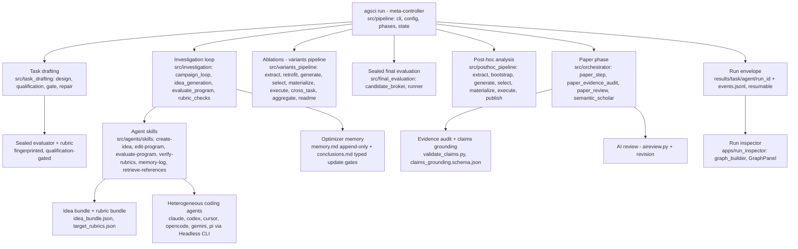
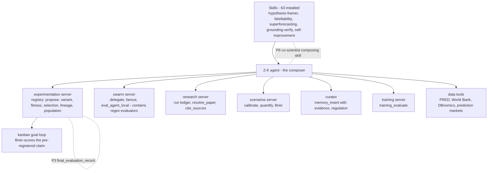
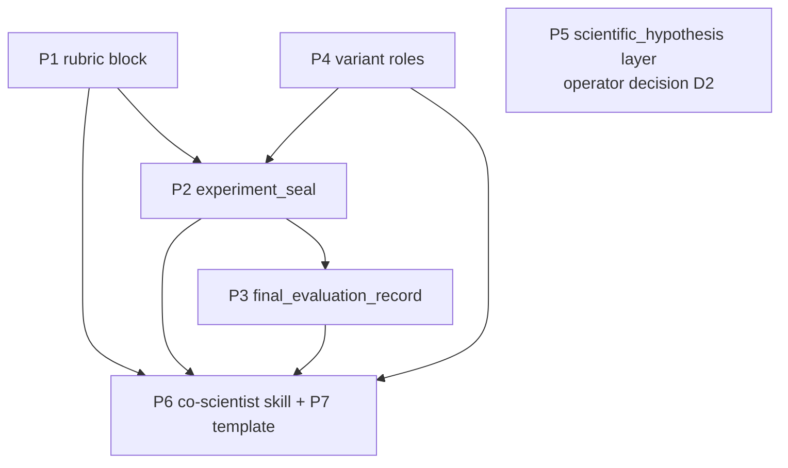

# The Agentic Scientist (AI-Scientist-v3) integration proposal

**Provenance.** Composed 2026-10-15 from research run `98a3741ba5467605` (non-repudiation
ledger: repo page, arXiv abstract, `docs/pipeline.md`, `docs/task_drafting.md`, two agent
`SKILL.md` files, the full recursive file tree at commit `2b8aa39`, plus release coverage),
first-hand reads of the zed-kask experimentation server
(`kask/mcp-servers/hkask-mcp-experimentation/src/{server,store,types}.rs`), the
experimentation reference model, the experiment-protocol template, and the composing skills
(`hypothesis-framer`, `falsifiability`, `self-improvement` surface, `refactor-architecture`,
`skill-discovery`). Goal `4d5a028d-e905-4232-8985-c378e8c444a5`. The `refactor-architecture`
and `skill-discovery` skills were activated for the composition; this document stops at the
proposal — RA-1 requires the operator's explicit decision before any implementation.

**Revision pass 2 (2026-10-15, research run `ca7478f7c4648b68`).** An external prompt
draft for the same inquiry (composed by another agent) was reviewed. Adopted from it:
the referent pin and in-tree lineage verification (§1), the v2-baseline anchoring (§1.2),
the node spot-check table (§1.1), the D/P-label + verification-oracle requirement
(§4.2.1), the implementation-constraints block (§4.2.2), and the skill-draft deliverable
(§4.2.3). Corrected in it: its T2 sketches v2's agentic tree search — the observed v3
delegates execution to coding agents — and its "every tool a skill draft references
exists in the registry" criterion is honored by marking proposed tools proposed-pending
(§4.2.2). Its Skillware citation was resolved and verified before adoption (Fan & Lan,
arXiv:2607.18970). The four operator decisions (§6) are unchanged in substance.

**Expectation check (pre-registered before probing).** The expectation was that
AI-Scientist-v3 would decompose into literature-grounded ideation, tournament/debate
selection, tool-mediated execution, an archive with lineage, and human-in-the-loop
checkpoints (the earlier "AI Coscientist" line). **The falsifier fired**: v3 is *The
Agentic Scientist* — an orchestrator of off-the-shelf coding agents (Claude Code, Codex,
Cursor, OpenCode, Gemini, Pi via Headless CLI) inside a six-phase pipeline with sealed
evaluators, rubric verification, and evidence-audited paper writing. The comparison axes
below follow the observed architecture, not the prediction.

## 1. What AI-Scientist-v3 is (verified)

**Referent pin.** "AI co-scientist" is ambiguous: Google DeepMind released a separate
system, *Co-Scientist* — "a multi-agent AI system built with Gemini that iteratively
generates, debates, and evolves novel hypotheses for complex scientific problems"
(Google DeepMind blog, Nature publication 2026-07-07; the Google Research announcement
describes "Gemini 2.0 as a virtual scientific collaborator"). The referent throughout
this report is Sakana AI's The Agentic Scientist (AI-Scientist-v3). The pin is
load-bearing for this report's own history: the pre-registered expectation
("tournament/debate selection among agents") pattern-matched Google's architecture —
the falsifier fired because Sakana's v3 is an orchestrator of off-the-shelf coding
agents, not a tournament. Any future "co-scientist" work in zed-kask names its referent
explicitly.

**Lineage — verified in-tree.** The claim that the experimentation server is "based on
David Ha's work at Sakana" resolves against the design authority's own provenance
record: the reference model was "composed 2026-09-30 from the David Ha research run
(research run `9c47de77a42b8ed8`)" with research anchors including The AI Scientist
v1/v2 (Lu et al. 2024; Yamada et al. 2025) and Ha's evolutionary-search line (EvoJAX,
WANN, World Models — `experimentation-reference-model.md` §4). The server translates
the *ideas* — population search over hill-climbing, small legible controllers, the loop
as the target — into zed-kask's registry discipline; it is not a port of Sakana code,
and v3 is not its ancestor: v3 and zed-kask are parallel descendants of the same
research program. (The intake framing "translate evolution" was renamed to
*controlled experimentation* by operator ruling 2026-10-02 — the mechanism's name
changed, not the goal.)

Paper: *The Agentic Scientist: Orchestrating Coding Agents for Automated Scientific
(Co-)Discovery* (Lange, Grillotti, Yamada, Charakorn & Ha; arXiv:2610.18933, submitted
2026-10-13, 88 pages; repo released 2026-10-15, Apache 2.0, Python 88.1%). From the
abstract: research is decomposed into "task drafting, idea generation, planning, sandboxed
experimentation, result aggregation, baseline and ablation construction, post-hoc analysis,
and report writing"; each step is powered by coding agents with **agentic
self-verification**; a **meta-controller** manages parallel research agents and **enforces
rubric verification at each stage**; the orchestration layer is reusable across
heterogeneous domains; the system spans a co-scientist mode (a co-authored paper was
accepted at ALIFE 2026) and fully autonomous mode; and the ablations show "reliable
scientific autonomy depends not only on base model capabilities, but also on the
cross-agent orchestration layer."

### 1.1 Function graph (from the repo tree and docs)



Node spot-checks — every graph node carries a resolving source; seven verified here
against commit `2b8aa39` (retrieved 2026-10-15):

| Graph node | Resolving citation |
| --- | --- |
| Meta-controller (`agsci run`, six phases) | `src/pipeline/{cli,config,phases,state}.py` (file tree, commit `2b8aa39`); `docs/pipeline.md` (extracted) |
| Task drafting → sealed evaluator + rubric | `src/task_drafting/{design,qualification,gate,checks,repair_*}.py` (tree); `docs/task_drafting.md` (extracted) |
| Agent skills driving heterogeneous agents | `src/agents/skills/*/SKILL.md` (tree); `create-idea/SKILL.md` and `memory-log/SKILL.md` extracted in full |
| Idea + rubric bundles | `create-idea/SKILL.md` (extracted): `idea_bundle.json` keys, rubric rules |
| Optimizer memory + conclusions gate | `memory-log/SKILL.md` (extracted): append-only `memory.md`, typed update gates (a)–(d) |
| Sealed final evaluation | `src/final_evaluation/{candidate_broker,runner}.py` (tree); `docs/evaluation_evidence.md` (README listing) |
| Variants/ablations pipeline | `src/variants_pipeline/` nine-stage modules (tree); `docs/pipeline.md` ablations section (extracted) |

Load-bearing mechanisms, each verified against the repo:

- **M1 — six-phase meta-controller** (`src/pipeline/{cli,config,phases,state}.py`;
  `docs/pipeline.md`): task drafting → investigation → ablations → final evaluation →
  post-hoc → paper, optional review/revision; per-phase Hydra config composition, resume
  against a shared run directory, immutable run-local task snapshot.
- **M2 — task drafting produces a sealed evaluator + rubric**
  (`src/task_drafting/{design,qualification,gate,checks,repair_*}.py`;
  `docs/task_drafting.md`): the evaluator is drafted, qualified (contract check, smoke,
  full production qualification, independent alignment judges), repaired in bounded
  chains, and published with a fingerprint; "both alignment and qualification must accept
  the same scaffold before publication."
- **M3 — typed idea bundles** (`src/agents/skills/create-idea/SKILL.md`): each idea is
  `idea_bundle.json` — `idea_id`, `title`, `hypothesis`, `implementation_plan`,
  `target_rubrics` — plus a matching `target_rubrics.json`; rubric rules require at least
  one `metric` rubric and one `implementation` rubric, stable snake_case ids, concrete
  measurable descriptions.
- **M4 — investigation loop** (`src/investigation/`): idea cycles with parallel workers,
  `evaluate_program.py`, `rubric_checks.py`, `best_program_extraction.py`, git-based
  checkpoints, `events.jsonl` structured event stream.
- **M5 — rubric verification** is typed and machine-checkable: implementation rubrics
  carry `verification: {type: source_contains, patterns: [...]}` (create-idea SKILL.md).
- **M6 — optimizer memory** (`src/agents/skills/memory-log/SKILL.md`): append-only
  `memory.md` + JSONL event log, plus a distilled `conclusions.md` with a **typed update
  gate** — update only on (a) contradiction, (b) new category, (c) Do/Don't flip,
  (d) meaningful refinement; otherwise keep. Conclusions are "the synthesis layer that
  makes other workers' next cycles more efficient."
- **M7 — ablations as a first-class phase** (`src/variants_pipeline/`, nine stages:
  extract → retrofit → generate → select → materialize → execute → cross-task → aggregate
  → README; `docs/pipeline.md`): baselines and ablated variants against the sealed
  runtime, with cross-task generalization.
- **M8 — sealed final evaluation** (`src/final_evaluation/{candidate_broker,runner}.py`;
  `docs/evaluation_evidence.md`): the winner is re-scored in a sealed environment before
  the paper cites it.
- **M9 — post-hoc analysis** (`src/posthoc_pipeline/`, seven stages): mines completed run
  artifacts for additional valid analyses, published via a success-only manifest.
- **M10 — evidence-audited paper phase** (`src/orchestrator/paper_evidence_audit.py`,
  80 KB; `write-paper/scripts/validate_claims.py`;
  `write-paper/templates/claims_grounding.schema.json`): every manuscript claim is
  audited against recorded evidence; venue templates (ICLR, ALIFE); optional OpenAI
  review.
- **M11 — run envelope**: one predictable directory per run, structured event journals,
  resumable phases (`docs/pipeline.md`).
- **M12 — run inspector** (`apps/run_inspector/`): a web UI that renders the run as a
  graph (ideas → attempts → programs, performance views).
- **M13 — literature retrieval with provenance** (`retrieve-references` skill:
  `openalex_fetch.py`, `s2_fetch.py`, `scholarly_fetch.py`,
  `provenance.schema.json`).
- **M14 — cross-harness agent swappability**: the same experiment runs across agents and
  models by override (README).
- **M15 — cost accounting** (`metrics/cost_events.jsonl`, provider-reported vs
  list-price estimates; `docs/agent_billing.md`).
- **M16 — autonomy spectrum**: co-scientist collaboration through fully autonomous runs
  (abstract).
- **M17 — containerized sandboxing**: every phase in Docker, GPU quarantine, sealed
  runtime validation (README, `docs/gpu_quarantine.md`).
- **M18 — agentic self-verification at each stage** (abstract): each pipeline step
  verifies its own output before handing off.

### 1.2 The v2→v3 delta (the published baseline)

The v2 predecessor paper (Yamada, Lange, Lu et al., *The AI Scientist-v2:
Workshop-Level Automated Scientific Discovery via Agentic Tree Search*,
arXiv:2504.08066) is held in the zk-ref-open corpus and is the published baseline for
the experiment-loop lineage. In v2, the system "removes the dependency on human-coded
templates. Instead, it employs agentic tree search (managed by an Experiment Progress
Manager across several stages) to generate and refine code implementations"
(zk-ref-open `ai-scientist-v2-2504-08066.pdf:38`, record `13232f8b`); v1→v2 moved from
a topic-specific linear pipeline to a domain-general tree-based one with VLM
self-checks (ibid. `:21`, record `afa7ce10`). v3's delta over that baseline: (a) the
experiment loop is no longer bespoke tree search managed by harness code — execution
is delegated to off-the-shelf coding agents driven by SKILL.md files; (b) evaluation
is sealed and rubric-typed from drafting (qualification-gated, fingerprinted), not
post-hoc; (c) baselines/ablations, sealed final evaluation, post-hoc analysis, and
evidence-audited paper writing are first-class phases with their own pipelines. The
consequence for zed-kask: what is new to translate is the *orchestration discipline*
(sealing, typed rubrics, disjoint final evaluation, conclusions gates) — not the search
algorithm, which zed-kask's protocol already replaced with pre-registered declarations
and human-chaired selection.

## 2. The zed-kask baseline (first-hand)

The experimentation server (`kask/mcp-servers/hkask-mcp-experimentation`, DIVERGENCE.md
D86/D87) is a **registry, not an executor**: six tools over one SQLCipher store —
`experiment_propose` (`server.rs:179-243`), `variant_register` (`server.rs:248-271`),
`fitness_record` (`server.rs:276-306`, "runs are recorded report references ONLY — never
simulated"), `selection_record` (`server.rs:311-341`), `lineage_read`
(`server.rs:346-407`), `population_query` (`server.rs:412-457`). The data model
(`types.rs`): six artifact layers (`types.rs:6-13`), the pre-registered `Prediction`
{claim, confidence} ("the tiny controller", `types.rs:31-38`), budget enforcement
(`max_runs` required at declaration, `BudgetExhausted` typed refusal), the linked kanban
goal that Brier-scores the claim, health snapshotting with stuck-experiment detection
(`types.rs:132-148`) and claim Brier with void-marker exclusion (`types.rs:158-205`).
The protocol — Declare → Vary → Test → Select → Retain with a baseline headroom
pre-check (operator ruling Q6, 2026-09-30) and human-chaired selection at the algedonic
review (Q4) — is the design authority (`experimentation-reference-model.md` §3-§5;
template `experiment-protocol.j2`).

The surrounding affordances the protocol already assumes but does not join:

- **Execution harnesses**: `swarm_eval_agent_local`
  (`kask/mcp-servers/hkask-mcp-swarm/src/local_tools.rs:3443`) — deterministic evaluators
  with exactly v3's rubric vocabulary (`contains` / `not_contains` / `regex`), repeats,
  pass rates; `training_evaluate`
  (`kask/mcp-servers/hkask-mcp-training/src/tools/evaluate.rs:97`) for adapters.
- **Hypothesis discipline**: `hypothesis-framer` (FINER/PICO, convergence gate),
  `falsifiability` (Popper admission gate, Chamberlin hypotheses, Platt discriminating
  tests, hard elimination) — both already delegation targets.
- **Prediction quantification**: `superforecasting` / the scenarios server
  (`scenario_calibrate`, `scenario_quantify`, Brier scoring).
- **Learning memory**: curator `memory_insert` requires an evidence h_mem citation
  (`kask/mcp-servers/hkask-mcp-curator/src/hkask_mcp_curator.rs:1082`); `therapy`
  reifies lessons.
- **Research provenance**: the research server (run-scoped non-repudiation ledger,
  `resolve_paper`, `cite_sources`) — stronger than v3's fetchers.
- **External ground truth**: FRED / World Bank / DBnomics series tools and
  prediction-market resolution — measurable observations for non-code hypotheses.
- **Evidence audit**: `grounding-verify` (claim → source vouching, provenance lattice).



## 3. Disposition matrix — every v3 mechanism, exactly one disposition

| v3 mechanism | zed-kask disposition | Where it lands |
| --- | --- | --- |
| M1 six-phase meta-controller | **Compose as skill** — the agent is the meta-controller; no orchestrator server | `co-scientist` skill (P6) |
| M2 sealed evaluator + rubric | **Extend experimentation server** — typed rubric block + `experiment_seal` | P1 + P2 |
| M3 typed idea bundles | **Covered by composition** — hypothesis-framer/falsifiability produce the hypothesis; the rubric block carries the typed rubrics; `experiment_propose` is the bundle record | P1 + P6 step 2 |
| M4 investigation loop | **Compose** — swarm fanout + registry + memory; the skill is the loop | P6 steps 3-4 |
| M5 rubric verification (`source_contains` etc.) | **Already covered** — `swarm_eval_agent_local`'s evaluator vocabulary; P1 makes declaration and execution share it | P1 (join only) |
| M6 optimizer memory + conclusions gate | **Compose** — curator `memory_insert` (evidence-cited) + a conclusions-gate template; no new server state | P6 step 4 + P7 template |
| M7 baselines + ablations | **Extend + compose** — `role` on `variant_register`; ablation construction is agent work | P4 + P6 step 4 |
| M8 sealed final evaluation | **Extend** — `final_evaluation_record` with server-enforced run-ref disjointness | P3 |
| M9 post-hoc analysis | **Compose** — `grounding-verify` + `evaluate_evidence` over the experiment's artifacts | P6 step 6 |
| M10 evidence-audited paper phase | **Deliberate scope cut** — adopt the evidence-audit discipline (grounding-verify + `cite_sources` + report artifact), not venue-formatted LaTeX generation | P6 step 6; §8 |
| M11 run envelope + events | **Covered differently** — the registry + kanban goal + research run ledger are the durable envelope; `lineage_read` is the readback; no file-tree envelope | no change |
| M12 run inspector graph | **Partial** — `lineage_read` text graph + a mermaid render in the report step (`diataxis-diagram`); no web app | P6 step 6 |
| M13 literature retrieval + provenance | **Already covered, stronger** — research server with non-repudiation ledger | no change |
| M14 cross-harness swappability | **Already covered** — swarm server model-agnostic delegation, provider registry | no change |
| M15 cost accounting | **Partial, not proposed** — per-call usage exists; experiment-level rollup can ride the budget field later | noted, deferred |
| M16 autonomy spectrum | **Already covered, deliberately more gated** — algedonic review Q4; human-chaired selection is a values alignment (V3 accountability, P2 consent), not a gap | no change |
| M17 container sandboxing | **Deliberate scope cut** — zed-kask's execution surfaces are its own harnesses; no new sandbox substrate | §8 |
| M18 agentic self-verification | **Already covered as project discipline** — D/P labelling, deterministic `lisp_eval` gates, verifier-gated loops | no change |

## 4. The proposal (refactor-architecture record)

### 4.1 ra-explore — friction points and ranked candidates

Friction observed at the seams of the capability graph (not inside any one server):

- **F1 — the declaration→measurement seam is untyped.** `eval_set` / `fitness_fn` /
  `noise_band` are free JSON (`server.rs:87-92`); nothing checks that recorded scores
  were produced by the declared fitness function against the declared eval set. v3's
  answer is M2+M5. *Signal: untestable through the current interface.*
- **F2 — the headroom rule is prose, not machinery.** Q6 (baseline-first, void on
  saturation) lives in the reference model and template text; the registry cannot enforce
  or attest it. *Signal: discipline re-implemented in every skill's text.*
- **F3 — no baseline/ablation role in the registry.** Every experiment re-describes
  "what is the baseline, what is ablated" in free text. *Signal: missing locality.*
- **F4 — no sealed final evaluation.** The GEPA disjoint feedback/selection split is a
  prompt-layer rule; the registry records no selection-grade re-scoring. *Signal:
  untestable claim of generality.*
- **F5 — cycle conclusions are curator-global, not experiment-scoped.** v3's typed
  update gate (M6) has no zed-kask equivalent wired into the experiment cycle.
- **F6 — no composed inquiry loop.** All pieces exist (framing, quantification,
  execution, recording, memory, audit); no skill composes them. *Signal: the pieces
  bounce between surfaces; the loop is re-invented per session.*

Deletion tests: a separate `ablation_register` tool fails (pass-through to
`variant_register` + a role check — extend instead, P4); an experiment-scoped
conclusions table fails (duplicates curator memory + goal comments — template instead,
P7); `experiment_seal` earns its keep (delete it and the headroom rule, the
declaration-measurement join, and the drift check all reappear as prose in every
consumer skill).

Ranked candidates: **C1 (Strong)** — sealed rubric declarations (P1+P2, closes F1+F2);
**C2 (Strong)** — final evaluation with enforced disjointness (P3, closes F4);
**C3 (Strong)** — the `co-scientist` composing skill (P6, closes F3+F5+F6 and routes
every other step to existing skills); **C4 (Worth exploring)** — the
`scientific_hypothesis` layer value (P5, the functional decision below); **C5
(Speculative)** — experiment-level cost rollups (deferred).

### 4.2 ra-deepen — the deepened shapes

**P1 — typed rubric block on `experiment_propose`** (schema evolution, additive
PRAGMA-checked migration in the D87 shape; no backward compatibility per §P8.7-Q5 —
new declarations require rubrics, pre-rule rows keep NULL):

```rust
pub struct Rubric {
    pub id: String,          // stable snake_case
    pub description: String, // concrete and measurable
    pub kind: RubricKind,    // Metric | Implementation | GroundedReport
    pub verification: RubricVerification,
}
pub enum RubricVerification {
    Contains { spec: String },     // == swarm_evaluate_local "contains"
    NotContains { spec: String },   // == "not_contains"
    Regex { pattern: String },      // == "regex"
    ReportRef { harness: String },  // a recorded harness report names the evidence
}
```

Declaration validation (v3's create-idea rules, `server.rs` propose path): at least one
`Metric` rubric, at least one `Implementation` or `GroundedReport` rubric, unique stable
ids. The complexity hidden behind the small interface: the declaration-measurement join
becomes machine-checkable, and the rubric vocabulary is *identical* to the execution
harness's evaluator vocabulary — one grammar from declaration to recorded run.

**P2 — `experiment_seal`** (new tool): after the baseline variant's fitness is recorded,
freezes the eval contract — SHA-256 over `(eval_set, rubrics, fitness_fn, noise_band)` —
and records the headroom attestation (baseline variant + fitness refs + non-saturation).
Post-seal invariants, all typed refusals: challenger `fitness_record` requires the seal;
every fitness record cites the seal fingerprint; a second baseline role is refused
(see P4); re-declaring sealed fields is a new experiment, never an edit. This is v3's
M2 fused with the existing Q6 ruling — the pre-check becomes budgeted, attested, and
content-addressed.

**P3 — `final_evaluation_record`** (new tool): records the sealed re-scoring of one
variant on the selection set. Server-enforced preconditions: experiment sealed; variant
registered; **run refs disjoint from every prior fitness record's run refs for the
experiment** (the server holds them — the GEPA disjointness rule becomes mechanical);
counts against `budget.max_runs`. Selection-grade evidence for the algedonic review.

**P4 — `role` on `variant_register`** (schema evolution): optional
`baseline | challenger | ablation` (default challenger). Exactly one baseline per
experiment (typed refusal on the second); `ablation` requires `parent_variant_id`. The
Q6 baseline-first rule and v3's M7 ablation discipline become registry-checkable.

**P5 — `scientific_hypothesis` as the seventh `LAYERS` value** (`types.rs:6-13`): the
genotype is the operationalized hypothesis + measurement plan (small, legible, versioned
— it fits the reference model's genotype definition); fitness is recorded observations —
harness reports, FRED/DBnomics series reads, prediction-market resolutions. This is the
functional decision D2 below: it generalizes the registry from
improving-zed-kask-artifacts to scientific inquiry at large, with self-improvement as the
special case. The reference model's own synthesis anticipated this: "the pre-registered,
Brier-scored prediction is the tiny controller… this system scores its own hypotheses."

**P6 — the `co-scientist` composing skill** (new SKILL.md + templates; routes to existing
skills rather than reimplementing them). The unit of composition is the Skillware pair —
a Skill Artifact specifying reusable task behavior, managed as software through an
independent identity and lifecycle, activated by a compatible Agent Host (Fan & Lan,
arXiv:2607.18970) — the same unit v3 itself adopted for its agents:

| Phase (v3 analog) | zed-kask composition |
| --- | --- |
| 1. Frame (task drafting) | `hypothesis-framer` (FINER/PICO) → `falsifiability-admit` → research run (`web_search`, `resolve_paper`) for literature grounding → `superforecasting`/`scenario_calibrate` for the prediction confidence |
| 2. Declare | render `co-scientist-frame.j2` (rubric bundle) → `experiment_propose` (rubrics, prediction, budget, `linked_goal_id`) |
| 3. Baseline & seal (qualification) | `variant_register(role=baseline)` → run the layer's harness (`swarm_eval_agent_local` / `training_evaluate` / measured observation) → headroom check (baseline at 1.0 → void with `no-headroom`, redesign the eval set) → `experiment_seal` |
| 4. Investigate (investigation loop) | `variant_register` challengers + `role=ablation` variants → `swarm_fanout_local`/`swarm_execute_plan_local` with rubric-mapped evaluators → `fitness_record` (report refs + seal fingerprint) → conclusions gate (P7) → iterate within `max_runs` |
| 5. Final evaluation | `final_evaluation_record` on the disjoint selection set |
| 6. Select & report (paper) | algedonic review → `selection_record` → `grounding-verify` over the study's claims → study report with `cite_sources` → durable artifact + `lineage_read` mermaid render |

**P7 — `co-scientist-conclusions.j2` template**: v3's M6 typed update gate translated to
curator memory — append the cycle's memory event (evidence-cited `memory_insert`), then
update the distilled conclusion only on (a) contradiction, (b) new category, (c)
recommendation flip, (d) meaningful refinement; otherwise keep. The gate taxonomy is
v3's; the record is zed-kask's curator memory, so conclusions feed `therapy`'s
reification channel rather than a parallel file.

### 4.2.1 Dependency order, D/P labels, verification oracles



| Item | Depends on | D/P | Verification oracle (proposed — none yet run) |
| --- | --- | --- | --- |
| P1 typed rubric block | — | D (schema + validation; rubric *content* is P at use time) | `tool_behavior` extensions: rubric-bearing declaration accepted; missing `Metric` rubric → typed refusal; duplicate ids → typed refusal; additive PRAGMA-checked migration round-trips |
| P4 variant roles | — | D | exactly-one-`baseline` refusal test; `ablation` without `parent_variant_id` → typed refusal |
| P2 `experiment_seal` | P1, P4 | D | seal fingerprint = SHA-256 over `(eval_set, rubrics, fitness_fn, noise_band)` against a test vector; post-seal challenger `fitness_record` without seal → typed refusal; second baseline → refusal; replay-convergence caller key |
| P3 `final_evaluation_record` | P2 | D | run-ref disjointness: overlap with any prior fitness record's run refs → typed refusal; counts against `budget.max_runs` (exactly-at-ceiling passes, one-past refuses) |
| P5 `scientific_hypothesis` layer | operator decision D2 | P (the decision) / D (the wiring) | `LAYERS` round-trip + `population_query` layer-filter test |
| P6 `co-scientist` skill | P1–P4 | P (composition) with D gates in-skill | pin suite on a fixed task set; the route-does-not-reimplement check (every step names an existing or proposed tool; no step re-implements a delegated skill's method); `skill-discovery` evaluate ≥ 24/32 |
| P7 conclusions template | ships with P6 | D form / P application | the four update triggers (a)–(d) plus the keep case, receipts through `lisp_eval` |

Every oracle above was the acceptance criteria for the implementation pass — all executed green at their commits (2026-10-15): the typed-refusal suites, the fingerprint determinism test, the disjointness refusals, the budget boundaries, and the tool-surface pins live in the crate's test modules; the CS-1 conclusions-gate receipt executed live through `lisp_eval`.

### 4.2.2 Implementation constraints for the follow-on pass (project rules)

No `unwrap()` — every new refusal is a typed `ExperimentationError` variant mapped
through `map_experimentation_error` (the per-variant contract, `types.rs:209`). No
`mod.rs`. Arbitrary-JSON payloads (`genotype_config`, rubric bodies) stay
`AnyJsonValue`-shaped at the boundary. `McpToolError` contract: a missing
experiment/variant/seal id classifies `not_found` naming the thing; closed-set fields
(`role`, `RubricKind`) classify `invalid_argument` naming the valid values. Migrations
are additive PRAGMA-checked ALTERs in the D87 shape. New identity-minting tools
(`experiment_seal`, `final_evaluation_record`) take optional caller keys for replay
convergence (the kata-kanban/D86 shape). `final_evaluation_record` joins the `max_runs`
budget enforcement. D-seam: the work extends D86 in place — the DIVERGENCE.md entry
gains the new tools in the same change; no upstream edits are required, so no new
D-seam. No new crate (the server exists), so the `[lib]` path rule does not trigger.
The crate's existing `tool_behavior` and store suites are extended in the same change.

**Tool-reference honesty.** Every *existing* tool named in the P6 phase table is
registry-verified (§2). `experiment_seal` and `final_evaluation_record` are this
proposal's P2/P3: the skill draft references them as **proposed**, and the skill cannot
be installed until P2/P3 land. (The reviewed prompt draft's criterion "every tool a
skill draft references exists in the registry at draft time" is honored by marking them
proposed-pending, not by silently assuming them.)

### 4.2.3 The `co-scientist` skill draft (outline — proposed, not installed)

```markdown
---
name: co-scientist
description: "Compose a human-gated scientific inquiry cycle over the experiment
  registry: frame a falsifiable hypothesis, declare a rubric-typed pre-registered
  experiment, seal the baseline, investigate variants through evaluation harnesses,
  record a disjoint final evaluation, and produce an evidence-audited study report."
---

# Co-scientist

## Reference models
The experiment protocol (`experimentation-reference-model.md` — design authority);
The Agentic Scientist (arXiv:2610.18933) for the sealed-evaluation discipline;
Skillware (arXiv:2607.18970) for the SKILL.md + templates unit.

## When to Use / NOT to Use
Use: an end-to-end inquiry cycle on a measurable question. Not: artifact-improvement
experiments (`self-improvement` owns those — delegate); forecasting without measurement
(`superforecasting`); single-skill stages (invoke the owning skill directly).

## Instructions
1. **Frame** — `hypothesis-framer` (FINER/PICO) → `falsifiability/falsifiability-admit`
   (Popper gate) → research run (`web_search`, `resolve_paper`) → `superforecasting` |
   `scenario_calibrate` for the prediction confidence.
2. **Declare** — render `co-scientist-frame.j2` (rubric bundle) → `experiment_propose`
   (rubrics, prediction `{claim, confidence}`, budget `{max_runs}`, `linked_goal_id`,
   layer).
3. **Baseline & seal** — `variant_register(role=baseline)` → the layer's harness
   (`swarm_eval_agent_local` | `training_evaluate` | measured observation via
   FRED/DBnomics/market resolution) → `fitness_record` → headroom check →
   `experiment_seal`.
4. **Investigate** — `variant_register` (challengers; `role=ablation` with parent) →
   `swarm_fanout_local` / `swarm_execute_plan_local` with rubric-mapped evaluators →
   `fitness_record` (report refs + seal fingerprint) → conclusions gate
   (`co-scientist-conclusions.j2` + `memory_insert` with evidence) → iterate within
   `max_runs`.
5. **Final evaluation** — `final_evaluation_record` on the disjoint selection set.
6. **Select & report** — algedonic review → `selection_record` → `grounding-verify`
   over the study's claims → study report + `cite_sources` → `lineage_read` mermaid
   render.

## Gates (D)
- Headroom: baseline pass rate 1.0 → void (`no-headroom`), redesign the eval set,
  fresh declaration.
- Conclusions: update only on (a) contradiction, (b) new category, (c)
  recommendation flip, (d) meaningful refinement; otherwise keep.
- Budget: server-enforced `max_runs`; `BudgetExhausted` is terminal for the
  declaration.

## Regression case
The conclusions gate through `lisp_eval` across all four triggers plus the keep case;
the headroom void path; the route-does-not-reimplement check (no step re-implements a
delegated skill's method).
```

(Draft outline only — the installed skill carries the full D/P labelling, template
context contracts, and pin suite per the `create-skill` discipline; steps 3 and 5 name
P2/P3 tools and activate only once those land.)

### 4.3 ra-audit — duplication classification

- `co-scientist` vs `self-improvement`: **Divergent** at the loop level, **Identical**
  at the registry level. Resolution: `co-scientist` owns the general protocol and routes
  artifact-layer experiments to `self-improvement`'s machinery (GEPA forms, LoRA gates)
  rather than copying it; `self-improvement` remains the artifact-improvement
  specialist. No refactor of `self-improvement` is proposed in v1 — the seam is
  delegation, and a later strangler pass can fold them if the shared loop proves
  identical in practice.
- `co-scientist` vs `superforecasting`: **Surface-only** overlap — forecasting
  quantifies a prediction; the experiment registry scores a measured claim. The skill
  consumes `superforecasting` for step 1's confidence, never reimplements it.
- `experiment_seal` vs `fitness_record`: **not duplication** — the seal adds the
  attestation, the gate, and the content address; `fitness_record` remains the
  measurement record.
- Rubric `verification` vs `swarm_evaluate_local` evaluators: **deliberately Identical**
  — one vocabulary across declaration and execution is the point (M5's lesson).

### 4.4 skill-discovery route (receipt)

Task pattern: "compose a co-scientist investigation loop over the experiment registry."
Dimension scores are P (judgment); composites recomputed in `lisp_eval` (D): hypothesis-
framer `{c:0.5, d:0.7, t:0.6}` → **0.575**; self-improvement `{c:0.65, d:0.55, t:0.35}`
→ **0.55**; falsifiability `{c:0.5, d:0.65, t:0.55}` → **0.55**; superforecasting →
**0.50**; kata-improvement → **0.45**. Best fit 0.575 → coverage **`partial`**
(0.4-0.79 band); SD-1 consistency check → `true` (3 recs ≤ 3; partial band constraints
hold). Detect-gap output: (1) **coverage gap** — no skill composes the full inquiry
cycle → `create_skill` (P6); (2) **feature gap** — registry lacks sealed rubrics and
final evaluation → `extend_skill`-class work on the experimentation server (P1-P3);
(3) **feature gap** — cycle conclusions gate → new template (P7); (4)
`route_to_existing_skill` for framing, elimination, quantification, execution, and
audit steps (the phase table above).

### 4.5 RA-1 — stopped at the proposal

Per the refactor-architecture constraint, exploration without a selected candidate is
advisory, never migration authority. The operator's explicit decision signal
(`proceed_to_refactor` / `need_more_data` / `defer_or_reject`) gates any implementation.
Decisions are framed in §6.

## 5. The adjacent-possible reading (Kauffman)

Kauffman's adjacent possible is the set of one-step recombinations of what already
exists (*The Origins of Order*, 1993; *Investigations*, 2000). Every item in this
proposal is exactly one such step — no new substrate, only new joins between existing
affordances:

- **P1 (rubric block)** = the swarm evaluator vocabulary (exists) × the declaration
  fields (exist). One step: make them the same grammar.
- **P2 (seal)** = the Q6 headroom ruling (exists) × v3's fingerprint discipline (now
  published) × the store (exists). One step: attest and content-address the pre-check.
- **P3 (final evaluation)** = the GEPA disjointness rule (exists) × `fitness_record`
  (exists). One step: enforce the disjointness server-side.
- **P4 (roles)** = the protocol's baseline/ablation prose (exists) × `variant_register`
  (exists). One step: make the roles machine-checkable.
- **P5 (layer value)** = the reference model's genotype definition (exists, already
  general) × the data/observation tools (exist). One step: admit the hypothesis as a
  genotype medium.
- **P6/P7 (skill + template)** = six existing skills and five existing servers. The
  recombination event itself.

v3's own ablation finding — that scientific autonomy depends on the cross-agent
orchestration layer, not just base models — is the external validation of this reading:
the orchestration layer is precisely the adjacent possible of already-good components.

## 6. Operator decisions — ruled 2026-10-15

The operator ruled "proceed on D1 through D4 as recommended" (2026-10-15). RA-1
receipt: `decision = "proceed_to_refactor"` → `["proceed_to_refactor", "ra-audit"]`
(`lisp_eval`, 2026-10-15).

| Decision | Ruling | Consequence |
| --- | --- | --- |
| D1 — adopt the proposal | **proceed_to_refactor** | The program implements P1–P7 as one domain, one commit per piece, tests green at each commit |
| D2 — generalize the registry | **Yes** — `scientific_hypothesis` joins `LAYERS` | The registry is the general lab notebook; self-improvement becomes the special case; external measurable questions get the full pre-registration discipline |
| D3 — pin the terms | **Both pinned** in the derived ontology registry (operator ruling 2026-10-15) | `rubric` and `ablation` resolve deterministically ever after; no private definitions |
| D4 — scope cuts | **All four confirmed** | No sandbox substrate; no venue-formatted paper generation; no run-inspector web app; cost rollups deferred |

## 7. What this proposal replaces

Nothing is deleted by the proposal itself (no code changes yet). When implemented, the
additions supersede: the free-form `fitness_fn`-only declaration path for new
experiments (P1 replaces it for all new declarations — no dual path, per §P8.7-Q5), the
skill-level headroom prose in `experiment-protocol.j2` step 3 (the seal enforces it; the
template text is updated in the same change), and the ad-hoc baseline/ablation
descriptions in consumer skill text (P4 makes them registry fields). Net surface: +2
tools, +2 schema extensions, +1 layer value, +1 skill with 3 templates, +1 reference
doc; the replaced prose shrinks correspondingly.

## 8. Deliberate scope cuts and risks

**Cuts.** (a) No container sandbox: v3 runs coding agents with full tool permissions in
Docker; zed-kask's execution surfaces are its own harnesses (swarm eval, training,
operator-approved terminal) — adding a general sandbox is a security decision of its own
and is not smuggled in here. (b) No venue-formatted paper generation: the artifact is an
evidence-audited study report; the *discipline* (claims grounding, evidence audit) is
adopted via `grounding-verify`, the *artifact form* is not. (c) No run-inspector web
app: `lineage_read` + mermaid covers the readback. (d) Cost rollups deferred.

**Risks.** (1) *Seal rigidity* — a sealed contract cannot adapt mid-experiment; that is
the point (pre-registration), and the escape hatch is a fresh declaration with lineage.
(2) *Rubric gaming* — `contains`/`regex` verification is shallow by design; the
anti-gaming trio (real sources, load-bearing properties, external ground truth) remains
the guardrail, and `GroundedReport` rubrics require harness reports. (3) *Scope creep
of P5* — a general lab notebook invites unmeasurable hypotheses; the falsifiability
admission gate and the headroom pre-check are the filters, and both are enforced before
any spend. (4) *The co-scientist skill could drift into self-improvement duplication* —
the delegation seam (§4.3) is the control; the first pin suite should include a
route-does-not-reimplement check. (5) *Source volatility* — the v3 repo is hours old
at a single commit (`2b8aa39`); re-pin the SHA and re-verify cited paths at
implementation time, and report blocked rather than fabricate if modules have moved.

## 9. Citations

- Lange, R. T., Grillotti, L., Yamada, Y., Charakorn, R., & Ha, D. (2026). The Agentic
  Scientist: Orchestrating Coding Agents for Automated Scientific (Co-)Discovery.
  arXiv:2610.18933. https://arxiv.org/abs/2610.18933
- SakanaAI/AI-Scientist-v3 (repository, commit `2b8aa39`, Apache 2.0).
  https://github.com/SakanaAI/AI-Scientist-v3
- SakanaAI/AI-Scientist-v3 docs: End-to-End Pipeline.
  https://raw.githubusercontent.com/SakanaAI/AI-Scientist-v3/main/docs/pipeline.md
- SakanaAI/AI-Scientist-v3 docs: Task drafting diagnostics.
  https://raw.githubusercontent.com/SakanaAI/AI-Scientist-v3/main/docs/task_drafting.md
- SakanaAI/AI-Scientist-v3 agent skills: create-idea SKILL.md; memory-log SKILL.md
  (paths under `src/agents/skills/`).
- Sakana AI (2026). The AI Scientist, now published in Nature.
  https://sakana.ai/ai-scientist-nature/ — the v1/v2 papers are held in the zk-ref-open
  corpus (`ai-scientist-2408-06292.pdf`, `ai-scientist-v2-2504-08066.pdf`).
- AlphaSignal (2026). Sakana AI's Agentic Scientist turns coding agents into open-source
  researchers. https://alphasignal.ai/news/sakana-ai-s-agentic-scientist-turns-coding-agents-into-open-source-researchers
- Google DeepMind (2026). Co-Scientist: A multi-agent AI partner to accelerate research.
  https://deepmind.google/blog/co-scientist-a-multi-agent-ai-partner-to-accelerate-research/
  (Nature publication 2026-07-07); Google Research. Accelerating scientific breakthroughs
  with an AI co-scientist.
  https://research.google/blog/accelerating-scientific-breakthroughs-with-an-ai-co-scientist/
  — the disambiguation referent (§1).
- Fan, H., & Lan, Z. (2026). Skillware: A Software Ontology and Engineering Lifecycle
  for Persistent Behavioral Artifacts. arXiv:2607.18970.
  https://arxiv.org/abs/2607.18970
- Yamada, Y., Lange, R. T., Lu, C., et al. (2025). The AI Scientist-v2: Workshop-Level
  Automated Scientific Discovery via Agentic Tree Search. arXiv:2504.08066 — held in
  the zk-ref-open corpus (`ai-scientist-v2-2504-08066.pdf`; passages cited at §1.2,
  records `13232f8b`, `afa7ce10`).
- Kauffman, S. (1993). *The Origins of Order*; (2000). *Investigations* — the adjacent
  possible.
- zed-kask internal: `experimentation-reference-model.md` (design authority, with its
  own research anchors); `kask/docs/reference/mcp-servers/experimentation.md`;
  `DIVERGENCE.md` D86/D87; the skills cited in §2.
