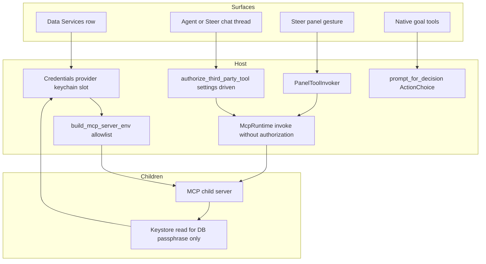

# Curator Nostr client — design review (2026-11-11)

**Status: advisory input to the operator's algedonic-review ratification. It
decides nothing and implements nothing.**

**Updated 2026-11-11, about 20:45 PST:** two operator rulings given after
delivery are recorded in §9, which revises the recommendations on decisions 1
and 4. §1–§8 are otherwise as delivered.

**Updated again, about 23:15 PST:** a third ruling settles the sub-question §9
left open; it is recorded at the end of §9. The design note has since been
revised to the ruled design, so quotations of the note in §1 refer to its
original text, which is in git at `d2c8c18754`.

Artifact under review:
`kask/docs/research/curator-nostr-client-design-2026-11-11.md` (129 lines,
untracked), as it stood from my first read until 18:52 PST, SHA-256
`8810e4d3…91c9`.
**The note was edited by someone else at about 19:03, after the findings were
written** (now `3d750203…d488`): L51–53 rename the server to
`hkask-mcp-nostr-client` under an operator ruling and point to a new sibling,
`curator-nostr-relay-design-2026-11-11.md`. That is the only difference:
putting the three original lines back into the current file reproduces the
reviewed hash exactly. The line count is unchanged, so the note line numbers
cited below still hold. This review says `hkask-mcp-nostr` where the note now says
`hkask-mcp-nostr-client`. The relay note is not reviewed here; §4a records
where it touches these findings. Instruments:
`refactor-architecture` (explore / audit / deepen lenses, advisory only) and
`grill-me` (ledger discipline, the note as answerer). Two operator inputs
arrived mid-review and are folded in: reference models to consult (§2) and a
proposed Nostr GPUI panel (§4).

Tree citations are pinned to commit `af777e15e8` (2026-11-11 18:14 PST).
I observed five different HEAD commits during the review, and the working
tree carries uncommitted edits that are not mine in several cited files, so
working-tree line numbers differ; 21 of the cited files, including every
Rust source carrying a finding, are byte-identical between the pin and the
last HEAD I observed (`39cb39a6ff`). Method, counts, failures and side
effects are in §8.

## Summary for the operator

The note's direction is sound and several of its claims verify: keys in the
keychain and never in `settings.json`, outbox-first reads, querying kind sets,
DMs out of v1. The three promises that carry the safety case do not yet have
mechanisms behind them:

1. **The publish confirmation is not enforced by anything.** The only gate on
   a model-invoked MCP tool is a settings-driven permission prompt that offers
   "Always for … MCP tool" and whose title carries none of the note text.
2. **"The MCP server reads the keychain directly" contradicts the documented
   rule for MCP children, and the precedent the note cites points the other
   way.** RunPod's key is held by the editor process; no child has it by any
   channel.
3. **The threat model covers what the agent writes and omits what it reads.**
   Relay content is untrusted text entering the same session that holds a
   signing capability.

One further fact bears on custody: this machine's login keyring is unlocked
for the session, and my own terminal commands reached the Secret Service and
received an item path for an existing kask slot. I requested no secret value.

Verdict: **rework, targeted** — §3 (tool surface), §4 (signing options), §5
(threat model) and §6 (charter claim) need a revision pass before the §7
decisions can be answered well, because the shape the evidence supports is not
among options A/B/C as written. §1–§2 stand with small corrections. The line
between "rework" and "accept-with-changes" is a judgment call here; the rule I
used is stated in §7.

The cheapest safe sequence the evidence supports: ship reads first (no key at
all), and decide signing custody after that with usage in hand. (Custody has
since been ruled — §9. Reads first still holds as a build order.)

## 1. Findings

Severity: High = a promise the safety case depends on has no mechanism;
Medium = under-specified in a way that will produce a defect or a second
design round; Low = wording or bookkeeping. IS is what the note or the tree
says; OUGHT is my recommendation.

### F1 (High) — Publish confirmation has no enforcing mechanism

IS (note §3, L61–64): `nostr_publish_note` "surfaces the drafted note to the
operator for confirmation before broadcasting". §3 L72–73 adds the setting
`publish_requires_confirmation: true`. §5 L105–107: "publish requires the
operator's confirmation of the final text".

IS (tree):

- An MCP child has no channel to the human in this runtime: 0 hits for
  `elicit` in `kask/crates/hkask-mcp/src` and `kask/crates/hkask-mcp-server/src`.
- The model path's only gate is `authorize_third_party_tool`
  (`crates/agent/src/tools/context_server_registry.rs:705`). It is
  settings-driven: "Unlike built-in tools, third-party tools don't support
  pattern-based permissions. They only support `default` (allow/deny/confirm)
  per tool." (`crates/agent/src/thread.rs:8908-8909`); it offers
  `"Always for {display_name} MCP tool"` (`crates/agent/src/thread.rs:8926`); "MCP tools are
  gated only by tool id (no per-input pattern" (`crates/agent/src/thread.rs:8951`); and an
  `Allow` in settings "resolves the task immediately without prompting"
  (`crates/agent/src/thread.rs:9649-9651`, return at `:9670`).
- The prompt title is built before the input arrives:
  `let initial_title = self.initial_title(serde_json::Value::Null, cx);`
  (`context_server_registry.rs:703`), so it reads "Run MCP tool
  `nostr_publish_note`" with no text. Even with input, the inline preview is
  capped: `const MAX_INLINE_ARG_LEN: usize = 120;` (`:16`). How the tool card
  renders arguments elsewhere in the UI I did not verify.
- Other callers reach the same tool with no prompt at all:
  "**`McpRuntime::invoke` performs NO per-call authorization**"
  (`DIVERGENCE.md` L35), and the un-prompted callers are named: "(bridge skill
  execution, panels, IPC)" (`DIVERGENCE.md` L114). The panel path is
  `ToolPort::invoke(&*tool_port, &server, &tool, args, webid)`
  (`crates/zed/src/main.rs:4036`) under an identity that is "not a credential"
  (`main.rs:4019`).
- On defaults a prompt does appear each call (`assets/settings/default.json:1243`,
  `"default": "confirm"`). One click on the "Always" option, or a global
  default of `allow`, removes the human from every later publish.
- A real human gate already exists for a different purpose. Goal outcomes use
  `prompt_for_decision` (`crates/agent/src/thread.rs:9565`, called at
  `crates/agent/src/tools/goal_tools.rs:267`), whose values are "created from
  the ActionChoice response, never deserialized from input"
  (`goal_tools.rs:45`), and those tools are excluded from grants because
  "configurable permission grants cannot supply a human judgment"
  (`crates/settings_ui/src/pages/tool_permissions_setup.rs:1410-1411`).

OUGHT: publish authority is a host-side human decision the model can neither
satisfy nor pre-grant — an ActionChoice-class prompt showing the full final
text, the signing npub and the target relays; or a panel gesture (§4); or
approval at a remote signer. No `false` state in settings. Reference models
agree in so many words (§2).

### F2 (High) — The key-custody path is unsanctioned and its precedent is inverted

IS (note §3, L75–78): "`env_var: \"\"` (no consumer reads it as an env var —
the MCP server reads the keychain directly; the RunPod precedent in DIVERGENCE
D29 already keeps credentials out of MCP child env)".

IS (tree):

- The documented child rule: "The server reads them from env only — there is
  no keychain fallback for API keys … One keychain namespace (zed's), one read
  path (`build_mcp_server_env`), one delivery mechanism (env vars)."
  (`kask/crates/hkask-mcp-server/src/server/credentials.rs:12-15`). D5 repeats
  it: "`resolve_credential` reads API keys from env vars only"
  (`DIVERGENCE.md` L36).
- The RunPod precedent keeps the key out of children entirely, not merely out
  of their env: "its key lives at exactly ONE location" and "No MCP child
  receives `RUNPOD_API_KEY`." (`DIVERGENCE.md` L48). The editor process uses
  that key.
- A mechanical path does exist. `Keychain::retrieve_by_key`
  (`kask/crates/hkask-keystore/src/keychain.rs:235`) reads
  `kask://credentials/<key>` in "the same schema zed's
  `LinuxPlatform::write_credentials` uses" (`keychain.rs:5`); children receive
  `DBUS_SESSION_BUS_ADDRESS` (`kask/crates/hkask-mcp/src/runtime.rs:338-344`);
  and the shared server crate uses it for one secret, the DB passphrase
  (`credentials.rs:28`). Across the eight servers there are 0 non-test direct
  keystore uses (1 hit, a kata-kanban test).
- A child that reads the keychain itself bypasses the per-server credential
  allowlist, the control that "limits the blast radius of a compromised MCP
  server" (`kask/crates/kask_bridge/src/mcp_servers.rs:448`).
- A stronger pattern is already in the tree: "the zed side holds the
  OpenRouter key via the credential channel, the child never sees it"
  (`DIVERGENCE.md` L40).
- The keyring is session-unlocked. Observed on this machine: the default
  collection's `Locked` property is `false`, and `SearchItems` from my
  terminal returned an object path for `kask://credentials/hkask_db_passphrase`
  (and none for `kask://credentials/nostr`). I made no `GetSecret` call, so
  whether a secret read would prompt is untested. "Unlock-gated" (note §6)
  therefore means the login unlock, once per session.
- A Nostr child parses untrusted relay data (F3) in the same process that
  would hold the key.

Expectation check: I predicted no child keychain path existed. That was wrong
in its strong form (the DB passphrase path is real) and right in the form
that matters (no sanctioned path for this class of secret, and the cited
precedent supports the opposite design).

OUGHT: the identity key never enters an MCP child. Sign in the editor process
or at a remote signer; give the Nostr child an empty credential allowlist and
pin that with a test in the style of
`curator_credentials_do_not_include_data_service_keys`.

### F3 (High) — The threat model omits the read side

IS (note §5): five rows — settings exposure, process memory, prompt injection
"via publish content", public broadcast, DMs. Reads are described only as
"anonymous relay reads" (§3 L55–56).

IS (evidence):

- Relays are untrusted. NIP-01 defines the event id as the sha256 of the
  serialized event and the signature as a Schnorr signature over it; a reader
  that does not check both lets any relay attribute text to any pubkey.
- "Treat every tool path as taint-unaware."
  (`kask/docs/architecture/core/PRINCIPLES.md:75`).
- The platform already frames outside text where it matters: "external
  passages are framed and labelled as evidence rather than Curator memory"
  (`DIVERGENCE.md` L139).
- Events carry relay hints (NIP-10 `e` tags, NIP-65 `r` tags). A read tool
  that follows them connects to hosts chosen by event authors.

The combination is the risk: hostile note text enters the model's context in
the session that can publish. With F1's standing grant, injected text can
produce a signed post under an identity the note itself describes as having
"no rotation and no recovery" (§1 L12–13). In the security-audit skill's
vocabulary this is LLM06:2025 Excessive Agency
(`.agents/skills/security-audit/SKILL.md:19`).

OUGHT: verify id and signature before any event reaches tool output; frame
event content as untrusted; bound counts and sizes; validate relay URLs
before following hints; add the read side to §5; keep the publish veto
independent of the model (F1).

### F4 (Medium) — Relay failure is unspecified, and one of the three relays is failing now

IS (note): 0 of 129 lines match `fail|timeout|unreachable|degrad|partial|retry|SSL`.
"False empties" (§3 L57–59) is about relay selection only.

IS (observed, 2026-11-11 18:05 PST, one probe from this machine): TLS to
`nostr.mom` failed (`curl` exit 35, "wrong version number"); `nos.lol` and
`nostr.bitcoiner.social` answered 200. An anonymous `amy outbox` lookup
confirmed all three are published as both read and write. This reproduces the
operator's earlier observation independently. It was an HTTPS probe, not a
WebSocket session; the TLS failure precedes both.

IS (norms): "degradation is surfaced, never silent"
(`kask/docs/architecture/core/magnifica-humanitas.md:48`). An interrupted
state-changing call is "never auto-retried at any layer, because a retry could
duplicate state-changing effects" (`DIVERGENCE.md` L35).

OUGHT: every read and publish result carries a per-relay outcome (connected,
end of stored events, timeout, TLS error, accepted or rejected with the
relay's message). An empty read says which of the two it is: no events on N
reachable relays, or M of N unreachable. Define publish success (how many
acceptances) and report it. Sign once, store the signed event, and re-send
that same event on retry — re-broadcasting an identical event is harmless,
re-signing creates a second note.

### F5 (Medium) — Read correctness is partly specified

- Kind rule. Note L67–68: "clients post replies as NIP-22 kind:1111 comments
  and top-level posts as kind:1". NIP-10: "Kind 1 events with `e` tags are
  replies to other kind 1 events. Kind 1 replies MUST NOT be used to reply to
  other kinds, use NIP-22 instead." Replies to notes are kind 1; kind 1111 is
  for other roots. `amy`'s help agrees: "NIP-10 reply (kind:1) / NIP-22
  comment (others)". The note's conclusion (query kind sets) holds; thread
  reconstruction has to handle both tag schemes.
- The kind set "(1, 6, 1111, 30023, …)" is open-ended. 30023 is addressable,
  so latest-wins per identifier applies. The ellipsis is also where the DM
  boundary leaks (F8).
- Outbox. NIP-65: "When downloading events **from** a user, clients SHOULD use
  the **write** relays of that user." The note matches this for author mode.
  Unspecified: where the relay list itself is found (NIP-65 points to
  well-known indexers), and relay strategy for hashtag mode (no author),
  following mode (one relay list per followed author, so a fan-out bound),
  and thread mode (hints plus each author's write relays).
- `kask.nostr = { npub, read_relays[], write_relays[] }` stores in settings
  two facts that are derivable: the npub (from the key or signer) and the
  relays (from the published kind:10002). Both can drift from their sources.

OUGHT: resolve relays at use time from the published list, keep only seed
relays in settings, derive the npub from the signer and treat a mismatch with
any configured npub as an error.

### F6 (Medium) — One-key-one-location: the options miscount the stores

IS (note §4): A — "One key location (the Data Services slot)". B — "two
keychain stores to keep aligned". C — "`amy bunker` or the Amethyst desktop
app holds the key". Note §1: the identity was "created in Amethyst".

IS (evidence):

- The key already lives in Amethyst desktop, so A adds a second copy rather
  than establishing the only one.
- `amy status` reports "No accounts under /home/mdz-axolotl/.amy". B, and C
  via `amy bunker` ("run a remote signer for this (local-key) account"), both
  require importing the key into amy first — another copy, held under
  `~/.amy/`, outside the D28 tree.
- The invariant's stated rationale is divergence: "a stale copy there fed MCP
  servers a dead key while the user's fresh key sat unread"
  (`kask/crates/kask_bridge/src/inference_providers.rs:20-22`). A key that
  cannot be rotated cannot go stale. "Keep aligned" names the wrong risk; the
  cost of each extra copy is exposure.
- C's consent claim depends on flags. `amy`'s help: "--interactive prompts y/N
  on the terminal for anything not pre-allowed (needs a TTY). Default
  (neither): approve everything." `--perms sign_event:1,…` restricts
  operations.

Unverified: whether Amethyst desktop can itself act as a NIP-46 signer, and
where it stores the key.

OUGHT: restate each option as a count of places the key exists and who can
read each. If `amy bunker` is used, `--perms` and `--interactive` are
mandatory and the note should say who launches it (it needs a terminal).

### F7 (Medium) — The Data Services row does not fit as specified

- `env_var: ""`. The descriptor documents the field as "The env var name that
  the credential's consumer reads." (`inference_providers.rs:130`), and an
  empty value already means something else for providers: it `signals "no key
  needed"` (`:97`). The row copy interpolates it — "or set the {env_var}
  environment variable" (`crates/settings_ui/src/pages/kask_page/data_services.rs:99-101`)
  and "Or set the {env_var} env var and restart Zed" (`:167`) — and would
  render a blank name.
- Row copy is API-key copy: `Label::new("API Key")` (`:138`) and "to generate
  an API key." beside the dashboard link (`:160`), which the note points at
  `https://nostr.com`. For an identity key this tells the operator to visit a
  website to "generate an API key".
- The input is unmasked: 0 hits for mask/password in
  `crates/settings_ui/src/components/input_field.rs`. The LLM providers page
  does mask (`crates/settings_ui/src/pages/llm_providers_page.rs:614`).
- No validation hook: `on_confirm` writes straight to the keychain (`:182`).
  The note's "decode the entered nsec server-side" does not say which side. If
  the MCP child decodes, the key transits to the child (F2); if the editor
  decodes, the editor needs bech32 and secp256k1, neither of which is in
  `Cargo.lock`.
- Opening the page reads every row's secret value to test for presence:
  `.retrieve_by_url_async(url).await.is_ok_and(|s| !s.is_empty())`
  (`crates/settings_ui/src/pages/kask_page.rs:129-131`).
- One special case exists (`if key == "runpod"`, `data_services.rs:113`). A
  second is the signal P5.5 names: "A new instance of an existing pattern is a
  signal to consolidate the pattern, not copy it" (`PRINCIPLES.md:89`).
- The tree's own rule against landing a credential before its reader: "a
  dormant third-party secret with no read path is worse than a logged one-time
  delete" (`mcp_servers.rs:1302-1303`).

OUGHT: give the descriptor a credential kind (API key, identity key, signer
URI) that drives label, masking, validation and copy; make the presence check
not read the value; land the row in the same change as its consumer.

### F8 (Medium) — The DM boundary is drawn at tool names only

IS (note §5 L110–111): "DMs (NIP-17/44/59): out of scope for v1". No DM verb
appears in §3, which is correct.

Gaps: the read kind set is open (F5); no kind restriction is stated for the
signer; and Option C needs NIP-44 for its own transport — NIP-46 specifies
that request and response content is NIP-44 encrypted — using a throwaway
client keypair, so "no NIP-44 in v1" contradicts C unless it is reworded.

Supporting detail (registry metadata, an inference until confirmed with
`cargo tree`): `nostr-sdk` 0.45.6 exposes only TLS features; the `nostr` crate
gates `nip04`, `nip44` and `nip59` as features and the SDK requests only
`std`, `rand`, `os-rng`. The DM cryptography can be left uncompiled.

OUGHT: closed kind allowlists for read and for signing; in v1 the signer
refuses everything except kind 1; state the boundary as "the identity key
signs kind 1 events and does nothing else". Under a remote signer, grant
`sign_event:1` only.

### F9 (Medium) — No treatment of privacy-marked threads

IS: 0 lines of the note mention D100 or private threads. The default perimeter
is `&["media", "corpus"]` (`crates/settings_content/src/settings_content.rs:2044`;
`DIVERGENCE.md` L114). A relay server sends queries out (a read reveals which
identity or hashtag is of interest) and publishing is public by definition.

OUGHT: decide perimeter membership explicitly. My recommendation: publish is
refused on privacy-marked threads structurally; whether reads are allowed is
the operator's call.

### F10 (Medium) — Option A's dependency cost is understated

IS (note §4 L88): "Cost: a new crypto dependency in-repo."

IS (crates.io, read 2026-11-11): `nostr-sdk` 0.45.0 through 0.45.5 are all
yanked (five of them on 2026-11-02/03); 0.45.6 was published 2026-11-03,
eight days before this review. Its normal dependencies include
`async-wsocket`, `negentropy`, `nostr-database`, `nostr-gossip` and `lru`.
`Cargo.lock` at the pin has 0 entries for `secp256k1`, `k256`, `bech32`,
`nostr`, `nostr-sdk`, `scrypt`, `chacha20poly1305`. This would be the tree's
first Schnorr stack, and the values charter records "No supply-chain audit
surface exists." (`magnifica-humanitas.md:105`). Minimum Rust 1.85 is
satisfied by the toolchain (1.98.1).

OUGHT: name crates and versions in the note and pin exactly. Consider
separating the two needs: signing an event is a sha256 and one Schnorr
signature and needs a small crate set; relay pools and outbox resolution are
the large part and need no key. This is an inference about effort, not
something I built.

### F11 (Low) — Citation and wording corrections

- §2 L34–36, "Every credential resolves … to one canonical keychain URL
  (`kask://credentials/<credential_key>`)": provider-backed keys resolve to
  the provider's URL instead (`inference_providers.rs:166`).
- §2 L36, "(DIVERGENCE.md D28/D29 patterns)": D28 is artifact storage (L47);
  the credential bridge is D29 (L48) and the keychain row is D5 (L36).
- §2 L42–44, "the OWASP LLM06 sensitive-disclosure path this repo's
  security-audit skill targets": that skill uses the 2025 numbering, where
  Sensitive Information Disclosure is LLM02:2025 and LLM06:2025 is Excessive
  Agency (`SKILL.md:17,19`). `PRINCIPLES.md:56` uses the older numbering.
- Verified as stated: the registry location (`inference_providers.rs:181`);
  the page contract quote (`kask_page.rs:548`); the hex/npub pair (offline
  `amy decode`); the published relay list (`amy outbox`). I did not re-verify
  the `amy` version string.

### F12 (Low) — Server registration and storage obligations are unstated

A ninth server carries the D86 checklist (`DIVERGENCE.md` L99): workspace
member, `mcp-servers.txt` (checked against the registry,
`kask/scripts/build/mcp-servers.txt:6`), `BUILT_IN_MCP_SERVERS` allowlists, a
tool-surface pin. "**Every MCP server uses BOTH axes.**" (`PRINCIPLES.md:115`).
Two statements of "8 servers" become stale (`PRINCIPLES.md:129`, `:273`). The
note never says what the server stores under `mcp/nostr/` (D28), though
drafts, signed events awaiting broadcast and relay receipts all need a home.

## 2. Reference models

Read at README level unless noted. Star counts as shown on the day; four of
the seven have 0–1 stars, so these are design statements, not field-proven
systems.

| Model | What it is | Custody | Publish gate | Relevance |
| --- | --- | --- | --- | --- |
| Nostrbook MCP (operator-supplied) | Documentation server: `read_nip`, `read_kind`, `read_tag`, `read_protocol`, `read_nips_index`. AGPL, Node. | None — no keys, no relay I/O | n/a | Not a client. Useful at build time so an agent reads current NIPs instead of recalling them; I fetched six NIPs by hand for this review to do the same job. |
| AbdelStark/nostr-mcp (operator-supplied; source read: `index.ts`, `nostr-client.ts`) | 2 tools: `post_note`, `send_zap` (WIP). 39 stars, 23 commits. | `NOSTR_NSEC_KEY` in a `.env` file | None — the model calls `post_note` and it signs and publishes | A counter-example on every custody question: key in a dotfile, fixed relay list from env (no outbox), kind 1 only, no reads, content logged at debug. |
| llmops-pro/nostr-ops-mcp | 16 tools with a write pipeline: read-only switch, kind allowlist (deny by default), rate limit, optional confirm token, audit log | NIP-46 preferred; raw nsec "dev/legacy" | Confirm token off by default, and redeemed by another model-callable tool | Kind allowlist and audit log are worth adopting. Its own conclusion: "The floor is your signer." |
| DiegoYegros/nostr-mcp (+ `SECURITY.md`) | 31 tools | NIP-49 encrypted file first, NIP-46, raw env "automation only" | Not described for notes | The read-side standard: "Invalid signatures are discarded, duplicate events are merged, and partial relay failures show up in results instead of being hidden." |
| forgesworn/bray | 261 tools; read-only mode with a bare npub | NIP-46 first, then encrypted key, key file, env var last | MCP elicitation for spending | States F1 directly: "`confirm: true` is set by the model, so it is not a human approval." Also: the active npub is printed at start "so the answer to 'which key is this?' does not depend on asking the agent." |
| jorgenclaw/nostr-mcp-server | 23 tools | Bunker mode, or `privateKey` passed as a parameter on each tool call | None | The parameter mode puts the key in the model's context — the pattern to avoid. |
| AustinKelsay/nostr-mcp-server | 40 tools; marked unmaintained, superseded by `nostr-agent-interface` (48 tools) | not read | not read | Shows how fast tool counts grow (see §4). |

What the set agrees on, and how it bears on the note:

- **A flag or token the model can set is not human approval.** Stated by bray,
  and visible in nostr-ops's design. Supports F1.
- **The signer is the real boundary.** Three of the four that rank custody
  tiers put a remote signer first; the fourth puts an encrypted key file
  first. All four rank a raw key last. The note recommends the reverse order
  (A now, C later).
- **Reads verify and report.** Signature verification, relay provenance and
  surfaced partial failure are the stated read contract in the most careful
  model. Supports F3 and F4.
- **Deny-by-default kind allowlists** for signing. Supports F8.
- **Identity is checked against the key, not asked of the agent.** Supports
  the note's npub preview and F5's derive-do-not-store point.

Not found in two searches: a Rust MCP server built on `nostr-sdk`. Two
searches finding none is not evidence that none exists. ContextVM (MCP
transported over Nostr) surfaced and is a different thing.

## 3. Architecture lenses (refactor-architecture)

No code exists, the operator has selected no candidate, and the skill's
decision router was not run. Everything here is advisory.

### Deletion test on the proposed server

Delete `hkask-mcp-nostr` and have the agent shell to `amy`:

- **Vanishes:** relay pools, outbox resolution, NIP parsing. `amy` does these
  today; an anonymous outbox lookup returned the operator's relay list in
  about two seconds, with a JSON contract and defined exit codes. Its help
  lists the read verbs (and `publish` of an already-signed event) as running
  "ANONYMOUSLY — … they just can't sign".
- **Reappears:** the human publish veto (nowhere to put it but a terminal
  prompt); typed, per-relay failure reporting in the platform's own
  vocabulary; storage placement (amy writes every observed event to
  `~/.amy/shared/`); the private-thread perimeter (a shell command is not a
  server id); a 543-line command grammar the agent must hold; a JVM
  application outside the repo.

Result: for **reads**, the server as proposed is close to a pass-through over
`amy` or the SDK. It earns its keep through policy it owns — which kinds,
which relays, verification, bounds, failure reporting — and it is shallow to
the degree it hands those to the caller (`read_relays[]` and `write_relays[]`
in settings do exactly that). For **publish**, something host-side has to
exist whichever library does the relay work, and that is where a new module
is justified.

### Duplication audit

| Operation | Where it exists | Classification | Supported action |
| --- | --- | --- | --- |
| Relay pool, outbox resolution | `amy` (external, observed working); `nostr-sdk` (dependency list names `nostr-gossip`; behaviour not verified) | Pass-through if the server only forwards | Do not re-implement; own the policy |
| Event signing | Amethyst, `amy` (external); nothing in the tree | Surface-only (new) | Host-side or remote, small |
| Key storage | Credentials provider and `hkask-keystore`; `amy` keyring; Amethyst | Divergent — three stores, one intent | Choose one per F6 |
| Credential row | `DATA_SERVICES` | Divergent — row semantics assume an API key with an env var | Extend the descriptor (F7) |
| Credential delivery to a child | Env injection by allowlist; keystore read for the DB passphrase | Divergent | Neither, for this key (F2) |
| Human veto | Goal ActionChoice; grantable permission prompt | Divergent | Use the ActionChoice class (F1) |
| Server bootstrap | Eight sibling servers | Identical, repeated per server | Accept a ninth, or fold reads into research (below) |
| Steer overlay and split | Kanban and media overlays; the vertical split is "media-panel-only" (`DIVERGENCE.md` L34) | Identical pattern, third instance | Consolidate before a third use (§4) |
| Framing of outside text | Federated search framing | Divergent | Reuse the discipline (F3) |

Observed relationships, as triples over real paths:

```text
kask_bridge/src/inference_providers.rs#DATA_SERVICES   isRenderedBy    settings_ui/src/pages/kask_page/data_services.rs#render_data_service_row
settings_ui/src/pages/kask_page.rs#write_credential    writesTo        keychain slot named by inference_providers.rs#credential_url_for_key
kask_bridge/src/mcp_servers.rs#build_mcp_server_env    injectsInto     MCP child env, filtered by mcp_servers.rs#filter_credentials_for_server
hkask-mcp-server/src/server/credentials.rs#resolve_credential   readsFrom   child env (API keys) | hkask-keystore (DB passphrase only)
agent/src/tools/context_server_registry.rs#KaskServerTool::run  isGatedBy   agent/src/thread.rs#authorize_third_party_tool (settings-driven)
zed/src/main.rs#PanelToolInvoker                       calls           hkask-mcp ToolPort::invoke (no prompt)
agent/src/tools/goal_tools.rs                          isGatedBy       agent/src/thread.rs#prompt_for_decision (not grantable)
```

The existing paths, including the two routes to any child tool:



### Constraint forces

| Decision | Force | Authority |
| --- | --- | --- |
| The nsec never reaches `settings.json`, logs, tool output or model context | Prohibition (P1) | Note §2; page contract `kask_page.rs:548` |
| A human veto on publish that a model cannot satisfy | Prohibition (P2, charter) | "Default is deny. Access requires explicit, scoped, version-aware, and revocable consent." (`PRINCIPLES.md:49`); "never without a seat for the human" (`co-research-environment.md:60`) |
| No Python | Prohibition | `.rules` |
| Credential scoping per server | Guardrail (P4) | `mcp_servers.rs:448-456` |
| Surfaced degradation | Guideline (V3) | `magnifica-humanitas.md:48` |
| A new module earns its existence | Guideline (P5) | "Remove before adding. Every module must earn existence" (`PRINCIPLES.md:85`) |
| Seams from usage | Guideline (P7) | "Types and seams should emerge from real usage" (`PRINCIPLES.md:143`) |
| Outbox required; replies vary by kind; one relay failing | Evidence | Note §1, §3; this review's probes |
| The SDK's outbox support suffices without custom relay logic | Hypothesis | Unverified |

### Candidates, ranked

1. **Strong — split the proposal in two.** A credential-free relay instrument
   (reads, relay outcomes, broadcast of already-signed events) and a host-side
   signer reached only through a human gesture. *Locality:* everything about
   the key lives in one host module. *Leverage:* the model-visible surface
   cannot sign, by construction, on every call path. *Testability:* the
   signer is checkable against published test vectors with no network.
2. **Worth exploring — reads first, with `amy --json` as the first adapter**
   behind the relay seam, to learn real tool shapes before adopting the SDK.
3. **Worth exploring — fold reads into `hkask-mcp-research`** instead of a
   ninth server. It already hosts feed-like network reads (`rss_subscribe`,
   `kask/mcp-servers/hkask-mcp-research/src/hkask_mcp_research.rs:961`), and
   with signing host-side the Nostr reads add no credential. Against it: a
   panel wants one server's generated tool names, and the private-thread
   perimeter is per server id, so Nostr could not be disabled alone.
4. **Speculative — a full-function Nostr client panel** (§4).

### Design tree for candidate 1

Interface items, in domain terms (names are illustrative, not decided):

- **Relay instrument** (MCP child, no credentials): read notes by author,
  hashtag or following; read profile; read thread; describe account; broadcast
  a signed event. Every result is events plus a relay outcome report. It
  hides the relay pool, relay-list discovery, the kind policy, id and
  signature verification, de-duplication, latest-wins for replaceable events,
  timeouts and size bounds, relay URL validation, and its cache.
- **Signer** (editor process): report the public identity; sign a drafted
  note. Not reachable from any tool surface.
- **Publish veto** (editor UI): shows full text, identity and target relays;
  yields a decision value the model cannot supply.
- **Drafts and receipts store** under `mcp/nostr/`: agent-authored drafts,
  signed events awaiting broadcast, per-relay receipts.

Seams and adapters:

- Signer seam: local-key adapter (key or NIP-49 blob from the Data Services
  slot), remote-signer adapter (bunker URI from the slot), test adapter (fixed
  test key).
- Relay seam: production adapter; a local-relay test adapter (the SDK ships a
  `local-relay` feature); optionally an `amy` adapter for the first spike.
- Credential seam: the existing credentials provider.

Test surface (properties visible from outside, which survive a refactor):

- A read against relays that are up, down and failing TLS returns events and
  names the failing relay; it never returns a bare empty.
- A forged event (wrong id or signature) served by a relay never reaches
  output.
- An author whose only recent activity is kind 1111 yields a non-empty read.
- No signature exists without a recorded human decision; the tool surface
  contains no path to the signer.
- The Nostr child's credential allowlist is empty.
- Signing matches published Schnorr test vectors, and a real fetched public
  event of the operator's verifies.
- A retry after interruption re-sends the stored event and never re-signs.
- The signer refuses any kind outside its allowlist.

Glossary terms this would add: identity key, signer, publish veto, relay
outcome, relay instrument, draft, receipt.

One ADR worth proposing (hard to reverse, surprising without context, a real
trade-off): *the identity key never enters an MCP child; publish authority is
a human gesture, not a grantable tool permission.*

## 4. The Nostr GPUI panel (operator addition)

The proposal: a Nostr panel as another way to drive the same MCP server, with
a lower chat pane like the media panel, covering full Nostr functionality and
letting the operator confirm that agent-directed actions reach Nostr.

What the tree says about building one:

- It would be the third Steer overlay. "The Steer overlay set is two (kanban,
  media)" and there are "Two standing obligations per overlay": invalidate
  baked-in panel state, and render tool lists from the server's generated
  names (`DIVERGENCE.md` L34). The split view is media-only today, so a second
  user is the consolidation signal (`PRINCIPLES.md:89`).
- A panel button reaches a tool with no prompt (`main.rs:4036`; 0 uses of the
  permission or decision prompts in the panel crates). That is right when the
  click *is* the human act — and it is the one surface in the tree the model
  cannot press.
- The lower chat is a Curator thread with the full tool surface
  (`crates/hkask-steer/src/hkask_steer.rs:4`). It is a model path. The panel
  therefore has two routes to every tool: the gesture (human, ungated) and
  the chat (model, settings-gated).
- The child cannot tell the two apart. Panel calls arrive unstamped
  (`DIVERGENCE.md` L114) under an accounting identity, and "a per-call token
  check whose value the caller supplies is not a boundary" (`PRINCIPLES.md:65`).

What follows:

- The panel is the best available home for the publish veto, **provided
  signing is not an MCP tool**. If it were, the panel's own chat could call
  it. With candidate 1 the flow is: the agent drafts (a tool that writes a
  draft, nothing more); the panel lists pending drafts in full; the operator
  presses Publish; the editor signs; the child broadcasts; the panel shows
  each relay's answer and then reads the event back from the relays.
- That read-back is what answers "is it flowing through": the confirmation
  comes from the relays, not from the agent's report. It matches the
  charter's "Measured epistemics, not asserted ones."
  (`co-research-environment.md:43`).

Where I would push back, with the evidence:

- **"Full Nostr functionality" has no natural edge.** `amy`'s help runs to 543
  lines across about twenty sections (DMs, group messaging, zaps, git,
  releases, more). One reference server registers 261 tools; another lists
  40, and its successor project 48. The media panel's source is 21,295 lines
  (`media_viewer.rs` alone is 20,669), for a server that D44 records at 68
  tools (`DIVERGENCE.md` L61; a historical figure, not recounted). A full
  client is a build of that order.
- **Deletion test.** Remove a full-client panel and the operator opens
  Amethyst desktop, which is installed and is a full client. What Amethyst
  cannot do is show agent drafts, hold the veto over agent-directed signing,
  or show receipts for agent-directed actions. Those three, plus a minimal
  read view, are where a panel earns its place. The rest duplicates Amethyst.
- **The values charter names this surface.** It lists attention sobriety as an
  unmet OUGHT — "hKask does not audit its own surfaces for attention
  exploitation" (`magnifica-humanitas.md:110`). A social feed inside the
  research bench is the case that sentence anticipates. Whether it deepens the
  seat at the bench is the operator's judgment.

Recommendation: build the narrow panel — drafts, publish gesture, per-relay
receipts, read-back, a minimal read view — and let further functions follow
use. What would change my view: evidence that the operator switches to
Amethyst repeatedly during research sessions, or a concrete need to read
threads together with the agent in the bench.

Not assessed: layout, GPUI cost, or the panel's interaction design. The
`kask-seam-audit` layout loop is the instrument for that, before elements are
added.

## 4a. The relay design note (appeared at 19:02; not reviewed)

`curator-nostr-relay-design-2026-11-11.md` proposes a second server,
`hkask-mcp-nostr-relay`, a loopback relay over LMDB, and records three
operator rulings (lifetime, storage, naming). I read it once and verified
none of its claims. Where it meets this review:

- **It leans on the promise F1 finds unenforced.** Its §5 says "Signing stays
  at confirmation time, as the client note specifies", and its
  `nostr_relay_delete` acts "with operator confirmation". Both inherit F1:
  nothing in the runtime makes a model-invoked MCP tool wait for a human.
- **It agrees with F2 and F3 in its own design.** The relay's registry entry
  is `credentials: &[]` ("the relay verifies signatures and never signs"), and
  it states that stored events are "untrusted third-party text". Those are the
  same two properties this review recommends for the client's read side.
- **It bears on candidate 3.** The naming ruling presupposes a separate
  client server, so folding reads into `hkask-mcp-research` runs against the
  direction of that ruling. I leave the candidate listed, ranked below the
  split, and defer to the ruling.
- **It changes F5 and F12 slightly.** The client would list the local relay
  "as its first read relay", which is one more input to the relay-resolution
  question; and the registration checklist now applies to two servers, taking
  the fleet from eight to ten.
- **It would serve the panel's read-back** (§4): a local relay holding the
  operator's own events is a second place to confirm that a publish landed,
  though the confirmation that matters is still the public relays' answer.
- Its open item 5 (yank state of `nostr-sdk`) matches what I read on
  crates.io: six consecutive 0.45.x releases yanked, 0.45.6 current.

The relay note was revised at 19:06 and now cites this review's F1, F10 and
F12. The bullets above describe the 19:02 version; I have not reviewed either.

## 5. Recommendations on the four §7 decisions

### Decision 1 — Signing option A / B / C

**Ruled by the operator after delivery — see §9. The text below is the
pre-ruling recommendation, kept for the record.**

**Recommendation: none of the three as written. Decide in two steps.**

*Step 1, structural (independent of custody):* signing happens in the editor
process or at a remote signer, never in an MCP child, and is reachable only
by a human gesture. Evidence: F1, F2, F3; the D9 host-held-key pattern; the
goal-tool precedent.

*Step 2, custody — two shapes under that structure:*

- **Local key in the Data Services slot**, read by the editor at signing
  time. Meets the letter of the ask ("the key stored in the settings — kask —
  data services"). Adds a copy of an unrotatable key to a session-unlocked
  keyring that the agent's own shell can reach (F2). Simplest to build.
- **Remote signer**, with a bunker URI in the slot. The key stays where it is.
  Needs a running signer, a relay between them, NIP-44 for transport, and
  correct flags (F6). The bunker URI carries a secret and belongs in the
  keychain too, which the note does not say.

There is a divergence I can only surface. The operator's words ask for the
key in Data Services; the custody evidence and three of four reference models
favour the key not being on this keyring. Registering the *account* in Data
Services (signer connection plus derived npub) may satisfy the intent, or may
not. That is the operator's call.

My lean, as judgment: the note's own description — "no rotation and no
recovery" — argues for the remote signer once publishing matters. The
identity is new (11 events), so stakes are low today and rise with use.

Option B as written (amy holding the key in its own slot, the server shelling
out to sign) I would not take: it adds a copy, puts state outside the D28
tree, and leaves the veto in a terminal. `amy` remains useful as a keyless
read adapter and as a remote signer the operator launches.

### Decision 2 — v1 verb scope

**Recommendation: split v1.**

- **v1a, reads only, no key anywhere:** notes, profile, thread, account.
  Required properties: verification before output, per-relay outcomes, closed
  kind set, untrusted framing, bounds (F3, F4, F5). This is where relay and
  failure behaviour is learned at zero custody risk.
- **v1b, publish kind 1** through the human gesture, with the agent's verb
  being *draft*, not *publish*.

Two scope points to settle explicitly: `nostr_publish_note { text }` cannot
reply, yet the operator's observed public activity was a reply; and
`nostr_account` should derive what it reports rather than read settings.

### Decision 3 — Default relays

**Recommendation: resolve from the published relay list at use time; store
only seed relays.** Evidence: NIP-65; F5. Use an author's own write relays
when reading that author, not the operator's. Report per-relay outcome on
every call (F4).

Separately, and outside the design: `nostr.mom` failed TLS from this machine
at 18:05 PST and is one of three published write relays. The operator may
want to look at their relay list.

### Decision 4 — Raw nsec paste, or ncryptsec only

**Ruled by the operator after delivery — see §9. The text below is the
pre-ruling recommendation, kept for the record.**

**Recommendation: if a key is stored on this machine at all, ncryptsec only,
with the passphrase asked for at signing and not stored.** Evidence: the
keyring is session-unlocked and reachable from a shell (F2). With an encrypted
blob, reading the slot does not yield the key, and the passphrase prompt is a
per-use human act — the only thing in the note's custody ladder that would be.
Cost: two more crates not in the lockfile (`scrypt`, `chacha20poly1305`) and a
passphrase prompt.

If the operator prefers a raw nsec for simplicity, that is a legitimate
trade made knowingly. Either way the row needs F7's changes (masking, correct
copy, host-side npub preview, a presence check that does not read the value),
should also accept a bunker URI, and should land with its consumer.

## 6. grill-me gap analysis

The skill assumes a live learner. Here the note is a static answerer: I
drafted the questions, took the note's verbatim text as each answer, and
graded against the tree. Drafting and grading are judgment steps, mine in
both cases; the ledger arithmetic ran through the skill's own jq filters.
§8 lists where I departed from the skill's procedure.

Ledger result: 15 questions, 15 answers; 1 Solid, 11 Partial, 3 Gap after one
regrade pass (answers 4 and 15 moved Gap → Partial; their historical failed
flags remain). Batch directions from the filter: hold, reprobe, reprobe,
reprobe, complete (five-batch bound). No question reached three failures, so
none was retired. Calibrated level 2.

**The ladder did not climb.** Solid answers never reached the 80% needed to
escalate, so every question after calibration was asked at level 2
(Mechanism). Levels 3–5 — Rationale, Edge Cases, Synthesis — are Unassessed
*as levels*. That is itself a result: the note does not sustain mechanism-level
questioning.

| Area | Rating | Established by |
| --- | --- | --- |
| Storage mapping | Partial | Q1 "where do rows come from, and to what location does every credential resolve?" — Partial (over-general resolution claim). Q11 "by what mechanism does the design keep the nsec out of settings.json?" — Solid. |
| One-key-one-location | Partial | Q2 "which DIVERGENCE rows does the note cite?" — Partial (D28 is storage; D5 uncited). Q7 "under Option B, what keeps the two slots from being two stores?" — Partial (admits the second store, names no mechanism). |
| Read correctness | Partial | Q3 "which kinds carry replies and posts?" — Partial (conclusion holds, rule over-general). Q9 "how are relays located in each read mode?" — Partial (author mode only). |
| Key custody plumbing | Partial | Q4 "by what mechanism does the child obtain the key, and which precedent supports it?" — Partial after regrade (a path exists; unsanctioned; precedent inverted). |
| Publish consent | **Gap** | Q5 "what mechanically enforces confirmation before broadcast?" — Gap (nothing named; nothing in the runtime). Q12 "what is confirmed, and what bounds it?" — Partial. |
| Relay failure | **Gap** | Q6 "what does a read report when a resolved relay cannot be reached?" — Gap (unaddressed). |
| DM boundary | Partial | Q8 "what keeps v1 from performing or half-performing DM cryptography?" — Partial (no DM verb; nothing below the tool names). |
| Charter test | **Gap** | Q10 "by what mechanism does each leg of the custody ladder keep the human in the loop?" — Gap. The keychain leg is a login unlock; the confirmation leg is unenforced; the identity leg is the key leg restated. Reads do pass the test. `nostr_publish_note` under a standing grant is the tool that can take the human out. |
| Signing dependency | Partial | Q13 "how does Option A acquire its capability, at what named cost?" — Partial (cost understated). |
| Remote signer | Partial | Q14 "under Option C, what makes every publish a consented request?" — Partial (flag-dependent; default approves everything). |
| Data Services row fit | Partial | Q15 "by what mechanism does the row validate a pasted nsec and show its npub?" — Partial after regrade (behaviour stated, mechanism not). |

Unassessed by this instrument (no question asked): the private-thread
perimeter, read-side injection, storage placement, server registration, and
the panel proposal, which arrived after the ledger closed. F3, F9 and F12
cover the first four from the tree read; they carry no grill-me rating.

## 7. Verdict

**Rework, targeted: revise §3–§6 of the note, then put the §7 decisions.**

The rule I applied: *accept as proposed* if there are no High findings;
*accept with changes* if the High findings can be fixed without changing the
set of options the operator is asked to choose among; *rework* if a High
finding changes that set. F1 and F2 together move signing out of the MCP
child, which is none of A, B or C. I wrote this rule after the findings were
in hand; it is not a criterion fixed in advance, and an operator who reads
the same findings as "accept with changes" would not be wrong about the
substance.

How the verdict was reached: 12 findings (3 High, 7 Medium, 2 Low), each tied
to a note line and to a tree citation re-checked at a pinned commit; a
deletion test and duplication audit over the proposed module; 15 graded
questions through the grill-me ledger; seven reference models read; three
live probes (keyring state, relay TLS, relay-list lookup). What it does not
rest on: any build or test (there is no code), any reading of `nostr-sdk`
source, or any measurement of the reference models in use.

What I would want before the next round: the operator's answer on whether
"key stored in Data Services" means the key itself or the account; and
whether Amethyst desktop can serve as a remote signer.

## 8. Verification log

### What ran

- **Reads of the normative baseline, in full:** the design note,
  `PRINCIPLES.md`, `co-research-environment.md`, `magnifica-humanitas.md`;
  `DIVERGENCE.md` rows D2, D3, D5, D9, D28, D29, D86, D100 and line 139.
- **Tree reads:** `inference_providers.rs` (L1–400), `mcp_servers.rs`
  (L430–600 plus greps), `credentials.rs` (whole), `keychain.rs` (four
  ranges), `data_services.rs` (whole), `context_server_registry.rs`
  (L695–830), `thread.rs` (three ranges), plus targeted greps.
- **Citation pinning:** 132 fragment checks resolved at `af777e15e8` in four
  runs (90, 15, 11, 16), 132 of 132. Two earlier candidate citations failed
  at an intermediate commit (text changed by concurrent commits) and were
  dropped. A diff of 21 cited files between the pin and `39cb39a6ff` was
  empty; the remaining cited files (the settings input field, the
  security-audit skill, `mcp-servers.txt`, the research server, `Cargo.lock`)
  were checked at the pin only.
- **Sweeps and counts (at the pin unless noted):** `Cargo.lock` entries for
  nine crypto/Nostr crate names — 0 each; built-in servers — 8, matching
  `mcp-servers.txt` — 8; `elicit` in the two MCP crates — 0; masking in the
  settings input field — 0; prompt calls in the four panel crates — 0 files;
  direct keystore use across `kask/mcp-servers` — 1, a test; "nostr" in
  tracked code — 3 files, all coincidental substrings; note lines matching
  failure vocabulary — 0 of 129; note lines mentioning D100/private — 0;
  nsec-shaped strings in the note — 0.
- **Templates rendered:** `ra-explore` (three variables), `ra-audit` (four),
  `ra-deepen` (four), `grill-me-round` twice, `grill-me-assess` once. All
  rendered on the first attempt; no template failure occurred.
- **grill-me filters (jq, the skill's authored text extracted by line
  range):** question delivery ×5; feedback/update ×11 (five queries, five
  grades, one regrade); final evidence ×3, `true` each time.
- **`onto_anchor`:** credential → `schema:Credential`; consent →
  `dpv:Consent`; private key → `cso:private_key`; authorization →
  `cso:authorization`.
- **Live probes:** Secret Service `NameHasOwner`, the default collection's
  `Locked` property, and `SearchItems` for two slot URLs (object paths only;
  no secret read); `curl` TLS/NIP-11 probe of the three relays; `amy --help`,
  `amy status`, `amy decode` (offline), `amy outbox --refresh` (anonymous).
- **Web:** two searches; pages fetched — Nostrbook MCP, the AbdelStark
  repository page and two source files, five READMEs and one `SECURITY.md`;
  NIPs 01, 10, 22, 46, 49, 65 from the NIPs repository; four crates.io
  metadata endpoints. No research-run ledger was opened, so these are
  unledgered fetches.

### What failed or was not done

- One `fetch` returned 404: I guessed a path for the SDK's manifest. I used
  crates.io metadata instead.
- One search reported a provider rate-limit (Semantic Scholar, 429); the
  other providers answered.
- One terminal command exited 1 because its final `grep -c` counted zero
  matches; its output was complete.
- **Not run:** any build, test or lint; `amy --version`; any secret read; a
  WebSocket-level relay session; any reading of `nostr-sdk` source. Five of
  the seven reference models were read at README level only.

### Departures from the skills' procedures

- **grill-me.** I wrote all fifteen question drafts and all fifteen grades in
  one pass and then ran the filters over them batch by batch. The skill
  intends each batch's direction to shape the next batch's questions; mine
  were fixed in advance, so the three "reprobe" directions did not change
  what was asked. I rendered the round template for batch 1 only (ask, then
  grade after the fact) — 2 of 11 round renders — and the assess template
  once. I supplied the calibrated level myself. The ratings are therefore my
  graded reading of the note under the skill's bookkeeping, not an adaptive
  interrogation.
- **refactor-architecture.** The inventory freeze checked seven package names
  and the server directory listing at the pin; I did not enumerate every
  workspace member. The decision router was not run because no operator
  decision exists. The design tree was walked on my own judgment of the
  strongest shape, as the task asked.

### Side effects

- The only working-tree change I made is this file. The edit to the design
  note and the new relay note are not mine.
- Scratch files under `/tmp` (the grill-me ledger, fetched NIP texts, `amy`
  help text, an isolated `amy` home).
- `amy --help` and `amy status` ran under the operator's real home.
  `~/.amy/shared/` shows a directory modification time of 16:36, inside my
  session and consistent with the first of those calls; the files in it keep
  their earlier times (15:00, 15:02). I cannot rule out that my call created
  and removed a transient file there. `amy decode` and `amy outbox` ran with
  an isolated home.
- The TLS probe contacted the operator's three relays. The relay-list lookup
  contacted relays of `amy`'s choosing, which I did not record. Both fetched
  public data only; the relays involved could observe that this address
  looked up this identity.
- The Secret Service queries read keyring metadata, not secrets.
- No nsec appears in this review; the sweep for nsec-shaped strings is run
  after writing (reported in the handoff message).

## 9. Operator rulings after delivery, and what they change

Added 2026-11-11, about 20:45 PST. The three Nostr documents were committed
by the operator at 19:27 (`d2c8c18754`), so the header's "untracked" is out
of date; this section is an uncommitted change on top of that commit. Tree
citations in this section are pinned to `05c7ab2000`. Between the first pin and this one, 14 of 15 cited files I
re-checked are unchanged; `DIVERGENCE.md` changed on one line (L110), which
this review does not cite.

### The rulings, verbatim

1. On what "stored in Data Services" means: "it means that like the other
   service api keys the nsec private key for the active nostr identity in
   zed-kask is stored or input into the nsec key field in the nostr settings
   in the data services section of the kask settings."
2. On custody, in reply to my proposal to keep that field and have it hold a
   NIP-49 password-encrypted key (`ncryptsec`): "please proceed as proposed
   with the ncryptsec".

My reading of ruling 2: it adopts the proposal I had just put — the Nostr row
and field stay; the editor process, not the MCP child, reads the slot and
signs; the agent's verb is *draft*; a signature needs a human act — with the
ncryptsec form of storage. If the ruling was meant more narrowly (storage
form only), the items under "follows from the ruling" below are still my
recommendation and not yet ruled.

This closes the divergence §5 raised under decision 1: the key itself goes in
Data Services. The account-only reading is off the table.

### Decision 1, revised

**Local key, signed in the editor process.** This is the note's Option A with
one move: the signing happens in the editor, and `hkask-mcp-nostr-client`
gets `credentials: &[]`. Options B and C are not taken for v1; a remote signer
remains a possible second signer later and nothing here blocks it.

Still open under decision 1: whether the editor takes `nostr-sdk` (or the
`nostr` crate, whose registry metadata lists a `nip49` feature) or a smaller
crate set for signing (F10). I have built neither.

### Decision 4, revised

**The slot holds an ncryptsec. The password is asked for when a publish is
approved, and is not stored.**

One sub-question the two rulings leave between them, which I am not settling:
ruling 1 says the nsec is input into the field; ruling 2 says ncryptsec. The
reading that satisfies both is that the field accepts either form and the
keychain only ever receives an ncryptsec — a pasted raw nsec is encrypted in
the editor, under a password asked for at that moment, before anything is
written. The alternative is a field that accepts ncryptsec only. I recommend
the first, because it matches ruling 1's wording and does not depend on the
operator producing the blob elsewhere; the operator should confirm.

### What follows from the ruling

- **F1 gets a stronger fix than the one §1 proposed.** With the key
  encrypted, a signature needs the password, and the model does not have it.
  The veto stops depending on a prompt the model cannot click and starts
  depending on a secret the model cannot supply. This holds only while the
  password is never cached, never placed in a thread, and never returned to a
  tool. A "remember for this session" option would return the design to F1.
- **The password prompt cannot be a chat turn or the existing question
  form.** "**All turns are ingested**" into memory (`DIVERGENCE.md` L37). The
  elicitation form has no masked field (0 hits for `masked` in
  `crates/agent_ui/src/conversation_view/elicitation.rs`), and the tool that
  uses it hands the answer back to the model
  (`crates/agent/src/tools/ask_user_tool.rs:118`). The decision prompt offers
  buttons only (`crates/agent/src/thread.rs:9565`). A masked input exists as
  a primitive (`crates/editor/src/editor.rs:9074`) and is used for a password
  prompt already (`crates/git_ui_core/src/askpass_modal.rs:45`). So the
  approval surface is a dedicated host prompt or the panel (§4): full note
  text, signing npub, target relays, one masked password field.
- **The slot no longer yields the key to whoever can read it.** That lowers
  the weight of two earlier points: the session-unlocked keyring (F2) and the
  settings page reading every row's value to test presence (F7,
  `crates/settings_ui/src/pages/kask_page.rs:131`). Both now expose a blob.
- **The npub preview needs the password.** An ncryptsec does not reveal its
  public key. The row can ask for the password once at save, show the npub,
  and discard both; that also proves the blob opens with the password the
  operator believes it has. At every later signing, the public key derived
  from the decrypted key must equal the recorded npub, or signing is refused.
- **Key derivation runs off the foreground.** NIP-49 uses scrypt with a cost
  byte chosen when the blob is made; its table gives 64 MiB and about 100 ms
  at 16, and 1 GiB and about 2 seconds at 20. The editor has to accept the
  cost it is given, within a bound, and refuse beyond it (the table's top
  entry needs 4 GiB).
- **Wipe after use.** NIP-49: "It is recommended that clients zero out the
  memory of passwords and private keys before freeing that memory." The tree
  already does this for other secrets (`use zeroize::Zeroizing;`,
  `kask/crates/hkask-keystore/src/keychain.rs:17`).
- **Password text is normalized** to Unicode NFKC before use, per NIP-49.
- **A wrong password is a typed refusal**, not a retry loop: the cipher is
  authenticated, so a wrong password is detectable; the draft stays pending.
- **If a raw nsec is pasted**, NIP-49's security byte should record that the
  key was "handled insecurely (… cut and paste unencrypted, etc)".

Dependencies, from `Cargo.lock` at the pin: absent — `scrypt`,
`chacha20poly1305`, `poly1305`, `aead`, `bech32`, `secp256k1`, `k256`;
present — `chacha20`, `sha2`, `zeroize`, `unicode-normalization`. Nothing was
added or resolved.

### The flow this produces

1. Agent calls a draft tool; the draft is stored, unsigned.
2. Operator opens the pending draft (host prompt or panel) and reads the full
   text, the npub and the target relays.
3. Operator types the password and approves.
4. Editor reads the ncryptsec from `kask://credentials/nostr`, derives the
   key off the foreground, checks the derived npub, signs one kind 1 event,
   wipes password and key.
5. Editor stores the signed event and hands it to the child to broadcast.
6. Child reports each relay's answer; a retry re-sends the stored event.

### Additions to the test surface (§3)

- NIP-49's own test data: its published encrypted key decrypts, under the
  published password, to the published key; its normalization example
  produces the stated bytes.
- A wrong password yields the typed refusal and no signature.
- No code path signs without a password entered in that same approval.
- The password never appears in thread history, tool output or logs.
- A blob whose cost byte exceeds the bound is refused before any allocation.
- Interop: a throwaway key encrypted here opens with `amy key decrypt`, and
  the reverse (`amy`'s help lists `key encrypt` and `key decrypt`).

### What ncryptsec does not cover

- **Password strength is now the whole protection for a blob this session can
  reach.** Guessing is offline and unlimited. NIP-49 itself advises against
  exposing these blobs, "as cracking a key may become easier".
- The key is in editor memory for the moment of signing. One observation on
  this machine: `ptrace_scope` is 1. I did not test what a same-user process
  can read, nor whether keystrokes into the prompt can be observed.
- A human who approves without reading is not stopped by any of this.
- The key still cannot be rotated.

### Not verified, and one correction

- I told the operator in conversation that this is "the password-encrypted
  form Amethyst exports". I have not seen that myself. Curator memory holds
  an earlier session's account of Amethyst's backup screen offering an
  "Encrypt key" button that produces an `ncryptsec1…` (thread `2402cc1e`,
  recorded as model inference). The operator can confirm it at a glance. The
  same thread asserts that Amethyst can act as a NIP-46 signer; that is also
  unverified and no longer needed for v1.
- `amy key encrypt NSEC|HEX --password X` exists per its help text, but takes
  the key and the password as command arguments, where the shell history and
  other processes can see them. I have not run it.
- No build, no crate resolution, no cryptography executed.

### What I did not do

- **The keyring test I offered** (whether an agent terminal can read a secret
  value, using a dummy slot) was not run. The ruling did not ask for it, it
  would write to the operator's keyring, and with an ncryptsec in the slot
  its result matters less: it would only show how exposed the blob is.
- **The design note is not edited** — my brief forbids it. It still says
  what it said; §3–§6 need bringing into line with these rulings.
- **Nothing is implemented.** The note routes implementation through the
  algedonic review and a delegated agent.

### Third ruling (added about 23:15 PST)

Asked whether the field should accept either form or ncryptsec only, the
operator ruled: "nsec plus encryption password in nostr settings."

That settles the sub-question under "Decision 4, revised": the row takes the
nsec and a password, and the editor encrypts. An ncryptsec is not an input.

One reading remains for the operator to confirm. I read the ruling as: the
password is typed into the row and used, not saved, and is asked for again at
each publish, which is what ruling 2 accepted. If the password were stored
beside the encrypted key, the encryption would protect nothing. The design
note and the plan both hold the settings row until this is confirmed.

At the operator's instruction the design note was then revised to the ruled
design, and a plan and a handoff prompt were written. They are in
`/home/mdz-axolotl/Documents/zk-data/skills/task-breakdown/2026-11-11-curator-nostr-client/`.
Planning turned up one correction to this review's test surface: the
keystore crate's temporary keyring is compiled only for that crate's own
tests, so tests elsewhere must use the fake credentials provider.

### Standing of the verdict

"Rework, targeted" was a verdict on the note's original text. (This
subsection was written before the note was revised.) At that time the text was
unchanged. Two of its four decisions are now ruled (1 and 4), which removes
the main reason the options needed rework; decisions 2 and 3 are open with
§5's recommendations. What remains is editorial: revise the note to state the
ruled design, and settle the nsec-paste sub-question above.
