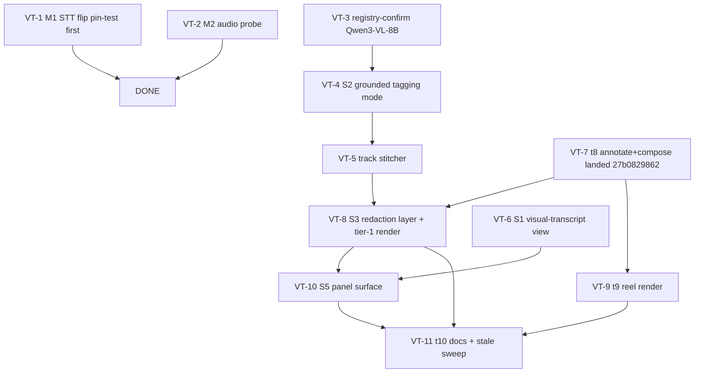

# Media models + visual-event tagging — task-breakdown proposal

Status: **PROPOSAL — operator review required.** This document files no tasks on any board, changes no code, and commits nothing. Existing board cards are referenced by id, never re-filed.
Date: 2026-10-29 · Author: Z-K agent (glm-5.3:cloud), composed for the principal investigator.
Companion deliverables: `kask/docs/research/media-model-selection-report.md` (ledger run `29f97aa1cac697b3`), `kask/docs/research/visual-event-tagging-design.md` (layer contracts, redaction design, validation record).

## 1. Verified current state (checked at run time, 2026-10-29)

- **Live plan** (immutable ratified spec): `~/Documents/zk-data/skills/task-breakdown/2026-10-27-media-layers/plan.md` — t1-t10, operator-ratified 2026-10-27 ("please proceed as recommended", all five recommendations accepted, pixel models deferred to v2). Research basis: completed run `c586efeca587b6de`.
- **Goal** `7cb1ac3a-aef4-4585-8a9a-9aedfd7a4d42` (spec_digest `f812d5a7…`), last judged 2026-10-28 with t1-t3 Done. **Run-time verification supersedes the snapshot**: t4 (vision pass) and t5 (audio pass, commit `b603570832`), t6 (unified lexical search, commit `4960ec126a`) and t7 (layers corpus-text export, commit `f95cb5356e`) were delivered at the run's initial read; t4's commit hash was not enumerated in the read window (delivery verified via the registered tool surface). **During this proposal's finalization the concurrent stream landed t8 at `27b0829862` ("Land the media EDL compose (t8) and layers export (t7)") — the annotate/compose surface now exists; the redaction decision vocabulary riding it remains proposed (VT-8 AC 2). t9 (reel render) and t10 (docs) remain open.**
- **Visual transcript board** (`7298d5c3-e528-445c-89ab-ca783209b02d`), all Backlog: M1 STT flip (`728606d2`), M2 Omni Flash probe (`97e1f5e3`), S1 view+export (`09d2c1d5`), S2 grounded tagging (`15ee05ae`), S3 redaction layer + tier-1 render (`280e92b9` — records "Tier-2 … deferred per operator decision C"), S5 panel surface (`d159bd2f`).
- Model evidence for the adoption tasks: `kask/docs/research/media-model-selection-report.md`.

## 2. Proposed order (dependency-ordered; 12 tasks, phases A-E + one operator-gated deferral)

### Phase A — model adoptions (independent, parallelizable)

- **VT-1 — STT flip to Nemotron-3.5-Transcribe** (= board card M1 `728606d2`) · scope M · deps: None
  ACs: (1) a pin test proves the DeepInfra transcribe arm (`kask/crates/hkask-inference/src/media_providers.rs:289`) parses Nemotron's `verbose_json` word granularities into `TimedWord` **before** the flip; (2) `DEFAULT_MEDIA_STT_MODEL` flips (defaults in `Default` impls only; `kask/crates/hkask-inference/src/model_constants.rs:206`), settings knobs, docs and stale comments swept in the same change, whisper documented as fallback for languages outside the 40; (3) one real transcription with word timings verified end-to-end; clippy + media suite green.
  Verify: `bash kask/scripts/cargo-test-nonzero.sh -p hkask-mcp-media` (pin test); `./script/clippy`. Files: `kask/crates/hkask-inference/src/media_providers.rs`, `kask/crates/hkask-inference/src/model_constants.rs`, settings, docs.

- **VT-2 — Omni Flash `input_audio` probe → adopt or fall back** (= board card M2 `97e1f5e3`) · scope S · deps: None
  ACs: (1) exactly one `layers_audio_pass` call with the per-call model override on a short real clip produces — or fails to produce — labeled `audio_event` items, recorded verbatim on the card; (2) adoption decision recorded: Omni Flash as the audio passes' per-call model if the probe passes, else the code's named fallback (`OpenRouter/mistralai/voxtral-small-24b-2507`, `media_providers.rs:449-454`) with the failure shape; (3) audio passes never route audio-only models via `HKASK_MEDIA_PASS_MODEL`; the adopted model named in the media docs/live-tool instructions.
    Outcome (2026-10-29): VT-2 probe PASSED — one `layers_audio_pass` call on a real 15 s recording produced a labeled `audio_event` layer (Omni Flash accepted `input_audio` through OpenRouter); Omni Flash adopted as the audio passes' per-call model, Voxtral the named fallback. VT-1 prepared and pinned the same day (the arm sends chunk_level=word; the parse accepts both observed response shapes; routing + pin tests green) but the DEFAULT FLIP IS HELD: the DeepInfra endpoint returned word timestamps once and then segment-only across 7 same-day requests — the M1 card carries the full evidence. This proposal's citations refer to the pre-work tree.

- **VT-3 — Registry-confirm `Qwen3 VL 8B Instruct` for grounded tagging** (new) · scope XS · deps: None
  ACs: (1) the catalog entry is confirmed for the per-call override path (`model_list`/`model_info`); (2) one fixture `layers_semantic_pass` run with the override lands valid layers (non-reasoning Instruct edition — Thinking/reasoning-mandatory editions reject the passes).

### Phase B — tagging

- **VT-4 — Grounded tagging pass mode** (= board card S2 `15ee05ae`) · scope M · deps: VT-3
  ACs: (1) the vision-pass template accepts a grounded mode (box-dense, short specific labels; same `SemanticPassOutput` schema — zero store change); (2) a grounded run on the per-call override lands time-anchored object items carrying boxes; researcher-authored tags remain the `researcher` kind, distinguishable by provenance; (3) verified by running the grounded pass on a real fixture; clippy + media suite green.
  Verify: `bash kask/scripts/cargo-test-nonzero.sh -p hkask-mcp-media semantic_pass`; `./script/clippy`. Files: `kask/mcp-servers/hkask-mcp-media/src/tools/layers.rs`, `src/templates.rs`.

- **VT-5 — Deterministic track stitcher** (new; design doc §4.3) · scope M · deps: VT-4
  ACs: (1) a stitcher over object layers emits a derived `object`-kind layer with `track_id` in payload, provenance `model: "deterministic:track-stitcher"` + parameters, defaulting to no cross-shot merge; (2) edge cases surface in stats: unlinked detections (short tracks), occlusion gaps, shot-fragmentation counts — never smoothed; (3) empty or malformed source layers return named degradations (`no_detections` / typed `invalid_argument` naming the layer); clippy + media suite green.
  Files: `src/tools/layers.rs`, `src/layer_pass.rs` or new `src/layer_stitch.rs`, `src/hkask_mcp_media.rs`.

### Phase C — reading + curation

- **VT-6 — Visual-transcript view** (= board card S1 `09d2c1d5`, scope narrowed) · scope S · deps: t6/t7 (delivered)
  ACs: (1) a server tool returns one time-ordered event list across all stored kinds with time ranges, searchable text, provenance; (2) the export half is **not rebuilt** — t7's `layers_export` (commit `f95cb5356e`) is the semantic handoff, cited in the card; (3) verified by running a real recording's layers through the view; clippy green.
  Files: `src/tools/layers.rs`, `src/hkask_mcp_media.rs`.

- **VT-7 — Annotate and compose** (= plan task t8 — **landed by the concurrent stream at `27b0829862` during this proposal's finalization**, per the commit "Land the media EDL compose (t8) and layers export (t7)") · scope M · deps: t6 (delivered)
  The remaining proposed content on this line is the redaction decision vocabulary riding the landed annotate surface — folded into VT-8 AC 2. The plan's t8 ACs (union-merged Keep ops, label-query compose with the query recorded in provenance, typed bounds errors) are now the delivered baseline to verify against, not re-proposed work.
  Verify: `bash kask/scripts/cargo-test-nonzero.sh -p hkask-mcp-media edl_compose`; `./script/clippy`.

### Phase D — redaction + render

- **VT-8 — Redaction layer + tier-1 render** (= board card S3 `280e92b9`; **slots after t8** per the brief) · scope M · deps: VT-7
  ACs: (1) a redaction decision is an authored layer whose items carry `{time range, target (box | reserved mask-track ref), op: blur|black|pixelate|delogo}` — validated, unknown ops rejected typed; (2) render applies `boxblur`/`drawbox`/`pixelize` over affected segments only and stream-copies the rest — pinned by a test that only affected segments re-encode; (3) no render without an approved decision layer (typed `not_found`/`failed_precondition` naming it); source media never modified; verified end-to-end on a fixture; clippy + media suite green.
  Verify: `bash kask/scripts/cargo-test-nonzero.sh -p hkask-mcp-media redact`; `./script/clippy`. Files: `src/tools/layers.rs`, `src/video/ffmpeg.rs`, `src/omc.rs`, `src/hkask_mcp_media.rs`.

- **VT-9 — Reel render** (= plan task t9) · scope M · deps: VT-7 (parallelizable with VT-8; shares the segment-render primitive)
  ACs: (1) a composed EDL renders to a playable gallery asset whose lineage records the EDL layer id and contributing item ids; (2) unknown or empty EDL returns `not_found` naming the layer; (3) render test passes on a small fixture — isolated rerun on full-suite flake (recorded trap: `educt_render_edl` is intermittently red in full runs).
  Verify: `bash kask/scripts/cargo-test-nonzero.sh -p hkask-mcp-media render_edl` (isolated rerun on flake); `./script/clippy`.

### Phase E — surface + docs

- **VT-10 — Panel surface** (= board card S5 `d159bd2f`) · scope M · deps: VT-6, VT-7, VT-8
  ACs: (1) clicking a visual-transcript event seeks playback to its start; selecting a span authors a researcher tag; (2) selecting a target + span authors a redaction decision and dispatches the render through the composed tools, with strict payload tests for every dispatch; (3) panel suite + clippy green; verified in the panel after rebuild.
  Files: `crates/media_panel/src/media_panel.rs`.

- **VT-11 — Docs + stale sweep** (= plan task t10) · scope S · deps: VT-8, VT-9, VT-10
  ACs: (1) every new layers tool appears in the media-server connection docs and live-tool instructions, with the transcript-layers vs media-layers concept map extended to the visual transcript and the redaction surface; (2) a repo-wide stale sweep over media-server guidance yields zero stale references, grep receipt attached.

### Deferred — operator-gated (not sequenced)

- **VT-12 — Tier-2 mask + inpaint** (S4-class) · scope L when taken · deps: operator decision C revisit + VT-8
  SAM 3 mask tracks (fal `$0.005/16 frames` — new serving path — or gated HF weights) → VOID or Generative Omnimatte removal on RunPod. Deferred per operator decision C and the plan's ratified pixel-model deferral; the decision vocabulary (`target.kind: "mask_track"`) is reserved in VT-8 so no store migration is owed. Evidence and licenses: model report R3 (VOID Apache-2.0 — verified).

## 3. Checks run at proposal time (receipts)

- **TB-1 catastrophic scan** (`lisp_eval`, task-breakdown skill form, 2026-10-29): `[]` — no empty decomposition, no all-XL tasks, dependencies present across the multi-task list, acceptance criteria present on every task.
- **TB-COUNT** (`lisp_eval`): `task_count = 12`, `task_count_penalty = 0.0` (within the 3..20 rule).
- **Independent critic gate (TB-2): NOT run.** This is a Phase-1 proposal; ratification runs the full task-breakdown pipeline (the 2026-10-27 plan is the precedent — its gate receipts live in the plan file).
- **Structural validation of the proposed item shapes** (`lisp_eval`, design doc §9): 9/9 cases matched expectation, negative controls reject.
- **Research ledger** `29f97aa1cac697b3` — completed; sources annotated with honest states.

## 4. Constraints honored

- **No parallel annotation store**: every proposed artifact rides `layers_store` or a derived layer through it.
- **Redaction slots after t8** (VT-8 depends on VT-7), per the brief.
- **Sequences with the live plan**: t8→VT-7 (landed at `27b0829862` during finalization — the proposal's remaining content there folds into VT-8), t9→VT-9, t10→VT-11; t1-t8 are already delivered at HEAD and are not re-proposed.
- **Nothing implemented, filed, or committed by this document** — Phase 1 outputs are proposals for operator ratification.

## 5. Risks

| Risk | Impact | Mitigation |
|---|---|---|
| Grounded pass hallucinates boxes/labels, poisoning search | High | Delivered whole-pass rejection on out-of-range boxes (`tools/layers.rs:327-350`) + confidence + plan-vs-observed coverage; only researcher-approved decisions reach renders |
| Cloud cost on grounded passes | Medium | Per-call override leaves the cheap default unchanged; bounded chunks + resume; VT-3 fixture run measures real cost before any default change |
| Stitcher invents false continuity | Medium | Gaps stay disjoint and counted; cross-shot merge off by default; stats surfaced per track |
| Real-media render flakiness in full-suite runs | Low | Isolated rerun before blaming a change (recorded trap; VT-9 AC) |
| Panel dispatch drifts from server contracts | Medium | Strict payload tests for every dispatch (S5 AC) |
| Tier-2 scope creep | Medium | Decision C + reserved vocabulary; VT-12 carries its own gate |

## 6. Open questions for the operator

1. Ratify VT-1/VT-2 (both are existing backlog cards; the model report supplies the evidence).
2. Registry-confirm Qwen3-VL-8B per-call (VT-3) — or as the new pass default (cost trade is yours).
3. The inpainting ontology-anchor ruling (coarse 5W1H pending).
4. Tier-2 serving-path decision (fal for masks vs RunPod runner + the Python-runner allowlist exception) — deferred with decision C.
5. Track stitcher default-on vs opt-in (proposal: opt-in).