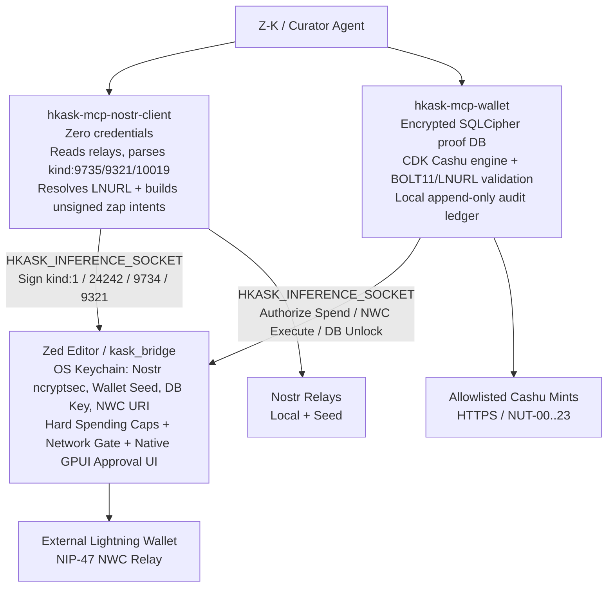
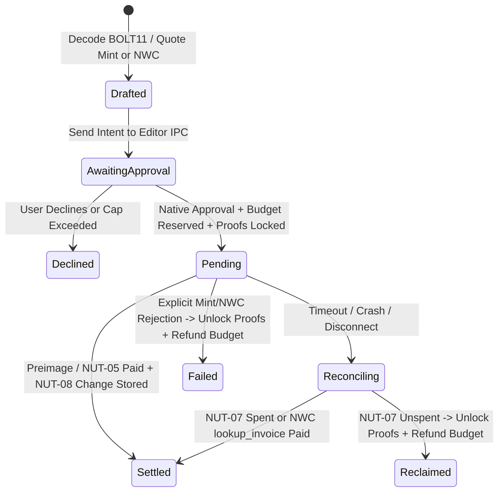

# Cashu + Lightning Wallet MCP Server (`hkask-mcp-wallet`)

**Reserved Divergence Seam:** `D110` (following `D109` `hkask-mcp-nostr-blossom` in `DIVERGENCE.md`).
**Research Provenance:** Verified open-source Rust reference implementations and protocol specifications under research run `ccbfe15d56d5a79b` (2026-11-19).
**Criticality:** **Tier-0 Financial Infrastructure.** Handles real cryptocurrency (Bitcoin / Lightning satoshis and Cashu bearer e-cash). Every design choice prioritizes fail-closed safety, cryptographic verifiability, crash-safe recovery, and mandatory human custody/approval over convenience.

---

## 1. Operator Rulings (2026-11-19)

The following five load-bearing architectural decisions are locked by operator approval:

1. **Lightning rail (v1): NWC (NIP-47) first.** Connect to the operator's external Lightning wallet (e.g., Alby Hub, Phoenixd, Zeus, LND/CLN via NWC) behind an internal `LightningRail` trait. Self-custodial embedded `ldk-node` is deferred to a future rail so v1 carries zero on-chain UTXO, channel liquidity, gossip, or watchtower operational burden.
2. **Spend approval policy: Mandatory native editor approval on every value-moving operation.** Every spend (`wallet_pay_invoice`, `wallet_send_ecash`, `nostr_zap`, `nostr_nutzap`) requires an explicit native GPUI confirmation in the Zed editor process before any secret is decrypted or any value moves. **There is no `autopublish`-equivalent bypass for spending.**
3. **Network default & hard caps:** Default to `regtest` / `signet` during development (`mainnet` disabled until explicitly enabled by the operator). Mainnet defaults enforce conservative editor-side caps (**10,000 sats/tx**, **50,000 sats/day**, allowlisted Cashu mints only). No MCP tool may read raw secrets or mutate caps, network, or mint allowlists.
4. **Cashu state persistence (v1):** Local **SQLCipher**-encrypted SQLite database + **BIP-39 / NUT-13 deterministic secrets** + **NUT-09 signature restore** as the sole source of truth. Cross-device NIP-60 (`kind: 17375` / `7375` / `7376`) relay-backed Cashu sync is deferred to v2.
5. **Co-research & values grounding:** Deepens the human's seat at the bench (the agent prepares, decodes, quotes, and reconciles; the human holds custody, caps, and per-transaction veto) and upholds *Magnifica Humanitas* **V3 (accountability)** and **V7 (the limit as positive)** through hard editor-enforced spending boundaries.

---

## 2. Authoritative Open-Source Rust Reference Models & Specs

| Layer | Reference Implementation | Crate / Repo | License | Role, Coverage & Caveats |
|---|---|---|---|---|
| **Cashu Wallet & Protocol** | **Cashu Dev Kit (CDK)** (`v0.18.0`, Sep 2026) | [`cashubtc/cdk`](https://github.com/cashubtc/cdk) (`cashu`, `cdk`, `cdk-sqlite`, `cdk-http-client`, `cdk-fake-wallet`) | MIT / Apache-2.0 | **Authoritative Rust Cashu reference.** Mandatory NUT-00..06 + optional NUT-07..30, including **NUT-07** (state check), **NUT-08** (fee change), **NUT-09** (signature restore), **NUT-11** (P2PK for Nutzaps), **NUT-12** (DLEQ proof verification), **NUT-13** (deterministic secrets), **NUT-17** (WebSocket quote subscriptions), **NUT-19** (cached idempotent responses), **NUT-23/25** (BOLT11/12). Includes `cdk-sqlite` with **SQLCipher** encryption and `cdk-fake-wallet` for deterministic testing. **Status: ALPHA** (pin exact versions in workspace `Cargo.toml`). |
| **Lightning (NWC / NIP-47)** | **rust-nostr `nwc`** | [`rust-nostr/nostr`](https://github.com/rust-nostr/nostr) (`nwc`) | MIT | **Reference Rust NIP-47 client.** Supports `pay_invoice`, `make_invoice`, `get_balance`, `lookup_invoice`, NIP-44/NIP-04 encryption, and real-time payment notifications. **Status: ALPHA** (pin exact version). |
| **BOLT11 Invoice Parsing** | **`lightning-invoice`** | [`lightningdevkit/rust-lightning`](https://crates.io/crates/lightning-invoice) | MIT / Apache-2.0 | **Canonical BOLT11 parser/validator.** Decodes amount (msat), network (`Bitcoin`, `Testnet`, `Signet`, `Regtest`), expiry, payment hash, and description hash *before* approval or payment. |
| **LNURL / Lightning Address** | **`lnurl-rs`** | [`benthecarman/lnurl-rs`](https://github.com/benthecarman/lnurl-rs) | MIT | Minimal (~1K SLoC) LNURL-pay & `LightningAddress` (`user@domain`) client for NIP-57 zap callbacks. Must be wrapped in `zed-kask`'s SSRF public-HTTPS perimeter. |
| **Lightning (Future Self-Custodial Rail)** | **`ldk-node`** | [`lightningdevkit/ldk-node`](https://github.com/lightningdevkit/ldk-node) | MIT / Apache-2.0 | Reference non-custodial LDK + BDK node library. Deferred past v1; `LightningRail` trait keeps this pluggable later. |
| **Protocol Specifications** | **Cashu NUTs** & **Nostr NIPs** | [`cashubtc/nuts`](https://github.com/cashubtc/nuts), [`nostr-protocol/nips`](https://github.com/nostr-protocol/nips) | Open specs | **NUT-00..06, 07, 08, 09, 11, 12, 13, 17, 19, 23**; **NIP-47** (NWC), **NIP-57** (`kind: 9734` / `9735` Lightning zaps), **NIP-61** (`kind: 10019` / `9321` Nutzaps — `02`-prefixed P2PK pubkey rule). |

### Dependency Isolation Note
`hkask-nostr-core` (`kask/crates/hkask-nostr-core/Cargo.toml:14`) and `hkask-nostr-signer` (`kask/crates/hkask-nostr-signer/Cargo.toml:15`) use pure-Rust `k256`, whereas `cdk` and `lightning-invoice` depend on `secp256k1` (C bindings to `libsecp256k1`). Isolating `cdk` and `nwc` inside `kask/mcp-servers/hkask-mcp-wallet` and a dedicated `hkask-wallet-core` crate keeps `libsecp256k1` and Cashu storage dependencies out of `hkask-nostr-core`, `hkask-nostr-signer`, and `hkask-mcp-nostr-client`.

---

## 3. Architecture & Trust Boundaries

### 3.1 Process Separation

`hkask-mcp-nostr-client` is intentionally a **zero-credential** child process (`credentials: &[]`, `kask/crates/kask_bridge/src/mcp_servers/catalog.rs:384-393`) because it ingests untrusted public relay text. Adding spending capability must **preserve** that boundary:



### 3.2 Keychain & Custody Split (`kask_bridge::credentials`)

Mirroring `NOSTR_NCRYPTSEC_CREDENTIAL_URL` and `NOSTR_PASSWORD_CREDENTIAL_URL` (`kask/crates/kask_bridge/src/credentials.rs:128-170`), wallet secrets live exclusively in dedicated OS keychain slots that **never** enter `DATA_SERVICES` or `credential_urls_for_mcp()`:

| Keychain Slot | Contents | Who Reads It |
|---|---|---|
| `kask://credentials/wallet_seed_mnemonic` | Encrypted BIP-39 12/24-word mnemonic for Cashu NUT-13 deterministic secrets | Editor (`kask_bridge`) only — used on seed setup/restore and derived-key handoff |
| `kask://credentials/wallet_db_passphrase` | High-entropy random 32-byte hex key for `hkask-mcp-wallet`'s SQLCipher database | Editor (`kask_bridge`) → passed once over authenticated `HKASK_INFERENCE_SOCKET` unlock handshake (never via CLI args, never via `settings.json`, never logged) |
| `kask://credentials/wallet_nwc_uri` | NIP-47 `nostr+walletconnect://...` connection URI | Editor (`kask_bridge`) only — `hkask-mcp-wallet` never sees the raw NWC secret; NWC `pay_invoice` executes editor-side after native approval |

*Verification pin:* Mirror `nostr_key_slots_reach_no_mcp_child` in `kask/crates/kask_bridge/src/credentials.rs` to assert that none of the three wallet slots appear in `credential_urls_for_mcp()` or `data_service_credential_urls()`.

### 3.3 Parent-Owned Grants & IPC Seam (`kask_bridge::delegation_grants` + `wallet_approval.rs`)

Follow the exact D106 pattern (`kask/crates/kask_bridge/src/delegation_grants.rs:8-11`, `kask/crates/kask_bridge/src/nostr_signing.rs`):

- Register new host effects in `hkask-types::inference_ipc` and `kask_bridge::delegation_grants`:
  - `WALLET_DB_UNLOCK = "host/wallet_db_unlock"` (allows `hkask-mcp-wallet` to request its SQLCipher DB key on startup)
  - `WALLET_SPEND_APPROVE = "host/wallet_spend_approve"` (allows `hkask-mcp-wallet` to request native operator approval + cap check + optional NWC execution for a single bounded payment intent)
  - `NOSTR_ZAP_SIGN = "host/sign_nostr_zap"` (separate from `host/sign_nostr_note` so `autopublish` can **never** apply to `kind: 9734` or `kind: 9321`)
- **Approval order of operations (non-negotiable):**
  1. Tokio dispatch validates the child's delegation grant token, network match (`kask.wallet.network`), mint allowlist (for Cashu), and hard caps (`per_tx_cap_sats`, rolling 24h `daily_cap_sats`). Refusals fail immediately before enqueuing to GPUI.
  2. GPUI-side handler (`kask_bridge::wallet_approval`) opens a native modal prompt on the active editor window displaying:
     - **Rail:** Cashu (`<mint_url>`) or Lightning (`NWC`)
     - **Network:** `REGTEST` / `SIGNET` / `MAINNET` (with prominent visual warning on `MAINNET`)
     - **Amount:** exact `amount_sats`
     - **Max Fee:** exact `max_fee_sats` (and total `amount + max_fee`)
     - **Destination:** BOLT11 payee/description, Lightning Address, or Nostr `npub` + event ID
     - **Budget:** remaining 24h cap after this transaction
     - **Buttons:** `Approve Payment (<N> sats)` / `Decline`
  3. **No window = no approval.** If no active editor window is available, or the user clicks `Decline` or dismisses the dialog, return a typed `UserDeclined` error without touching the keychain or spending state.
  4. On approval, atomically reserve the amount against the editor's rolling 24h spend ledger, then either:
     - Return a short-lived, single-use signed/HMAC approval receipt bound to `(intent_id, amount_sats, max_fee_sats, destination_hash, expires_at)` for Cashu melt/send execution in `hkask-mcp-wallet`, **or**
     - Execute the NWC `pay_invoice` directly inside the editor-side NWC worker using `wallet_nwc_uri` and return `{ preimage, fee_paid_sats, payment_hash }`.

### 3.4 Settings & Private-Thread Perimeter

Add `KaskWalletSettings` in `crates/settings_content/src/settings_content.rs` and `kask/crates/kask_bridge/src/settings.rs` (public policy only — **zero secrets**):

```rust
pub struct KaskWalletSettings {
    /// "regtest" (default), "signet", or "mainnet".
    pub network: WalletNetwork,
    /// Explicit opt-in required before mainnet payments are admitted. Default: false.
    pub mainnet_enabled: bool,
    /// Hard per-transaction cap in satoshis (enforced in editor). Default: 10_000.
    pub per_tx_cap_sats: u64,
    /// Hard rolling 24-hour spend cap in satoshis (enforced in editor). Default: 50_000.
    pub daily_cap_sats: u64,
    /// Max fee percentage or absolute fee cap in satoshis. Default: 100 sats or 2%.
    pub max_fee_sats: u64,
    /// Operator-allowlisted Cashu mint URLs (https:// only on mainnet/signet).
    pub allowed_mints: Vec<String>,
    /// Default mint URL (must be in allowed_mints).
    pub default_mint: String,
    /// Optional NWC relay / display label (never the secret URI!).
    pub nwc_label: String,
}
```

- **D100 Private-Thread Perimeter:** Add `"wallet"` to `DEFAULT_PRIVATE_THREAD_DISABLED_SERVERS` (`crates/settings_content/src/settings_content.rs`), matching `nostr-client`, `nostr-relay`, and `nostr-blossom`, because contacting external Cashu mints or NWC relays leaks network metadata from private threads.

---

## 4. Threat Model & Security Invariants

| ID | Threat | Attack Vector | Concrete Control & Falsifier |
|---|---|---|---|
| **T1** | **Prompt-injection wallet drain** | Malicious Nostr note / web page instructs agent to call `wallet_pay_invoice` or `nostr_zap`. | Every spend requires a native GPUI modal approval in the editor showing exact sats, fee, and destination. Zero `autopublish` bypass. Hard per-tx and 24h caps enforced editor-side. *Falsifier:* Automated test proving `wallet_pay_invoice` without editor approval token fails closed and moves 0 sats. |
| **T2** | **Secret / seed / NWC URI exfiltration** | Compromised MCP child, tool output, or error log leaks `nsec`, BIP-39 mnemonic, NWC secret, or spendable Cashu token. | `wallet_nwc_uri` and `wallet_seed_mnemonic` never leave the editor keychain. `Zeroizing<T>` wraps all secret buffers. Error types never echo raw inputs or tokens. `wallet_send_ecash` returns a token only after explicit operator approval. *Falsifier:* `nostr_key_slots_reach_no_mcp_child`-style unit test + redaction tests on every error variant. |
| **T3** | **Proof loss on crash mid-swap / mid-melt** | Process killed (`SIGKILL`) or network drops between sending proofs to mint and storing returned blinded signatures. | SQLCipher WAL + atomic state machine (`unspent -> reserved -> pending -> spent`); **NUT-13** deterministic secrets + **NUT-09** restore; **NUT-07** proof-state reconciliation on startup and via `wallet_reconcile`; **NUT-19** cached response replay where supported. *Falsifier:* Kill-9 chaos test mid-melt/swap recovers 100% of value after restart + reconcile. |
| **T4** | **Malicious or buggy Cashu mint** | Mint issues invalid blind signatures, overcharges melt fees, or refuses redemption. | Strict operator mint allowlist (`kask.wallet.allowed_mints`); untrusted `kind: 10019` mints are surfaced as data, never auto-added. Verify **NUT-12 DLEQ** proofs when mint advertises NUT-12. Always include **NUT-08** blank outputs on melt to reclaim overpaid Lightning routing fees. Enforce per-mint balance exposure visibility in `wallet_balance`. |
| **T5** | **SSRF / DNS rebinding / open redirect** | Crafted `lud16`, LNURL callback, or mint URL points to `127.0.0.1`, RFC1918, or cloud metadata (`169.254.169.254`). | Strict public `https://` validator rejecting loopback, private, link-local, unspecified, broadcast, and credentialed URLs; disable HTTP redirects on LNURL/mint fetches (or re-validate every hop); resolve DNS and verify resolved IP before connecting. Loopback allowed **only** under `#[cfg(feature = "test-fixture")]` or explicit `regtest` mode. |
| **T6** | **BOLT11 / NIP-57 invoice substitution or mismatch** | Malicious LNURL server returns an invoice for 1,000,000 sats instead of 1,000 sats, wrong network, expired invoice, zero-amount invoice, or wrong `description_hash`. | Parse every BOLT11 with `lightning-invoice` before approval: verify `network == kask.wallet.network`, verify `amount_milli_satoshis == expected_msat` (reject zero-amount invoices by default), verify `!is_expired()`, and for NIP-57 zaps verify `description_hash == sha256(zap_request_json)`. |
| **T7** | **Integer overflow / msat-sat rounding** | Overflowing `amount + fee` in `u64` or silently truncating millisatoshis. | All arithmetic uses `checked_add` / `checked_sub` / `checked_mul` on dedicated `Satoshis(u64)` and `Millisatoshis(u64)` newtypes; msat-to-sat conversion rejects non-exact sub-satoshis or rounds up conservatively for caps/fees. |
| **T8** | **Duplicate payment on timeout** | Agent retries `wallet_pay_invoice` after an RPC timeout while the first payment is still in flight. | Mandatory `idempotency_key` on all spend tools + unique constraint on `payment_hash` in the local SQLCipher audit ledger; in-flight `pending` payments refuse duplicate submission and direct caller to `wallet_reconcile` / `wallet_transactions`. |
| **T9** | **Private-thread leakage (D100)** | Private thread calls wallet tool, leaking activity to external mints or NWC relays. | `"wallet"` is in `DEFAULT_PRIVATE_THREAD_DISABLED_SERVERS`; both offer-point and dispatch-time belts refuse calls on privacy-marked threads. |
| **T10** | **Unauthorized `settings.json` cap tampering** | Terminal command raises `per_tx_cap_sats` or flips `mainnet_enabled: true`. | Documented known boundary (same as D106 `autopublish`): agent file tools always prompt on `settings.json` (`SensitiveSettingsKind::Global`). For v1, mainnet activation additionally requires explicit operator confirmation in the Settings UI (writing a keychain-backed mainnet-consent flag alongside the setting). |

---

## 5. Persistence, State Machine & Crash Recovery

### 5.1 Data Layout (D28 Compliant)
Under `<data_dir>/mcp/wallet/`:
- `wallet.db` — SQLCipher-encrypted SQLite database (WAL mode, `chmod 0600` on Unix) containing:
  - `cdk-sqlite` tables (keysets, mints, proofs, mint_quotes, melt_quotes, NUT-13 counters)
  - `wallet_ledger` — append-only local audit log: `(id, idempotency_key, direction, rail, network, mint_url, payment_hash, amount_sats, fee_sats, status, target_summary, nostr_event_id, approval_id, created_at, updated_at)`
- **No plaintext secrets, seeds, or raw spendable tokens are ever written to logs, stderr, or unencrypted files.**

### 5.2 Atomic Spend Lifecycle


---

## 6. MCP Tool Surface & Wire Contract

Create `kask/crates/hkask-ipc-wire/src/wallet_wire.rs` (mirroring `nostr_wire.rs`) exporting `WALLET_SERVER_ID = "wallet"` and `WALLET_TOOL_NAMES` pinned by `tool_surface_pin!` in `hkask-mcp-wallet`. All tools carry dual-axis P5.4 ontology annotations (`hkask_mcp_server::dual_axis_annotate!`).

### 6.1 `hkask-mcp-wallet` Tools (10 tools)

| Tool | Class | PKO / DC-BIBO | Contract |
|---|---|---|---|
| `wallet_status` | Read-only | `pko:ProcedureExecution` / `bibo:Report` | Reports network, `mainnet_enabled`, configured rails (Cashu mints + NWC connectivity), per-tx & remaining 24h cap, DB unlock state, and count of pending items needing reconciliation. |
| `wallet_balance` | Read-only | `pko:ProcedureExecution` / `bibo:Report` | Per-mint Cashu balances (confirmed unspent vs. pending/reserved) and NWC Lightning balance (when configured). |
| `wallet_transactions` | Read-only | `pko:ProcedureExecution` / `dcterms:Dataset` | Paginated local audit ledger filtered by rail/status/since; never emits raw tokens or secrets. |
| `wallet_decode_payment` | Read-only (pure local) | `pko:ProcedureExecution` / `bibo:Report` | Decodes BOLT11 invoice, LNURL/Lightning Address, or Cashu `cashuA`/`cashuB` token (amount, network, mint, expiry, P2PK lock, description hash). Contacts nothing. |
| `wallet_reconcile` | Read/Repair (non-spending) | `pko:StepExecution` / `bibo:Report` | Runs NUT-07 proof state checks and NWC `lookup_invoice` on all `pending`/`reconciling` records; reclaims unspent proofs and updates ledger. |
| `wallet_create_invoice` | Receive (non-spending) | `pko:StepExecution` / `dcterms:Dataset` | Creates a BOLT11 receive invoice via either Cashu NUT-04 mint quote (on an allowlisted mint) or NWC `make_invoice`; returns invoice, payment hash, quote ID, and expiry. |
| `wallet_receive_ecash` | Receive (non-spending) | `pko:StepExecution` / `dcterms:Dataset` | Validates token format, checks mint allowlist, verifies DLEQ (NUT-12), swaps proofs (including NUT-11 P2PK redemption using the wallet's P2PK key), and persists fresh proofs. |
| `wallet_pay_invoice` | **Spend (approval-gated)** | `pko:StepExecution` / `dcterms:Dataset` | Requires `idempotency_key`, `bolt11`, and `rail` (`cashu` or `nwc`). Validates BOLT11, quotes fee, requests native editor approval, executes NUT-05 melt (with NUT-08 change) or editor-side NWC pay, and records preimage. |
| `wallet_send_ecash` | **Spend (approval-gated)** | `pko:StepExecution` / `dcterms:Dataset` | Requires `idempotency_key`, `amount_sats`, `mint_url`, optional `p2pk_pubkey` (NUT-11) and `memo`. Requests native editor approval, swaps/locks proofs, and returns encoded Cashu token + ledger ID. |
| `wallet_restore_from_seed` | Recovery (approval-gated) | `pko:StepExecution` / `bibo:Report` | Runs NUT-09 / NUT-13 deterministic restore against allowlisted mints using the editor-held BIP-39 seed after native operator confirmation. |

### 6.2 `hkask-mcp-nostr-client` Zap Additions (Phase 4)
- Extend `nostr_profile` to surface `lud16` / `lud06` (as unverified metadata) and add `kind: 10019` (nutzap mint preferences) + `kind: 9735` (zap receipt) + `kind: 9321` (nutzap) parsing in `hkask-nostr-core`.
- Add `nostr_prepare_zap` (resolves recipient LNURL-pay under SSRF checks, requests editor-signed `kind: 9734` zap request, fetches & validates BOLT11 `description_hash` + `amount_msat`, and returns the verified invoice for `wallet_pay_invoice` — keeping `nostr-client` 100% zero-credential and keeping all money movement inside `hkask-mcp-wallet` + editor approval).
- Add `nostr_publish_nutzap` (publishes an editor-signed `kind: 9321` event carrying a P2PK-locked Cashu proof set already created by `wallet_send_ecash`, using the NIP-61 `02`-prefixed recipient pubkey).

---

## 7. Phased Implementation & Verification Plan

Each phase is a vertical slice with hard verification gates. **Do not advance to the next phase while any gate or invariant pin is red.**

### Phase 1 — Core Types, Validators & Editor Approval Seam
- **Deliverables:**
  - `kask/crates/hkask-wallet-core`: `Satoshis`, `Millisatoshis`, `WalletNetwork`, `SpendIntent`, BOLT11 decoder (`lightning-invoice`), SSRF-safe URL validator, zeroizing helpers.
  - `kask/crates/hkask-ipc-wire/src/wallet_wire.rs` + `inference_ipc.rs` additions (`WALLET_DB_UNLOCK`, `WALLET_SPEND_APPROVE`, `NOSTR_ZAP_SIGN`).
  - `kask/crates/kask_bridge/src/{credentials.rs, delegation_grants.rs, settings.rs, wallet_approval.rs}` + `crates/settings_content` + `crates/settings_ui/src/pages/kask_page/wallet.rs` (Settings → Kask → Wallet UI: network selector, mainnet consent toggle, per-tx/daily caps, mint allowlist, seed setup/backup, NWC URI masked entry).
  - Register `"wallet"` in `DEFAULT_PRIVATE_THREAD_DISABLED_SERVERS`.
- **Verification Gate:**
  - `cargo test -p hkask-wallet-core -p hkask-types -p kask_bridge`
  - Unit tests proving: (a) wallet keychain slots never reach any MCP child; (b) declined/missing-window approvals never touch keychain; (c) per-tx cap, 24h rolling cap, wrong network, unallowlisted mint, and mainnet-disabled all fail closed; (d) checked arithmetic catches overflow.

### Phase 2 — Cashu Wallet Engine (`hkask-mcp-wallet` + CDK)
- **Deliverables:**
  - `kask/mcp-servers/hkask-mcp-wallet/` registered in `catalog.rs`, workspace `Cargo.toml`, and `kask/scripts/build/mcp-servers.txt`.
  - CDK integration (`cdk` + `cdk-sqlite` SQLCipher + `cdk-http-client`), NUT-13 seed derivation, NUT-04/05/07/08/09/11/12/19 support, append-only `wallet_ledger`, and all 10 tools (`tool_surface_pin!` + dual-axis ontology).
- **Verification Gate:**
  - Deterministic test suite against `cdk-fake-wallet` covering mint, receive, send, P2PK send/receive, melt + fee change, idempotent retry, and `wallet_reconcile`.
  - **Crash-recovery test:** Simulate mid-melt and mid-swap interruption; verify restart + `wallet_reconcile` recovers 100% of value with zero double-spend or lost proofs.
  - **Restore test:** Wipe `wallet.db`, run `wallet_restore_from_seed` (NUT-09/13), verify 100% balance recovery.

### Phase 3 — Lightning Rail via NWC (NIP-47)
- **Deliverables:**
  - `LightningRail` trait + `NwcRail` using `rust-nostr` `nwc` executed editor-side behind `wallet_approval.rs` (so `wallet_nwc_uri` never enters the MCP child).
  - Wire `wallet_balance`, `wallet_create_invoice`, `wallet_pay_invoice`, and `wallet_reconcile` (`lookup_invoice`) to `LightningRail`.
- **Verification Gate:**
  - Integration tests against a mock NIP-47 wallet service covering: successful `pay_invoice` with preimage verification, timeout → `Reconciling` → `lookup_invoice`, malformed/mismatched responses, and duplicate `idempotency_key` rejection.

### Phase 4 — Nostr Zaps (NIP-57) & Nutzaps (NIP-61)
- **Deliverables:**
  - `hkask-nostr-core`: parse/verify `kind: 9735`, `kind: 9321`, `kind: 10019`; expose `lud16`/`lud06` in `nostr_profile`.
  - `hkask-nostr-signer` + `kask_bridge::nostr_signing`: add `kind: 9734` (zap request) and `kind: 9321` (nutzap) behind `NOSTR_ZAP_SIGN` (never `autopublish`).
  - `hkask-mcp-nostr-client`: SSRF-hardened LNURL-pay helper (`lnurl-rs`), `nostr_prepare_zap` (with strict `description_hash` + `amount_msat` validation), `nostr_publish_nutzap` (with `02`-prefixed P2PK validation).
- **Verification Gate:**
  - End-to-end tests on local test relay + `cdk-fake-wallet` / mock LNURL server verifying: (a) NIP-57 `description_hash` mismatch is refused; (b) untrusted `kind: 10019` mint is refused; (c) NIP-61 P2PK nutzap is locked with `02`-prefixed pubkey and redeemed by recipient; (d) `nostr-client` still links zero signer/wallet credentials (`cargo tree -e no-dev -i hkask-nostr-signer`).

### Phase 5 — Security Audit, Documentation & Mainnet Readiness Gate
- **Deliverables:**
  - Run the `security-audit` skill over `hkask-wallet-core`, `hkask-mcp-wallet`, `kask_bridge::wallet_approval`, and the Phase 4 `nostr-client` zap surface.
  - Register `D110` in `DIVERGENCE.md` and write `kask/docs/reference/mcp-servers/wallet.md` + update `kask/docs/reference/kask-settings.md` and `kask/docs/reference/mcp-servers/README.md`.
- **Verification Gate:**
  - Zero unresolved critical/high findings from `security-audit`.
  - Full `cargo test` green across all touched crates + `kask/scripts/` invariant checks green.
  - Operator sign-off on regtest/signet walkthrough before enabling `mainnet_enabled`.

---

## 8. References

- Cashu Development Kit (`cashubtc/cdk` v0.18.0, MIT/Apache-2.0): https://github.com/cashubtc/cdk
- Cashu Protocol Specifications (NUTs): https://github.com/cashubtc/nuts
- `rust-nostr` & `nwc` crate (MIT): https://github.com/rust-nostr/nostr · https://crates.io/crates/nwc
- `lightning-invoice` (MIT/Apache-2.0): https://crates.io/crates/lightning-invoice
- `ldk-node` (MIT/Apache-2.0, future rail reference): https://github.com/lightningdevkit/ldk-node
- `lnurl-rs` (MIT): https://github.com/benthecarman/lnurl-rs
- Nostr NIPs (NIP-47, NIP-57, NIP-60, NIP-61): https://github.com/nostr-protocol/nips
- Internal precedents: `kask/docs/reference/mcp-servers/nostr-client.md`, `kask/crates/kask_bridge/src/nostr_signing.rs`, `kask/crates/kask_bridge/src/delegation_grants.rs`, `kask/crates/kask_bridge/src/credentials.rs`, `DIVERGENCE.md` (`D100`, `D105`, `D106`, `D109`).
